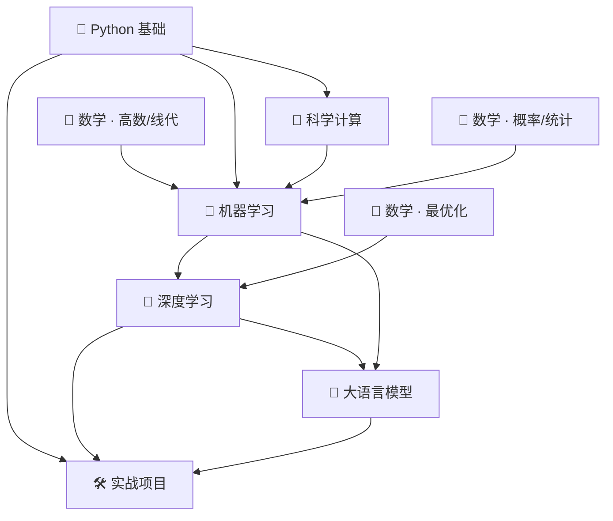

# 学习路线总览

> 本页回答一个问题：**先学什么、后学什么、什么可以跳**。
> 它不写课程内容，只排顺序与依赖。每个阶段的可执行单元见对应模块索引。

---

## 一、总体主线（推荐顺序）

**一句话**：Python 是工具，数学是地基，ML 是方法论，DL 是表达力，LLM 是当前主战场，项目是验收。

## 二、八条路线

| # | 路线 | 入口 | 依赖 | 建议节奏 | 出口标准 |
|---|---|---|---|---|---|
| 1 | Python 主线 | [[01_Python基础/00 模块索引\|Python 模块索引]] | 无 | 先跑通，不深挖 | 能独立写 100 行脚本处理文件与数据 |
| 2 | 科学计算 | [[02_科学计算/00 模块索引\|科学计算模块索引]] | Python 基础 | 与 ML 并行 | 能用 NumPy 向量化改写循环 |
| 3 | 数学地基（高数+线代） | [[06_数学基础/01 高等数学/00 分支索引\|高等数学]] · [[06_数学基础/02 线性代数/00 分支索引\|线性代数]] | 无 | 长期并行，不集中突击 | 能看懂 ML 论文里的公式记号 |
| 4 | 数学地基（概率+统计） | [[06_数学基础/03 概率论/00 分支索引\|概率论]] · [[06_数学基础/04 数理统计/00 分支索引\|数理统计]] | 高数基础 | 进入 ML 前必备 | 能解释"为什么用样本估计总体" |
| 5 | 机器学习 | [[03_机器学习/00 模块索引\|机器学习模块索引]] | Python + 线代 + 概率统计 | 主线 | 能自己实现一个模型并解释评估指标 |
| 6 | 深度学习 | [[04_深度学习/00 模块索引\|深度学习模块索引]] | ML + 最优化 + 线代 | 主线 | 能写训练循环、能定位不收敛原因 |
| 7 | 大语言模型 | [[05_大语言模型/00 模块索引\|大语言模型模块索引]] | DL + Attention | 主线 | 能复现一个最小 RAG 或微调流程 |
| 8 | 实战项目 | [[07_实战项目/00 项目总览\|项目总览]] | 任意 ≥2 条路线 | 贯穿始终 | 有可运行产出 + 复盘笔记 |

## 三、三条可并行的轨道

不要"学完 Python 再学数学"——那会拖成一年。建议三条轨道同时推进：

| 轨道 | 每天投入 | 内容 |
|---|---|---|
| **主轨**（技能） | 60% | 当前主线（Python → ML → DL → LLM） |
| **地基轨**（数学） | 30% | 按需补：卡在哪就补哪，不追求体系完整 |
| **输出轨**（项目） | 10% | 每两周至少一个小产出，逼出真实问题 |

## 四、可以跳过的部分（省时间）

| 内容 | 什么时候可以跳 | 理由 |
|---|---|---|
| 高数的级数、多元积分 | 只做 ML/DL 时 | 工程中很少直接用，需要时再补 |
| 数值计算的迭代法细节 | 不手写求解器时 | 框架已封装，理解收敛概念即可 |
| 离散数学的图论证明 | 不做算法岗时 | 会用 BFS/DFS 与图结构即可 |
| 传统 NLP 的规则方法 | 直接进 Transformer 时 | 已被预训练模型替代，了解思想即可 |

> 跳过 ≠ 不懂。**跳过前先在对应分支索引里记一行"暂缓理由"**，否则半年后会忘了自己为什么跳过。

## 五、路线与索引的关系

- 本页只给**顺序**。
- 具体学什么、学到什么程度，看各学科 `00 模块索引`。
- 每个知识点的 ID 与状态，看 [[08_知识索引/00 全知识点索引\|全知识点索引]]。
- 数学与学科的交叉引用，看 [[08_知识索引/06 知识关联索引\|知识关联索引]]。

## 六、五条学习路径（阶段 10 新增）

> 用途：不同起点的人不用从第一篇读起。每条路径都只列**必读**，其余按兴趣扩展。

| 路径 | 适合谁 | 必读顺序（≥5 篇） | 预计 |
|---|---|---|---|
| A 转行入门 | 零基础、要尽快能用 | [[PY-001 变量与赋值]] → [[MATH-216 矩阵乘法]] → [[ML-001 什么是机器学习]] → [[DL-011 神经网络前向传播]] → [[LLM-005 什么是大语言模型]] | 6–8 周 |
| B 应用优先（L2） | 会用工具、要能落地 | [[LLM-010 学习地图与实验环境]] → [[LLM-031 Tokenizer 基础与子词切分]] → [[LLM-088 自回归推理的基本流程]] → [[LLM-076 RAG 的基本架构]] → [[PROJ-023 搭建一个最小可用的 RAG 问答系统]] | 4–6 周 |
| C 原理推导（L3） | 要能手推、能读论文 | [[LLM-013 点积注意力与 Scaled Dot-Product Attention]] → [[LLM-017 Multi-Head Attention]] → [[LLM-025 残差、LayerNorm 与 Pre-LN、Post-LN]] → [[LLM-059 Scaling Laws]] → [[LLM-062 DPO 与偏好优化]] → [[REF-0001 Attention Is All You Need]] | 8–12 周 |
| D 项目驱动 | 边做边学 | [[PROJ-021 从零实现一个 Transformer 语言模型]] → [[PROJ-022 用 LoRA 微调 gpt2 做文本分类]] → [[PROJ-025 量化与推理优化实践]] → [[PROJ-026 端到端 LLM 应用：客服问答]] | 6–10 周 |
| E 面试突击 | 有基础、要查漏 | [[LLM-020 Attention 的计算复杂度与局限]] → [[LLM-030 Transformer 参数量与计算量估算]] → [[LLM-090 KV Cache 的原理与显存]] → [[LLM-095 推理显存估算与可行性判断]] → [[LLM-083 RAG 的评估]] | 2–3 周 |

> 每条路径的终点都能落到一个可交付物（实验报告 / 项目 / 论文笔记），不是"读完就算"。
