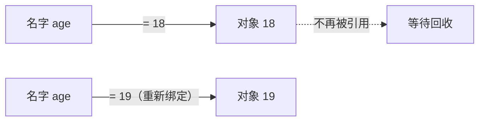

# PY-001 变量与赋值

## 1. 知识概览

> ⏱ **预计学习时间**：40 分钟

变量是**名字**，赋值是把名字**绑定**到一个值上。Python 里没有"声明变量"这一步，第一次赋值就等于创建。

- 一句话：`名字 = 值` 建立绑定；再次赋值只是把名字改接到另一个值。
- 解决什么问题：让程序记住中间结果，并能用有意义的名字反复引用它。
- 关键结论：**赋值不复制值，只是让名字指向对象**。

## 2. 学习目标

1. 能写出正确的赋值语句，并用 `print` 输出变量的值。
2. 能说出 `=` 与数学里"等于"的区别。
3. 能用 `type()` 判断一个值的类型。
4. 能解释"为什么 `x = 10; y = x; x = 20` 之后 `y` 还是 10"。

## 3. 通俗原理讲解

把变量想成**贴纸**，把值想成**盒子里的东西**。

- 赋值 `age = 18`：撕一张写着 `age` 的贴纸，贴到装着 `18` 的盒子上。
- 再赋值 `age = 19`：把贴纸撕下来，贴到另一个装着 `19` 的盒子上。原来的盒子还在，只是没人叫它 `age` 了。

类比失效的地方：Python 的盒子里装的其实是"对象的引用"，而不是对象本身。所以两个名字可以贴到同一个盒子上——这就是后面"可变/不可变"的根源。

### 图解：变量与赋值：名字绑定到对象



## 4. 深入技术原理

- Python 的赋值是**绑定（binding）**：`name = value` 在名字空间里创建或更新"名字 → 对象"的映射。
- 对象有身份（`id()`）、类型（`type()`）、值；变量名没有类型，**对象才有类型**。
- 所以同一个名字可以先指向 `int`，后指向 `str`，这不算错误（动态类型）。
- 赋值给多个名字：`a = b = 0` 让两个名字指向同一个对象；`x, y = 1, 2` 是解包赋值。
- `a, b = b, a` 可以一行交换，因为右边先整体求值成一个元组，再解包。

## 5. 完整可运行代码

```powershell
python var_demo.py
```

```python
name = "小明"
age = 18
height = 1.72
is_student = True

print(name, age, height, is_student)
print(type(name), type(age), type(height), type(is_student))

age = age + 1
print("明年", name, "就", age, "岁了")

a = b = c = 0
d, e = 1, 2
print(a, b, c, d, e)

x = 10
y = x
x = 20
print(x, y)

p, q = 1, 2
p, q = q, p
print(p, q)
```

## 6. 逐段代码解析

| 代码 | 作用 | 为什么这样写 |
|---|---|---|
| `name = "小明"` | 把字符串绑定到 `name` | 右边先求值，再绑定；字符串要加引号 |
| `age = age + 1` | 读出旧值、加 1、再绑回同名 | 右边用的是**旧** `age`，所以不会死循环 |
| `a = b = c = 0` | 三个名字指向同一个 `0` | `int` 不可变，所以共享安全 |
| `d, e = 1, 2` | 解包赋值 | 右边是元组 `(1, 2)`，左边按位置接收 |
| `y = x` | 两个名字指向同一对象 | 没有复制，只是多了一张贴纸 |
| `x = 20` | 把 `x` 改接到新对象 | 因为 `int` 不可变，`y` 仍指向 `10` |
| `p, q = q, p` | 交换 | 右边先算成元组，左边再解包，无需临时变量 |

## 7. 运行结果

```
小明 18 1.72 True
<class 'str'> <class 'int'> <class 'float'> <class 'bool'>
明年 小明 就 19 岁了
0 0 0 1 2
20 10
2 1
```

## 8. 基础练习

1. 创建三个变量分别存你的姓名、年龄、身高，然后一行 `print` 输出。
2. 让 `score = 60`，再执行 `score = score + 15`，最后打印 `score`。
3. 用一行代码同时给 `x`、`y` 赋值为 `1` 和 `2`。

## 9. 进阶练习

1. 解释下面两段代码结果的差异，并说明原因：

```python
# 片段 A
a = [1, 2]
b = a
b.append(3)
print(a)
```

```python
# 片段 B
c = 1
d = c
d = d + 1
print(c)
```

2. 写一段代码，交换 `m` 与 `n` 的值，要求**不使用**第三个变量。

## 10. 综合实践

写一个"温度换算"小程序：

- 用变量存摄氏温度 `celsius = 26.5`；
- 换算成华氏温度（公式 `F = C × 9 / 5 + 32`）；
- 输出形如：`26.5°C = 79.7°F`（保留 1 位小数）。

## 11. 参考答案

**基础**

1. `name = "你的名字"; age = 20; height = 1.70; print(name, age, height)`
2. `score` 最终为 `75`。
3. `x, y = 1, 2`

**进阶**

1. 片段 A 打印 `[1, 2, 3]`：`list` 是**可变对象**，`b` 与 `a` 指向同一个列表，`append` 改的是这个对象本身。片段 B 打印 `1`：`int` 是**不可变对象**，`d = d + 1` 让 `d` 改接到新对象 `2`，`c` 不受影响。
2. `m, n = n, m`

**综合实践**

```python
celsius = 26.5
fahrenheit = celsius * 9 / 5 + 32
print(f"{celsius}°C = {fahrenheit:.1f}°F")
```

输出：`26.5°C = 79.7°F`

## 12. 常见错误

| 错误现象 | 根本原因 | 正确做法 |
|---|---|---|
| `NameError: name 'x' is not defined` | 用了还没赋值的名字 | 先赋值再使用；注意拼写 |
| `SyntaxError: invalid syntax` | 把 `=` 当成了"比较相等" | 比较用 `==` |
| `TypeError: can only concatenate str (not "int") to str` | 字符串直接加数字 | 用 `f"{x}"` 或 `str(x)` |
| 以为 `y = x` 复制了列表 | 混淆绑定与复制 | 需要副本时用 `x.copy()` 或 `list(x)` |
| 变量名用 `class`、`for` 等 | 用了保留字 | 换名，如 `klass`、`loop` |

## 13. 知识关联

- **前置**：无（这是整条 Python 路线的起点）
- **后继**：[[PY-002 基本数据类型]]、[[PY-003 运算符]]
- **相关数学**：无（本节不涉及数学）
- **所属模块**：`M-PY-01 Python 编程基础`

## 14. 学习记录

| 日期 | 动作 | 用时 | 结果 | 复盘 |
|---|---|---|---|---|
| 2026-11-01 | 建立笔记 | — | 待学 | — |

- 掌握判定：能独立写出第 10 节程序，并能解释第 9 节两段代码的差异 = `practiced`。
- 状态说明：`planned` 表示笔记已建、内容待学，不代表已掌握。

---

## 🔗 Notion 同步信息

> 以下内容由 Notion「AI Knowledge System · 知识点」数据库按知识 ID 合并而来（导出于 2026-11-09）。

| 属性 | 值 |
|---|---|
| 学科 | Python基础 |
| 学习状态 | 未开始 |
| 难度 | L1 概念 |
| 知识类型 | Concept |
| 学习目标 | 理解变量是名字绑定，能正确赋值、输出与判断类型。 |

- **所属模块**：[M-PY-01 Python 编程基础](../%E8%AF%BE%E7%A8%8B%E6%A8%A1%E5%9D%97/M-PY-01%20Python%20%E7%BC%96%E7%A8%8B%E5%9F%BA%E7%A1%80.md)
- **后继知识**：[PY-002 基本数据类型](PY-002%20%E5%9F%BA%E6%9C%AC%E6%95%B0%E6%8D%AE%E7%B1%BB%E5%9E%8B.md)
- **被项目引用**：[PROJ-001 命令行计算器](../../07_%E5%AE%9E%E6%88%98%E9%A1%B9%E7%9B%AE/01%20Python%E9%A1%B9%E7%9B%AE/PROJ-001%20%E5%91%BD%E4%BB%A4%E8%A1%8C%E8%AE%A1%E7%AE%97%E5%99%A8.md)
