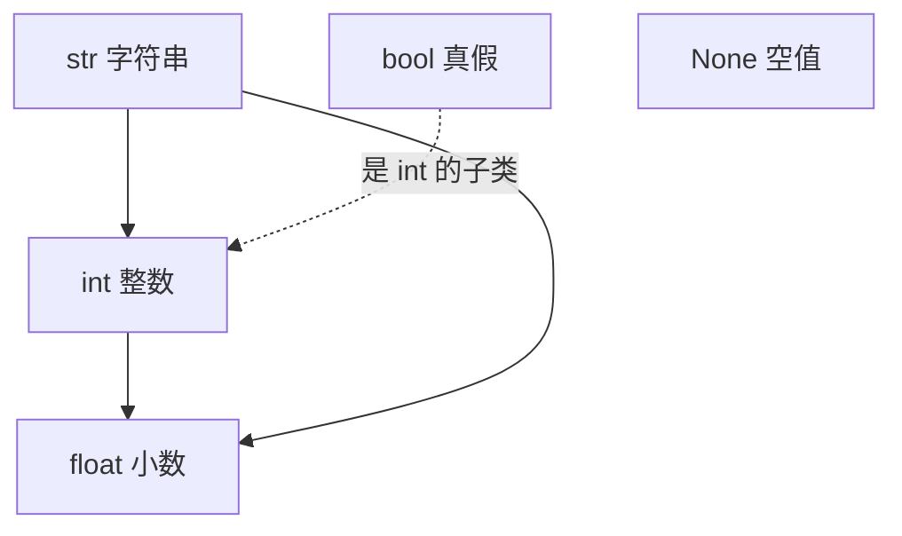

# PY-002 基本数据类型

## 1. 知识概览

> ⏱ **预计学习时间**：45 分钟

Python 的值都有类型。入门阶段只需要先认准五个：`int`（整数）、`float`（小数）、`str`（字符串）、`bool`（真假）、`NoneType`（空值）。

- 一句话：**类型决定这个值能做什么运算**。
- 解决什么问题：知道类型，才能预判 `1 + 1` 与 `"1" + "1"` 结果为何不同。
- 关键结论：Python 是动态类型——变量没有类型，值才有；类型可以随时变。

## 2. 学习目标

1. 能说出五个基本类型的名字与典型字面量。
2. 能用 `type()` 判断类型，用 `int()` / `float()` / `str()` / `bool()` 做转换。
3. 能解释为什么 `0.1 + 0.2 != 0.3`，以及工程上怎么处理。
4. 能判断哪些值在布尔语境下是"假"。

## 3. 通俗原理讲解

类型就像**容器规格**：矿泉水瓶装水，油桶装油。

- `1` 是整数瓶，`1.0` 是小数瓶，`"1"` 是文字瓶。三个瓶子看起来都写着 1，但**能做的事不同**：整数能取余，字符串能切片。
- `True` / `False` 是"开关"瓶，只有两个状态。
- `None` 是"空瓶"，表示"这里暂时没有值"，它不等于 `0`，也不等于 `""`。

类比失效处：现实里瓶子不能改规格，Python 里变量可以改指别的类型——变量只是标签。

### 图解：五类基本类型与转换方向



## 4. 深入技术原理

| 类型 | 字面量示例 | 关键特性 |
|---|---|---|
| `int` | `42`、`-7`、`0` | 任意精度，不会溢出（内存允许的话） |
| `float` | `3.14`、`1e-3` | IEEE-754 双精度，**有舍入误差** |
| `str` | `"hi"`、`'小明'` | 不可变序列，支持索引与切片 |
| `bool` | `True`、`False` | 是 `int` 的子类，`True == 1` |
| `NoneType` | `None` | 只有一个值，用 `is None` 判断 |

两个必须记住的细节：

1. **浮点是二进制近似**：`0.1` 无法用有限二进制精确表示，所以 `0.1 + 0.2` 得到 `0.30000000000000004`。比较浮点要用容差，不要用 `==`。
2. **布尔语境**：`0`、`0.0`、`""`、`[]`、`{}`、`None`、`False` 都判为假；其他为真。注意 `"0"` 和 `"False"` 是**非空字符串**，判为真。

## 5. 完整可运行代码

```powershell
python types_demo.py
```

```python
n = 42
f = 3.14
s = "Python"
b = True
nothing = None

print(n, f, s, b, nothing)
print(type(n).__name__, type(f).__name__, type(s).__name__,
      type(b).__name__, type(nothing).__name__)

print(int("7") + 1)
print(float("2.5") * 2)
print(str(100) + "分")

print(bool(""), bool("0"), bool(0), bool([]))

print(0.1 + 0.2)
print(abs((0.1 + 0.2) - 0.3) < 1e-9)
print(round(0.1 + 0.2, 2))
```

## 6. 逐段代码解析

| 代码 | 作用 | 为什么这样写 |
|---|---|---|
| `type(x).__name__` | 取类型名字符串 | 比直接打印 `<class 'int'>` 更干净 |
| `int("7")` | 字符串转整数 | 输入常是字符串（如命令行参数），必须先转 |
| `float("2.5")` | 字符串转小数 | `int("2.5")` 会报错，小数要用 `float` |
| `str(100) + "分"` | 数字转字符串再拼接 | `100 + "分"` 会 `TypeError` |
| `bool("0")` | 非空字符串 → `True` | 这是新手最常踩的坑 |
| `abs(a - b) < 1e-9` | 浮点近似比较 | 直接 `==` 会因舍入误差失败 |
| `round(x, 2)` | 四舍五入到 2 位 | 只解决显示，不解决精度本质 |

## 7. 运行结果

```
42 3.14 Python True None
int float str bool NoneType
8
5.0
100分
False True False False
0.30000000000000004
True
0.3
```

## 8. 基础练习

1. 用 `type()` 打印 `10`、`10.0`、`"10"`、`True` 的类型名。
2. 把字符串 `"123"` 转成整数并加 `1`，打印结果。
3. 判断 `bool(0)`、`bool("")`、`bool("False")` 的真假，并各写一句原因。

## 9. 进阶练习

1. 输入一个用字符串表示的小数（如 `"3.7"`），把它转成 `float` 并乘 `2`，输出结果。
2. 写一段代码判断 `0.1 + 0.2 == 0.3` 是否为真，并给出两种让它"看起来相等"的办法。

## 10. 综合实践

写一个"学生信息卡"小程序：

- 用五个变量存姓名（str）、年龄（int）、身高（float）、是否住校（bool）、备注（None）；
- 用 `type()` 逐一打印类型名；
- 输出一行格式化信息：`小明 | 18 岁 | 1.72 m | 住校 | 备注：无`。

## 11. 参考答案

**基础**

1. `print(type(10).__name__, type(10.0).__name__, type("10").__name__, type(True).__name__)` → `int float str bool`
2. `print(int("123") + 1)` → `124`
3. 分别 `False`、`False`、`True`：空字符串判假；`"False"` 是非空字符串，判真。

**进阶**

1. `print(float("3.7") * 2)` → `7.4`
2. `0.1 + 0.2 == 0.3` 为 `False`。两种办法：`abs(0.1+0.2-0.3) < 1e-9`，或 `round(0.1+0.2, 10) == 0.3`。

**综合实践**

```python
name = "小明"
age = 18
height = 1.72
live_on_campus = True
note = None

for v in (name, age, height, live_on_campus, note):
    print(type(v).__name__)

print(f"{name} | {age} 岁 | {height} m | {'住校' if live_on_campus else '走读'} | 备注：{note if note else '无'}")
```

## 12. 常见错误

| 错误现象 | 根本原因 | 正确做法 |
|---|---|---|
| `ValueError: invalid literal for int()` | 把 `"2.5"` 传给 `int()` | 小数用 `float()` 再按需取整 |
| `TypeError: can only concatenate str` | 数字与字符串直接 `+` | 用 f-string 或 `str()` |
| `0.1 + 0.2 == 0.3` 为 `False` | 浮点二进制近似 | 用容差比较 |
| `bool("False")` 得到 `True` | 非空字符串即真 | 需要显式解析时自己写判断 |
| 用 `x == None` | 惯用写法应用 `is` | `x is None` |

## 13. 知识关联

- **前置**：[[PY-001 变量与赋值]]
- **后继**：[[PY-003 运算符]]、[[PY-004 字符串]]
- **相关数学**：无（本节不涉及数学；浮点精度问题属数值计算范畴，见 `06_数学基础/06 数值计算/00 分支索引`）
- **所属模块**：`M-PY-01 Python 编程基础`

## 14. 学习记录

| 日期 | 动作 | 用时 | 结果 | 复盘 |
|---|---|---|---|---|
| 2026-11-01 | 建立笔记 | — | 待学 | — |

- 掌握判定：能解释 `bool("0")` 为真、`0.1+0.2` 不为 `0.3`，并能写出容差比较 = `practiced`。

---

## 🔗 Notion 同步信息

> 以下内容由 Notion「AI Knowledge System · 知识点」数据库按知识 ID 合并而来（导出于 2026-11-09）。

| 属性 | 值 |
|---|---|
| 学科 | Python基础 |
| 学习状态 | 未开始 |
| 难度 | L1 概念 |
| 知识类型 | Concept |
| 学习目标 | 认识 int/float/str/bool/None 五类值，会类型转换与浮点容差比较。 |

- **所属模块**：[M-PY-01 Python 编程基础](../%E8%AF%BE%E7%A8%8B%E6%A8%A1%E5%9D%97/M-PY-01%20Python%20%E7%BC%96%E7%A8%8B%E5%9F%BA%E7%A1%80.md)
- **前置知识**：[PY-001 变量与赋值](PY-001%20%E5%8F%98%E9%87%8F%E4%B8%8E%E8%B5%8B%E5%80%BC.md)
- **后继知识**：[PY-003 运算符](PY-003%20%E8%BF%90%E7%AE%97%E7%AC%A6.md) · [PY-004 字符串](PY-004%20%E5%AD%97%E7%AC%A6%E4%B8%B2.md) · [PY-007 列表与元组](../03%20%E6%95%B0%E6%8D%AE%E7%BB%93%E6%9E%84/PY-007%20%E5%88%97%E8%A1%A8%E4%B8%8E%E5%85%83%E7%BB%84.md)
