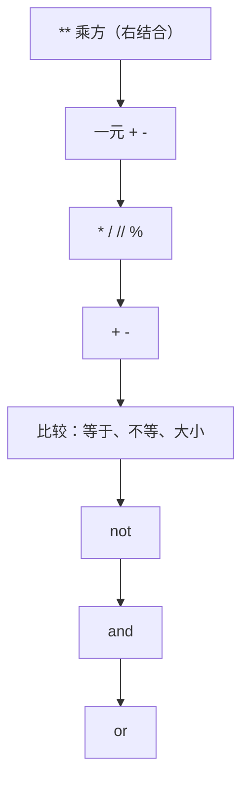

# PY-003 运算符

## 1. 知识概览

> ⏱ **预计学习时间**：40 分钟

运算符是"对值做动作"的符号。入门必掌握四类：

- **算术**：`+ - * / // % **`
- **比较**：`== != > < >= <=`
- **逻辑**：`and or not`
- **赋值**：`=`、`+=`、`-=`、`*=`、`//=` 等

一句话：**运算符决定表达式怎么算，优先级决定先算谁**。

## 2. 学习目标

1. 能区分 `/`（真除法）与 `//`（向下取整除法）、`%`（取余）、`**`（乘方）。
2. 能用比较与逻辑运算符组合出条件。
3. 能说出 `=` 与 `==` 的区别，并解释 `a + b * 2` 为何不等于 `(a + b) * 2`。
4. 能看懂并正确使用 `+=` 这类增强赋值。

## 3. 通俗原理讲解

运算符像**厨房电器**：`+` 是搅拌机、`//` 是切掉零头的刀、`%` 是"剩下的边角料"。

- `7 / 2 = 3.5`：真除法，永远给小数。
- `7 // 2 = 3`：切掉小数部分（**向下**取整，不是四舍五入）。
- `7 % 2 = 1`：切完剩下的部分。
- `7 ** 2 = 49`：乘方，不是"异或"（Python 里 `^` 才是按位异或）。

注意负数：`-7 // 2` 结果是 `-4`，因为向下取整；这是新手最容易判断错的一处。

### 图解：运算符优先级（从高到低）



## 4. 深入技术原理

- **优先级**（高→低）：`**` > 一元 `+ -` > `* / // %` > `+ -` > 比较 > `not` > `and` > `or`。
- `**` 是**右结合**：`2 ** 3 ** 2` = `2 ** 9` = `512`。
- 比较可以**链式**：`0 < x < 10` 等价于 `0 < x and x < 10`，且 `x` 只求值一次。
- `and` / `or` 有**短路**特性：`a and b` 若 `a` 为假则不再算 `b`；`a or b` 若 `a` 为真则不再算 `b`。返回值是操作数本身，不一定是 `True/False`。
- 增强赋值 `x += 3` 等价于 `x = x + 3`（可变对象上语义略有不同，入门阶段先按等价理解）。

## 5. 完整可运行代码

```powershell
python ops_demo.py
```

```python
a, b = 7, 2

print(a + b, a - b, a * b, a / b)
print(a // b, a % b, a ** b)

print(a > b, a == b, a != b)
print(True and False, True or False, not True)

x = 5
x += 3
print(x)
x *= 2
print(x)

print(1 + 2 * 3 ** 2)
print((1 + 2) * 3 ** 2)
print(2 ** 3 ** 2)

print(0 < x < 100)
print(-7 // 2, -7 % 2)
```

## 6. 逐段代码解析

| 代码 | 结果 | 说明 |
|---|---|---|
| `a / b` | `3.5` | 真除法，结果一定是 `float` |
| `a // b` | `3` | 向下取整 |
| `a % b` | `1` | 取余，`a == (a // b) * b + a % b` |
| `a ** b` | `49` | 乘方 |
| `x += 3` | `8` | 先算 `x + 3` 再绑回 `x` |
| `x *= 2` | `16` | 此时 `x` 已经是 8 |
| `1 + 2 * 3 ** 2` | `19` | 先 `3**2=9`，再 `2*9=18`，最后 `1+18` |
| `(1 + 2) * 3 ** 2` | `27` | 括号优先，`3*9` |
| `2 ** 3 ** 2` | `512` | 右结合，等于 `2**9` |
| `0 < x < 100` | `True` | 链式比较，`x` 此时是 16 |
| `-7 // 2` | `-4` | 向下取整，不是 -3 |
| `-7 % 2` | `1` | 余数符号跟除数一致 |

## 7. 运行结果

```
9 5 14 3.5
3 1 49
True False True
False True False
8
16
19
27
512
True
-4 1
```

## 8. 基础练习

1. 计算 `17 // 5`、`17 % 5`、`17 / 5`，并说明三者关系。
2. 判断 `x` 是否在 `1` 到 `100` 之间（含端点），用一条表达式写出。
3. 用增强赋值把 `n = 10` 变成 `n` 的平方。

## 9. 进阶练习

1. 不用 `**`，用循环或 `math.pow` 计算 `2 ** 10`，比较两种结果类型是否一致。
2. 解释 `print(3 > 2 > 1)` 与 `print(3 > 2 and 2 > 1)` 是否等价，并说明短路在什么情况下会体现差异。

## 10. 综合实践

写一个"秒数换算"程序：

- 给定 `total = 3725`（秒）；
- 用 `//` 与 `%` 拆成 时 / 分 / 秒；
- 输出 `3725 秒 = 1 小时 2 分 5 秒`。

## 11. 参考答案

**基础**

1. `17 // 5 = 3`，`17 % 5 = 2`，`17 / 5 = 3.4`；关系：`17 == (17 // 5) * 5 + 17 % 5`。
2. `1 <= x <= 100`
3. `n *= n`（结果为 100）

**进阶**

1. `2 ** 10` 是 `1024`（`int`）；`math.pow(2, 10)` 是 `1024.0`（`float`）。类型不同，大数时 `int` 更精确。
2. 结果相同，都是 `True`。差异体现在**副作用**：若写成 `f() > 0 and g() > 0`，`f()` 为假时 `g()` 不会执行；链式比较 `f() > 0 > g()` 也不是逐段独立求值。入门阶段只需知道"链式的中间值只算一次"。

**综合实践**

```python
total = 3725
hours = total // 3600
minutes = total % 3600 // 60
seconds = total % 60
print(f"{total} 秒 = {hours} 小时 {minutes} 分 {seconds} 秒")
```

## 12. 常见错误

| 错误现象 | 根本原因 | 正确做法 |
|---|---|---|
| 把 `=` 当比较 | 赋值与相等混淆 | 比较用 `==` |
| `7 // 2` 以为得 3.5 | 混淆 `//` 与 `/` | 要小数用 `/` |
| `-7 // 2` 以为得 -3 | 以为向零取整 | Python 是**向下**取整，得 -4 |
| `2 ** 3 ** 2` 算成 64 | 以为左结合 | 右结合，结果是 512 |
| `a and b` 期待得到 `True/False` | 忘记返回操作数本身 | 例：`0 and 5` 得 `0`，`3 and 5` 得 `5` |

## 13. 知识关联

- **前置**：[[PY-002 基本数据类型]]
- **后继**：[[PY-005 条件判断]]、[[PY-006 循环结构]]
- **相关数学**：无（本节是语言基础；`//`、`%` 的数学定义属整除理论）
- **所属模块**：`M-PY-01 Python 编程基础`

## 14. 学习记录

| 日期 | 动作 | 用时 | 结果 | 复盘 |
|---|---|---|---|---|
| 2026-11-01 | 建立笔记 | — | 待学 | — |

- 掌握判定：能正确算出 `-7 // 2` 与 `2 ** 3 ** 2`，并能用 `//`+`%` 完成第 10 节 = `practiced`。

---

## 🔗 Notion 同步信息

> 以下内容由 Notion「AI Knowledge System · 知识点」数据库按知识 ID 合并而来（导出于 2026-11-09）。

| 属性 | 值 |
|---|---|
| 学科 | Python基础 |
| 学习状态 | 未开始 |
| 难度 | L1 概念 |
| 知识类型 | Concept |
| 学习目标 | 掌握算术、比较、逻辑、赋值四类运算符及优先级。 |

- **所属模块**：[M-PY-01 Python 编程基础](../%E8%AF%BE%E7%A8%8B%E6%A8%A1%E5%9D%97/M-PY-01%20Python%20%E7%BC%96%E7%A8%8B%E5%9F%BA%E7%A1%80.md)
- **前置知识**：[PY-002 基本数据类型](PY-002%20%E5%9F%BA%E6%9C%AC%E6%95%B0%E6%8D%AE%E7%B1%BB%E5%9E%8B.md)
- **后继知识**：[PY-005 条件判断](PY-005%20%E6%9D%A1%E4%BB%B6%E5%88%A4%E6%96%AD.md)
- **被项目引用**：[PROJ-001 命令行计算器](../../07_%E5%AE%9E%E6%88%98%E9%A1%B9%E7%9B%AE/01%20Python%E9%A1%B9%E7%9B%AE/PROJ-001%20%E5%91%BD%E4%BB%A4%E8%A1%8C%E8%AE%A1%E7%AE%97%E5%99%A8.md)
