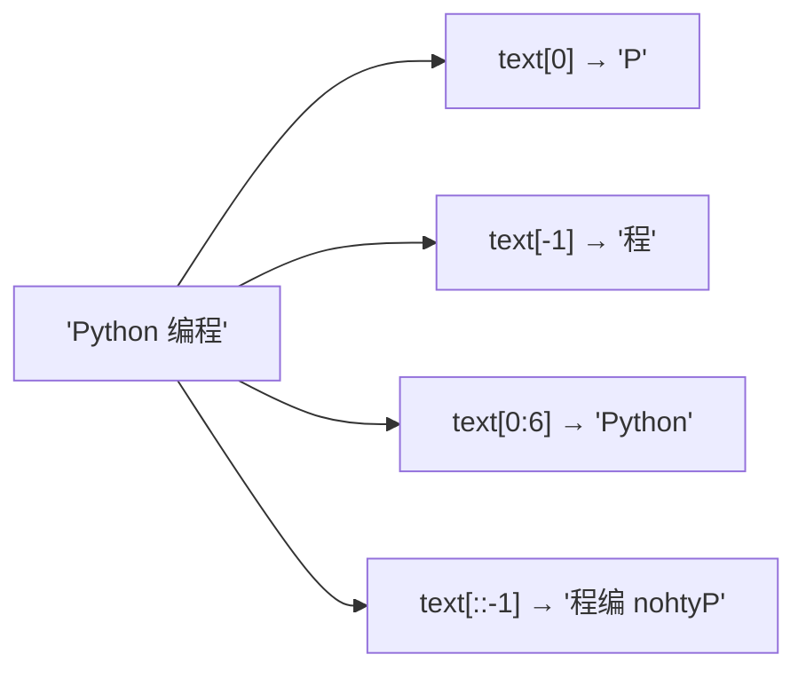

# PY-004 字符串

## 1. 知识概览

> ⏱ **预计学习时间**：45 分钟

字符串是**不可变的字符序列**。你可以索引、切片、拼接、格式化，但不能原地修改它。

- 一句话：字符串像"印好的纸条"——能剪、能抄、能拼接，但不能在纸条上改字。
- 解决什么问题：程序里几乎所有输入输出都是字符串（文件、命令行、网页、日志）。
- 关键结论：`text[0] = "X"` 会报错，必须用"生成新字符串"的方式。

## 2. 学习目标

1. 能用索引、负索引、切片取子串。
2. 会用 `len`、`split`、`join`、`strip`、`replace`、`find`、`upper`、`lower`。
3. 能用 f-string 做格式化（含小数位数、条件表达式）。
4. 能解释"为什么字符串长度不等于显示宽度"。

## 3. 通俗原理讲解

字符串是一串**带编号的格子**，从左往右从 `0` 开始编号：

```
 P  y  t  h  o  n    编  程
 0  1  2  3  4  5  6  7  8
-9 -8 -7 -6 -5 -4 -3 -2 -1
```

- `text[0]` 取第一格，`text[-1]` 取最后一格（负号表示从右数）。
- `text[0:6]` 是"左闭右开"：取第 0 到第 5 格，共 6 个字符。
- 切片不会报错越界：`text[0:100]` 只取到结尾。

### 图解：字符串下标与切片（左闭右开）



## 4. 深入技术原理

- **不可变**：每次 `replace`、`+`、`upper` 都**新建**一个字符串，原对象不变。所以循环里反复 `s += c` 会不断创建新对象，效率低（大量拼接应用 `"".join(list)`）。
- **切片规则**：`s[start:stop:step]`，`start` 缺省为 0，`stop` 缺省为末尾，`step` 可为负（此时从右往左）。
- **编码**：Python 3 的 `str` 是 Unicode 码点序列，`len()` 数的是码点，不是"显示宽度"，也不是字节数。中文一个字通常是 1 个码点，但某些 emoji 由多个码点组成。
- **f-string**：`f"{value:.1f}"` 保留 1 位小数；`f"{name!r}"` 显示 `repr`；f-string 里可以放表达式，但不要塞太复杂。

## 5. 完整可运行代码

```powershell
python str_demo.py
```

```python
text = "Python 编程"

print(len(text))
print(text[0], text[-1])
print(text[0:6])
print(text.upper())
print(text.lower())
print(text.replace("编程", "入门"))
print(text.split())
print("-".join(["a", "b", "c"]))
print(text.strip())
print("py" in text)
print(text.find("编"))

name, score = "小明", 95.5
print(f"{name} 考了 {score:.1f} 分")
print(f"{name} 的分数等级是 {'A' if score >= 90 else 'B'}")

s2 = text
text2 = text + "！"
print(s2, "|", text2)
```

## 6. 逐段代码解析

| 代码 | 结果 | 说明 |
|---|---|---|
| `len(text)` | `9` | `"Python"` 6 + 空格 1 + 中文 2 = 9 个码点 |
| `text[0]` / `text[-1]` | `P` / `程` | 负索引从右数 |
| `text[0:6]` | `Python` | 左闭右开，不含下标 6 |
| `text.replace(...)` | `Python 入门` | 返回**新**字符串 |
| `text.split()` | `['Python', '编程']` | 按空白切分，自动去掉多余空格 |
| `"-".join([...])` | `a-b-c` | 拼接效率高于循环 `+` |
| `text.find("编")` | `7` | 找不到返回 `-1`（不是报错） |
| `f"{score:.1f}"` | `95.5` | 保留 1 位小数 |
| `text + "！"` | 新对象 | `s2` 仍指向原字符串 |

## 7. 运行结果

```
9
P 程
Python
PYTHON 编程
python 编程
Python 入门
['Python', '编程']
a-b-c
Python 编程
False
7
小明 考了 95.5 分
小明 的分数等级是 A
Python 编程 | Python 编程！
```

## 8. 基础练习

1. 给 `s = "hello world"`，取出 `"world"`（两种写法：切片 / `split`）。
2. 把 `"  Python  "` 去掉首尾空格并转大写。
3. 用 f-string 输出 `圆周率约等于 3.14`（数字用变量）。

## 9. 进阶练习

1. 判断一个字符串是否回文（正读反读相同），用切片实现。
2. 统计一段文字里某个字符出现次数，不许用 `count()`，只能循环 + 比较。

## 10. 综合实践

写一个"姓名清洗"程序：

- 输入字符串 `raw = "  张 三 ; 李四;王五  "`；
- 去首尾空白，按 `;` 切分，每段再去空白；
- 输出清洗后的列表，并用 `、` 连接成一行。

## 11. 参考答案

**基础**

1. `s[6:]` 或 `s.split()[1]`。
2. `"  Python  ".strip().upper()` → `"PYTHON"`。
3. `pi = 3.14159; print(f"圆周率约等于 {pi:.2f}")`。

**进阶**

1. `def is_palindrome(s): return s == s[::-1]`
2. ```python
   text = "banana"
   target = "a"
   count = 0
   for ch in text:
       if ch == target:
           count += 1
   print(count)
   ```

**综合实践**

```python
raw = "  张 三 ; 李四;王五  "
parts = [p.strip() for p in raw.strip().split(";")]
print(parts)
print("、".join(parts))
```

输出：

```
['张 三', '李四', '王五']
张 三、李四、王五
```

## 12. 常见错误

| 错误现象 | 根本原因 | 正确做法 |
|---|---|---|
| `TypeError: 'str' object does not support item assignment` | 试图改字符串某一位 | 用切片拼接生成新串 |
| `text[100]` 报 `IndexError` | 索引越界 | 用切片，或先判断长度 |
| `find` 找不到却以为报错 | `find` 返回 `-1` | 判断 `!= -1` 或用 `in` |
| 循环里大量 `s += x` 很慢 | 每次新建字符串 | 收集到列表后 `"".join()` |
| `len("👍")` 与预期不符 | 一个 emoji 可能是多码点 | 需要显示宽度时用 `unicodedata` 或第三方库 |

## 13. 知识关联

- **前置**：[[PY-002 基本数据类型]]
- **后继**：[[PY-005 条件判断]]（字符串判空常用）
- **相关数学**：无
- **所属模块**：`M-PY-01 Python 编程基础`

## 14. 学习记录

| 日期 | 动作 | 用时 | 结果 | 复盘 |
|---|---|---|---|---|
| 2026-11-01 | 建立笔记 | — | 待学 | — |

- 掌握判定：能独立写出回文判断 + 姓名清洗，并能解释 `s += c` 为什么慢 = `practiced`。

---

## 🔗 Notion 同步信息

> 以下内容由 Notion「AI Knowledge System · 知识点」数据库按知识 ID 合并而来（导出于 2026-11-09）。

| 属性 | 值 |
|---|---|
| 学科 | Python基础 |
| 学习状态 | 未开始 |
| 难度 | L1 概念 |
| 知识类型 | Concept |
| 学习目标 | 掌握字符串索引、切片、常用方法与 f-string 格式化。 |

- **所属模块**：[M-PY-01 Python 编程基础](../%E8%AF%BE%E7%A8%8B%E6%A8%A1%E5%9D%97/M-PY-01%20Python%20%E7%BC%96%E7%A8%8B%E5%9F%BA%E7%A1%80.md)
- **前置知识**：[PY-002 基本数据类型](PY-002%20%E5%9F%BA%E6%9C%AC%E6%95%B0%E6%8D%AE%E7%B1%BB%E5%9E%8B.md)
