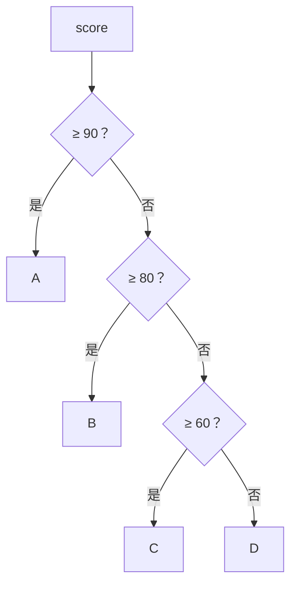

# PY-005 条件判断

## 1. 知识概览

> ⏱ **预计学习时间**：40 分钟

条件判断让程序**走不同的路**。Python 用 `if / elif / else` 三个关键字表达分支，靠**缩进**表示归属。

- 一句话：先算条件真假，再决定执行哪一块。
- 解决什么问题：让程序对输入作出反应，而不是永远执行同一串语句。
- 关键结论：Python **没有花括号**，缩进（通常 4 个空格）就是语法。

## 2. 学习目标

1. 能写出 `if / elif / else` 三段式，并说明 `elif` 为什么不能写成多个独立 `if`。
2. 能判断任意值在布尔语境下的真假。
3. 会用 `and` / `or` / `not` 组合条件。
4. 能用 `match / case` 处理多值分支（Python 3.10+）。

## 3. 通俗原理讲解

条件判断像**岔路口**：

```
             ┌─ 分数 ≥ 90 ─→ A
入口 ─ 看分数 ─┼─ 分数 ≥ 80 ─→ B
             └─ 其它      ─→ C
```

- `if` 是第一个路牌，`elif` 是"如果不是上面那种，再判断这个"，`else` 是"都不符合就走这里"。
- 关键：`elif` 是**互斥**的。一旦某个分支命中，后面的分支**不再判断**。
- 如果写成三个独立 `if`，则可能同时命中多个分支——这是最常见的逻辑错误。

### 图解：if / elif / else 的互斥分支



## 4. 深入技术原理

- **缩进即作用域**：同一代码块必须缩进一致；混用 Tab 与空格会 `IndentationError`。
- **真假值**：`0`、`0.0`、`""`、`[]`、`{}`、`()`、`set()`、`None`、`False` 判为假；其余为真。
- **短路求值**：`A and B` 若 `A` 为假，`B` 不执行；`A or B` 若 `A` 为真，`B` 不执行。可用于防御式写法：`if items and items[0] > 0:`。
- **链式比较**：`0 < x < 10` 只对 `x` 求值一次。
- **`match`**：按模式匹配，`case _:` 是兜底分支；它比一长串 `elif` 更清晰，但不是 `switch` 的简单替代。

## 5. 完整可运行代码

```powershell
python branch_demo.py
```

```python
score = 87

if score >= 90:
    level = "A"
elif score >= 80:
    level = "B"
elif score >= 60:
    level = "C"
else:
    level = "D"

print("等级", level)

x = 5
print(0 < x < 10)
print(x > 3 and x < 8)
print(not (x == 5))
print("空列表为假:", bool([]))

value = ""
if not value:
    print("value 是空值，走了 if 分支")
else:
    print("value 有内容，走了 else 分支")

command = "start"
match command:
    case "start":
        print("启动")
    case "stop":
        print("停止")
    case _:
        print("未知命令")
```

## 6. 逐段代码解析

| 代码 | 结果 | 说明 |
|---|---|---|
| `score = 87` | — | 87 不满足 ≥90，进入 `elif` |
| `elif score >= 80` | 命中 | 设为 `"B"`，后面分支不再判断 |
| `0 < x < 10` | `True` | 链式比较，等价 `0 < x and x < 10` |
| `not (x == 5)` | `False` | 因为 `x == 5` 为真 |
| `bool([])` | `False` | 空容器判假 |
| `if not value` | 命中 | 空字符串判假，`not` 后为真 |
| `match command` | `启动` | `case "start"` 命中 |

## 7. 运行结果

```
等级 B
True
True
False
空列表为假: False
value 是空值，走了 if 分支
启动
```

## 8. 基础练习

1. 给 `age` 赋值，输出"未成年 / 成年 / 老年"三类（用 18 与 60 作分界）。
2. 判断一个数是否为偶数，输出 `偶数` 或 `奇数`。
3. 判断用户名是否非空且长度不少于 3 个字符。

## 9. 进阶练习

1. 解释下面两段代码在 `score = 95` 时的差异：

```python
# 片段 A
score = 95
if score >= 60:
    print("及格")
if score >= 90:
    print("优秀")
```

```python
# 片段 B
score = 95
if score >= 90:
    print("优秀")
elif score >= 60:
    print("及格")
```

2. 写一个判断闰年的程序（能被 4 整除且不能被 100 整除，或能被 400 整除）。

## 10. 综合实践

写一个"成绩等级 + 建议"程序：

- 输入 `score`（0–100）与 `attendance`（出勤率 0–1）；
- 先判断分数是否合法（越界输出提示并结束）；
- 按分数给等级（A/B/C/D）；
- 若出勤率低于 0.8，额外输出"出勤不足，需补课"。

## 11. 参考答案

**基础**

1. ```python
   age = 25
   if age < 18:
       print("未成年")
   elif age < 60:
       print("成年")
   else:
       print("老年")
   ```
2. `print("偶数" if n % 2 == 0 else "奇数")`
3. `if username and len(username) >= 3: print("通过")`

**进阶**

1. 片段 A 会同时打印"及格"和"优秀"（两个独立判断）；片段 B 只打印"优秀"（互斥）。**有包含关系时用 `elif`**。
2. ```python
   year = 2024
   if (year % 4 == 0 and year % 100 != 0) or year % 400 == 0:
       print("闰年")
   else:
       print("平年")
   ```

**综合实践**

```python
score = 87
attendance = 0.75

if not (0 <= score <= 100):
    print("分数不合法")
else:
    if score >= 90:
        level = "A"
    elif score >= 80:
        level = "B"
    elif score >= 60:
        level = "C"
    else:
        level = "D"

    print(f"等级 {level}")

    if attendance < 0.8:
        print("出勤不足，需补课")
```

## 12. 常见错误

| 错误现象 | 根本原因 | 正确做法 |
|---|---|---|
| `IndentationError` | 缩进不一致或漏缩进 | 统一 4 空格，别混 Tab |
| 同时命中多个分支 | 写了多个独立 `if` | 有包含关系改用 `elif` |
| `if x = 5:` 语法错误 | 把赋值当判断 | 用 `==` |
| `if value:` 对 `"0"` 判真而意外 | 非空字符串即真 | 需要数值判断时显式转换 |
| `elif` 写在 `else` 之后 | 顺序错误 | `else` 必须最后 |

## 13. 知识关联

- **前置**：[[PY-003 运算符]]
- **后继**：[[PY-006 循环结构]]
- **相关数学**：无
- **所属模块**：`M-PY-01 Python 编程基础`

## 14. 学习记录

| 日期 | 动作 | 用时 | 结果 | 复盘 |
|---|---|---|---|---|
| 2026-11-01 | 建立笔记 | — | 待学 | — |

- 掌握判定：能说清 `if` 与 `elif` 的互斥差异，并独立写出闰年判断 = `practiced`。

---

## 🔗 Notion 同步信息

> 以下内容由 Notion「AI Knowledge System · 知识点」数据库按知识 ID 合并而来（导出于 2026-11-09）。

| 属性 | 值 |
|---|---|
| 学科 | Python基础 |
| 学习状态 | 未开始 |
| 难度 | L1 概念 |
| 知识类型 | Concept |
| 学习目标 | 用 if/elif/else 与 match 写出互斥分支，理解真假值与短路。 |

- **所属模块**：[M-PY-01 Python 编程基础](../%E8%AF%BE%E7%A8%8B%E6%A8%A1%E5%9D%97/M-PY-01%20Python%20%E7%BC%96%E7%A8%8B%E5%9F%BA%E7%A1%80.md)
- **前置知识**：[PY-003 运算符](PY-003%20%E8%BF%90%E7%AE%97%E7%AC%A6.md)
- **后继知识**：[PY-006 循环结构](PY-006%20%E5%BE%AA%E7%8E%AF%E7%BB%93%E6%9E%84.md) · [PY-044 异常处理](../05%20%E5%BC%82%E5%B8%B8%E4%B8%8E%E6%96%87%E4%BB%B6/PY-044%20%E5%BC%82%E5%B8%B8%E5%A4%84%E7%90%86.md)
- **被项目引用**：[PROJ-001 命令行计算器](../../07_%E5%AE%9E%E6%88%98%E9%A1%B9%E7%9B%AE/01%20Python%E9%A1%B9%E7%9B%AE/PROJ-001%20%E5%91%BD%E4%BB%A4%E8%A1%8C%E8%AE%A1%E7%AE%97%E5%99%A8.md)
