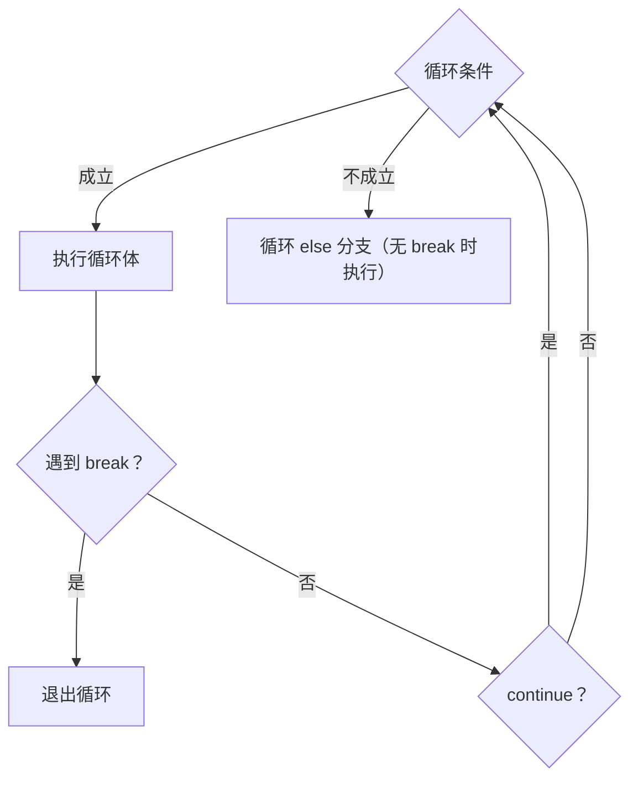

# PY-006 循环结构

## 1. 知识概览

> ⏱ **预计学习时间**：45 分钟

循环让程序**重复做事**。Python 只有两种循环：

- `for ... in ...`：遍历一个序列（或任何可迭代对象），**次数由数据决定**。
- `while ...`：条件为真就继续，**次数由条件决定**。

一句话：**知道要跑多少次用 `for`，知道什么时候停用 `while`**。

## 2. 学习目标

1. 能用 `for` + `range()` 控制循环次数，说清 `range(1, 6)` 为什么不含 6。
2. 能用 `while` 写出"不知道次数但有终止条件"的循环。
3. 会用 `break`（提前结束）、`continue`（跳过本轮）、`enumerate`（带序号）、`zip`（并行遍历）。
4. 能识别死循环的风险并避免。

## 3. 通俗原理讲解

循环像**流水线**：

- `for` 是"把这一箱苹果挨个过一遍"——箱子空了就停。
- `while` 是"只要传送带还在转，就一直处理"——必须有办法让它停下来，否则永远转。

`range(1, 6)` 生成 `1,2,3,4,5`：**左闭右开**，跟字符串切片同一个习惯。

### 图解：for 与 while 的执行路径



## 4. 深入技术原理

- `range(start, stop, step)`：不含 `stop`；`step` 可为负。
- `for` 遍历的是**可迭代对象**：列表、字符串、字典（遍历键）、`range`、生成器。
- `else` 可以挂在循环上：**没有**被 `break` 打断时执行。常用于"查找未命中"的场景。
- `enumerate(seq, start=1)` 同时给出下标与值；`zip(a, b)` 按最短的一方截断。
- `while` 的三个要素：初值、条件、更新。**漏掉更新就是死循环**。
- 修改正在遍历的列表会出问题（元素被跳过），应先复制或反向遍历。

## 5. 完整可运行代码

```powershell
python loop_demo.py
```

```python
total = 0
for i in range(1, 6):
    total += i
print("1~5 求和:", total)

fruits = ["苹果", "香蕉", "橙子"]
for index, fruit in enumerate(fruits, start=1):
    print(index, fruit)

n = 0
while n < 3:
    print("n =", n)
    n += 1

for x in range(1, 10):
    if x % 2 == 0:
        continue
    if x > 7:
        break
    print("奇数:", x)

for i in range(3):
    if i == 5:
        break
else:
    print("循环正常结束，没有 break")

pairs = list(zip([1, 2], ["a", "b"]))
print(pairs)
```

## 6. 逐段代码解析

| 代码 | 结果 | 说明 |
|---|---|---|
| `range(1, 6)` | `1..5` | 左闭右开 |
| `enumerate(fruits, start=1)` | `(1,'苹果')…` | 序号从 1 开始 |
| `while n < 3` | 打印 0,1,2 | 每次循环 `n += 1`，否则死循环 |
| `continue` | 跳过偶数 | 只影响本轮，不退出循环 |
| `break` | 遇到 9 时退出 | `x>7` 且为奇数才会到 9 |
| `for ... else` | 打印"正常结束" | 没有 `break` 才执行 `else` |
| `zip` | `[(1,'a'), (2,'b')]` | 长度不同时按短的截断 |

## 7. 运行结果

```
1~5 求和: 15
1 苹果
2 香蕉
3 橙子
n = 0
n = 1
n = 2
奇数: 1
奇数: 3
奇数: 5
奇数: 7
循环正常结束，没有 break
[(1, 'a'), (2, 'b')]
```

## 8. 基础练习

1. 用 `for` 打印 1 到 10 的平方。
2. 用 `while` 求 1 到 100 的和。
3. 遍历字符串 `"Python"`，逐个打印字符及其下标。

## 9. 进阶练习

1. 找出 1–100 中所有能被 3 整除但不能被 5 整除的数，放进列表。
2. 用 `for ... else` 判断一个数是否为质数（发现因子就 `break`）。

## 10. 综合实践

写一个"猜数字"程序的**逻辑核心**（不接输入，用固定答案循环）：

- 答案是 `42`；
- 依次尝试 `[10, 30, 42, 50]`；
- 每次比较并提示"偏小 / 偏大 / 猜中"，猜中后立即结束；
- 若全部猜完仍未命中，输出"机会用完"。

提示：用 `for ... else` 可以让"全部用完"的分支更干净。

## 11. 参考答案

**基础**

1. `for i in range(1, 11): print(i * i)`
2. ```python
   total, i = 0, 1
   while i <= 100:
       total += i
       i += 1
   print(total)
   ```
3. `for i, ch in enumerate("Python"): print(i, ch)`

**进阶**

1. `[n for n in range(1, 101) if n % 3 == 0 and n % 5 != 0]`
2. ```python
   n = 29
   for d in range(2, int(n ** 0.5) + 1):
       if n % d == 0:
           print("不是质数")
           break
   else:
       print("是质数")
   ```

**综合实践**

```python
answer = 42
for guess in [10, 30, 42, 50]:
    if guess < answer:
        print(guess, "偏小")
    elif guess > answer:
        print(guess, "偏大")
    else:
        print(guess, "猜中！")
        break
else:
    print("机会用完")
```

## 12. 常见错误

| 错误现象 | 根本原因 | 正确做法 |
|---|---|---|
| 程序卡住不结束 | `while` 忘了更新条件变量 | 检查循环体里有没有 `i += 1` |
| `range(1, 5)` 少打印 5 | 忘记左闭右开 | 用 `range(1, 6)` |
| 遍历时删元素漏掉一半 | 遍历中修改列表 | 先 `for x in list(a)` 或倒序删 |
| `break` 只跳出内层 | 嵌套循环 | 用标志变量或重构为函数 `return` |
| `else` 挂在 `if` 上却以为挂在 `for` | 缩进错位 | 缩进对齐到 `for` |

## 13. 知识关联

- **前置**：[[PY-005 条件判断]]
- **后继**：[[PY-009 函数]]（循环常被封装成函数）
- **相关数学**：无（求和/计数属算法基础）
- **所属模块**：`M-PY-01 Python 编程基础`

## 14. 学习记录

| 日期 | 动作 | 用时 | 结果 | 复盘 |
|---|---|---|---|---|
| 2026-11-01 | 建立笔记 | — | 待学 | — |

- 掌握判定：能用 `for ... else` 写出质数判断，并能解释死循环怎么产生 = `practiced`。

---

## 🔗 Notion 同步信息

> 以下内容由 Notion「AI Knowledge System · 知识点」数据库按知识 ID 合并而来（导出于 2026-11-09）。

| 属性 | 值 |
|---|---|
| 学科 | Python基础 |
| 学习状态 | 未开始 |
| 难度 | L1 概念 |
| 知识类型 | Concept |
| 学习目标 | 用 for/while 控制重复，掌握 break/continue/enumerate/zip。 |

- **所属模块**：[M-PY-01 Python 编程基础](../%E8%AF%BE%E7%A8%8B%E6%A8%A1%E5%9D%97/M-PY-01%20Python%20%E7%BC%96%E7%A8%8B%E5%9F%BA%E7%A1%80.md)
- **前置知识**：[PY-005 条件判断](PY-005%20%E6%9D%A1%E4%BB%B6%E5%88%A4%E6%96%AD.md)
- **后继知识**：[PY-009 函数](../02%20%E5%87%BD%E6%95%B0%E4%B8%8E%E4%BD%9C%E7%94%A8%E5%9F%9F/PY-009%20%E5%87%BD%E6%95%B0.md) · [PY-020 时间复杂度](../03%20%E6%95%B0%E6%8D%AE%E7%BB%93%E6%9E%84/PY-020%20%E6%97%B6%E9%97%B4%E5%A4%8D%E6%9D%82%E5%BA%A6.md)
