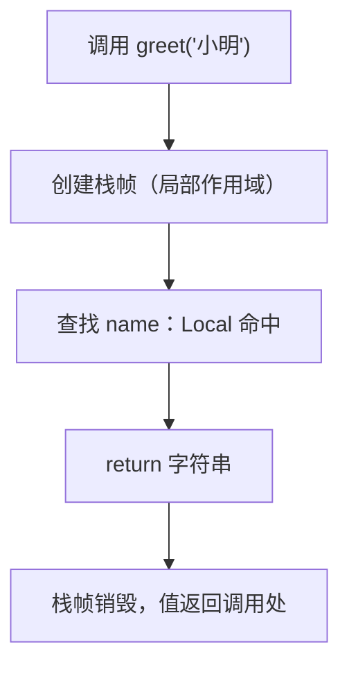

# PY-009 函数

## 1. 知识概览

> ⏱ **预计学习时间**：50 分钟

函数是**把一段逻辑打包并起个名字**。用 `def` 定义，用 `return` 交出结果。

```python
def 函数名(参数):
    """说明"""
    逻辑
    return 结果
```

一句话：**函数让同一段逻辑只写一次，并能用参数适配不同输入**。

## 2. 学习目标

1. 能定义、调用带参数与返回值的函数。
2. 会使用默认参数、关键字参数、`*args`、`**kwargs`。
3. 能分清"打印"与"返回"的区别，知道函数没写 `return` 时返回 `None`。
4. 能解释局部变量与全局变量的边界，以及为什么少用 `global`。

## 3. 通俗原理讲解

函数像**自动售货机**：

- 投币口 = 参数（输入）
- 出货口 = 返回值（输出）
- 机器内部怎么运作 = 函数体（调用者不需要关心）

关键区别：`print` 是"把东西显示出来"，`return` 是"把东西交回给调用者"。**打印了不等于返回了**——这是新手最常见的混淆。

### 图解：函数调用与作用域



## 4. 深入技术原理

- **参数传递**：Python 传的是"对象引用的值"。对不可变对象（int/str）函数内改不了外部；对可变对象（list/dict）**原地修改会影响外部**。
- **默认参数**：默认值在**函数定义时**求值一次，所以默认值不要用可变对象（`def f(x=[])` 是经典陷阱）。
- `*args` 收集位置参数为元组；`**kwargs` 收集关键字参数为字典。
- **作用域 LEGB**：Local → Enclosing → Global → Builtin。函数内赋值会创建局部变量，除非声明 `global` 或 `nonlocal`。
- **返回多值**：`return a, b` 实际返回一个元组，调用方可以解包。
- 函数也是一等对象：可以赋给变量、作为参数传递（`sorted(data, key=len)`）。

## 5. 完整可运行代码

```powershell
python func_demo.py
```

```python
def greet(name, greeting="你好"):
    return f"{greeting}，{name}！"

print(greet("小明"))
print(greet("小红", "早上好"))

def sum_all(*args):
    return sum(args)

print(sum_all(1, 2, 3))

def make_profile(**kwargs):
    return kwargs

print(make_profile(name="小明", age=18))

def outer():
    count = 0

    def inner():
        nonlocal count
        count += 1
        return count

    return inner

counter = outer()
print(counter(), counter(), counter())

def divide(a, b):
    if b == 0:
        return None
    return a / b

print(divide(10, 2), divide(1, 0))

square = lambda x: x * x
print(square(5))

def no_return():
    print("我只打印，不返回")

result = no_return()
print("返回值是:", result)
```

## 6. 逐段代码解析

| 代码 | 结果 | 说明 |
|---|---|---|
| `greet("小明")` | `你好，小明！` | 用了默认参数 |
| `greet("小红", "早上好")` | `早上好，小红！` | 位置参数覆盖默认值 |
| `sum_all(1, 2, 3)` | `6` | `args` 是 `(1, 2, 3)` |
| `make_profile(name=..., age=...)` | `{'name': '小明', 'age': 18}` | `kwargs` 收集成字典 |
| `counter()` | `1 2 3` | `nonlocal` 让内部函数能改外层变量 |
| `divide(1, 0)` | `None` | 提前 `return` 是常见的防御写法 |
| `square(5)` | `25` | `lambda` 是单表达式匿名函数 |
| `no_return()` | 打印一行，返回 `None` | 没有 `return` 就是返回 `None` |

## 7. 运行结果

```
你好，小明！
早上好，小红！
6
{'name': '小明', 'age': 18}
1 2 3
5.0 None
25
我只打印，不返回
返回值是: None
```

## 8. 基础练习

1. 写 `add(a, b)` 返回两数之和并调用打印。
2. 写 `is_even(n)` 返回布尔值，并用它筛选列表中的偶数。
3. 写 `area(width, height=1)` 计算矩形面积，验证默认参数生效。

## 9. 进阶练习

1. 写 `stats(nums)` 返回 `(最小值, 最大值, 平均值)` 三个值，并解包使用。
2. 解释下面两段代码的差异，说明为什么默认参数不要用列表：

```python
def bad(item, bucket=[]):
    bucket.append(item)
    return bucket
```

```python
def good(item, bucket=None):
    if bucket is None:
        bucket = []
    bucket.append(item)
    return bucket
```

## 10. 综合实践

写一个"成绩处理"函数组：

- `normalize(scores)`：把所有分数截断到 0–100；
- `passing(scores, line=60)`：返回及格名单；
- `summary(scores)`：返回一个字典，含人数、平均分（1 位小数）、最高分、最低分；
- 用一组含越界值的数据测试（如 `[-5, 58, 72, 105, 90]`）。

## 11. 参考答案

**基础**

1. `def add(a, b): return a + b` → `print(add(2, 3))`
2. `def is_even(n): return n % 2 == 0` → `print([x for x in range(10) if is_even(x)])`
3. `def area(width, height=1): return width * height`；`area(5)` 得 `5`。

**进阶**

1. ```python
   def stats(nums):
       return min(nums), max(nums), sum(nums) / len(nums)
   lo, hi, avg = stats([3, 1, 4])
   print(lo, hi, avg)
   ```
2. `bad` 的默认列表**只在定义时创建一次**，多次调用会共享同一个列表，导致结果累积；`good` 用 `None` 占位并在函数体内新建，每次调用都是干净的。这就是"默认参数不要用可变对象"的原因。

**综合实践**

```python
def normalize(scores):
    return [max(0, min(100, s)) for s in scores]

def passing(scores, line=60):
    return [s for s in scores if s >= line]

def summary(scores):
    return {
        "人数": len(scores),
        "平均分": round(sum(scores) / len(scores), 1),
        "最高分": max(scores),
        "最低分": min(scores),
    }

raw = [-5, 58, 72, 105, 90]
clean = normalize(raw)
print(clean)
print(passing(clean))
print(summary(clean))
```

## 12. 常见错误

| 错误现象 | 根本原因 | 正确做法 |
|---|---|---|
| 调用后拿到 `None` | 只 `print` 没 `return` | 需要结果就写 `return` |
| 多次调用结果累积 | 默认参数用了可变对象 | 用 `None` 占位 |
| `UnboundLocalError` | 函数内赋值把名字变成局部 | 需要改全局用 `global`（尽量重构避免） |
| 改了传入的列表影响外部 | 可变对象按引用传递 | 需要隔离时先 `copy()` |
| 参数顺序搞错 | 位置参数靠顺序 | 用关键字参数提高可读性 |

## 13. 知识关联

- **前置**：[[PY-006 循环结构]]
- **后继**：[[PY-010 模块与导入]]
- **相关数学**：无
- **所属模块**：`M-PY-01 Python 编程基础`

## 14. 学习记录

| 日期 | 动作 | 用时 | 结果 | 复盘 |
|---|---|---|---|---|
| 2026-11-01 | 建立笔记 | — | 待学 | — |

- 掌握判定：能说清 `print` 与 `return` 的差异、默认参数陷阱，并完成成绩处理函数组 = `practiced`。

---

## 🔗 Notion 同步信息

> 以下内容由 Notion「AI Knowledge System · 知识点」数据库按知识 ID 合并而来（导出于 2026-11-09）。

| 属性 | 值 |
|---|---|
| 学科 | Python基础 |
| 学习状态 | 未开始 |
| 难度 | L2 应用 |
| 知识类型 | Concept |
| 学习目标 | 会定义带参函数、返回值、默认参数与可变参数，理解作用域。 |

- **所属模块**：[M-PY-01 Python 编程基础](../%E8%AF%BE%E7%A8%8B%E6%A8%A1%E5%9D%97/M-PY-01%20Python%20%E7%BC%96%E7%A8%8B%E5%9F%BA%E7%A1%80.md)
- **前置知识**：[PY-006 循环结构](../01%20%E8%AF%AD%E6%B3%95%E4%B8%8E%E7%B1%BB%E5%9E%8B/PY-006%20%E5%BE%AA%E7%8E%AF%E7%BB%93%E6%9E%84.md)
- **后继知识**：[PY-010 模块与导入](../06%20%E6%A8%A1%E5%9D%97%E4%B8%8E%E5%8C%85/PY-010%20%E6%A8%A1%E5%9D%97%E4%B8%8E%E5%AF%BC%E5%85%A5.md) · [PY-022 递归](../03%20%E6%95%B0%E6%8D%AE%E7%BB%93%E6%9E%84/PY-022%20%E9%80%92%E5%BD%92.md) · [PY-023 函数参数详解](PY-023%20%E5%87%BD%E6%95%B0%E5%8F%82%E6%95%B0%E8%AF%A6%E8%A7%A3.md) · [PY-027 迭代器](PY-027%20%E8%BF%AD%E4%BB%A3%E5%99%A8.md) · [PY-031 类与对象基础](../04%20%E9%9D%A2%E5%90%91%E5%AF%B9%E8%B1%A1/PY-031%20%E7%B1%BB%E4%B8%8E%E5%AF%B9%E8%B1%A1%E5%9F%BA%E7%A1%80.md) · [PY-053 单元测试与 pytest](../06%20%E6%A8%A1%E5%9D%97%E4%B8%8E%E5%8C%85/PY-053%20%E5%8D%95%E5%85%83%E6%B5%8B%E8%AF%95%E4%B8%8E%20pytest.md)
