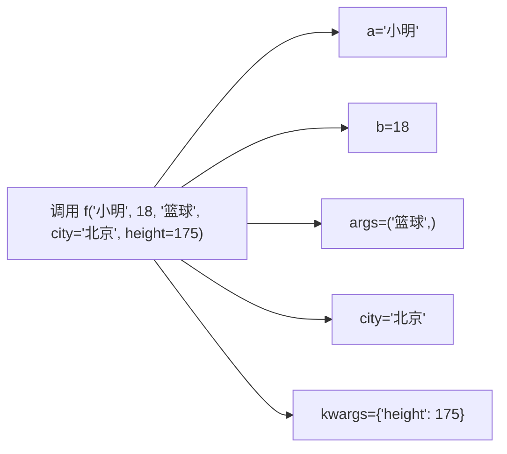

# PY-023 函数参数详解

## 1. 知识概览

| 项 | 内容 |
|---|---|
| 知识 ID | `PY-023` |
| 所属模块 | M-PY-03 函数、作用域与程序组织 |
| 学习难度 | L2 初级 |
| **预计学习时间** | 50 分钟 |
| 前置知识 | [[PY-009 函数]] |
| 学习目标 | 分清位置/关键字/默认/可变参数，会用 `*args`、`**kwargs` 与解包 |

## 2. 通俗原理讲解

函数参数像**点餐**：

- **位置参数**：按顺序说"一个汉堡、一杯可乐"——顺序错了就点错。
- **关键字参数**：说"汉堡一个、可乐一杯"——顺序无所谓，名字必须对。
- **默认参数**：套餐里默认配可乐，不想要才特别说明。
- **可变参数**：说"小吃随便来几样"——来几样都接（`*args`）；"饮料随便配"——配什么口味都行（`**kwargs`）。

一句话：**参数是函数对外的接口，接口设计好不好，决定别人用得顺不顺。**

## 3. 技术原理

**参数顺序（必须按此顺序写）**

```
def f(位置参数, 默认参数, *args, 仅关键字参数, **kwargs)
```

| 形式 | 写法 | 收到什么 |
|---|---|---|
| 位置参数 | `def f(a, b)` | 按顺序绑定 |
| 默认参数 | `def f(a, b=1)` | 不给就用默认值 |
| 可变位置 | `def f(*args)` | 元组 |
| 强制关键字 | `def f(*, a)` | 只能 `f(a=1)` 调用 |
| 可变关键字 | `def f(**kwargs)` | 字典 |

**两个必须记住的坑**

1. **默认参数只求值一次**：`def f(x=[])` 会在多次调用间共享同一个列表。
2. **解包**：`f(*lst)` 把列表拆成位置参数；`f(**d)` 把字典拆成关键字参数。

## 4. 图解辅助



同一个调用，参数按规则被分派到四个不同的"口袋"。

## 5. 完整代码示例

```powershell
python params_demo.py
```

```python
def describe(name, age=0, *hobbies, city="未知", **extra):
    print(f"姓名={name} 年龄={age} 城市={city} 爱好={hobbies} 其他={extra}")


describe("小明")
describe("小红", 18)
describe("小刚", 20, "篮球", "音乐", city="北京", height=175)


def add(a, b, c):
    return a + b + c


args = (1, 2, 3)
print(add(*args))

kwargs = {"a": 1, "b": 2, "c": 3}
print(add(**kwargs))
```

**预期输出**

```
姓名=小明 年龄=0 城市=未知 爱好=() 其他={}
姓名=小红 年龄=18 城市=未知 爱好=() 其他={}
姓名=小刚 年龄=20 城市=北京 爱好=('篮球', '音乐') 其他={'height': 175}
6
6
```

**说明**

- 第三个调用：`"篮球"`、`"音乐"` 被 `*hobbies` 收成元组；`city=` 是仅关键字参数；`height=175` 落进 `**extra`。
- `add(*args)` 与 `add(**kwargs)` 结果都是 6，说明解包只是"把容器摊开"。
- 注意 `city` 写在 `*hobbies` 之后，所以它是**仅关键字**参数，必须用 `city=` 传。

## 6. 实践练习

**基础**

1. 写 `greet(name, greeting="你好")`，分别用默认与自定义问候调用。
2. 写 `sum_all(*nums)` 返回所有数字之和，支持任意个数。
3. 用关键字参数调用一个三参数函数，故意打乱顺序。

**进阶**

1. 写 `create_user(**info)`，返回一个带默认值补全的字典（缺 `age` 补 0，缺 `city` 补 `"未知"`）。
2. 解释 `def f(x, lst=[])` 的陷阱，并给出正确写法。

**综合实践**

写一个"格式化输出"函数 `render(title, *items, sep=" | ", prefix="", suffix="")`，能接收任意数量条目并拼成一行；再写一个调用示例，把列表用 `*` 解包传进去。

## 7. 参考答案

**基础 1 · 思路**：第二个参数给默认值。

```python
def greet(name, greeting="你好"):
    return f"{greeting}，{name}！"

print(greet("小明"))
print(greet("小红", "早上好"))
```

运行结果：

```
你好，小明！
早上好，小红！
```

**基础 2 · 思路**：`*nums` 收成元组，直接 `sum`。

```python
def sum_all(*nums):
    return sum(nums)

print(sum_all(1, 2, 3), sum_all(), sum_all(10))
```

运行结果：`6 0 10`

**基础 3 · 思路**：关键字参数与顺序无关。

```python
def point(x, y, z):
    return (x, y, z)

print(point(z=3, x=1, y=2))
```

运行结果：`(1, 2, 3)`

**进阶 1 · 思路**：`dict.get` 补默认值。

```python
def create_user(**info):
    user = {"name": "匿名", "age": 0, "city": "未知"}
    user.update(info)
    return user

print(create_user(name="小明", city="北京"))
```

运行结果：`{'name': '小明', 'age': 0, 'city': '北京'}`

**进阶 2 · 思路**：默认值在定义时创建一次，多次调用共享。

```python
def bad(x, lst=[]):
    lst.append(x)
    return lst

print(bad(1), bad(2))


def good(x, lst=None):
    if lst is None:
        lst = []
    lst.append(x)
    return lst

print(good(1), good(2))
```

运行结果：

```
[1, 2] [1, 2]
[1] [2]
```

**综合实践 · 思路**：`*items` 收集，`sep.join` 拼接。

```python
def render(title, *items, sep=" | ", prefix="", suffix=""):
    body = sep.join(str(x) for x in items)
    return f"{prefix}{title}{sep}{body}{suffix}"

data = ["苹果", "香蕉", "橙子"]
print(render("水果", *data))
print(render("水果", *data, sep=", ", prefix="[", suffix="]"))
```

运行结果：

```
水果 | 苹果 | 香蕉 | 橙子
[水果, 苹果, 香蕉, 橙子]
```

## 8. 常见错误

| 错误写法 | 现象 | 原因 | 正确写法 |
|---|---|---|---|
| `def f(a=1, b)` | `SyntaxError` | 默认参数必须在后 | `def f(b, a=1)` |
| `f(*lst, **d)` 里键不存在 | `TypeError: unexpected keyword` | 字典键与形参不匹配 | 检查键名 |
| 默认参数用 `[]` / `{}` | 多次调用结果累积 | 定义时只创建一次 | 用 `None` 占位 |
| 给仅关键字参数用位置传 | `TypeError` | `*` 后必须用关键字 | `f(a=1)` |
| `kwargs` 里同名键冲突 | 覆盖前面的值 | 关键字重复 | 避免重复或显式合并 |

## 9. 知识关联

- **前置**：[[PY-009 函数]]
- **后继**：[[PY-024 局部变量与全局变量]]、[[PY-026 lambda 与高阶函数]]
- **相关数学**：无
- **所属模块**：`M-PY-03 函数、作用域与程序组织`

## 10. 学习记录

| 日期 | 状态 | 掌握程度 | 遇到的问题 | 个人总结 | 待复习 |
|---|---|---|---|---|---|
| — | planned | — | — | — | — |

---

## 🔗 Notion 同步信息

> 以下内容由 Notion「AI Knowledge System · 知识点」数据库按知识 ID 合并而来（导出于 2026-11-09）。

| 属性 | 值 |
|---|---|
| 学科 | Python基础 |
| 学习状态 | 未开始 |
| 难度 | L2 应用 |
| 知识类型 | Concept |
| 学习目标 | 分清位置/关键字/默认/可变参数，会用 *args、**kwargs 与解包。 |

- **所属模块**：[M-PY-03 函数、作用域与程序组织](../%E8%AF%BE%E7%A8%8B%E6%A8%A1%E5%9D%97/M-PY-03%20%E5%87%BD%E6%95%B0%E3%80%81%E4%BD%9C%E7%94%A8%E5%9F%9F%E4%B8%8E%E7%A8%8B%E5%BA%8F%E7%BB%84%E7%BB%87.md)
- **前置知识**：[PY-009 函数](PY-009%20%E5%87%BD%E6%95%B0.md)
- **后继知识**：[PY-024 局部变量与全局变量](PY-024%20%E5%B1%80%E9%83%A8%E5%8F%98%E9%87%8F%E4%B8%8E%E5%85%A8%E5%B1%80%E5%8F%98%E9%87%8F.md) · [PY-026 lambda 与高阶函数](PY-026%20lambda%20%E4%B8%8E%E9%AB%98%E9%98%B6%E5%87%BD%E6%95%B0.md) · [PY-030 类型注解](PY-030%20%E7%B1%BB%E5%9E%8B%E6%B3%A8%E8%A7%A3.md)
