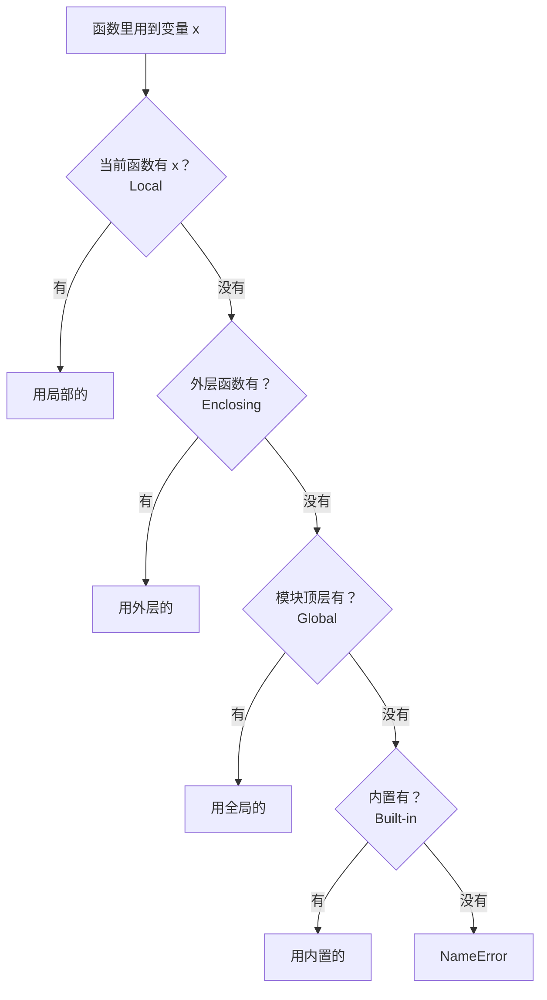

# PY-024 局部变量与全局变量

## 1. 知识概览

| 项 | 内容 |
|---|---|
| 知识 ID | `PY-024` |
| 所属模块 | M-PY-03 函数、作用域与程序组织 |
| 学习难度 | L2 初级 |
| **预计学习时间** | 45 分钟 |
| 前置知识 | [[PY-023 函数参数详解]] |
| 学习目标 | 理解 LEGB 查找规则、知道 `global` / `nonlocal` 的用途与危害 |

## 2. 通俗原理讲解

变量不是到处都能看见，它**住在某个房间里**：

- 函数内部定义的变量住在"局部房间"，外面看不到。
- 文件顶层定义的变量住在"全局房间"，函数能看见（可以读）。
- 想在函数里**修改**全局变量，必须明确声明 `global`——相当于"我要动楼上的东西"。

为什么这么设计？为了**防止意外互相干扰**：如果每个函数都能随手改全局变量，几十个函数一起改，bug 会像幽灵一样难找。

## 3. 技术原理

**LEGB 查找顺序**

| 层 | 名称 | 位置 |
|---|---|---|
| L | Local | 当前函数内部 |
| E | Enclosing | 外层嵌套函数 |
| G | Global | 模块顶层 |
| B | Built-in | Python 内置（`len`、`print`…） |

先找 L，找不到找 E，再找 G，最后 B；都没有就 `NameError`。

**三条规则**

1. **函数内赋值 = 创建局部变量**（除非声明 `global` / `nonlocal`）。
2. **读全局不需要声明**，赋值才需要。
3. `global` 改模块级变量；`nonlocal` 改外层函数变量（不跨越到全局）。

**为什么少用 `global`**：它让数据流不可追踪——你看到函数调用，无法从参数猜出它改了什么。更好的做法是**传参 + 返回值**。

## 4. 图解辅助



## 5. 完整代码示例

```powershell
python scope_demo.py
```

```python
count = 0


def increase():
    global count
    count += 1


increase()
increase()
print(count)


def read_only():
    print("读取全局:", count)


read_only()


def shadow():
    count = 100
    return count


print(shadow())
print(count)


def outer():
    x = 1

    def inner():
        nonlocal x
        x += 1
        return x

    return inner()


print(outer())
```

**预期输出**

```
2
读取全局: 2
100
2
2
```

**说明**

- `global count` 让 `increase` 能改模块级变量，所以打印 2。
- `read_only` 只是读，不需要声明。
- `shadow` 里的 `count = 100` 创建了**局部**变量，不影响全局，所以全局仍是 2。
- `nonlocal x` 让 `inner` 改外层函数的 `x`，返回 2。

## 6. 实践练习

**基础**

1. 在全局定义 `name = "小明"`，写函数打印它（不声明 global）。
2. 写函数把全局计数器加 1，调用三次后打印。
3. 在函数内定义同名变量并赋值，观察全局是否变化。

**进阶**

1. 不用 `global`，用"传参 + 返回"实现同样的计数器功能。
2. 解释下面的代码为什么报 `UnboundLocalError`：

```python
total = 0

def add():
    total = total + 1
    return total
```

**综合实践**

写一个"购物车"程序：不用任何全局变量，用函数 + 参数 + 返回值管理商品列表与总价（添加商品、计算总价、打印清单各一个函数）。

## 7. 参考答案

**基础 1 · 思路**：读全局无需声明。

```python
name = "小明"

def show():
    print(name)

show()
```

运行结果：`小明`

**基础 2 · 思路**：必须声明 `global` 才能改。

```python
count = 0

def inc():
    global count
    count += 1

inc(); inc(); inc()
print(count)
```

运行结果：`3`

**基础 3 · 思路**：函数内赋值创建局部变量，全局不变。

```python
value = 1

def change():
    value = 999

change()
print(value)
```

运行结果：`1`

**进阶 1 · 思路**：把状态当参数传入、当返回值传出。

```python
def inc(count):
    return count + 1

count = 0
for _ in range(3):
    count = inc(count)
print(count)
```

运行结果：`3`

**进阶 2 · 思路**：函数内一旦对 `total` 赋值，它就被判定为**局部变量**；但右侧先读 `total`，此时局部变量还没赋值 → `UnboundLocalError`。

修正：声明 `global total`，或改成传参返回。

**综合实践 · 思路**：状态集中在一个 dict/list，函数接收并返回它。

```python
def add_item(cart, name, price):
    cart.append({"name": name, "price": price})
    return cart

def total_price(cart):
    return sum(item["price"] for item in cart)

def show(cart):
    for item in cart:
        print(f"{item['name']}: {item['price']}")
    print("总计:", total_price(cart))

cart = []
add_item(cart, "苹果", 3.5)
add_item(cart, "香蕉", 2.0)
show(cart)
```

运行结果：

```
苹果: 3.5
香蕉: 2.0
总计: 5.5
```

## 8. 常见错误

| 错误写法 | 现象 | 原因 | 正确写法 |
|---|---|---|---|
| 函数内 `x += 1` 但外面有 `x` | `UnboundLocalError` | 赋值使 x 变局部 | 声明 `global` 或传参 |
| 到处用 `global` | 状态难追踪 | 副作用隐蔽 | 返回值传递 |
| 以为改列表要 `global` | 不必要 | 原地修改对象不需要重新绑定 | 直接 `append` |
| `nonlocal` 用在模块级 | `SyntaxError` | nonlocal 只针对外层函数 | 用 `global` |
| 同名变量遮蔽 | 结果与预期不符 | 就近原则 | 换名，避免重名 |

## 9. 知识关联

- **前置**：[[PY-023 函数参数详解]]
- **后继**：[[PY-025 闭包]]（闭包正是 E 层的典型应用）
- **相关数学**：无
- **所属模块**：`M-PY-03 函数、作用域与程序组织`

## 10. 学习记录

| 日期 | 状态 | 掌握程度 | 遇到的问题 | 个人总结 | 待复习 |
|---|---|---|---|---|---|
| — | planned | — | — | — | — |

---

## 🔗 Notion 同步信息

> 以下内容由 Notion「AI Knowledge System · 知识点」数据库按知识 ID 合并而来（导出于 2026-11-09）。

| 属性 | 值 |
|---|---|
| 学科 | Python基础 |
| 学习状态 | 未开始 |
| 难度 | L2 应用 |
| 知识类型 | Concept |
| 学习目标 | 理解 LEGB 查找规则，知道 global / nonlocal 的用途与危害。 |

- **所属模块**：[M-PY-03 函数、作用域与程序组织](../%E8%AF%BE%E7%A8%8B%E6%A8%A1%E5%9D%97/M-PY-03%20%E5%87%BD%E6%95%B0%E3%80%81%E4%BD%9C%E7%94%A8%E5%9F%9F%E4%B8%8E%E7%A8%8B%E5%BA%8F%E7%BB%84%E7%BB%87.md)
- **前置知识**：[PY-023 函数参数详解](PY-023%20%E5%87%BD%E6%95%B0%E5%8F%82%E6%95%B0%E8%AF%A6%E8%A7%A3.md)
- **后继知识**：[PY-025 闭包](PY-025%20%E9%97%AD%E5%8C%85.md)
