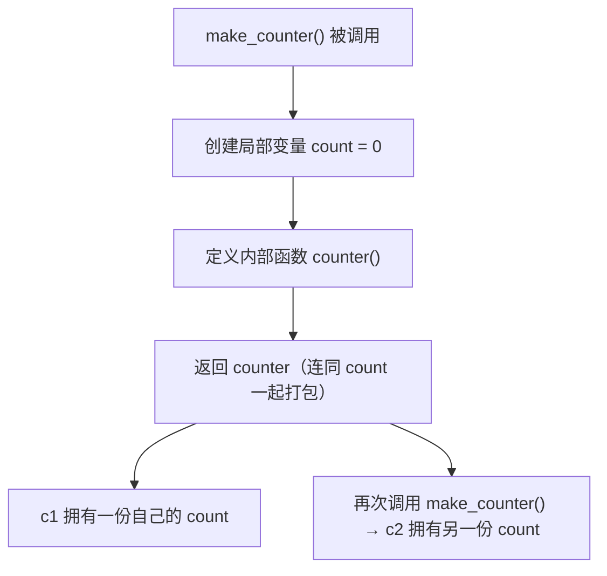

# PY-025 闭包

## 1. 知识概览

| 项 | 内容 |
|---|---|
| 知识 ID | `PY-025` |
| 所属模块 | M-PY-03 函数、作用域与程序组织 |
| 学习难度 | L3 中级 |
| **预计学习时间** | 55 分钟 |
| 前置知识 | [[PY-024 局部变量与全局变量]] |
| 学习目标 | 理解"函数记住定义时的环境"、能写计数器与工厂函数、知道闭包的内存影响 |

## 2. 通俗原理讲解

闭包像**带记忆的便签本**：

- 你写了一个小函数，它需要用到外面的一些数据。
- 正常情况外层函数一结束，局部变量就该消失了。
- 但因为内层函数还在用它们，Python 会**把这些变量打包带走**，跟函数绑在一起。

于是你得到一个"自带环境"的函数：**不靠全局变量，也能记住上次的状态**。

## 3. 技术原理

**闭包三要素**

1. 有嵌套函数（内层定义在外层里）。
2. 内层函数**引用了外层的变量**。
3. 外层函数**返回内层函数**（而不是调用它）。

此时外层变量被保存在内层函数的 `__closure__` 里，每个函数实例各有一份。

**关键点**

| 点 | 说明 |
|---|---|
| 变量归属 | 存在"单元格（cell）"里，随函数对象存活 |
| 修改外层变量 | 需要 `nonlocal` |
| 多次调用外层 | 每次得到**独立**的闭包实例 |
| 内存 | 闭包持有可能很大的对象，注意别无意中拖住大列表 |
| 与类对比 | 简单状态用闭包，复杂状态用类 |

**经典坑：循环变量延迟绑定**

```python
funcs = [lambda: i for i in range(3)]
print([f() for f in funcs])   # [2, 2, 2]
```

因为三个 lambda 共享同一个 `i`，调用时循环早已结束，`i` 是 2。修法：用默认参数 `lambda i=i: i`。

## 4. 图解辅助



c1 与 c2 互不影响，这就是"两次调用得到两个独立计数器"。

## 5. 完整代码示例

```powershell
python closure_demo.py
```

```python
def make_counter():
    count = 0

    def counter():
        nonlocal count
        count += 1
        return count

    return counter


c1 = make_counter()
c2 = make_counter()
print(c1(), c1(), c1())
print(c2())


def make_multiplier(n):
    def mul(x):
        return x * n

    return mul


double = make_multiplier(2)
triple = make_multiplier(3)
print(double(5), triple(5))
print(double.__closure__[0].cell_contents)
```

**预期输出**

```
1 2 3
1
10 15
2
```

**说明**

- `c1` 与 `c2` 是两次调用 `make_counter()` 的产物，`count` 各自独立：`c1` 数到 3 时 `c2` 才 1。
- `make_multiplier(2)` 返回的函数"记住"了 `n = 2`，所以 `double(5) = 10`。
- `__closure__[0].cell_contents` 能直接看到被打包的值（仅用于理解，生产代码不要这么写）。

## 6. 实践练习

**基础**

1. 写 `make_adder(n)`，返回一个"加 n"的函数，分别造出"加 1"和"加 10"。
2. 用闭包实现一个只能递增的计数器，调用三次打印 1、2、3。
3. 判断：同一个 `make_counter()` 返回的两个函数是否共享计数？

**进阶**

1. 写 `make_logger(prefix)`，返回的函数打印 `[prefix] 消息`。
2. 解释并修复循环闭包问题：`funcs = [lambda: i for i in range(3)]`。

**综合实践**

写一个"限流器"：`make_limiter(max_calls)` 返回一个函数，内部计数，超过 `max_calls` 次后返回 `False`，否则返回 `True`。

## 7. 参考答案

**基础 1 · 思路**：外层参数 `n` 被内层引用。

```python
def make_adder(n):
    def add(x):
        return x + n
    return add

add1 = make_adder(1)
add10 = make_adder(10)
print(add1(5), add10(5))
```

运行结果：`6 15`

**基础 2 · 思路**：`nonlocal` + 计数。

```python
def make_counter():
    count = 0
    def counter():
        nonlocal count
        count += 1
        return count
    return counter

c = make_counter()
print(c(), c(), c())
```

运行结果：`1 2 3`

**基础 3 · 思路**：每次调用外层都新建局部变量。

答案：**不共享**，各自独立。

**进阶 1 · 思路**：外层保存前缀。

```python
def make_logger(prefix):
    def log(msg):
        print(f"[{prefix}] {msg}")
    return log

info = make_logger("INFO")
info("开始运行")
```

运行结果：`[INFO] 开始运行`

**进阶 2 · 思路**：三个 lambda 共享同一个 `i`；用默认参数在定义时捕获当前值。

```python
funcs = [lambda i=i: i for i in range(3)]
print([f() for f in funcs])
```

运行结果：`[0, 1, 2]`

**综合实践 · 思路**：闭包持有计数，超过阈值返回 False。

```python
def make_limiter(max_calls):
    used = 0
    def allow():
        nonlocal used
        if used >= max_calls:
            return False
        used += 1
        return True
    return allow

allow = make_limiter(2)
print(allow(), allow(), allow())
```

运行结果：

```
True True False
```

## 8. 常见错误

| 错误写法 | 现象 | 原因 | 正确写法 |
|---|---|---|---|
| 内层直接 `count += 1` | `UnboundLocalError` | 没声明 nonlocal | 加 `nonlocal count` |
| 循环里创建闭包 | 全部拿到最后一个值 | 延迟绑定 | 用默认参数捕获 |
| 以为每次调用外层共享状态 | 计数从 1 开始 | 每次新建 | 只调用一次外层 |
| 闭包持有大列表 | 内存不释放 | 引用未断 | 用完置空或改用类 |
| 用闭包替代明显该用类的地方 | 越写越绕 | 状态多、行为多 | 用类 |

## 9. 知识关联

- **前置**：[[PY-024 局部变量与全局变量]]
- **后继**：[[PY-029 装饰器]]（装饰器就是闭包的典型应用）
- **相关数学**：无
- **所属模块**：`M-PY-03 函数、作用域与程序组织`

## 10. 学习记录

| 日期 | 状态 | 掌握程度 | 遇到的问题 | 个人总结 | 待复习 |
|---|---|---|---|---|---|
| — | planned | — | — | — | — |

---

## 🔗 Notion 同步信息

> 以下内容由 Notion「AI Knowledge System · 知识点」数据库按知识 ID 合并而来（导出于 2026-11-09）。

| 属性 | 值 |
|---|---|
| 学科 | Python基础 |
| 学习状态 | 未开始 |
| 难度 | L3 推导 |
| 知识类型 | Concept |
| 学习目标 | 理解函数记住定义时环境，能写计数器与工厂函数。 |

- **所属模块**：[M-PY-03 函数、作用域与程序组织](../%E8%AF%BE%E7%A8%8B%E6%A8%A1%E5%9D%97/M-PY-03%20%E5%87%BD%E6%95%B0%E3%80%81%E4%BD%9C%E7%94%A8%E5%9F%9F%E4%B8%8E%E7%A8%8B%E5%BA%8F%E7%BB%84%E7%BB%87.md)
- **前置知识**：[PY-024 局部变量与全局变量](PY-024%20%E5%B1%80%E9%83%A8%E5%8F%98%E9%87%8F%E4%B8%8E%E5%85%A8%E5%B1%80%E5%8F%98%E9%87%8F.md)
- **后继知识**：[PY-029 装饰器](PY-029%20%E8%A3%85%E9%A5%B0%E5%99%A8.md)
