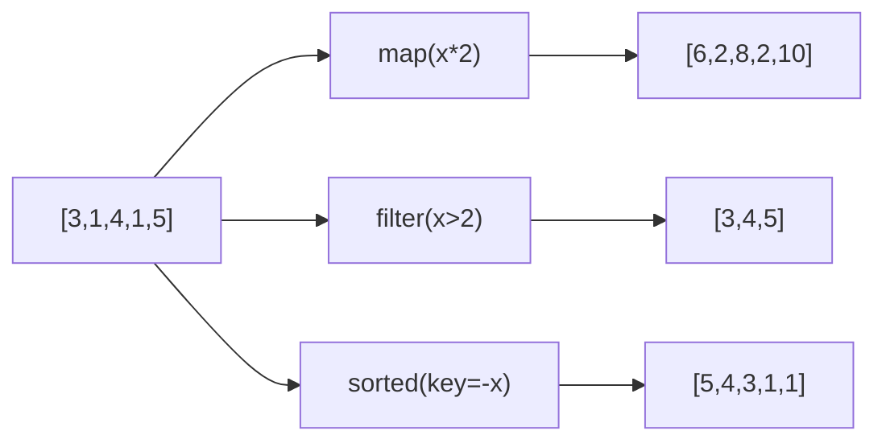

# PY-026 lambda 与高阶函数

## 1. 知识概览

| 项 | 内容 |
|---|---|
| 知识 ID | `PY-026` |
| 所属模块 | M-PY-03 函数、作用域与程序组织 |
| 学习难度 | L2 初级 |
| **预计学习时间** | 45 分钟 |
| 前置知识 | [[PY-023 函数参数详解]] |
| 学习目标 | 会用 lambda 写短函数、理解"函数可作为参数"、掌握 map/filter/sorted key |

## 2. 通俗原理讲解

**lambda** 是"一次性的小函数"：用完就扔，不占名字。

```python
def add(a, b):        # 普通函数，有名字
    return a + b

add2 = lambda a, b: a + b    # 匿名函数，赋给变量才有名字
```

**高阶函数**指"接收函数作为参数"或"返回函数"的函数。生活类比：**洗衣机接受"洗衣模式"这个参数**——同样的机器，换个模式就干不同的活。

## 3. 技术原理

| 工具 | 作用 | 返回 |
|---|---|---|
| `lambda args: expr` | 定义单表达式函数 | 函数对象 |
| `map(f, it)` | 对每个元素应用 f | 迭代器（需 `list()` 查看） |
| `filter(f, it)` | 保留 f 为真的元素 | 迭代器 |
| `sorted(it, key=f)` | 按 f 的返回值排序 | 新列表 |
| `functools.reduce(f, it)` | 累积归约 | 单个值 |

**何时用 lambda**：只在一处使用、逻辑一行能写清。**何时不用**：需要多行、需要注释、需要复用——那就用 `def`，可读性优先。

**注意**：`map`/`filter` 返回的是**迭代器**，只能遍历一次；需要列表要显式 `list()`。

## 4. 图解辅助



同一个列表，三种高阶操作得到三种结果。

## 5. 完整代码示例

```powershell
python lambda_demo.py
```

```python
add = lambda a, b: a + b
print(add(2, 3))

nums = [3, 1, 4, 1, 5]
print(sorted(nums, key=lambda x: -x))
print(list(map(lambda x: x * 2, nums)))
print(list(filter(lambda x: x > 2, nums)))


def apply_twice(f, x):
    return f(f(x))


print(apply_twice(lambda x: x + 3, 10))

from functools import reduce

print(reduce(lambda a, b: a * b, [1, 2, 3, 4]))
```

**预期输出**

```
5
[5, 4, 3, 1, 1]
[6, 2, 8, 2, 10]
[3, 4, 5]
16
24
```

**说明**

- `sorted(key=lambda x: -x)` 等价于 `reverse=True`，但演示了"按计算出的值排序"。
- `apply_twice(f, 10)` 把函数当参数传进去，`f(f(10)) = 16`。
- `reduce` 把 `[1,2,3,4]` 依次累乘得 24。

## 6. 实践练习

**基础**

1. 用 lambda 写"判断偶数"的函数并调用。
2. 用 `sorted` + `key` 按字符串长度排序 `["apple", "fig", "banana"]`。
3. 用 `map` 把 `[1,2,3]` 变成 `["1","2","3"]`（字符串）。

**进阶**

1. 用 `filter` 从 `[1,2,3,4,5,6]` 中筛出能被 3 整除的数。
2. 用 `sorted` 对 `[("小明",85),("小红",92)]` 按分数降序排。

**综合实践**

写一个"通用排序器"：`sort_by(records, key_func, reverse=False)`，用高阶函数实现；然后用它分别按姓名、按分数、按分数降序排序同一批学生数据。

## 7. 参考答案

**基础 1 · 思路**：单表达式。

```python
is_even = lambda n: n % 2 == 0
print(is_even(4), is_even(7))
```

运行结果：`True False`

**基础 2 · 思路**：`key=len`。

```python
print(sorted(["apple", "fig", "banana"], key=len))
```

运行结果：`['fig', 'apple', 'banana']`

**基础 3 · 思路**：`map(str, ...)`。

```python
print(list(map(str, [1, 2, 3])))
```

运行结果：`['1', '2', '3']`

**进阶 1 · 思路**：取模判断。

```python
print(list(filter(lambda x: x % 3 == 0, [1, 2, 3, 4, 5, 6])))
```

运行结果：`[3, 6]`

**进阶 2 · 思路**：`key=lambda r: r[1]` + `reverse`。

```python
data = [("小明", 85), ("小红", 92)]
print(sorted(data, key=lambda r: r[1], reverse=True))
```

运行结果：`[('小红', 92), ('小明', 85)]`

**综合实践 · 思路**：把"排序依据"作为参数传入。

```python
def sort_by(records, key_func, reverse=False):
    return sorted(records, key=key_func, reverse=reverse)

students = [("小明", 85), ("小红", 92), ("小刚", 78)]
print(sort_by(students, lambda r: r[0]))
print(sort_by(students, lambda r: r[1]))
print(sort_by(students, lambda r: r[1], reverse=True))
```

运行结果：

```
[('小刚', 78), ('小明', 85), ('小红', 92)]
[('小刚', 78), ('小明', 85), ('小红', 92)]
[('小红', 92), ('小明', 85), ('小刚', 78)]
```

## 8. 常见错误

| 错误写法 | 现象 | 原因 | 正确写法 |
|---|---|---|---|
| `map(f, lst)` 后直接打印 | 看到 `<map object>` | 返回迭代器 | `list(map(...))` |
| 把 `map` 结果遍历两次 | 第二次为空 | 迭代器一次性 | 先转 list |
| lambda 里写多行语句 | `SyntaxError` | lambda 只能是单表达式 | 用 `def` |
| lambda 里做赋值 | `SyntaxError` | 不支持语句 | 用普通函数 |
| 嵌套 lambda 过深 | 难读难调 | 可读性差 | 改用 `def` |

## 9. 知识关联

- **前置**：[[PY-023 函数参数详解]]
- **后继**：[[PY-029 装饰器]]（高阶函数的典型应用）
- **相关数学**：无
- **所属模块**：`M-PY-03 函数、作用域与程序组织`

## 10. 学习记录

| 日期 | 状态 | 掌握程度 | 遇到的问题 | 个人总结 | 待复习 |
|---|---|---|---|---|---|
| — | planned | — | — | — | — |

---

## 🔗 Notion 同步信息

> 以下内容由 Notion「AI Knowledge System · 知识点」数据库按知识 ID 合并而来（导出于 2026-11-09）。

| 属性 | 值 |
|---|---|
| 学科 | Python基础 |
| 学习状态 | 未开始 |
| 难度 | L2 应用 |
| 知识类型 | Concept |
| 学习目标 | 会用 lambda 写短函数，掌握 map/filter/sorted key。 |

- **所属模块**：[M-PY-03 函数、作用域与程序组织](../%E8%AF%BE%E7%A8%8B%E6%A8%A1%E5%9D%97/M-PY-03%20%E5%87%BD%E6%95%B0%E3%80%81%E4%BD%9C%E7%94%A8%E5%9F%9F%E4%B8%8E%E7%A8%8B%E5%BA%8F%E7%BB%84%E7%BB%87.md)
- **前置知识**：[PY-023 函数参数详解](PY-023%20%E5%87%BD%E6%95%B0%E5%8F%82%E6%95%B0%E8%AF%A6%E8%A7%A3.md)
