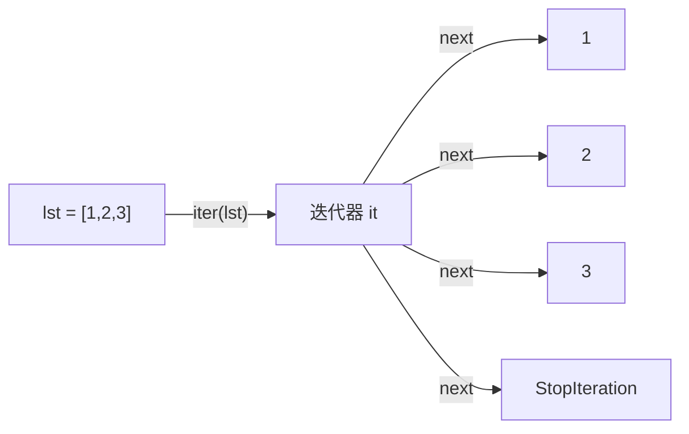

# PY-027 迭代器

## 1. 知识概览

| 项 | 内容 |
|---|---|
| 知识 ID | `PY-027` |
| 所属模块 | M-PY-03 函数、作用域与程序组织 |
| 学习难度 | L2 初级 |
| **预计学习时间** | 45 分钟 |
| 前置知识 | [[PY-009 函数]] |
| 学习目标 | 分清"可迭代对象"与"迭代器"、会用 `iter`/`next`、能手写一个迭代器类 |

## 2. 通俗原理讲解

迭代器像**抽纸盒**：

- 你把手伸进去抽一张（`next`），拿出来一张。
- 抽完了再抽，盒子里没有了（`StopIteration`）。
- 抽纸盒**不会被重置**——抽过就是抽过了。

所以迭代器只能"走一遍"。而列表是"可反复翻阅的书"（可迭代对象），每次 `for` 都会重新开始。

## 3. 技术原理

| 概念 | 定义 | 例子 |
|---|---|---|
| 可迭代对象 Iterable | 能用 `for` 遍历 | `list`、`str`、`dict`、`range` |
| 迭代器 Iterator | 有 `__next__`，能逐个产出 | `iter([1,2,3])`、生成器 |
| `iter(x)` | 取迭代器 | 对 list 调用得到新迭代器 |
| `next(it)` | 取下一个 | 到头抛 `StopIteration` |

**协议**：一个对象只要实现了 `__iter__` 返回自身、`__next__` 返回下一个值（结束时 `raise StopIteration`），它就是迭代器。

**关键区别**

- 列表是 Iterable 但**不是** Iterator（它没有 `__next__`）。
- `for x in obj` 背后做的是：`it = iter(obj)`，然后反复 `next(it)` 直到 `StopIteration`。

## 4. 图解辅助



注意：`iter(lst)` 每次调用都得到**新的**迭代器，所以 `for` 可以反复跑；但对同一个 `it` 再 `next` 就没有了。

## 5. 完整代码示例

```powershell
python iterator_demo.py
```

```python
nums = [1, 2, 3]
it = iter(nums)
print(next(it), next(it), next(it))
try:
    next(it)
except StopIteration:
    print("迭代结束")


class Countdown:
    def __init__(self, start):
        self.current = start

    def __iter__(self):
        return self

    def __next__(self):
        if self.current <= 0:
            raise StopIteration
        value = self.current
        self.current -= 1
        return value


for x in Countdown(3):
    print(x)

print(list(Countdown(2)))
```

**预期输出**

```
1 2 3
迭代结束
3
2
1
[2, 1]
```

**说明**

- `next(it)` 连取三次得到 1、2、3；第四次抛 `StopIteration`，被 `except` 捕获。
- `Countdown` 把 `__iter__` 返回自身（所以它既是可迭代对象也是迭代器），`__next__` 负责递减。
- `list(Countdown(2))` 一次性抽干，得到 `[2, 1]`。

## 6. 实践练习

**基础**

1. 用 `iter` 与 `next` 手动遍历 `"abc"`，打印每个字符。
2. 判断 `[1,2,3]` 是不是迭代器（用 `hasattr(x, '__next__')` 验证）。
3. 用 `for` 遍历同一个 `iter([1,2])` 两次，观察第二次是否有输出。

**进阶**

1. 写一个 `Range` 类，实现 `range(start, stop)` 的简化版。
2. 解释为什么 `for x in [1,2,3]` 可以反复执行，而 `for x in it` 第二次没输出。

**综合实践**

写一个 `Take` 迭代器：包装任意可迭代对象，只允许取前 n 个元素，取完自动停止。

## 7. 参考答案

**基础 1 · 思路**：`iter` + 循环 `next` 直到异常。

```python
s = "abc"
it = iter(s)
while True:
    try:
        print(next(it))
    except StopIteration:
        break
```

运行结果：

```
a
b
c
```

**基础 2 · 思路**：列表没有 `__next__`。

```python
print(hasattr([1, 2, 3], "__next__"))
print(hasattr(iter([1, 2, 3]), "__next__"))
```

运行结果：

```
False
True
```

**基础 3 · 思路**：迭代器只能走一遍。

```python
it = iter([1, 2])
for x in it:
    print("第一次", x)
for x in it:
    print("第二次", x)
```

运行结果：只有 `第一次 1`、`第一次 2`，第二次无输出。

**进阶 1 · 思路**：用 `self.current` 记录位置。

```python
class MyRange:
    def __init__(self, start, stop):
        self.current = start
        self.stop = stop

    def __iter__(self):
        return self

    def __next__(self):
        if self.current >= self.stop:
            raise StopIteration
        v = self.current
        self.current += 1
        return v

print(list(MyRange(1, 5)))
```

运行结果：`[1, 2, 3, 4]`

**进阶 2 · 思路**：`for` 每次都对**对象**调用 `iter()`；列表每次给出新迭代器，而迭代器 `iter(it) is it`，位置不会重置。

**综合实践 · 思路**：包装源迭代器，计数到 n 就停。

```python
class Take:
    def __init__(self, iterable, n):
        self.it = iter(iterable)
        self.left = n

    def __iter__(self):
        return self

    def __next__(self):
        if self.left <= 0:
            raise StopIteration
        self.left -= 1
        return next(self.it)

print(list(Take(range(100), 3)))
```

运行结果：`[0, 1, 2]`

## 8. 常见错误

| 错误写法 | 现象 | 原因 | 正确写法 |
|---|---|---|---|
| 对同一个迭代器 `for` 两次 | 第二次空 | 已耗尽 | 重新 `iter()` 或改用列表 |
| 把迭代器当列表反复用 | 数据"消失" | 一次性 | 需要复用就 `list()` |
| 自定义类只写 `__next__` | `for` 报错 | 缺 `__iter__` | 两个都实现 |
| 在 `__next__` 里返回值后忘记推进 | 死循环 | 状态没变 | 每次修改 `current` |
| 捕获所有异常代替 `StopIteration` | 掩盖真实错误 | 过度捕获 | 只捕 `StopIteration` |

## 9. 知识关联

- **前置**：[[PY-009 函数]]
- **后继**：[[PY-028 生成器]]（生成器就是写迭代器的省事方式）
- **相关数学**：无
- **所属模块**：`M-PY-03 函数、作用域与程序组织`

## 10. 学习记录

| 日期 | 状态 | 掌握程度 | 遇到的问题 | 个人总结 | 待复习 |
|---|---|---|---|---|---|
| — | planned | — | — | — | — |

---

## 🔗 Notion 同步信息

> 以下内容由 Notion「AI Knowledge System · 知识点」数据库按知识 ID 合并而来（导出于 2026-11-09）。

| 属性 | 值 |
|---|---|
| 学科 | Python基础 |
| 学习状态 | 未开始 |
| 难度 | L2 应用 |
| 知识类型 | Concept |
| 学习目标 | 分清可迭代对象与迭代器，能手写一个迭代器类。 |

- **所属模块**：[M-PY-03 函数、作用域与程序组织](../%E8%AF%BE%E7%A8%8B%E6%A8%A1%E5%9D%97/M-PY-03%20%E5%87%BD%E6%95%B0%E3%80%81%E4%BD%9C%E7%94%A8%E5%9F%9F%E4%B8%8E%E7%A8%8B%E5%BA%8F%E7%BB%84%E7%BB%87.md)
- **前置知识**：[PY-009 函数](PY-009%20%E5%87%BD%E6%95%B0.md)
- **后继知识**：[PY-028 生成器](PY-028%20%E7%94%9F%E6%88%90%E5%99%A8.md)
