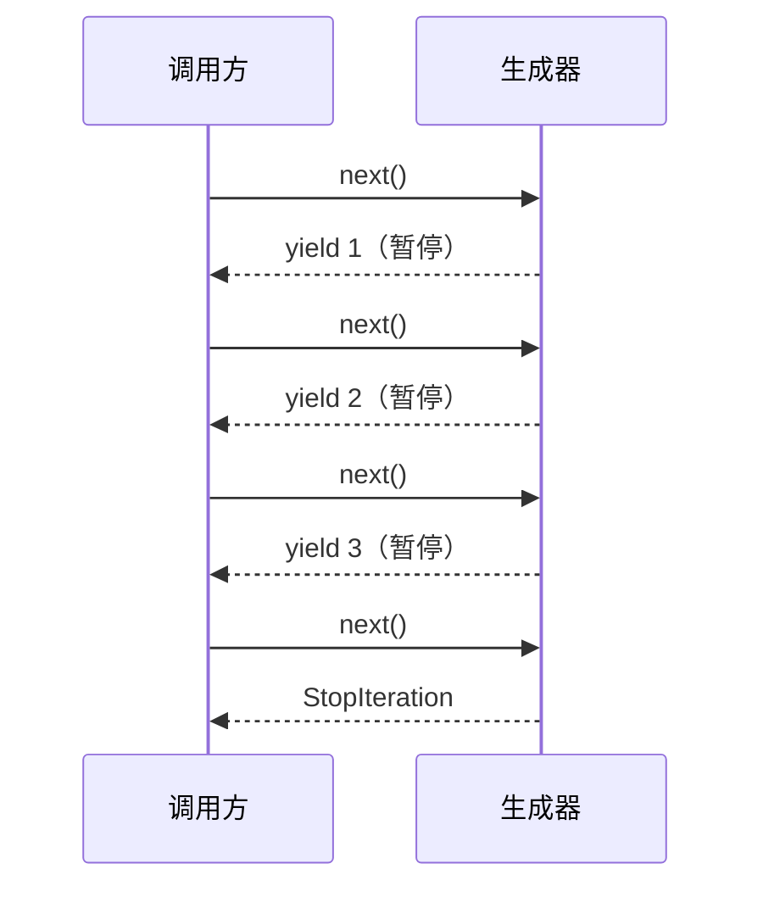

# PY-028 生成器

## 1. 知识概览

| 项 | 内容 |
|---|---|
| 知识 ID | `PY-028` |
| 所属模块 | M-PY-03 函数、作用域与程序组织 |
| 学习难度 | L3 中级 |
| **预计学习时间** | 50 分钟 |
| 前置知识 | [[PY-027 迭代器]] |
| 学习目标 | 会用 `yield` 写生成器、理解惰性求值、知道它为什么省内存 |

## 2. 通俗原理讲解

普通函数是**一次做完**：调用 → 算完 → 返回结果 → 结束。

生成器是**做一点、停一下**：遇到 `yield` 就把值交出去，**暂停**在原地；下次再要，就从暂停处继续。

生活类比：

- 普通函数 = 把一整锅饭端上桌。
- 生成器 = 自助餐，你要一份盛一份，厨房不用一次做完全部。

## 3. 技术原理

| 对比 | 列表 | 生成器 |
|---|---|---|
| 内存 | 一次性存全部 | 只存当前状态 |
| 求值 | 立即 | 惰性（用到才算） |
| 可重复遍历 | 可以 | 只能一次 |
| 写法 | `[f(x) for x in ...]` | `(f(x) for x in ...)` 或 `yield` |

**`yield` 的三个语义**

1. 产出值给调用方。
2. 函数**暂停**，保留局部变量。
3. 下一次 `next()` 从暂停处继续。

**什么时候用**：数据量大、只需顺序处理一次、或数据是"算出来比存起来便宜"（读大文件、流式处理、无限序列）。

**常见用法**：`for line in open(...)` 本身就是惰性读取；`sum(x*x for x in range(10**6))` 不建大列表。

## 4. 图解辅助



每次 `next` 只推进一格，中间状态被保留。

## 5. 完整代码示例

```powershell
python generator_demo.py
```

```python
def count_up(n):
    i = 1
    while i <= n:
        yield i
        i += 1


g = count_up(3)
print(next(g))
print(list(g))

gen = (x * x for x in range(5))
print(list(gen))


def read_chunks(items, size=2):
    for i in range(0, len(items), size):
        yield items[i:i + size]


for chunk in read_chunks([1, 2, 3, 4, 5]):
    print(chunk)

import sys

list_version = [x for x in range(1000)]
gen_version = (x for x in range(1000))
print(sys.getsizeof(list_version) > sys.getsizeof(gen_version))
```

**预期输出**

```
1
[2, 3]
[0, 1, 4, 9, 16]
[1, 2]
[3, 4]
[5]
True
```

**说明**

- `next(g)` 取到 1 后生成器**暂停**；`list(g)` 继续取剩下的 2、3（不是从头）。
- 生成器表达式用圆括号，不建列表。
- `read_chunks` 按固定大小切块，适合分批上传/处理。
- `getsizeof` 证明：列表占的内存远大于生成器对象本身。

## 6. 实践练习

**基础**

1. 写生成器 `evens(n)`，依次产出 0 到 n 的偶数。
2. 用生成器表达式求 1–100 的平方和。
3. 判断：生成器能否用 `len()`？为什么？

**进阶**

1. 写 `fib_gen()` 无限产出斐波那契数列，用 `islice` 取前 10 个。
2. 解释 `sum(x for x in range(10**7))` 为什么不会爆内存。

**综合实践**

写一个"日志分批处理器"：生成器按 100 行一批读取一个大文本文件，统计每批的行数并打印，最后输出总行数（先用代码生成一个 250 行的临时文件）。

## 7. 参考答案

**基础 1 · 思路**：循环 `yield` 偶数。

```python
def evens(n):
    for x in range(n + 1):
        if x % 2 == 0:
            yield x

print(list(evens(6)))
```

运行结果：`[0, 2, 4, 6]`

**基础 2 · 思路**：生成器表达式直接喂给 `sum`。

```python
print(sum(x * x for x in range(1, 101)))
```

运行结果：`338350`

**基础 3 · 思路**：生成器没有预先知道长度。

答案：不能。`len()` 需要已知长度，生成器是惰性的，元素还没算出来。

**进阶 1 · 思路**：`while True` + `yield`，用 `itertools.islice` 截取。

```python
from itertools import islice

def fib_gen():
    a, b = 0, 1
    while True:
        yield a
        a, b = b, a + b

print(list(islice(fib_gen(), 10)))
```

运行结果：`[0, 1, 1, 2, 3, 5, 8, 13, 21, 34]`

**进阶 2 · 思路**：`sum` 每次只向生成器要一个值，算完即弃，不保留中间结果。

**综合实践 · 思路**：生成器按块读，主程序逐块统计。

```python
from pathlib import Path

p = Path("demo_log.txt")
p.write_text("\n".join(f"line {i}" for i in range(250)), encoding="utf-8")

def read_chunks(path, size=100):
    batch = []
    with path.open(encoding="utf-8") as f:
        for line in f:
            batch.append(line.rstrip("\n"))
            if len(batch) == size:
                yield batch
                batch = []
    if batch:
        yield batch

total = 0
for i, chunk in enumerate(read_chunks(p), start=1):
    print(f"第 {i} 批：{len(chunk)} 行")
    total += len(chunk)
print("总计:", total)

p.unlink()
```

运行结果：

```
第 1 批：100 行
第 2 批：100 行
第 3 批：50 行
总计: 250
```

## 8. 常见错误

| 错误写法 | 现象 | 原因 | 正确写法 |
|---|---|---|---|
| 生成器函数里用 `return 值` | 拿到 `StopIteration`，值丢了 | 生成器用 `yield` | 改成 `yield` |
| 对同一生成器遍历两次 | 第二次空 | 一次性 | 重新创建生成器 |
| 以为生成器表达式是元组 | 拿到 `<generator>` | 圆括号是生成器 | 要元组用 `tuple(...)` |
| 生成器里做重 IO 却忘了关闭资源 | 文件句柄泄漏 | 未用 `with` | 生成器内用 `with` |
| 把生成器传给需要 `len` 的函数 | `TypeError` | 无长度 | 先 `list()`（注意内存） |

## 9. 知识关联

- **前置**：[[PY-027 迭代器]]
- **后继**：[[PY-029 装饰器]]、`PY-041 文件读写`（大文件流式读，待建）
- **相关数学**：无
- **所属模块**：`M-PY-03 函数、作用域与程序组织`

## 10. 学习记录

| 日期 | 状态 | 掌握程度 | 遇到的问题 | 个人总结 | 待复习 |
|---|---|---|---|---|---|
| — | planned | — | — | — | — |

---

## 🔗 Notion 同步信息

> 以下内容由 Notion「AI Knowledge System · 知识点」数据库按知识 ID 合并而来（导出于 2026-11-09）。

| 属性 | 值 |
|---|---|
| 学科 | Python基础 |
| 学习状态 | 未开始 |
| 难度 | L3 推导 |
| 知识类型 | Concept |
| 学习目标 | 会用 yield 写生成器，理解惰性求值与省内存。 |

- **所属模块**：[M-PY-03 函数、作用域与程序组织](../%E8%AF%BE%E7%A8%8B%E6%A8%A1%E5%9D%97/M-PY-03%20%E5%87%BD%E6%95%B0%E3%80%81%E4%BD%9C%E7%94%A8%E5%9F%9F%E4%B8%8E%E7%A8%8B%E5%BA%8F%E7%BB%84%E7%BB%87.md)
- **前置知识**：[PY-027 迭代器](PY-027%20%E8%BF%AD%E4%BB%A3%E5%99%A8.md)
- **后继知识**：[PY-057 异步编程基础](../06%20%E6%A8%A1%E5%9D%97%E4%B8%8E%E5%8C%85/PY-057%20%E5%BC%82%E6%AD%A5%E7%BC%96%E7%A8%8B%E5%9F%BA%E7%A1%80.md)
