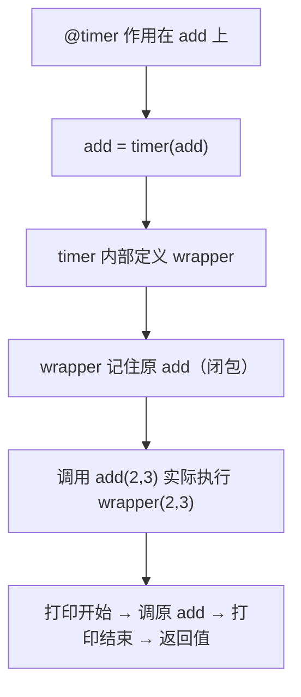

# PY-029 装饰器

## 1. 知识概览

| 项 | 内容 |
|---|---|
| 知识 ID | `PY-029` |
| 所属模块 | M-PY-03 函数、作用域与程序组织 |
| 学习难度 | L3 中级 |
| **预计学习时间** | 60 分钟 |
| 前置知识 | [[PY-025 闭包]] |
| 学习目标 | 理解 `@` 的本质、能写无参/带参装饰器、知道为什么要 `functools.wraps` |

## 2. 通俗原理讲解

装饰器像**给手机套壳**：

- 手机还是那个手机（原函数不变）。
- 套上壳后多了功能（防摔、支架）。
- 你拿到的仍是"手机"，只是行为被增强了。

技术上它就是**接收一个函数、返回一个新函数**的函数——正是闭包的应用。

```text
@decorator
def f(): ...
# 等价于
f = decorator(f)
```

## 3. 技术原理

**最小装饰器结构**

```python
def my_decorator(func):
    def wrapper(*args, **kwargs):
        # 前置
        result = func(*args, **kwargs)
        # 后置
        return result
    return wrapper
```

**为什么用 `*args, **kwargs`**：装饰器要能套住任意签名的函数，必须原样转发参数。

**为什么要 `functools.wraps`**：不用它，`f.__name__` 会变成 `"wrapper"`，文档、调试、日志全乱。

**带参数的装饰器**：需要三层——`decorator_factory(参数)` → `decorator(func)` → `wrapper`。

**常见用途**：计时、日志、重试、缓存（`lru_cache`）、权限校验、事务。

## 4. 图解辅助



## 5. 完整代码示例

```powershell
python decorator_demo.py
```

```python
import functools


def timer(func):
    @functools.wraps(func)
    def wrapper(*args, **kwargs):
        print(f"开始执行 {func.__name__}")
        result = func(*args, **kwargs)
        print(f"结束执行 {func.__name__}")
        return result

    return wrapper


@timer
def add(a, b):
    return a + b


print(add(2, 3))
print(add.__name__)


def repeat(times):
    def decorator(func):
        @functools.wraps(func)
        def wrapper(*args, **kwargs):
            result = None
            for _ in range(times):
                result = func(*args, **kwargs)
            return result

        return wrapper

    return decorator


@repeat(3)
def say_hi():
    print("hi")


say_hi()
```

**预期输出**

```
开始执行 add
结束执行 add
5
add
hi
hi
hi
```

**说明**

- `@timer` 让每次调用 `add` 都自动打印前后标记。
- `print(add.__name__)` 输出 `add` 而不是 `wrapper`，这是 `functools.wraps` 的功劳。
- `@repeat(3)` 是**带参数**的装饰器：先执行 `repeat(3)` 得到真正的装饰器，再作用到 `say_hi`。

## 6. 实践练习

**基础**

1. 写一个装饰器，在函数执行前打印 `"开始"`。
2. 用 `@timer` 装饰一个计算 1 到 100 求和的函数。
3. 判断：装饰器会改变原函数的返回值吗？

**进阶**

1. 写 `log_args` 装饰器，打印每次调用传入的参数。
2. 写 `retry(n)` 装饰器：函数抛异常时自动重试，最多 n 次。

**综合实践**

写一个 `memoize` 装饰器（自己实现缓存，不用 `lru_cache`），装饰递归版斐波那契，比较加缓存前后的调用次数。

## 7. 参考答案

**基础 1 · 思路**：最小结构。

```python
def announce(func):
    def wrapper(*args, **kwargs):
        print("开始")
        return func(*args, **kwargs)
    return wrapper

@announce
def hello():
    print("你好")

hello()
```

运行结果：

```
开始
你好
```

**基础 2 · 思路**：套用 `timer`。

```python
@timer
def sum_100():
    return sum(range(1, 101))

print(sum_100())
```

运行结果：

```
开始执行 sum_100
结束执行 sum_100
5050
```

**基础 3 · 思路**：装饰器返回 `func` 的返回值。

答案：**不会**（只要 wrapper 正确 `return`）。

**进阶 1 · 思路**：在 wrapper 里打印 `args` 与 `kwargs`。

```python
def log_args(func):
    def wrapper(*args, **kwargs):
        print(f"调用 {func.__name__} args={args} kwargs={kwargs}")
        return func(*args, **kwargs)
    return wrapper

@log_args
def area(w, h=1):
    return w * h

print(area(3, h=2))
```

运行结果：

```
调用 area args=(3,) kwargs={'h': 2}
6
```

**进阶 2 · 思路**：`for` 循环 + `try/except`，最后一次仍失败就抛出。

```python
def retry(n):
    def decorator(func):
        def wrapper(*args, **kwargs):
            last = None
            for i in range(n):
                try:
                    return func(*args, **kwargs)
                except Exception as e:
                    last = e
                    print(f"第 {i+1} 次失败：{e}")
            raise last
        return wrapper
    return decorator

calls = {"n": 0}

@retry(3)
def unstable():
    calls["n"] += 1
    if calls["n"] < 3:
        raise ValueError("还没好")
    return "成功"

print(unstable())
```

运行结果：

```
第 1 次失败：还没好
第 2 次失败：还没好
成功
```

**综合实践 · 思路**：用字典做缓存，键用参数元组。

```python
def memoize(func):
    cache = {}

    def wrapper(*args):
        if args in cache:
            return cache[args]
        result = func(*args)
        cache[args] = result
        return result

    return wrapper


calls = {"n": 0}

@memoize
def fib(n):
    calls["n"] += 1
    if n < 2:
        return n
    return fib(n - 1) + fib(n - 2)


print(fib(20))
print("实际计算次数:", calls["n"])
```

运行结果：

```
6765
实际计算次数: 21
```

不加缓存时 `fib(20)` 需要约 2 万次调用；加缓存后只算 21 次。

## 8. 常见错误

| 错误写法 | 现象 | 原因 | 正确写法 |
|---|---|---|---|
| wrapper 忘记 `return` | 原函数返回值丢失 | 没转发结果 | `return func(...)` |
| 不用 `*args, **kwargs` | 带参函数报错 | 只支持无参 | 用可变参数 |
| 不用 `functools.wraps` | `__name__` 变 wrapper | 元信息丢失 | 加 `@functools.wraps(func)` |
| 带参装饰器少写一层 | `TypeError` | 层级不对 | 三层结构 |
| 装饰器顺序搞混 | 执行顺序与预期相反 | 从下往上套 | 记住"近的先生效" |

## 9. 知识关联

- **前置**：[[PY-025 闭包]]
- **后继**：[[PY-030 类型注解]]、`PY-053 单元测试与 pytest`（测试常用装饰器，待建）
- **相关数学**：无
- **所属模块**：`M-PY-03 函数、作用域与程序组织`

## 10. 学习记录

| 日期 | 状态 | 掌握程度 | 遇到的问题 | 个人总结 | 待复习 |
|---|---|---|---|---|---|
| — | planned | — | — | — | — |

---

## 🔗 Notion 同步信息

> 以下内容由 Notion「AI Knowledge System · 知识点」数据库按知识 ID 合并而来（导出于 2026-11-09）。

| 属性 | 值 |
|---|---|
| 学科 | Python基础 |
| 学习状态 | 未开始 |
| 难度 | L3 推导 |
| 知识类型 | Concept |
| 学习目标 | 理解 @ 的本质，能写无参/带参装饰器，会用 functools.wraps。 |

- **所属模块**：[M-PY-03 函数、作用域与程序组织](../%E8%AF%BE%E7%A8%8B%E6%A8%A1%E5%9D%97/M-PY-03%20%E5%87%BD%E6%95%B0%E3%80%81%E4%BD%9C%E7%94%A8%E5%9F%9F%E4%B8%8E%E7%A8%8B%E5%BA%8F%E7%BB%84%E7%BB%87.md)
- **前置知识**：[PY-025 闭包](PY-025%20%E9%97%AD%E5%8C%85.md)
