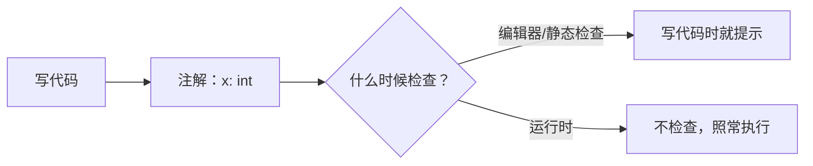

# PY-030 类型注解

## 1. 知识概览

| 项 | 内容 |
|---|---|
| 知识 ID | `PY-030` |
| 所属模块 | M-PY-03 函数、作用域与程序组织 |
| 学习难度 | L2 初级 |
| **预计学习时间** | 45 分钟 |
| 前置知识 | [[PY-023 函数参数详解]] |
| 学习目标 | 会写函数与变量注解、理解"注解不做运行时检查"、会用 `Optional`/`Union` |

## 2. 通俗原理讲解

类型注解像**包裹上贴的标签**：

- 标签写着"易碎品"，提醒搬运工小心。
- 但标签**不会让箱子变结实**——它只是给人（和工具）看的提示。

Python 的注解同理：`def f(x: int) -> str` 写明了"要 int、返回 str"，但**运行时不会强制检查**。你传 `"abc"` 照样能跑。

那有什么用？给编辑器（VS Code + Pylance）和静态检查工具看，让它们在**你运行之前**就提示错误。

## 3. 技术原理

| 写法 | 含义 |
|---|---|
| `x: int` | 变量注解 |
| `def f(a: int, b: str) -> bool:` | 参数与返回值注解 |
| `list[int]` | 元素为 int 的列表（3.9+） |
| `dict[str, int]` | 键 str、值 int 的字典 |
| `Optional[int]` | 可能是 int 或 None |
| `Union[int, str]` | 两种类型之一（3.10+ 可写 `int \| str`） |
| `Any` | 任意类型（等于放弃检查） |

**三条关键事实**

1. 注解保存在 `__annotations__` 字典里，可被程序读取（框架常用它做参数校验）。
2. **不做运行时类型检查**——传错类型不会立刻报错，除非函数内部用它做了不支持的运算。
3. 要想真正检查，需要 `mypy` / `pyright` 这类**静态检查工具**。

**常用类型**

```python
from typing import Optional, Union, Any, Callable
```

## 4. 图解辅助



## 5. 完整代码示例

```powershell
python typing_demo.py
```

```python
def greet(name: str, times: int = 1) -> str:
    return f"你好，{name}！" * times


print(greet("小明"))
print(greet("小红", 2))

from typing import Optional, List


def find(nums: List[int], target: int) -> Optional[int]:
    for i, x in enumerate(nums):
        if x == target:
            return i
    return None


print(find([1, 2, 3], 2))
print(find([1, 2, 3], 9))


def total(values: list[int]) -> int:
    return sum(values)


print(total([1, 2, 3]))
print(greet.__annotations__)
```

**预期输出**

```text
你好，小明！
你好，小红！你好，小红！
1
None
6
{'name': <class 'str'>, 'times': <class 'int'>, 'return': <class 'str'>}
```

**说明**

- `Optional[int]` 表示"可能返回 int，也可能返回 None"，正好对应"找不到返回 None"。
- `list[int]` 是 3.9+ 的内置泛型写法，与 `List[int]` 等价。
- 最后一行证明注解被保存在 `__annotations__` 中，可被程序读取。

## 6. 实践练习

**基础**

1. 给 `def area(w, h)` 加上 `float` 注解与 `-> float` 返回值注解。
2. 写 `def names(items: list[str]) -> str`，用逗号连接列表。
3. 声明 `age: int = 18`，打印它的类型。

**进阶**

1. 写 `parse_int(s: str) -> Optional[int]`，能解析则返回整数，否则返回 `None`。
2. 解释为什么 `greet(123)` 不会报错，以及怎样在开发期发现这类问题。

**综合实践**

给一个"用户信息处理"模块加类型注解：`build_user(name: str, age: int = 0, tags: list[str] | None = None) -> dict[str, object]`，并用 `mypy` 或 VS Code 的类型提示检查一遍（不装工具也可以，靠编辑器提示观察）。

## 7. 参考答案

**基础 1 · 思路**：参数与返回值都标注。

```python
def area(w: float, h: float) -> float:
    return w * h

print(area(2.0, 3.5))
```

运行结果：`7.0`

**基础 2 · 思路**：`list[str]` 泛型。

```python
def names(items: list[str]) -> str:
    return ", ".join(items)

print(names(["小明", "小红"]))
```

运行结果：`小明, 小红`

**基础 3 · 思路**：变量注解不影响运行。

```python
age: int = 18
print(type(age))
```

运行结果：`<class 'int'>`

**进阶 1 · 思路**：`try/except` + `Optional`。

```python
from typing import Optional

def parse_int(s: str) -> Optional[int]:
    try:
        return int(s)
    except ValueError:
        return None

print(parse_int("42"), parse_int("abc"))
```

运行结果：`42 None`

**进阶 2 · 思路**：注解不做运行时检查，`f"你好，{123}！"` 合法，所以不报错。

要在开发期发现：用 VS Code 的 Pylance 类型提示，或运行 `mypy typing_demo.py`（需 `pip install mypy`）。

**综合实践 · 思路**：签名写清，内部做默认值处理。

```python
def build_user(name: str, age: int = 0, tags: list[str] | None = None) -> dict[str, object]:
    return {"name": name, "age": age, "tags": tags or []}

print(build_user("小明"))
print(build_user("小红", 20, ["vip"]))
```

运行结果：

```text
{'name': '小明', 'age': 0, 'tags': []}
{'name': '小红', 'age': 20, 'tags': ['vip']}
```

## 8. 常见错误

| 错误写法 | 现象 | 原因 | 正确写法 |
|---|---|---|---|
| 以为注解会强制类型 | 传错也不报错 | 注解无运行时检查 | 用 mypy/pyright 检查 |
| `list[int]` 在 Python 3.8 报错 | `TypeError` | 内置泛型 3.9+ 才有 | 用 `List[int]` 或升级 |
| `def f(x: int = None)` | 类型与实际不符 | 默认值不是 int | 用 `Optional[int]` |
| 到处标 `Any` | 等于没标 | 放弃检查 | 尽量写具体类型 |
| 注解当成文档替代品 | 复杂逻辑没说明 | 注解只讲类型 | 配合 docstring |

## 9. 知识关联

- **前置**：[[PY-023 函数参数详解]]
- **后继**：`PY-056 代码风格与类型检查`（mypy/pyright 实战，待建）
- **相关数学**：无
- **所属模块**：`M-PY-03 函数、作用域与程序组织`

## 10. 学习记录

| 日期 | 状态 | 掌握程度 | 遇到的问题 | 个人总结 | 待复习 |
|---|---|---|---|---|---|
| — | planned | — | — | — | — |

---

## 🔗 Notion 同步信息

> 以下内容由 Notion「AI Knowledge System · 知识点」数据库按知识 ID 合并而来（导出于 2026-11-09）。

| 属性 | 值 |
|---|---|
| 学科 | Python基础 |
| 学习状态 | 未开始 |
| 难度 | L2 应用 |
| 知识类型 | Concept |
| 学习目标 | 会写函数与变量注解，理解注解不做运行时检查。 |

- **所属模块**：[M-PY-03 函数、作用域与程序组织](../%E8%AF%BE%E7%A8%8B%E6%A8%A1%E5%9D%97/M-PY-03%20%E5%87%BD%E6%95%B0%E3%80%81%E4%BD%9C%E7%94%A8%E5%9F%9F%E4%B8%8E%E7%A8%8B%E5%BA%8F%E7%BB%84%E7%BB%87.md)
- **前置知识**：[PY-023 函数参数详解](PY-023%20%E5%87%BD%E6%95%B0%E5%8F%82%E6%95%B0%E8%AF%A6%E8%A7%A3.md)
- **后继知识**：[PY-056 代码风格与类型检查](../06%20%E6%A8%A1%E5%9D%97%E4%B8%8E%E5%8C%85/PY-056%20%E4%BB%A3%E7%A0%81%E9%A3%8E%E6%A0%BC%E4%B8%8E%E7%B1%BB%E5%9E%8B%E6%A3%80%E6%9F%A5.md)
