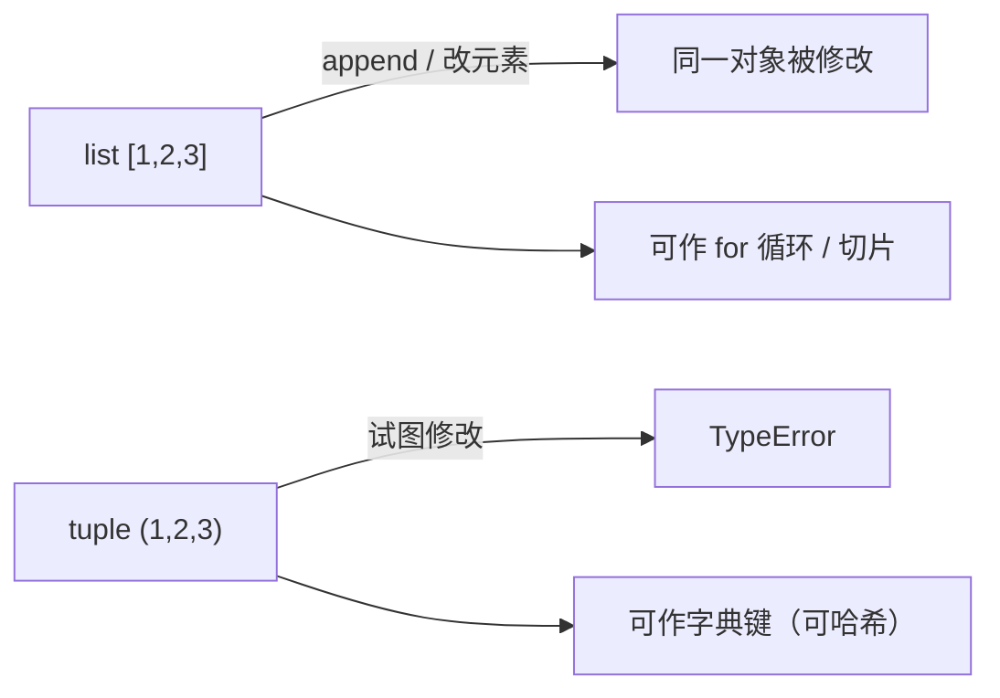

# PY-007 列表与元组

## 1. 知识概览

> ⏱ **预计学习时间**：50 分钟

两种"一排东西"的容器：

- `list`（列表）：**可变**，能增删改，用 `[]`。
- `tuple`（元组）：**不可变**，创建后不能改，用 `()`。

一句话：**会变的用列表，不会变的（且想防误改）用元组**。

## 2. 学习目标

1. 会做索引、切片、遍历、长度、求和、最值。
2. 会用 `append` / `extend` / `insert` / `remove` / `pop` / `sort` / `sorted`。
3. 能说清 `sort()`（原地）与 `sorted()`（新建）的区别。
4. 能解释为什么元组不能改，以及什么时候该用元组。

## 3. 通俗原理讲解

- 列表像**可擦写白板**：可以加一行、擦一行、重排。
- 元组像**打印好的表格**：内容固定，想改只能重新打印一份。
- 两者都能放下标取元素，都支持切片，都能遍历。

为什么要有元组？因为它**传达意图**：这个数据不该被改（比如坐标 `(x, y)`、函数返回的多值）。同时元组可作字典的键，列表不行。

### 图解：列表可变 vs 元组不可变



## 4. 深入技术原理

| 操作 | 列表 | 元组 |
|---|---|---|
| 索引 / 切片 | ✅ | ✅ |
| `append` / `remove` | ✅ | ❌ |
| 可作字典键 | ❌（不可哈希） | ✅ |
| 内存开销 | 略大 | 略小 |
| 语义 | 同类元素的有序集合 | 固定结构的一条记录 |

- `sort()` 原地排序、返回 `None`；`sorted()` 返回新列表。**把 `sort()` 的返回值赋给变量是经典 bug**（得到 `None`）。
- 切片 `a[1:4]` 返回**新列表**（浅拷贝）；`b = a` 只是多一个名字指向同一列表。
- 列表推导式 `[x * x for x in nums if x > 0]` 是构造列表的常用写法。
- 浅拷贝：嵌套列表用 `a.copy()` 只复制外层，内层仍共享。

## 5. 完整可运行代码

```powershell
python list_tuple_demo.py
```

```python
nums = [3, 1, 4, 1, 5]
print(nums[0], nums[-1])
print(nums[1:4])
print(len(nums), sum(nums), max(nums), min(nums))

nums.append(9)
print(nums)

nums.sort()
print(nums)
print(sorted(nums, reverse=True))

point = (3, 5)
x, y = point
print(x, y)

try:
    point[0] = 10
except TypeError as e:
    print("元组不可修改:", type(e).__name__)

matrix = [[1, 2], [3, 4]]
print(matrix[1][0])
print([row[0] for row in matrix])
```

## 6. 逐段代码解析

| 代码 | 结果 | 说明 |
|---|---|---|
| `nums[0], nums[-1]` | `3 5` | 首尾元素 |
| `nums[1:4]` | `[1, 4, 1]` | 左闭右开，取下标 1、2、3 |
| `sum(nums)` | `14` | 内置求和 |
| `nums.append(9)` | 末尾加 9 | 原地修改，无返回值 |
| `nums.sort()` | 升序原地排序 | 返回 `None` |
| `sorted(nums, reverse=True)` | 新列表降序 | 原列表不变 |
| `x, y = point` | `3 5` | 元组解包 |
| `point[0] = 10` | `TypeError` | 元组不可变 |
| `matrix[1][0]` | `3` | 先取行，再取列 |
| 列表推导 | `[1, 3]` | 取每行第一个元素 |

## 7. 运行结果

```
3 5
[1, 4, 1]
5 14 5 1
[3, 1, 4, 1, 5, 9]
[1, 1, 3, 4, 5, 9]
[9, 5, 4, 3, 1, 1]
3 5
元组不可修改: TypeError
3
[1, 3]
```

## 8. 基础练习

1. 建一个含 5 个数字的列表，输出总和、最大值、最小值。
2. 把 `["b", "a", "c"]` 排序并输出。
3. 用元组表示一个点的坐标，并解包打印。

## 9. 进阶练习

1. 写一个函数，接收列表，返回"去重且保持原顺序"的新列表（不许用 `set` 直接转，会丢顺序）。
2. 解释 `a = [1, 2]; b = a; b.append(3)` 之后 `a` 是什么，以及如何避免这种副作用。

## 10. 综合实践

写一个"成绩单统计"程序：

- `scores = [78, 92, 65, 88, 92, 70]`；
- 输出：最高分、最低分、平均分（保留 1 位小数）、及格人数（≥60）；
- 输出降序排列的成绩；
- 输出每个分数的名次（相同分数名次相同）。

## 11. 参考答案

**基础**

1. `nums = [4, 8, 1, 6, 3]; print(sum(nums), max(nums), min(nums))`
2. `print(sorted(["b", "a", "c"]))` → `['a', 'b', 'c']`
3. `p = (3, 5); x, y = p; print(x, y)`

**进阶**

1. ```python
   def dedupe(items):
       seen = []
       for x in items:
           if x not in seen:
               seen.append(x)
       return seen
   ```
2. `a` 变成 `[1, 2, 3]`，因为 `b = a` 只是别名。避免方式：`b = a.copy()` 或 `b = list(a)`（浅拷贝）。

**综合实践**

```python
scores = [78, 92, 65, 88, 92, 70]
print("最高", max(scores), "最低", min(scores))
print("平均", round(sum(scores) / len(scores), 1))
print("及格人数", sum(1 for s in scores if s >= 60))
print("降序", sorted(scores, reverse=True))

order = sorted(scores, reverse=True)
rank = {s: order.index(s) + 1 for s in set(scores)}
print([(s, rank[s]) for s in scores])
```

## 12. 常见错误

| 错误现象 | 根本原因 | 正确做法 |
|---|---|---|
| `a = a.sort()` 后 `a` 是 `None` | `sort` 原地排序无返回值 | 直接 `a.sort()`，或 `a = sorted(a)` |
| 改 `b` 结果 `a` 也变了 | `b = a` 是别名不是复制 | 用 `a.copy()` |
| 嵌套列表 `copy()` 后仍互相影响 | 浅拷贝 | 需要深拷贝用 `copy.deepcopy` |
| 用列表当字典键报 `TypeError` | 列表不可哈希 | 改用元组 |
| 遍历中 `remove` 漏元素 | 索引位移 | 倒序遍历或先复制 |

## 13. 知识关联

- **前置**：[[PY-002 基本数据类型]]
- **后继**：[[PY-008 字典与集合]]
- **相关数学**：无（列表是编程结构，不是数学概念）
- **所属模块**：`M-PY-01 Python 编程基础`

## 14. 学习记录

| 日期 | 动作 | 用时 | 结果 | 复盘 |
|---|---|---|---|---|
| 2026-11-01 | 建立笔记 | — | 待学 | — |

- 掌握判定：能说清 `sort` / `sorted` / `copy` 三处差异，并独立完成成绩单统计 = `practiced`。

---

## 🔗 Notion 同步信息

> 以下内容由 Notion「AI Knowledge System · 知识点」数据库按知识 ID 合并而来（导出于 2026-11-09）。

| 属性 | 值 |
|---|---|
| 学科 | Python基础 |
| 学习状态 | 未开始 |
| 难度 | L2 应用 |
| 知识类型 | Concept |
| 学习目标 | 掌握列表与元组的差异、增删改查、排序与浅拷贝。 |

- **所属模块**：[M-PY-01 Python 编程基础](../%E8%AF%BE%E7%A8%8B%E6%A8%A1%E5%9D%97/M-PY-01%20Python%20%E7%BC%96%E7%A8%8B%E5%9F%BA%E7%A1%80.md)
- **前置知识**：[PY-002 基本数据类型](../01%20%E8%AF%AD%E6%B3%95%E4%B8%8E%E7%B1%BB%E5%9E%8B/PY-002%20%E5%9F%BA%E6%9C%AC%E6%95%B0%E6%8D%AE%E7%B1%BB%E5%9E%8B.md)
- **后继知识**：[PY-008 字典与集合](PY-008%20%E5%AD%97%E5%85%B8%E4%B8%8E%E9%9B%86%E5%90%88.md) · [PY-011 列表深入](PY-011%20%E5%88%97%E8%A1%A8%E6%B7%B1%E5%85%A5.md) · [PY-018 查找算法](PY-018%20%E6%9F%A5%E6%89%BE%E7%AE%97%E6%B3%95.md) · [PY-059 NumPy 与列表的区别](../08%20NumPy/PY-059%20NumPy%20%E4%B8%8E%E5%88%97%E8%A1%A8%E7%9A%84%E5%8C%BA%E5%88%AB.md)
