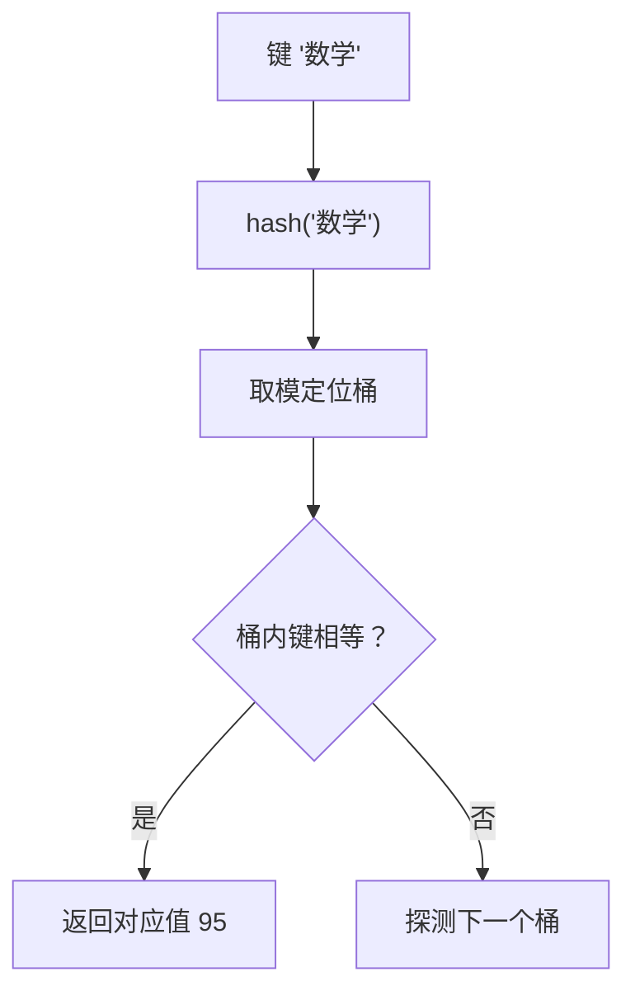

# PY-008 字典与集合

## 1. 知识概览

> ⏱ **预计学习时间**：50 分钟

- `dict`（字典）：**键 → 值**的映射，用 `{}` 写 `key: value`。
- `set`（集合）：**不重复**的元素集合，用 `{1, 2}` 或 `set()`。

一句话：**要"按名字查东西"用字典，要"去重 / 判存在 / 做集合运算"用集合**。

## 2. 学习目标

1. 会创建、读取、新增、删除字典项，能用 `get` 安全取值。
2. 会遍历 `keys()` / `values()` / `items()`。
3. 会做集合的交、并、差，理解"集合无序"。
4. 能说清为什么字典/集合的查找是 O(1)，而列表是 O(n)。

## 3. 通俗原理讲解

- 字典像**通讯录**：给一个名字（键），立刻拿到电话（值）。不需要从头翻。
- 集合像**入场名单**：只关心"在不在"，不关心第几个；同一个人不会登记两次。

两者都靠**哈希表**实现：把键算成一个"柜子编号"，直接去那个柜子取。所以查找快，但要求键**可哈希**（列表、字典不能当键，元组、字符串、数字可以）。

### 图解：哈希查找：算位置直接取



## 4. 深入技术原理

- **平均 O(1)**：字典/集合的查找、插入、删除平均常数时间；最坏 O(n)（哈希冲突严重时）。
- **键必须可哈希**：`int`、`str`、`tuple`（元素也可哈希）可以；`list`、`dict`、`set` 不可以。
- **顺序**：Python 3.7+ 字典**保持插入顺序**；集合**无序**，所以不要依赖集合的打印顺序。
- `d[k]` 键不存在会 `KeyError`；`d.get(k)` 返回 `None`，`d.get(k, 默认值)` 返回默认值。
- `set` 的常见用途：去重（`set(list)`，但会丢顺序）、成员判断、集合运算 `& | - ^`。
- 字典推导式：`{k: v for k, v in pairs}`。

## 5. 完整可运行代码

```powershell
python dict_set_demo.py
```

```python
scores = {"语文": 88, "数学": 95}
print(scores["数学"])
print(scores.get("英语", "缺考"))

scores["英语"] = 79
print(scores)
print(list(scores.keys()))
print(sum(scores.values()))
print("数学" in scores)

for subject, score in scores.items():
    print(f"{subject}: {score}")

tags = {"python", "数据", "python"}
print(sorted(tags))
print(len(tags))
tags.add("AI")
print(sorted(tags))

a = {1, 2, 3}
b = {2, 3, 4}
print(sorted(a & b), sorted(a | b), sorted(a - b))

del scores["英语"]
print(scores)
```

## 6. 逐段代码解析

| 代码 | 结果 | 说明 |
|---|---|---|
| `scores["数学"]` | `95` | 直接取值，键不存在会报错 |
| `scores.get("英语", "缺考")` | `缺考` | 安全取值，给默认值 |
| `scores["英语"] = 79` | 新增一项 | 键不存在即新增 |
| `sum(scores.values())` | `262` | 88+95+79 |
| `"数学" in scores` | `True` | 判断的是**键**，不是值 |
| `items()` | 键值对 | 遍历时同时拿到两者 |
| `sorted(tags)` | `['python', '数据']` | 重复的 `"python"` 自动去掉 |
| `tags.add("AI")` | 加一个 | 集合可变 |
| `a & b` | `[2, 3]` | 交集 |
| `a \| b` | `[1, 2, 3, 4]` | 并集 |
| `a - b` | `[1]` | 差集（在 a 不在 b） |

## 7. 运行结果

```
95
缺考
{'语文': 88, '数学': 95, '英语': 79}
['语文', '数学', '英语']
262
True
语文: 88
数学: 95
英语: 79
['python', '数据']
2
['AI', 'python', '数据']
[2, 3] [1, 2, 3, 4] [1]
{'语文': 88, '数学': 95}
```

## 8. 基础练习

1. 建一个字典存三个同学的年龄，按名字取其中一个的年龄。
2. 统计列表 `[1, 2, 2, 3, 3, 3]` 中有哪些不重复的值。
3. 判断 `"apple"` 是否在集合 `{"apple", "pear"}` 中。

## 9. 进阶练习

1. 统计一段文本中每个单词出现的次数，用字典实现。
2. 有两个列表 `a = [1, 2, 3]`、`b = [2, 3, 4]`，用集合求"只在 a 中的元素"和"两边都有的元素"。

## 10. 综合实践

写一个"库存管理"小程序：

- `stock = {"苹果": 5, "香蕉": 0, "橙子": 3}`；
- 输出所有缺货（数量为 0）的商品；
- 给 `"香蕉"` 补货 10 件；
- 输出总库存与最贵的单品名（另一个字典 `price = {"苹果": 3.5, "香蕉": 2.0, "橙子": 4.0}`）。

## 11. 参考答案

**基础**

1. `ages = {"小明": 18, "小红": 19, "小刚": 20}; print(ages["小红"])`
2. `print(set([1, 2, 2, 3, 3, 3]))` → `{1, 2, 3}`
3. `print("apple" in {"apple", "pear"})` → `True`

**进阶**

1. ```python
   text = "a b a c b a"
   counts = {}
   for w in text.split():
       counts[w] = counts.get(w, 0) + 1
   print(counts)
   ```
2. ```python
   a, b = [1, 2, 3], [2, 3, 4]
   sa, sb = set(a), set(b)
   print(sorted(sa - sb), sorted(sa & sb))
   ```

**综合实践**

```python
stock = {"苹果": 5, "香蕉": 0, "橙子": 3}
price = {"苹果": 3.5, "香蕉": 2.0, "橙子": 4.0}

print("缺货:", [k for k, v in stock.items() if v == 0])
stock["香蕉"] += 10
print("总库存:", sum(stock.values()))
print("最贵:", max(price, key=price.get))
```

## 12. 常见错误

| 错误现象 | 根本原因 | 正确做法 |
|---|---|---|
| `KeyError` | 直接用了不存在的键 | 用 `get`，或先 `in` 判断 |
| 用列表当字典键 | 不可哈希 | 用元组 |
| 依赖集合的打印顺序 | 集合无序 | 需要顺序时 `sorted(s)` |
| `"数学" in scores` 以为查值 | `in` 查的是键 | 查值用 `in scores.values()` |
| 遍历字典时增删键 | 运行时改变大小 | 先 `list(d.keys())` 复制 |

## 13. 知识关联

- **前置**：[[PY-007 列表与元组]]
- **后继**：[[PY-009 函数]]（常用字典做参数与返回值）
- **相关数学**：无（哈希与集合论属离散数学，见 `06_数学基础/05 离散数学/00 分支索引`，本节不展开）
- **所属模块**：`M-PY-01 Python 编程基础`

## 14. 学习记录

| 日期 | 动作 | 用时 | 结果 | 复盘 |
|---|---|---|---|---|
| 2026-11-01 | 建立笔记 | — | 待学 | — |

- 掌握判定：能写出词频统计 + 库存管理，并能解释"为什么集合无序"= `practiced`。

---

## 🔗 Notion 同步信息

> 以下内容由 Notion「AI Knowledge System · 知识点」数据库按知识 ID 合并而来（导出于 2026-11-09）。

| 属性 | 值 |
|---|---|
| 学科 | Python基础 |
| 学习状态 | 未开始 |
| 难度 | L2 应用 |
| 知识类型 | Concept |
| 学习目标 | 掌握字典键值操作与集合运算，理解哈希查找为何快。 |

- **所属模块**：[M-PY-01 Python 编程基础](../%E8%AF%BE%E7%A8%8B%E6%A8%A1%E5%9D%97/M-PY-01%20Python%20%E7%BC%96%E7%A8%8B%E5%9F%BA%E7%A1%80.md)
- **前置知识**：[PY-007 列表与元组](PY-007%20%E5%88%97%E8%A1%A8%E4%B8%8E%E5%85%83%E7%BB%84.md)
- **后继知识**：[PY-012 字典底层与哈希](PY-012%20%E5%AD%97%E5%85%B8%E5%BA%95%E5%B1%82%E4%B8%8E%E5%93%88%E5%B8%8C.md)
- **关联数学**：[MATH-501 集合与集合运算](../../06_%E6%95%B0%E5%AD%A6%E5%9F%BA%E7%A1%80/05%20%E7%A6%BB%E6%95%A3%E6%95%B0%E5%AD%A6/MATH-501%20%E9%9B%86%E5%90%88%E4%B8%8E%E9%9B%86%E5%90%88%E8%BF%90%E7%AE%97.md)
