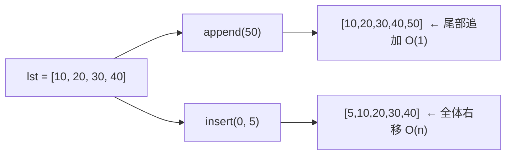

# PY-011 列表深入

## 1. 知识概览

| 项 | 内容 |
|---|---|
| 知识 ID | `PY-011` |
| 所属模块 | M-PY-02 数据结构与算法基础 |
| 学习难度 | L2 初级 |
| **预计学习时间** | 45 分钟 |
| 前置知识 | [[PY-007 列表与元组]] |
| 学习目标 | 掌握嵌套列表、切片赋值、`sort` 的 key 用法、推导式，并知道哪些操作慢 |

## 2. 通俗原理讲解

列表像一个**可以伸缩的抽屉柜**：每一格有编号，能往里塞东西、抽出来、换位置。

- 你已经会"往最后塞"（`append`）——那是**最快**的，因为不用挪动别人。
- "往最前面插"（`insert(0, x)`）——**最慢**，因为后面所有格子都得往后挪一格。
- 嵌套列表就是"抽屉里再放一个小抽屉"。

一句话：**列表本身很简单，难的是知道每个操作背后要不要搬东西**。

## 3. 技术原理

| 操作 | 时间复杂度 | 原因 |
|---|---|---|
| `append` / `pop()` | O(1) | 只在尾部操作 |
| `insert(0, x)` / `pop(0)` | O(n) | 需要整体移位 |
| `x in lst` | O(n) | 逐个比较 |
| `lst[i]` | O(1) | 连续内存 + 下标计算 |
| `sort()` | O(n log n) | Timsort |

**三个进阶点**：

1. **切片赋值**可以改变长度：`a[1:3] = [x, y, z]` 会把 2 个元素换成 3 个。
2. **`sort(key=...)`** 只接受"单参数函数"，返回排序依据；`key` 会被调用一次并缓存，比 `cmp` 快。
3. **排序稳定**：相等元素的相对顺序不变，所以可以"先按次要字段排，再按主要字段排"。

## 4. 图解辅助



## 5. 完整代码示例

保存为 `list_deep.py`，在 PowerShell 中运行：

```powershell
python list_deep.py
```

```python
matrix = [[1, 2, 3], [4, 5, 6]]
print(matrix[1][2])

nums = [5, 2, 8, 1]
nums.sort(reverse=True)
print(nums)

words = ["apple", "Bob", "cat", "David"]
print(sorted(words, key=str.lower))
print(sorted(words, key=len))

nums2 = [1, 2, 3, 4, 5]
nums2[1:3] = [20, 30, 40]
print(nums2)

squares = [x * x for x in range(6) if x % 2 == 0]
print(squares)

pairs = [(x, y) for x in range(2) for y in "ab"]
print(pairs)
```

**预期输出**

```
6
[8, 5, 2, 1]
['apple', 'Bob', 'cat', 'David']
['Bob', 'cat', 'apple', 'David']
[1, 20, 30, 40, 4, 5]
[0, 4, 16]
[(0, 'a'), (0, 'b'), (1, 'a'), (1, 'b')]
```

**说明**

- `key=str.lower` 让 `"Bob"` 按 `b` 排序，而不是按大写字母的 ASCII 值（那样会排到 `apple` 前面）。
- `key=len` 排序是**稳定**的：`Bob`/`cat` 都是 3，保持原顺序；`apple`/`David` 都是 5，也保持原顺序。
- 切片赋值把下标 1、2 两个元素换成了三个，所以长度从 5 变 6。

## 6. 实践练习

**基础**

1. 给定 `data = [3, 1, 4, 1, 5, 9, 2, 6]`，用 `sort` 升序并打印。
2. 把 `["banana", "Apple", "cherry"]` 按长度排序，长度相同则按字母序。
3. 用列表推导式生成 1–20 中所有 3 的倍数。

**进阶**

1. 写 `flatten(matrix)`，把二维列表压成一维（不许用第三方库）。
2. 给定 `students = [("小明", 85), ("小红", 92), ("小刚", 78)]`，按分数从高到低排序并打印姓名。

**综合实践**

写一个"成绩排序器"：读入 5 个 `(姓名, 分数)` 元组，先按分数降序；分数相同按姓名升序；输出排名表（名次从 1 开始，同分同名次）。

## 7. 参考答案

**基础 1 · 思路**：直接调用原地 `sort()`。

```python
data = [3, 1, 4, 1, 5, 9, 2, 6]
data.sort()
print(data)
```

运行结果：

```
[1, 1, 2, 3, 4, 5, 6, 9]
```

**基础 2 · 思路**：`key` 返回元组 `(长度, 小写形式)`，Python 按元组逐项比较。

```python
words = ["banana", "Apple", "cherry"]
print(sorted(words, key=lambda w: (len(w), w.lower())))
```

运行结果：

```
['Apple', 'banana', 'cherry']
```

**基础 3 · 思路**：`range(1, 21)` 过滤 `x % 3 == 0`。

```python
print([x for x in range(1, 21) if x % 3 == 0])
```

运行结果：`[3, 6, 9, 12, 15, 18]`

**进阶 1 · 思路**：双层循环；也可用推导式的双重 for。

```python
def flatten(matrix):
    out = []
    for row in matrix:
        for x in row:
            out.append(x)
    return out

print(flatten([[1, 2], [3, 4], [5]]))
```

运行结果：`[1, 2, 3, 4, 5]`

**进阶 2 · 思路**：`key=lambda s: s[1]` 取分数，`reverse=True`。

```python
students = [("小明", 85), ("小红", 92), ("小刚", 78)]
for name, score in sorted(students, key=lambda s: s[1], reverse=True):
    print(name, score)
```

运行结果：

```
小红 92
小明 85
小刚 78
```

**综合实践 · 思路**：先排序（分数降序、姓名升序），再遍历时判断"是否与上一名同分"决定名次是否递增。

```python
records = [("小明", 85), ("小红", 92), ("小刚", 78), ("小美", 85), ("小强", 92)]
records.sort(key=lambda r: (-r[1], r[0]))

rank = 0
prev_score = None
for i, (name, score) in enumerate(records, start=1):
    if score != prev_score:
        rank = i
        prev_score = score
    print(f"第 {rank} 名  {name}  {score}")
```

运行结果：

```
第 1 名  小强  92
第 1 名  小红  92
第 3 名  小明  85
第 3 名  小美  85
第 5 名  小刚  78
```

## 8. 常见错误

| 错误写法 | 现象 | 原因 | 正确写法 |
|---|---|---|---|
| `a = a.append(1)` | `a` 变成 `None` | `append` 返回 `None` | 直接 `a.append(1)` |
| `sorted(a, key=lambda x: x)` 后以为 `a` 变了 | `a` 没变 | `sorted` 返回新列表 | 用 `a.sort(...)` |
| 嵌套列表 `b = a.copy()` 后改内层 | 原列表也变 | 浅拷贝 | 用 `copy.deepcopy` |
| 循环里 `insert(0, x)` 处理上万条 | 极慢 | 每次 O(n) | 先 `append` 再 `reverse()` |
| `key=len()` | 报错 | 传的是调用结果不是函数 | `key=len` |

## 9. 知识关联

- **前置**：[[PY-007 列表与元组]]
- **后继**：[[PY-014 栈]]、[[PY-015 队列]]、[[PY-019 排序算法]]
- **相关数学**：无（排序与复杂度的数学见 [[PY-020 时间复杂度]]）
- **所属模块**：`M-PY-02 数据结构与算法基础`

## 10. 学习记录

| 日期 | 状态 | 掌握程度 | 遇到的问题 | 个人总结 | 待复习 |
|---|---|---|---|---|---|
| — | planned | — | — | — | — |

> 状态由你本人更新，系统不会自动改成"已掌握"。

---

## 🔗 Notion 同步信息

> 以下内容由 Notion「AI Knowledge System · 知识点」数据库按知识 ID 合并而来（导出于 2026-11-09）。

| 属性 | 值 |
|---|---|
| 学科 | Python基础 |
| 学习状态 | 未开始 |
| 难度 | L2 应用 |
| 知识类型 | Concept |
| 学习目标 | 掌握嵌套列表、切片赋值、sort 的 key 用法与推导式，知道哪些操作慢。 |

- **所属模块**：[M-PY-02 数据结构与算法基础](../%E8%AF%BE%E7%A8%8B%E6%A8%A1%E5%9D%97/M-PY-02%20%E6%95%B0%E6%8D%AE%E7%BB%93%E6%9E%84%E4%B8%8E%E7%AE%97%E6%B3%95%E5%9F%BA%E7%A1%80.md)
- **前置知识**：[PY-007 列表与元组](PY-007%20%E5%88%97%E8%A1%A8%E4%B8%8E%E5%85%83%E7%BB%84.md)
- **后继知识**：[PY-014 栈](PY-014%20%E6%A0%88.md) · [PY-015 队列](PY-015%20%E9%98%9F%E5%88%97.md) · [PY-016 链表](PY-016%20%E9%93%BE%E8%A1%A8.md) · [PY-019 排序算法](PY-019%20%E6%8E%92%E5%BA%8F%E7%AE%97%E6%B3%95.md)
