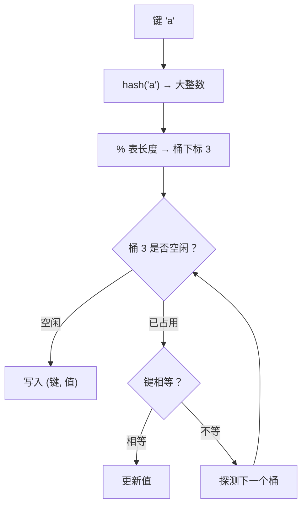

# PY-012 字典底层与哈希

## 1. 知识概览

| 项 | 内容 |
|---|---|
| 知识 ID | `PY-012` |
| 所属模块 | M-PY-02 数据结构与算法基础 |
| 学习难度 | L2 初级 |
| **预计学习时间** | 50 分钟 |
| 前置知识 | [[PY-008 字典与集合]] |
| 学习目标 | 理解字典为什么快、什么能当键、插入顺序为何保留，以及什么时候会退化 |

## 2. 通俗原理讲解

字典像**带索引的储物柜**：

- 你给一个名字（键），系统先算一个"柜子编号"（哈希值），直接走到那个柜子拿东西。
- 不用从头翻，所以快。
- 但如果两个人的名字算出了同一个柜子编号（**哈希冲突**），就得在柜子里再翻一翻。

这就是字典 O(1) 的全部秘密：**用计算换查找**。

## 3. 技术原理

**哈希表的工作流程**

1. 对键调用 `hash(key)` 得到一个整数。
2. 用 `整数 % 表长度` 定位到桶（bucket）下标。
3. 桶里若已有其他键，按"开放寻址"探测下一个空位，并用 `==` 确认是否真的相等。

**四个关键结论**

| 结论              | 原因                                  |
| --------------- | ----------------------------------- |
| 键必须可哈希          | 不可变对象才有稳定哈希（`list`/`dict`/`set` 没有） |
| 平均 O(1)，最坏 O(n) | 冲突严重时退化为线性扫描                        |
| 3.7+ 保留插入顺序     | 内部维护插入序的数组，是语言保证                    |
| 扩容会重新哈希         | 装填因子过高时扩容并 rehash，这一瞬间变慢            |

**装填因子**：元素数 / 桶数。Python 在约 2/3 时扩容，所以字典比"刚好够用"要占更多内存——这是**拿空间换时间**。

## 4. 图解辅助



## 5. 完整代码示例

```powershell
python dict_hash.py
```

```python
d = {"a": 1, "b": 2}
print(hash("a") != hash("b"))

d["c"] = 3
print(list(d))

print(d.get("z", "默认值"))

d.setdefault("d", []).append(1)
print(d["d"])

prices = {"苹果": 3.5, "香蕉": 2.0}
print(max(prices, key=prices.get))
print(sorted(prices.items(), key=lambda kv: kv[1]))

try:
    {[1, 2]: "x"}
except TypeError as e:
    print("不可哈希:", type(e).__name__)
```

**预期输出**

```
True
['a', 'b', 'c']
默认值
[1]
苹果
[('香蕉', 2.0), ('苹果', 3.5)]
不可哈希: TypeError
```

**说明**

- `list(d)` 得到 `['a','b','c']`，正是插入顺序（3.7+ 的语言保证）。
- `max(prices, key=prices.get)` 按"值"找最大对应的键。
- `[1,2]` 不能当键：列表可变，哈希会变，所以被禁止。

## 6. 实践练习

**基础**

1. 建一个字典存三种水果的价格，打印最贵的水果名。
2. 用 `get` 安全读取一个不存在的键，返回 `"无此商品"`。
3. 统计 `"abracadabra"` 中每个字符出现的次数。

**进阶**

1. 把两个字典按"值相加"合并（同一个键的值累加）。
2. 用 `setdefault` 把一组 `(部门, 姓名)` 按部门分组。

**综合实践**

写一个"词频 Top-N"程序：给定一段英文文本，统计词频，输出出现次数最多的前 3 个词（忽略大小写，去掉标点）。

## 7. 参考答案

**基础 1 · 思路**：`max` 配 `key=dict.get`。

```python
prices = {"苹果": 3.5, "香蕉": 2.0, "橙子": 4.0}
print(max(prices, key=prices.get))
```

运行结果：`橙子`

**基础 2 · 思路**：`get(key, 默认值)` 不会抛异常。

```python
prices = {"苹果": 3.5}
print(prices.get("榴莲", "无此商品"))
```

运行结果：`无此商品`

**基础 3 · 思路**：遍历字符，用 `get(ch, 0) + 1` 累加。

```python
text = "abracadabra"
counts = {}
for ch in text:
    counts[ch] = counts.get(ch, 0) + 1
print(counts)
```

运行结果：

```
{'a': 5, 'b': 2, 'r': 2, 'c': 1, 'd': 1}
```

**进阶 1 · 思路**：遍历第二个字典，用 `get` 取旧值再加。

```python
a = {"x": 1, "y": 2}
b = {"y": 3, "z": 4}
merged = dict(a)
for k, v in b.items():
    merged[k] = merged.get(k, 0) + v
print(merged)
```

运行结果：`{'x': 1, 'y': 5, 'z': 4}`

**进阶 2 · 思路**：`setdefault(dept, []).append(name)`。

```python
pairs = [("技术", "小明"), ("销售", "小红"), ("技术", "小刚")]
groups = {}
for dept, name in pairs:
    groups.setdefault(dept, []).append(name)
print(groups)
```

运行结果：`{'技术': ['小明', '小刚'], '销售': ['小红']}`

**综合实践 · 思路**：先 `lower()`、用 `replace` 去标点或正则 `\w+` 分词，再计数，最后按次数排序取前 3。

```python
import re

text = "The quick brown fox jumps over the lazy dog. The dog sleeps."
words = re.findall(r"[a-z]+", text.lower())
counts = {}
for w in words:
    counts[w] = counts.get(w, 0) + 1

top3 = sorted(counts.items(), key=lambda kv: (-kv[1], kv[0]))[:3]
for w, c in top3:
    print(w, c)
```

运行结果：

```
the 3
dog 2
brown 1
```

## 8. 常见错误

| 错误写法 | 现象 | 原因 | 正确写法 |
|---|---|---|---|
| `{}.get(k)` 后直接 `.append()` | `AttributeError` | 返回 `None` | `setdefault(k, [])` |
| 用列表当键 | `TypeError: unhashable` | 不可哈希 | 转成元组 |
| 遍历字典时增删键 | `RuntimeError` | 大小改变 | 先 `list(d)` 复制 |
| 以为字典顺序随机 | 输出顺序"看起来乱" | 3.7+ 有插入序，但 `set` 无序 | 需要排序用 `sorted` |
| 大量字符串键不担心内存 | 内存占用偏高 | 装填因子留空位 | 可接受，这是速度的代价 |

## 9. 知识关联

- **前置**：[[PY-008 字典与集合]]
- **后继**：[[PY-013 集合与哈希原理]]
- **相关数学**：无（哈希与集合论属离散数学，暂不展开）
- **所属模块**：`M-PY-02 数据结构与算法基础`

## 10. 学习记录

| 日期 | 状态 | 掌握程度 | 遇到的问题 | 个人总结 | 待复习 |
|---|---|---|---|---|---|
| — | planned | — | — | — | — |

---

## 🔗 Notion 同步信息

> 以下内容由 Notion「AI Knowledge System · 知识点」数据库按知识 ID 合并而来（导出于 2026-11-09）。

| 属性 | 值 |
|---|---|
| 学科 | Python基础 |
| 学习状态 | 未开始 |
| 难度 | L2 应用 |
| 知识类型 | Concept |
| 学习目标 | 理解字典为何快、什么能当键、插入顺序为何保留、何时退化。 |

- **所属模块**：[M-PY-02 数据结构与算法基础](../%E8%AF%BE%E7%A8%8B%E6%A8%A1%E5%9D%97/M-PY-02%20%E6%95%B0%E6%8D%AE%E7%BB%93%E6%9E%84%E4%B8%8E%E7%AE%97%E6%B3%95%E5%9F%BA%E7%A1%80.md)
- **前置知识**：[PY-008 字典与集合](PY-008%20%E5%AD%97%E5%85%B8%E4%B8%8E%E9%9B%86%E5%90%88.md)
- **后继知识**：[PY-013 集合与哈希原理](PY-013%20%E9%9B%86%E5%90%88%E4%B8%8E%E5%93%88%E5%B8%8C%E5%8E%9F%E7%90%86.md)
