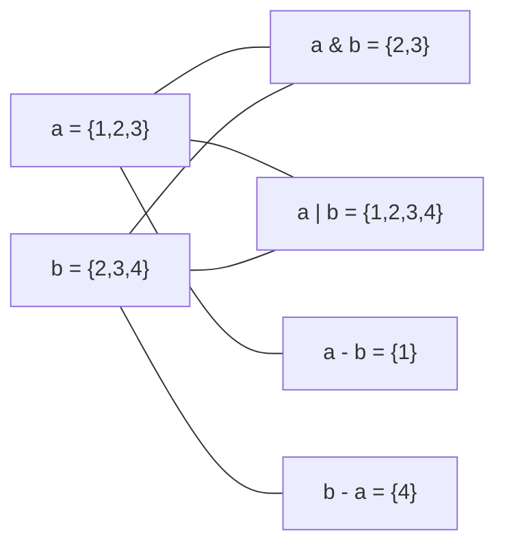

# PY-013 集合与哈希原理

## 1. 知识概览

| 项 | 内容 |
|---|---|
| 知识 ID | `PY-013` |
| 所属模块 | M-PY-02 数据结构与算法基础 |
| 学习难度 | L2 初级 |
| **预计学习时间** | 40 分钟 |
| 前置知识 | [[PY-012 字典底层与哈希]] |
| 学习目标 | 掌握集合运算、理解"无序"的根源、知道什么时候用 set 比 list 快 |

## 2. 通俗原理讲解

集合像**夜店的入场名单**：

- 只关心"这个人在不在名单上"，不关心排第几。
- 同一个人登记两次也只算一次（自动去重）。
- 两个人名可以快速做"交集 / 并集 / 差集"——"两边都来的""至少来一边的""只在 A 来的"。

**为什么没有顺序**？因为名单是按"名字算出的柜子号"存的，不是按加入时间排的。

## 3. 技术原理

| 特性 | 说明 |
|---|---|
| 底层 | 哈希表（和字典同一套机制，只是只存键不存值） |
| 成员判断 | 平均 O(1)（list 是 O(n)） |
| 去重 | 插入时自动判重 |
| 无序 | 迭代顺序由哈希决定，**不要依赖** |
| 可变 | `set` 可增删；`frozenset` 不可变、可哈希、可作字典键 |

**四种运算**

| 运算 | 符号 | 方法 | 含义 |
|---|---|---|---|
| 交集 | `&` | `intersection` | 两边都有 |
| 并集 | `\|` | `union` | 至少一边有 |
| 差集 | `-` | `difference` | 在左不在右 |
| 对称差 | `^` | `symmetric_difference` | 只在一侧有 |

## 4. 图解辅助



## 5. 完整代码示例

```powershell
python set_hash.py
```

```python
a = {1, 2, 3}
b = {2, 3, 4}
print(sorted(a & b), sorted(a | b), sorted(a - b), sorted(a ^ b))
print(2 in a)

tags = ["python", "数据", "python", "AI"]
print(sorted(set(tags)))

fs = frozenset([1, 2, 3])
print(fs, len(fs))
d = {fs: "不可变集合可作键"}
print(d[frozenset([1, 2, 3])])

s = set()
s.add(1)
s.add(1)
print(len(s))
```

**预期输出**

```
[2, 3] [1, 2, 3, 4] [1] [1, 4]
True
['AI', 'python', '数据']
frozenset({1, 2, 3}) 3
不可变集合可作键
1
```

**说明**

- 所有集合输出都套了 `sorted()`，因为集合本身无序，直接打印顺序不稳定。
- `frozenset` 不可变 → 可哈希 → 能当字典键；普通 `set` 不行。
- 重复 `add(1)` 不报错，长度仍是 1。

## 6. 实践练习

**基础**

1. 用集合对 `[1, 2, 2, 3, 4, 4, 5]` 去重并打印升序结果。
2. 求 `{1,2,3,4}` 与 `{3,4,5}` 的交集、并集、差集。
3. 判断 `"apple"` 是否在 `{"apple", "pear", "peach"}` 中。

**进阶**

1. 有两个班级名单列表，找出"只在一班"的学生。
2. 解释为什么 `{[1,2], [3,4]}` 会报错，并给出合法替代写法。

**综合实践**

写一个"标签分析器"：给出 5 篇文章的标签列表，输出①所有出现过的标签②至少两篇文章共有的标签③只出现过一次的标签。

## 7. 参考答案

**基础 1 · 思路**：`set()` 去重后 `sorted()`。

```python
print(sorted(set([1, 2, 2, 3, 4, 4, 5])))
```

运行结果：`[1, 2, 3, 4, 5]`

**基础 2 · 思路**：直接用运算符。

```python
a, b = {1, 2, 3, 4}, {3, 4, 5}
print(sorted(a & b), sorted(a | b), sorted(a - b))
```

运行结果：

```
[3, 4] [1, 2, 3, 4, 5] [1, 2]
```

**基础 3 · 思路**：`in` 判断集合成员，O(1)。

```python
print("apple" in {"apple", "pear", "peach"})
```

运行结果：`True`

**进阶 1 · 思路**：差集 `set(class1) - set(class2)`。

```python
class1 = ["小明", "小红", "小刚"]
class2 = ["小红", "小美"]
print(set(class1) - set(class2))
```

运行结果：`{'小明', '小刚'}`（集合打印顺序可能不同，元素一致）

**进阶 2 · 思路**：列表不可哈希，不能放进集合；应改用元组 `frozenset` 或元组。

```python
print({(1, 2), (3, 4)})
```

运行结果：`{(1, 2), (3, 4)}`

**综合实践 · 思路**：把所有标签并入一个集合；用计数器统计出现篇数；按篇数筛选。

```python
docs = [
    ["python", "数据"],
    ["python", "AI"],
    ["数据", "可视化"],
    ["python", "AI", "数据"],
    ["工具"],
]

all_tags = set()
count = {}
for tags in docs:
    for t in tags:
        all_tags.add(t)
        count[t] = count.get(t, 0) + 1

print("全部标签:", sorted(all_tags))
print("至少两篇共有:", sorted(t for t, c in count.items() if c >= 2))
print("只出现一次:", sorted(t for t, c in count.items() if c == 1))
```

运行结果：

```
全部标签: ['AI', 'python', '可视化', '工具', '数据']
至少两篇共有: ['AI', 'python', '数据']
只出现一次: ['可视化', '工具']
```

## 8. 常见错误

| 错误写法 | 现象 | 原因 | 正确写法 |
|---|---|---|---|
| 依赖 `print(set)` 的顺序 | 每次顺序可能不同 | 集合无序 | 用 `sorted()` |
| 用 `set` 去重后要求"保持原顺序" | 顺序丢了 | set 不保序 | `dict.fromkeys(list)` |
| 把列表放进集合 | `TypeError` | 不可哈希 | 转元组 |
| 对 `frozenset` 调用 `add` | `AttributeError` | 不可变 | 用 `set` |
| 小数据也迷信 set 更快 | 反而更慢 | 建 set 有开销 | 数据量大时才值得 |

## 9. 知识关联

- **前置**：[[PY-012 字典底层与哈希]]
- **后继**：[[PY-018 查找算法]]（哈希查找）
- **相关数学**：集合论属离散数学，见 `06_数学基础/05 离散数学/00 分支索引`
- **所属模块**：`M-PY-02 数据结构与算法基础`

## 10. 学习记录

| 日期 | 状态 | 掌握程度 | 遇到的问题 | 个人总结 | 待复习 |
|---|---|---|---|---|---|
| — | planned | — | — | — | — |

---

## 🔗 Notion 同步信息

> 以下内容由 Notion「AI Knowledge System · 知识点」数据库按知识 ID 合并而来（导出于 2026-11-09）。

| 属性 | 值 |
|---|---|
| 学科 | Python基础 |
| 学习状态 | 未开始 |
| 难度 | L2 应用 |
| 知识类型 | Concept |
| 学习目标 | 掌握集合运算，理解无序根源，知道 set 何时比 list 快。 |

- **所属模块**：[M-PY-02 数据结构与算法基础](../%E8%AF%BE%E7%A8%8B%E6%A8%A1%E5%9D%97/M-PY-02%20%E6%95%B0%E6%8D%AE%E7%BB%93%E6%9E%84%E4%B8%8E%E7%AE%97%E6%B3%95%E5%9F%BA%E7%A1%80.md)
- **前置知识**：[PY-012 字典底层与哈希](PY-012%20%E5%AD%97%E5%85%B8%E5%BA%95%E5%B1%82%E4%B8%8E%E5%93%88%E5%B8%8C.md)
