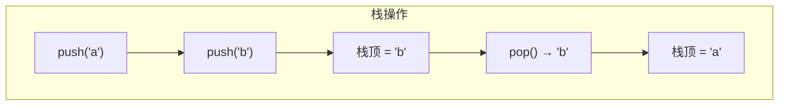

# PY-014 栈

## 1. 知识概览

| 项 | 内容 |
|---|---|
| 知识 ID | `PY-014` |
| 所属模块 | M-PY-02 数据结构与算法基础 |
| 学习难度 | L2 初级 |
| **预计学习时间** | 40 分钟 |
| 前置知识 | [[PY-011 列表深入]] |
| 学习目标 | 理解后进先出、能用 `list` 实现栈、能解括号匹配这类经典问题 |

## 2. 通俗原理讲解

栈像**一摞盘子**：

- 只能从最上面拿（`pop`），也只能往最上面放（`push`）。
- 最后放上去的，最先被拿走 → **后进先出（LIFO）**。
- 想拿最下面那个？必须先把上面的全拿开。

生活里到处都是栈：浏览器"后退"、编辑器"撤销"、函数调用。

## 3. 技术原理

| 操作 | Python 写法 | 复杂度 |
|---|---|---|
| 入栈 | `stack.append(x)` | O(1) |
| 出栈 | `stack.pop()` | O(1) |
| 看栈顶 | `stack[-1]` | O(1) |
| 判空 | `not stack` | O(1) |

**不需要**自己写类——Python 的 `list` 尾部操作已经是 O(1)，直接当栈用最省事。

**什么时候用栈**：问题具有"最近的未完成事项优先处理"的结构，例如：

- 括号 / 标签配对
- 表达式求值、中缀转后缀
- 深度优先搜索（DFS）
- 撤销/回退历史

## 4. 图解辅助



## 5. 完整代码示例

```powershell
python stack_demo.py
```

```python
stack = []
stack.append("a")
stack.append("b")
print(stack)
print(stack.pop())
print(stack)


def is_balanced(s):
    pairs = {")": "(", "]": "[", "}": "{"}
    stack = []
    for ch in s:
        if ch in "([{":
            stack.append(ch)
        elif ch in pairs:
            if not stack or stack.pop() != pairs[ch]:
                return False
    return not stack


for expr in ["(a+b)", "([{}])", "(]", "((a)"]:
    print(expr, is_balanced(expr))
```

**预期输出**

```
['a', 'b']
b
['a']
(a+b) True
([{}]) True
(] False
((a) False
```

**说明**

- `stack.pop()` 既删除又返回，所以能直接 `print`。
- 括号匹配的核心：**遇到左括号压栈，遇到右括号就弹栈并比对**；最后栈必须为空。
- `(]` 失败在"弹出的左括号与右括号不匹配"；`((a)` 失败在"最后栈里还剩一个左括号"。

## 6. 实践练习

**基础**

1. 建一个栈，依次 push `1,2,3`，然后全部 pop 并打印，观察顺序。
2. 用栈判断字符串 `"{([])}"` 是否括号匹配。
3. 用列表实现"撤销"：记录输入步骤，撤销时打印被撤销的那一步。

**进阶**

1. 用栈把十进制数转成二进制。
2. 用栈实现"浏览器后退"：访问 A→B→C，后退两次，输出当前页面。

**综合实践**

写一个简易"逆波兰表达式（后缀表达式）"求值器，支持 `+ - * /`，输入如 `["3", "4", "+", "2", "*"]`，输出 `14`。

## 7. 参考答案

**基础 1 · 思路**：append 三次，pop 三次。

```python
stack = []
for x in [1, 2, 3]:
    stack.append(x)
print(stack)
while stack:
    print(stack.pop())
```

运行结果：

```
[1, 2, 3]
3
2
1
```

**基础 2 · 思路**：复用上面的 `is_balanced`。

```python
print(is_balanced("{([])}"))   # 需先定义该函数
```

运行结果：`True`

**基础 3 · 思路**：用栈保存历史，撤销即 pop。

```python
history = []
for step in ["打开文件", "输入文字"]:
    history.append(step)
print("撤销:", history.pop())
print("剩余:", history)
```

运行结果：

```
撤销: 输入文字
剩余: ['打开文件']
```

**进阶 1 · 思路**：不断 `n % 2` 压栈，再依次弹出拼成二进制。

```python
def to_binary(n):
    stack = []
    while n > 0:
        stack.append(n % 2)
        n //= 2
    out = ""
    while stack:
        out += str(stack.pop())
    return out or "0"

print(to_binary(13))
```

运行结果：`1101`

**进阶 2 · 思路**：访问时压栈，后退时弹出当前页并取新的栈顶。

```python
history = []
for page in ["A", "B", "C"]:
    history.append(page)
history.pop()          # 后退一次，离开 C
print("后退一次 →", history[-1])
history.pop()          # 再后退，离开 B
print("后退两次 →", history[-1])
```

运行结果：

```
后退一次 → B
后退两次 → A
```

**综合实践 · 思路**：遇数字压栈，遇运算符弹出两个数计算后压回。

```python
def eval_rpn(tokens):
    stack = []
    for t in tokens:
        if t in {"+", "-", "*", "/"}:
            b = stack.pop()
            a = stack.pop()
            if t == "+":
                stack.append(a + b)
            elif t == "-":
                stack.append(a - b)
            elif t == "*":
                stack.append(a * b)
            else:
                stack.append(a / b)
        else:
            stack.append(int(t))
    return stack.pop()

print(eval_rpn(["3", "4", "+", "2", "*"]))
```

运行结果：`14`

## 8. 常见错误

| 错误写法 | 现象 | 原因 | 正确写法 |
|---|---|---|---|
| 用 `pop(0)` 当栈 | 逻辑反了且慢 | 那是队列行为 | `pop()` |
| 空栈直接 `pop()` | `IndexError` | 没判空 | 先 `if stack:` |
| 用栈做"先进先出" | 顺序错 | 栈是 LIFO | 队列用 `deque`，见 [[PY-015 队列]] |
| 括号匹配只数个数 | 顺序错也判对 | 数量相等不代表配对合法 | 必须用栈按序比对 |

## 9. 知识关联

- **前置**：[[PY-011 列表深入]]
- **后继**：[[PY-017 树的基本概念]]（DFS 用栈）、[[PY-022 递归]]（调用栈）
- **相关数学**：无
- **所属模块**：`M-PY-02 数据结构与算法基础`

## 10. 学习记录

| 日期 | 状态 | 掌握程度 | 遇到的问题 | 个人总结 | 待复习 |
|---|---|---|---|---|---|
| — | planned | — | — | — | — |

---

## 🔗 Notion 同步信息

> 以下内容由 Notion「AI Knowledge System · 知识点」数据库按知识 ID 合并而来（导出于 2026-11-09）。

| 属性 | 值 |
|---|---|
| 学科 | Python基础 |
| 学习状态 | 未开始 |
| 难度 | L2 应用 |
| 知识类型 | Algorithm |
| 学习目标 | 理解后进先出，能用 list 实现栈并解括号匹配。 |

- **所属模块**：[M-PY-02 数据结构与算法基础](../%E8%AF%BE%E7%A8%8B%E6%A8%A1%E5%9D%97/M-PY-02%20%E6%95%B0%E6%8D%AE%E7%BB%93%E6%9E%84%E4%B8%8E%E7%AE%97%E6%B3%95%E5%9F%BA%E7%A1%80.md)
- **前置知识**：[PY-011 列表深入](PY-011%20%E5%88%97%E8%A1%A8%E6%B7%B1%E5%85%A5.md)
