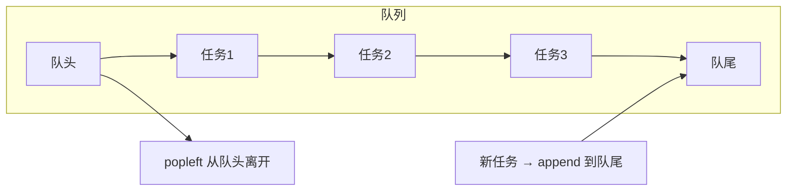

# PY-015 队列

## 1. 知识概览

| 项 | 内容 |
|---|---|
| 知识 ID | `PY-015` |
| 所属模块 | M-PY-02 数据结构与算法基础 |
| 学习难度 | L2 初级 |
| **预计学习时间** | 40 分钟 |
| 前置知识 | [[PY-011 列表深入]] |
| 学习目标 | 理解先进先出、会用 `deque`、能解 BFS 与任务排队问题 |

## 2. 通俗原理讲解

队列像**排队买奶茶**：

- 谁先来谁先买（**先进先出 FIFO**）。
- 新来的站队尾（`append`），买完的从队头离开（`popleft`）。
- 你不能从中间插队。

现实里的队列：打印任务、消息队列、客服排队、广度优先搜索。

## 3. 技术原理

| 操作 | 推荐写法 | 复杂度 |
|---|---|---|
| 入队 | `q.append(x)` | O(1) |
| 出队 | `q.popleft()` | O(1) |
| 看队头 | `q[0]` | O(1) |
| 判空 | `not q` | O(1) |

**关键点：不要用 `list.pop(0)` 当出队**。列表从头部删除要整体左移，是 O(n)；元素一多就明显变慢。正确工具是 `collections.deque`（双端队列），两端操作都是 O(1)。

**deque 还能当栈用**：`append` / `pop` 都是 O(1)。所以它其实是"两端都能进出的队列"。

## 4. 图解辅助



## 5. 完整代码示例

```powershell
python queue_demo.py
```

```python
from collections import deque

q = deque()
q.append("任务1")
q.append("任务2")
print(q)
print(q.popleft())
print(q)


def bfs(graph, start):
    seen = {start}
    q = deque([start])
    order = []
    while q:
        node = q.popleft()
        order.append(node)
        for nxt in graph[node]:
            if nxt not in seen:
                seen.add(nxt)
                q.append(nxt)
    return order


graph = {"A": ["B", "C"], "B": ["D"], "C": ["D"], "D": []}
print(bfs(graph, "A"))
```

**预期输出**

```
deque(['任务1', '任务2'])
任务1
deque(['任务2'])
['A', 'B', 'C', 'D']
```

**说明**

- `deque` 的打印形式是 `deque([...])`，元素顺序就是队列顺序。
- BFS 的三件套：**`seen` 防重复入队**、**`deque` 保证按层访问**、**先标记后入队**。
- 如果漏掉 `seen`，`D` 会被入队两次。

## 6. 实践练习

**基础**

1. 建一个队列，依次入队 `A,B,C`，再依次出队并打印。
2. 比较 `list.pop(0)` 与 `deque.popleft()` 的写法差异（各写一遍）。
3. 用队列实现"打印任务队列"：3 个任务依次打印。

**进阶**

1. 用 BFS 求无权图中从 A 到 D 的最短边数。
2. 用队列模拟"银行叫号"：3 个窗口，5 位客户，按顺序分配。

**综合实践**

写一个"热土豆"游戏：n 个人围成圈报数，报到 k 的人出局，剩下的人继续，输出最后的幸存者编号（用队列实现）。

## 7. 参考答案

**基础 1 · 思路**：`append` 入队，`popleft` 出队。

```python
from collections import deque

q = deque()
for x in ["A", "B", "C"]:
    q.append(x)
while q:
    print(q.popleft())
```

运行结果：

```
A
B
C
```

**基础 2 · 思路**：功能相同，但复杂度不同。

```python
from collections import deque

lst = ["a", "b", "c"]
print(lst.pop(0))        # O(n)

q = deque(["a", "b", "c"])
print(q.popleft())       # O(1)
```

运行结果：

```
a
a
```

**基础 3 · 思路**：入队 → 循环出队并打印。

```python
from collections import deque

jobs = deque(["文档1", "文档2", "文档3"])
while jobs:
    print("打印中:", jobs.popleft())
```

运行结果：

```
打印中: 文档1
打印中: 文档2
打印中: 文档3
```

**进阶 1 · 思路**：BFS 记录"层数"，第一次到达目标时的层数即最短边数。

```python
from collections import deque

def shortest_edges(graph, start, goal):
    q = deque([(start, 0)])
    seen = {start}
    while q:
        node, dist = q.popleft()
        if node == goal:
            return dist
        for nxt in graph[node]:
            if nxt not in seen:
                seen.add(nxt)
                q.append((nxt, dist + 1))
    return -1

graph = {"A": ["B", "C"], "B": ["D"], "C": ["D"], "D": []}
print(shortest_edges(graph, "A", "D"))
```

运行结果：`2`

**进阶 2 · 思路**：窗口队列存"空闲窗口号"，客户来了就分配。

```python
from collections import deque

windows = deque([1, 2, 3])
for i, customer in enumerate(["张三", "李四", "王五", "赵六", "钱七"], start=1):
    w = windows.popleft()
    print(f"客户{i} {customer} → 窗口{w}")
    windows.append(w)
```

运行结果：

```
客户1 张三 → 窗口1
客户2 李四 → 窗口2
客户3 王五 → 窗口3
客户4 赵六 → 窗口1
客户5 钱七 → 窗口2
```

**综合实践 · 思路**：队列头尾轮转——把队头的人移到队尾，重复 k-1 次，第 k 个人出局。

```python
from collections import deque

def hot_potato(n, k):
    q = deque(range(1, n + 1))
    while len(q) > 1:
        for _ in range(k - 1):
            q.append(q.popleft())
        q.popleft()
    return q[0]

print(hot_potato(5, 2))
```

运行结果：`3`

## 8. 常见错误

| 错误写法 | 现象 | 原因 | 正确写法 |
|---|---|---|---|
| `list.pop(0)` 当出队 | 数据量大时很慢 | 整体左移 O(n) | `deque.popleft()` |
| BFS 忘记 `seen` | 死循环或重复访问 | 图有环 | 入队前标记 |
| 用队列做 DFS | 得到 BFS 顺序 | 结构决定顺序 | DFS 用栈或递归 |
| deque 用切片 | `TypeError` | deque 不支持切片 | 先 `list(q)` |

## 9. 知识关联

- **前置**：[[PY-011 列表深入]]
- **后继**：[[PY-017 树的基本概念]]（层序遍历）
- **相关数学**：图论中的"最短路径"见 `06_数学基础/05 离散数学/00 分支索引`
- **所属模块**：`M-PY-02 数据结构与算法基础`

## 10. 学习记录

| 日期 | 状态 | 掌握程度 | 遇到的问题 | 个人总结 | 待复习 |
|---|---|---|---|---|---|
| — | planned | — | — | — | — |

---

## 🔗 Notion 同步信息

> 以下内容由 Notion「AI Knowledge System · 知识点」数据库按知识 ID 合并而来（导出于 2026-11-09）。

| 属性 | 值 |
|---|---|
| 学科 | Python基础 |
| 学习状态 | 未开始 |
| 难度 | L2 应用 |
| 知识类型 | Algorithm |
| 学习目标 | 理解先进先出，会用 deque，能解 BFS 与排队问题。 |

- **所属模块**：[M-PY-02 数据结构与算法基础](../%E8%AF%BE%E7%A8%8B%E6%A8%A1%E5%9D%97/M-PY-02%20%E6%95%B0%E6%8D%AE%E7%BB%93%E6%9E%84%E4%B8%8E%E7%AE%97%E6%B3%95%E5%9F%BA%E7%A1%80.md)
- **前置知识**：[PY-011 列表深入](PY-011%20%E5%88%97%E8%A1%A8%E6%B7%B1%E5%85%A5.md)
