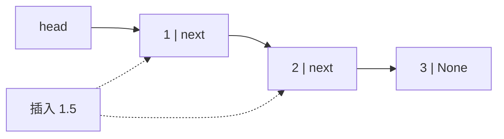

# PY-016 链表

## 1. 知识概览

| 项 | 内容 |
|---|---|
| 知识 ID | `PY-016` |
| 所属模块 | M-PY-02 数据结构与算法基础 |
| 学习难度 | L3 中级 |
| **预计学习时间** | 55 分钟 |
| 前置知识 | [[PY-011 列表深入]] |
| 学习目标 | 理解"节点 + 指针"的结构、能手写单链表、说清它与列表的取舍 |

## 2. 通俗原理讲解

链表像**寻宝游戏**：

- 每张纸条上写着"线索"和"下一张纸条藏在哪"。
- 你只知道第一张在哪（头节点），要找到第 5 张，必须顺着走 4 次。
- 想插一张新纸条？只要改前后两张的"下一张"指向，**不用挪动其他纸条**。

对比列表：列表像**连号的储物柜**，能直接跳到第 5 格，但中间插一个就得全体往后挪。

## 3. 技术原理

```
[值|next] → [值|next] → [值|next] → None
```

| 操作 | 列表 | 单链表 |
|---|---|---|
| 按下标访问 | O(1) | O(n) |
| 头部插入 | O(n) | O(1) |
| 尾部插入 | O(1)（append） | O(n)（除非存尾指针） |
| 删除已知节点 | O(n) | O(1)（改指针） |
| 内存连续性 | 连续 | 分散（每个节点独立对象） |

**Python 里的现实**：链表在 Python 中**很少用于生产**，因为对象开销大、缓存不友好，`list` 通常更快。学它是为了：

1. 理解"用引用串起数据"这种思维（树、图都建立在此之上）。
2. 应付面试与算法题。
3. 理解"为什么某些语言需要它"（C 里没有动态数组）。

## 4. 图解辅助



插入时只改两条指针，其他节点不动。

## 5. 完整代码示例

```powershell
python linked_list.py
```

```python
class Node:
    def __init__(self, value):
        self.value = value
        self.next = None


class LinkedList:
    def __init__(self):
        self.head = None

    def push_front(self, value):
        node = Node(value)
        node.next = self.head
        self.head = node

    def push_back(self, value):
        node = Node(value)
        if self.head is None:
            self.head = node
            return
        cur = self.head
        while cur.next:
            cur = cur.next
        cur.next = node

    def to_list(self):
        out, cur = [], self.head
        while cur:
            out.append(cur.value)
            cur = cur.next
        return out

    def remove(self, value):
        cur, prev = self.head, None
        while cur:
            if cur.value == value:
                if prev is None:
                    self.head = cur.next
                else:
                    prev.next = cur.next
                return True
            prev, cur = cur, cur.next
        return False


ll = LinkedList()
ll.push_back(1)
ll.push_back(2)
ll.push_front(0)
print(ll.to_list())
print(ll.remove(2))
print(ll.to_list())
```

**预期输出**

```
[0, 1, 2]
True
[0, 1]
```

**说明**

- `Node` 只有两个字段：值、下一个节点。
- `push_front` 是 O(1)：新建节点，让它指向原头，再把头换成它。
- `remove` 要维护 `prev`，否则断链后就找不回前一个节点。
- 删除头节点是特例，必须单独处理 `prev is None`。

## 6. 实践练习

**基础**

1. 用 `LinkedList` 依次 `push_back` 三个数，打印 `to_list()`。
2. 用 `push_front` 插入三个数，观察顺序是否与插入顺序相反。
3. 删除一个不存在的值，返回什么？

**进阶**

1. 实现 `reverse()`，把链表反转（不许新建链表）。
2. 实现 `length()`，返回节点数。

**综合实践**

写一个"学生名单链表"：支持尾部添加、按姓名删除、正序打印、反转后打印。

## 7. 参考答案

**基础 1 · 思路**：直接用上面类。

```python
ll = LinkedList()
for x in [10, 20, 30]:
    ll.push_back(x)
print(ll.to_list())
```

运行结果：`[10, 20, 30]`

**基础 2 · 思路**：每次都插到头部，所以顺序反过来。

```python
ll = LinkedList()
for x in [10, 20, 30]:
    ll.push_front(x)
print(ll.to_list())
```

运行结果：`[30, 20, 10]`

**基础 3 · 思路**：走到尾也没找到就返回 `False`。

```python
ll = LinkedList()
ll.push_back(1)
print(ll.remove(99))
```

运行结果：`False`

**进阶 1 · 思路**：三指针原地翻转（prev / cur / next）。

```python
def reverse(self):
    prev, cur = None, self.head
    while cur:
        nxt = cur.next
        cur.next = prev
        prev, cur = cur, nxt
    self.head = prev

LinkedList.reverse = reverse

ll = LinkedList()
for x in [1, 2, 3]:
    ll.push_back(x)
ll.reverse()
print(ll.to_list())
```

运行结果：`[3, 2, 1]`

**进阶 2 · 思路**：遍历计数。

```python
def length(self):
    n, cur = 0, self.head
    while cur:
        n += 1
        cur = cur.next
    return n

LinkedList.length = length

ll = LinkedList()
for x in [1, 2, 3, 4]:
    ll.push_back(x)
print(ll.length())
```

运行结果：`4`

**综合实践 · 思路**：组合上面的方法即可。

```python
ll = LinkedList()
for name in ["小明", "小红", "小刚"]:
    ll.push_back(name)
print("正序:", ll.to_list())
ll.remove("小红")
print("删除后:", ll.to_list())
ll.reverse()
print("反转后:", ll.to_list())
```

运行结果：

```
正序: ['小明', '小红', '小刚']
删除后: ['小明', '小刚']
反转后: ['小刚', '小明']
```

## 8. 常见错误

| 错误写法 | 现象 | 原因 | 正确写法 |
|---|---|---|---|
| `cur = cur.next` 前没保存 `nxt` | 断链后找不回 | 指针被覆盖 | 先 `nxt = cur.next` |
| 删除头节点时用 `prev.next` | `AttributeError` | `prev` 是 `None` | 单独判断 |
| 以为链表插入一定更快 | 实际更慢 | 要先找到位置 O(n) | 只在"已持有节点"时快 |
| `to_list` 里忘记 `cur = cur.next` | 死循环 | 指针没前进 | 每轮必前进 |

## 9. 知识关联

- **前置**：[[PY-011 列表深入]]
- **后继**：[[PY-017 树的基本概念]]（树 = 多个 next 的节点）
- **相关数学**：无
- **所属模块**：`M-PY-02 数据结构与算法基础`

## 10. 学习记录

| 日期 | 状态 | 掌握程度 | 遇到的问题 | 个人总结 | 待复习 |
|---|---|---|---|---|---|
| — | planned | — | — | — | — |

---

## 🔗 Notion 同步信息

> 以下内容由 Notion「AI Knowledge System · 知识点」数据库按知识 ID 合并而来（导出于 2026-11-09）。

| 属性 | 值 |
|---|---|
| 学科 | Python基础 |
| 学习状态 | 未开始 |
| 难度 | L3 推导 |
| 知识类型 | Algorithm |
| 学习目标 | 理解节点+指针结构，能手写单链表并说清与列表的取舍。 |

- **所属模块**：[M-PY-02 数据结构与算法基础](../%E8%AF%BE%E7%A8%8B%E6%A8%A1%E5%9D%97/M-PY-02%20%E6%95%B0%E6%8D%AE%E7%BB%93%E6%9E%84%E4%B8%8E%E7%AE%97%E6%B3%95%E5%9F%BA%E7%A1%80.md)
- **前置知识**：[PY-011 列表深入](PY-011%20%E5%88%97%E8%A1%A8%E6%B7%B1%E5%85%A5.md)
- **后继知识**：[PY-017 树的基本概念](PY-017%20%E6%A0%91%E7%9A%84%E5%9F%BA%E6%9C%AC%E6%A6%82%E5%BF%B5.md)
