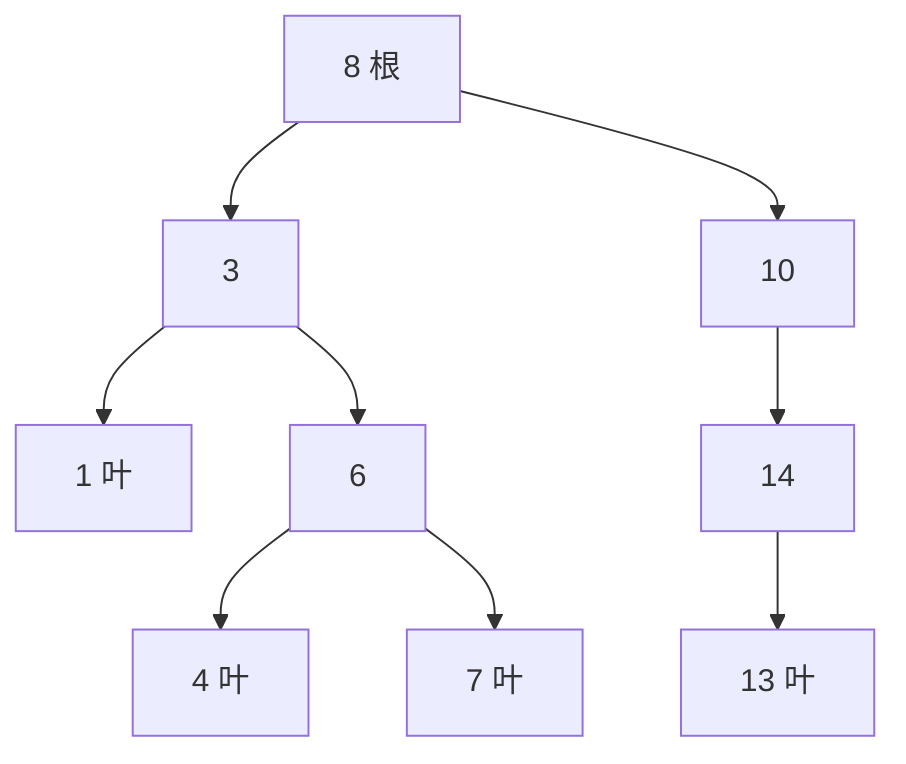

# PY-017 树的基本概念

## 1. 知识概览

| 项 | 内容 |
|---|---|
| 知识 ID | `PY-017` |
| 所属模块 | M-PY-02 数据结构与算法基础 |
| 学习难度 | L3 中级 |
| **预计学习时间** | 60 分钟 |
| 前置知识 | [[PY-016 链表]] |
| 学习目标 | 理解节点与子节点关系、掌握四种遍历、能手写二叉搜索树的插入与查找 |

## 2. 通俗原理讲解

树像**公司的组织架构**：

- 最上面是根（总经理），下面分几个部门，部门下再分组。
- 每个节点只有**一个上级**，但可以有多个下级。
- 没有环路——顺着"下级"走到底不会绕回自己。

二叉树是最常用的一种：**每个节点最多两个孩子**（左、右）。

## 3. 技术原理

**基本术语**

| 术语 | 含义 |
|---|---|
| 根（root） | 最顶层节点，没有父节点 |
| 叶（leaf） | 没有子节点的节点 |
| 深度 / 高度 | 从根到某节点的层数 / 树的最大层数 |
| 子树 | 某节点的后代构成的树 |

**四种遍历**（必须背下来）

| 遍历 | 顺序 | 用途 |
|---|---|---|
| 前序 preorder | 根 → 左 → 右 | 复制树、序列化 |
| 中序 inorder | 左 → 根 → 右 | **二叉搜索树的中序是升序** |
| 后序 postorder | 左 → 右 → 根 | 释放内存、计算子树 |
| 层序 level | 按层，用队列 | 求宽度、最短路径 |

**二叉搜索树（BST）**：对任意节点，左子树全部更小、右子树全部更大。因此查找像"猜数字"——每次排除一半，平均 O(log n)。但**若按顺序插入**（1,2,3,4…），树会退化成链表，查找变 O(n)。这就是为什么需要平衡树（AVL、红黑树）。

## 4. 图解辅助



对这棵树：中序 = 1,3,4,6,7,8,10,13,14（升序）；前序 = 8,3,1,6,4,7,10,14,13。

## 5. 完整代码示例

```powershell
python tree_demo.py
```

```python
class TreeNode:
    def __init__(self, value):
        self.value = value
        self.left = None
        self.right = None


def insert(root, value):
    if root is None:
        return TreeNode(value)
    if value < root.value:
        root.left = insert(root.left, value)
    elif value > root.value:
        root.right = insert(root.right, value)
    return root


def inorder(node, out=None):
    if out is None:
        out = []
    if node:
        inorder(node.left, out)
        out.append(node.value)
        inorder(node.right, out)
    return out


def preorder(node, out=None):
    if out is None:
        out = []
    if node:
        out.append(node.value)
        preorder(node.left, out)
        preorder(node.right, out)
    return out


def postorder(node, out=None):
    if out is None:
        out = []
    if node:
        postorder(node.left, out)
        postorder(node.right, out)
        out.append(node.value)
    return out


root = None
for v in [8, 3, 10, 1, 6, 14, 4, 7, 13]:
    root = insert(root, v)

print("中序:", inorder(root))
print("前序:", preorder(root))
print("后序:", postorder(root))
```

**预期输出**

```
中序: [1, 3, 4, 6, 7, 8, 10, 13, 14]
前序: [8, 3, 1, 6, 4, 7, 10, 14, 13]
后序: [1, 4, 7, 6, 3, 13, 14, 10, 8]
```

**说明**

- 中序输出**升序**，这是 BST 的定义带来的必然结果，可用它验证树建对了没有。
- `insert` 是递归的：值小往左、值大往右，到底就挂上去。
- 重复值被忽略（`elif` 只处理 `>`），这是有意为之。

## 6. 实践练习

**基础**

1. 依次插入 `[5, 3, 8, 1, 4]`，输出中序遍历，验证是否升序。
2. 写 `search(root, target)`，在 BST 中查找并返回 `True/False`。
3. 写出叶节点（没有孩子的节点）的判定条件。

**进阶**

1. 写 `height(root)` 求树的高度（空树为 0）。
2. 用队列实现层序遍历，输出每一层的节点。

**综合实践**

按 `[1,2,3,4,5]` 顺序插入建树，输出中序、前序，并解释这棵树为什么"退化成链表"。

## 7. 参考答案

**基础 1 · 思路**：复用 insert + inorder。

```python
root = None
for v in [5, 3, 8, 1, 4]:
    root = insert(root, v)
print(inorder(root))
```

运行结果：`[1, 3, 4, 5, 8]`

**基础 2 · 思路**：比较当前值决定往左还是往右，走到 None 就说明没找到。

```python
def search(root, target):
    cur = root
    while cur:
        if target == cur.value:
            return True
        cur = cur.left if target < cur.value else cur.right
    return False

print(search(root, 4), search(root, 99))
```

运行结果：`True False`

**基础 3 · 思路**：左右都为 `None`。

```python
def is_leaf(node):
    return node is not None and node.left is None and node.right is None

print(is_leaf(root.left.left))
```

运行结果：`True`

**进阶 1 · 思路**：递归取左右子树高度的较大值加 1。

```python
def height(node):
    if node is None:
        return 0
    return 1 + max(height(node.left), height(node.right))

print(height(root))
```

运行结果：`3`

**进阶 2 · 思路**：BFS，每层出队后记录当前队列长度。

```python
from collections import deque

def level_order(root):
    if root is None:
        return []
    out, q = [], deque([root])
    while q:
        level = []
        for _ in range(len(q)):
            node = q.popleft()
            level.append(node.value)
            if node.left:
                q.append(node.left)
            if node.right:
                q.append(node.right)
        out.append(level)
    return out

print(level_order(root))
```

运行结果：`[[5], [3, 8], [1, 4]]`

**综合实践 · 思路**：顺序插入只会往右挂，每个节点只有右孩子。

```python
root2 = None
for v in [1, 2, 3, 4, 5]:
    root2 = insert(root2, v)
print("中序:", inorder(root2))
print("前序:", preorder(root2))
print("高度:", height(root2))
```

运行结果：

```
中序: [1, 2, 3, 4, 5]
前序: [1, 2, 3, 4, 5]
高度: 5
```

高度 = 节点数，说明树退化成一条链，查找从 O(log n) 变成 O(n)。

## 8. 常见错误

| 错误写法 | 现象 | 原因 | 正确写法 |
|---|---|---|---|
| 忘记 `return root` | 树"丢了一半" | 递归返回值没接上 | 每次都 `return root` |
| 把 `<` 写成 `<=` | 重复值插两次 | 允许了相等 | 相等时不动 |
| 顺序插入后以为查找很快 | 实际很慢 | 树退化成链表 | 用随机顺序或平衡树 |
| 遍历时修改树 | 结果错乱 | 结构遍历中变了 | 先遍历再改 |

## 9. 知识关联

- **前置**：[[PY-016 链表]]
- **后继**：[[PY-022 递归]]（树的遍历全靠递归）
- **相关数学**：图论基础见 `06_数学基础/05 离散数学/00 分支索引`
- **所属模块**：`M-PY-02 数据结构与算法基础`

## 10. 学习记录

| 日期 | 状态 | 掌握程度 | 遇到的问题 | 个人总结 | 待复习 |
|---|---|---|---|---|---|
| — | planned | — | — | — | — |

---

## 🔗 Notion 同步信息

> 以下内容由 Notion「AI Knowledge System · 知识点」数据库按知识 ID 合并而来（导出于 2026-11-09）。

| 属性 | 值 |
|---|---|
| 学科 | Python基础 |
| 学习状态 | 未开始 |
| 难度 | L3 推导 |
| 知识类型 | Concept |
| 学习目标 | 掌握四种遍历，能手写 BST 插入与查找，理解退化。 |

- **所属模块**：[M-PY-02 数据结构与算法基础](../%E8%AF%BE%E7%A8%8B%E6%A8%A1%E5%9D%97/M-PY-02%20%E6%95%B0%E6%8D%AE%E7%BB%93%E6%9E%84%E4%B8%8E%E7%AE%97%E6%B3%95%E5%9F%BA%E7%A1%80.md)
- **前置知识**：[PY-016 链表](PY-016%20%E9%93%BE%E8%A1%A8.md)
- **关联数学**：[MATH-505 图论与树基础](../../06_%E6%95%B0%E5%AD%A6%E5%9F%BA%E7%A1%80/05%20%E7%A6%BB%E6%95%A3%E6%95%B0%E5%AD%A6/MATH-505%20%E5%9B%BE%E8%AE%BA%E4%B8%8E%E6%A0%91%E5%9F%BA%E7%A1%80.md)
