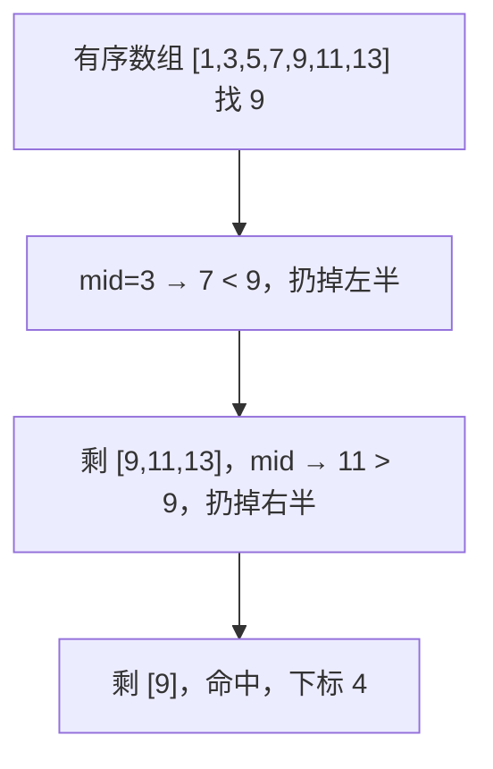

# PY-018 查找算法

## 1. 知识概览

| 项 | 内容 |
|---|---|
| 知识 ID | `PY-018` |
| 所属模块 | M-PY-02 数据结构与算法基础 |
| 学习难度 | L2 初级 |
| **预计学习时间** | 45 分钟 |
| 前置知识 | [[PY-007 列表与元组]] |
| 学习目标 | 掌握线性查找与二分查找、知道二分的前提、会用 `bisect` |

## 2. 通俗原理讲解

查找就是"在一堆东西里找到目标"。

- **线性查找**：从第一个开始一个一个看，最坏要看完全部。
- **二分查找**：像查字典——先翻到中间，看目标在前半还是后半，扔掉另一半，再对剩下的一半重复。**每次都少一半**。

代价是：二分**要求数据事先排好序**。没排序就得先排（O(n log n)），这种情况下不如直接线性找一遍。

## 3. 技术原理

| 算法 | 前提 | 时间复杂度 | 空间 |
|---|---|---|---|
| 线性查找 | 无 | O(n) | O(1) |
| 二分查找 | **必须有序** | O(log n) | O(1)（迭代） |
| 哈希查找 | 数据在 `dict`/`set` 中 | 平均 O(1) | O(n) |

**二分的三个易错点**

1. **边界**：用 `lo <= hi` 配 `mid + 1 / mid - 1`；用 `lo < hi` 则要配另一套边界，混用必错。
2. **中点溢出**：其他语言里 `(lo+hi)/2` 可能溢出，Python 不会（大整数），但仍建议写 `lo + (hi-lo)//2`。
3. **重复元素**：`bisect_left` 返回第一个位置，`bisect_right` 返回最后一个之后的位置。

**什么时候别用二分**：数据频繁插入删除（维护有序太贵）、数据量很小（线性更快）、数据无序且只查一次。

## 4. 图解辅助



## 5. 完整代码示例

```powershell
python search_demo.py
```

```python
def linear_search(arr, target):
    for i, x in enumerate(arr):
        if x == target:
            return i
    return -1


def binary_search(arr, target):
    lo, hi = 0, len(arr) - 1
    while lo <= hi:
        mid = (lo + hi) // 2
        if arr[mid] == target:
            return mid
        if arr[mid] < target:
            lo = mid + 1
        else:
            hi = mid - 1
    return -1


data = [1, 3, 5, 7, 9, 11, 13]
print(linear_search(data, 9))
print(binary_search(data, 9))
print(binary_search(data, 4))

import bisect

print(bisect.bisect_left(data, 9))
print(bisect.bisect_left(data, 6))
```

**预期输出**

```
4
4
-1
4
3
```

**说明**

- 两个函数都返回下标 4，因为 9 在下标 4。
- `binary_search(data, 4)` 返回 -1：找不到。
- `bisect_left(data, 6)` 返回 3：6 若插入，应放在下标 3 的位置（7 之前）。

## 6. 实践练习

**基础**

1. 在 `[10, 20, 30, 40]` 中线性查找 30，返回下标。
2. 在 `[2, 4, 6, 8, 10]` 中二分查找 8。
3. 二分查找一个不存在的数，确认返回 -1。

**进阶**

1. 用 `bisect` 实现"往有序列表中插入一个数并保持有序"。
2. 写一个函数，返回目标值在有序数组中第一次出现的下标（用 `bisect_left`）。

**综合实践**

写一个"手机号查姓名"程序：数据存为按手机号排序的列表，用二分查找实现查询；若不存在，提示"未找到"，并给出应该插入的位置。

## 7. 参考答案

**基础 1 · 思路**：遍历比对。

```python
print(linear_search([10, 20, 30, 40], 30))
```

运行结果：`2`

**基础 2 · 思路**：调用二分。

```python
print(binary_search([2, 4, 6, 8, 10], 8))
```

运行结果：`3`

**基础 3 · 思路**：同上，目标不存在。

```python
print(binary_search([2, 4, 6, 8, 10], 7))
```

运行结果：`-1`

**进阶 1 · 思路**：`bisect.insort` 一步到位。

```python
import bisect

arr = [1, 3, 5, 7]
bisect.insort(arr, 4)
print(arr)
```

运行结果：`[1, 3, 4, 5, 7]`

**进阶 2 · 思路**：`bisect_left` 找到位置后，验证该位置的值确实等于目标。

```python
import bisect

def first_index(arr, target):
    i = bisect.bisect_left(arr, target)
    if i < len(arr) and arr[i] == target:
        return i
    return -1

print(first_index([1, 2, 2, 2, 5], 2))
```

运行结果：`1`

**综合实践 · 思路**：按号码排序后二分；未命中时 `bisect_left` 正好给出插入点。

```python
import bisect

contacts = [
    ("13800000001", "小明"),
    ("13800000005", "小红"),
    ("13800000009", "小刚"),
]
numbers = [c[0] for c in contacts]

def find(number):
    i = bisect.bisect_left(numbers, number)
    if i < len(numbers) and numbers[i] == number:
        return contacts[i][1]
    return f"未找到，应插入位置 {i}"

print(find("13800000005"))
print(find("13800000007"))
```

运行结果：

```
小红
未找到，应插入位置 2
```

## 8. 常见错误

| 错误写法 | 现象 | 原因 | 正确写法 |
|---|---|---|---|
| 对无序列表二分 | 结果随机错 | 二分依赖有序 | 先排序 |
| `while lo < hi` 配 `hi = mid - 1` | 漏掉最后一个元素 | 边界不配套 | `lo <= hi` 配 `mid ± 1` |
| 排序后忘了元素与下标对应 | 找到值但位置错 | 排序打乱了原下标 | 排序时保留原始下标 |
| 用二分做频繁插入 | 每次都 O(n) | 插入要移位 | 换数据结构（如 `bisect` + 批量，或树） |

## 9. 知识关联

- **前置**：[[PY-007 列表与元组]]、[[PY-013 集合与哈希原理]]（哈希查找）
- **后继**：[[PY-019 排序算法]]（二分的前置是排序）、[[PY-020 时间复杂度]]
- **相关数学**：对数增长见 [[PY-020 时间复杂度]]
- **所属模块**：`M-PY-02 数据结构与算法基础`

## 10. 学习记录

| 日期 | 状态 | 掌握程度 | 遇到的问题 | 个人总结 | 待复习 |
|---|---|---|---|---|---|
| — | planned | — | — | — | — |

---

## 🔗 Notion 同步信息

> 以下内容由 Notion「AI Knowledge System · 知识点」数据库按知识 ID 合并而来（导出于 2026-11-09）。

| 属性 | 值 |
|---|---|
| 学科 | Python基础 |
| 学习状态 | 未开始 |
| 难度 | L2 应用 |
| 知识类型 | Algorithm |
| 学习目标 | 掌握线性与二分查找，知道二分前提，会用 bisect。 |

- **所属模块**：[M-PY-02 数据结构与算法基础](../%E8%AF%BE%E7%A8%8B%E6%A8%A1%E5%9D%97/M-PY-02%20%E6%95%B0%E6%8D%AE%E7%BB%93%E6%9E%84%E4%B8%8E%E7%AE%97%E6%B3%95%E5%9F%BA%E7%A1%80.md)
- **前置知识**：[PY-007 列表与元组](PY-007%20%E5%88%97%E8%A1%A8%E4%B8%8E%E5%85%83%E7%BB%84.md)
