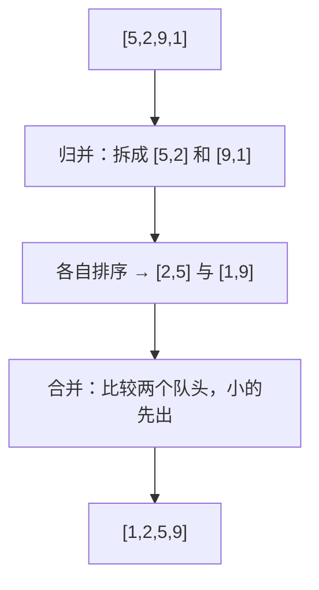

# PY-019 排序算法

## 1. 知识概览

| 项 | 内容 |
|---|---|
| 知识 ID | `PY-019` |
| 所属模块 | M-PY-02 数据结构与算法基础 |
| 学习难度 | L3 中级 |
| **预计学习时间** | 60 分钟 |
| 前置知识 | [[PY-011 列表深入]] |
| 学习目标 | 理解三种基础排序的思想与复杂度，知道 Python 内置排序为什么几乎总是首选 |

## 2. 通俗原理讲解

排序像**整理扑克牌**，有三种朴素思路：

- **冒泡**：相邻两张比大小，大的往后换；一轮下来最大的沉到末尾。像气泡往上冒。
- **插入**：像摸牌——手里的牌已经有序，新摸一张插到合适位置。
- **归并**：把牌分成两半各自排好，再把两叠有序牌合并成一叠。**分而治之**。

现实里你根本不用自己写：Python 的 `sorted()` / `list.sort()` 用的是 Timsort，稳定且快。学这几种是为了**理解"为什么它快"**。

## 3. 技术原理

| 算法 | 最好 | 平均 | 最坏 | 空间 | 稳定 |
|---|---|---|---|---|---|
| 冒泡 | O(n) | O(n²) | O(n²) | O(1) | 是 |
| 插入 | O(n) | O(n²) | O(n²) | O(1) | 是 |
| 归并 | O(n log n) | O(n log n) | O(n log n) | O(n) | 是 |
| 快速 | O(n log n) | O(n log n) | O(n²) | O(log n) | 否 |
| Timsort（内置） | O(n) | O(n log n) | O(n log n) | O(n) | 是 |

**稳定性**指相等元素的相对顺序是否保持。需要"先按次要字段、再按主要字段"排序时，稳定性非常有用。

**为什么 O(n²) 不可接受**：n = 10 万时，n² = 100 亿次比较；而 n log n ≈ 170 万次。差 5000 倍。

## 4. 图解辅助



## 5. 完整代码示例

```powershell
python sort_demo.py
```

```python
def bubble_sort(nums):
    a = nums[:]
    n = len(a)
    for i in range(n - 1):
        for j in range(n - 1 - i):
            if a[j] > a[j + 1]:
                a[j], a[j + 1] = a[j + 1], a[j]
    return a


def insertion_sort(nums):
    a = nums[:]
    for i in range(1, len(a)):
        key = a[i]
        j = i - 1
        while j >= 0 and a[j] > key:
            a[j + 1] = a[j]
            j -= 1
        a[j + 1] = key
    return a


def merge_sort(nums):
    if len(nums) <= 1:
        return nums[:]
    mid = len(nums) // 2
    left = merge_sort(nums[:mid])
    right = merge_sort(nums[mid:])
    out, i, j = [], 0, 0
    while i < len(left) and j < len(right):
        if left[i] <= right[j]:
            out.append(left[i])
            i += 1
        else:
            out.append(right[j])
            j += 1
    out.extend(left[i:])
    out.extend(right[j:])
    return out


data = [5, 2, 9, 1, 5, 6]
print(bubble_sort(data))
print(insertion_sort(data))
print(merge_sort(data))
print(sorted(data))
print(data)
```

**预期输出**

```
[1, 2, 5, 5, 6, 9]
[1, 2, 5, 5, 6, 9]
[1, 2, 5, 5, 6, 9]
[1, 2, 5, 5, 6, 9]
[5, 2, 9, 1, 5, 6]
```

**说明**

- 三个函数都先 `nums[:]` 复制，**不修改原列表**；最后一行证明 `data` 原样未动。
- 冒泡用 `n-1-i` 缩短每轮范围，因为末尾已经有序。
- 归并用 `<=` 保证稳定（相等时先取左边）。

## 6. 实践练习

**基础**

1. 用冒泡排序对 `[4, 2, 7, 1]` 排序并打印。
2. 用插入排序对 `[10, -1, 3, 3]` 排序并打印。
3. 用 `sorted` 对字符串按长度排序。

**进阶**

1. 统计冒泡排序在 `[5,4,3,2,1]` 上做了多少次交换。
2. 解释为什么归并排序需要 O(n) 额外空间。

**综合实践**

写一个"学生成绩榜"：给定 8 个 `(姓名, 分数)`，用归并排序按分数降序排（同分按姓名升序），输出名次表。

## 7. 参考答案

**基础 1 · 思路**：调用 `bubble_sort`。

```python
print(bubble_sort([4, 2, 7, 1]))
```

运行结果：`[1, 2, 4, 7]`

**基础 2 · 思路**：调用 `insertion_sort`。

```python
print(insertion_sort([10, -1, 3, 3]))
```

运行结果：`[-1, 3, 3, 10]`

**基础 3 · 思路**：`key=len` 排序稳定。

```python
print(sorted(["banana", "fig", "apple"], key=len))
```

运行结果：`['fig', 'apple', 'banana']`

**进阶 1 · 思路**：在交换分支里计数。

```python
def bubble_count(nums):
    a = nums[:]
    swaps = 0
    n = len(a)
    for i in range(n - 1):
        for j in range(n - 1 - i):
            if a[j] > a[j + 1]:
                a[j], a[j + 1] = a[j + 1], a[j]
                swaps += 1
    return a, swaps

print(bubble_count([5, 4, 3, 2, 1]))
```

运行结果：`([1, 2, 3, 4, 5], 10)`

**进阶 2 · 思路**：合并时需要一块能放下全部元素的新空间。

归并每层都要分配临时数组，总共约 n 个元素的空间，所以是 O(n)。

**综合实践 · 思路**：先按姓名升序排，再按分数降序排——利用稳定性一次到位；也可用 `key` 直接给元组。

```python
records = [("小明", 85), ("小红", 92), ("小刚", 78), ("小美", 85), ("小强", 92), ("小丽", 60), ("小刚2", 78), ("小华", 99)]
ranked = sorted(records, key=lambda r: (-r[1], r[0]))
for i, (name, score) in enumerate(ranked, start=1):
    print(i, name, score)
```

运行结果：

```
1 小华 99
2 小强 92
2 小红 92
4 小明 85
4 小美 85
6 小刚 78
6 小刚2 78
8 小丽 60
```

> 注：上面用序号直排，同分名次按"并列后跳号"处理需额外逻辑，见 [[PY-011 列表深入]] 第 11 节。

## 8. 常见错误

| 错误写法 | 现象 | 原因 | 正确写法 |
|---|---|---|---|
| 排序函数内直接改传入列表 | 调用方数据被改 | 没复制 | 先 `nums[:]` |
| 冒泡内层写 `range(n-1)` | 多做无用比较 | 未利用已排序尾部 | `range(n-1-i)` |
| 以为快排总是最快 | 特定输入退化 O(n²) | 基准选择不佳 | 用内置 `sorted` |
| 用 `sort()` 的返回值 | 得到 `None` | 原地排序 | 用 `sorted()` |
| 需要稳定排序却用快排 | 相等元素乱序 | 快排不稳定 | 用归并或内置 |

## 9. 知识关联

- **前置**：[[PY-011 列表深入]]
- **后继**：[[PY-018 查找算法]]（排序是二分的前提）、[[PY-020 时间复杂度]]
- **相关数学**：对数与增长阶见 [[PY-020 时间复杂度]]
- **所属模块**：`M-PY-02 数据结构与算法基础`

## 10. 学习记录

| 日期 | 状态 | 掌握程度 | 遇到的问题 | 个人总结 | 待复习 |
|---|---|---|---|---|---|
| — | planned | — | — | — | — |

---

## 🔗 Notion 同步信息

> 以下内容由 Notion「AI Knowledge System · 知识点」数据库按知识 ID 合并而来（导出于 2026-11-09）。

| 属性 | 值 |
|---|---|
| 学科 | Python基础 |
| 学习状态 | 未开始 |
| 难度 | L3 推导 |
| 知识类型 | Algorithm |
| 学习目标 | 理解冒泡/插入/归并的思想与复杂度，知道内置排序为何首选。 |

- **所属模块**：[M-PY-02 数据结构与算法基础](../%E8%AF%BE%E7%A8%8B%E6%A8%A1%E5%9D%97/M-PY-02%20%E6%95%B0%E6%8D%AE%E7%BB%93%E6%9E%84%E4%B8%8E%E7%AE%97%E6%B3%95%E5%9F%BA%E7%A1%80.md)
- **前置知识**：[PY-011 列表深入](PY-011%20%E5%88%97%E8%A1%A8%E6%B7%B1%E5%85%A5.md)
