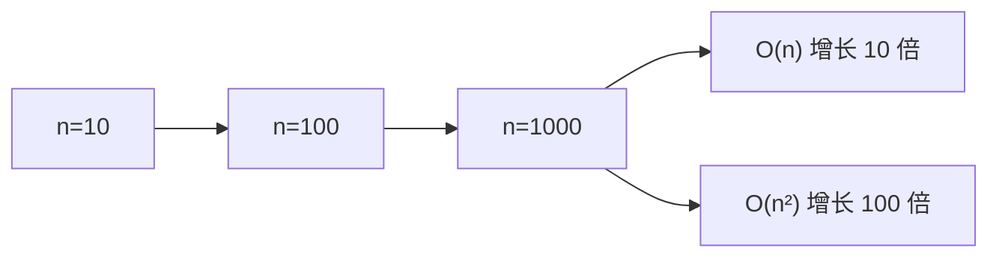

# PY-020 时间复杂度

## 1. 知识概览

| 项 | 内容 |
|---|---|
| 知识 ID | `PY-020` |
| 所属模块 | M-PY-02 数据结构与算法基础 |
| 学习难度 | L2 初级 |
| **预计学习时间** | 50 分钟 |
| 前置知识 | [[PY-006 循环结构]] |
| 学习目标 | 会用大 O 估算循环次数、能判断常见操作的复杂度、知道为什么 n² 不能接受 |

## 2. 通俗原理讲解

时间复杂度回答一个问题：**数据量变大时，程序会变慢多少？**

它不是"跑几秒"，而是"随规模增长的**趋势**"。

- 打电话找人：打一次就通 → O(1)。
- 从一叠名单里找一个名字：最坏要翻完 → O(n)。
- 名单里两两比较（谁和谁都认识吗）：n×(n-1)/2 次 → O(n²)。
- 每次砍一半（二分、归并）：→ O(log n) 或 O(n log n)。

**为什么只看趋势不看常数**：n 很大时，常数和低次项可以忽略。n² + 1000n，在 n = 10 万时主导的是 n²。

## 3. 技术原理

**大 O 记号的简化规则**

1. 去掉常数系数：`3n` → `O(n)`。
2. 只留最高阶：`n² + 5n + 7` → `O(n²)`。
3. 并列取最大：`O(n) + O(n²)` → `O(n²)`。
4. 嵌套相乘，顺序相加。

**常见增长阶（从快到慢）**

| 阶 | 名称 | n=1000 时的量级 |
|---|---|---|
| O(1) | 常数 | 1 |
| O(log n) | 对数 | ~10 |
| O(n) | 线性 | 1,000 |
| O(n log n) | 线性对数 | ~10,000 |
| O(n²) | 平方 | 1,000,000 |
| O(2ⁿ) | 指数 | 天文数字 |

**Python 常见操作的复杂度**（必须记）

| 操作 | 复杂度 |
|---|---|
| `lst[i]` / `lst.append` | O(1) |
| `x in lst` | O(n) |
| `x in set` / `x in dict` | 平均 O(1) |
| `lst.insert(0, x)` | O(n) |
| `sorted(lst)` | O(n log n) |
| `len(lst)` | O(1) |
| 字符串 `s += t`（循环里） | O(n²)，应改用 join |

## 4. 图解辅助



数据量每扩大 10 倍，O(n) 的时间约扩大 10 倍，O(n²) 扩大 100 倍。这就是"算法选错，机器再好也没用"。

## 5. 完整代码示例

```powershell
python complexity_demo.py
```

```python
def count_operations(n):
    ops = 0
    for _ in range(n):
        ops += 1
    return ops


def count_nested(n):
    ops = 0
    for _ in range(n):
        for _ in range(n):
            ops += 1
    return ops


for n in [10, 100]:
    print(n, count_operations(n), count_nested(n))


def sum_loop(n):
    s = 0
    for i in range(1, n + 1):
        s += i
    return s


def sum_formula(n):
    return n * (n + 1) // 2


print(sum_loop(100), sum_formula(100))

data = list(range(1000))
print(999 in data)
s = set(data)
print(999 in s)
```

**预期输出**

```
10 10 100
100 100 10000
5050 5050
True
True
```

**说明**

- 第一列 n，第二列是 O(n) 的次数，第三列是 O(n²) 的次数：n 从 10 到 100（10 倍），次数从 100 到 10000（**100 倍**）。
- `sum_loop` 与 `sum_formula` 结果相同，但前者 O(n)、后者 O(1)。这是"算法优化"的典型例子。
- 最后两行说明：同样是"判断存在"，list 是 O(n)，set 平均 O(1)。数据越大差距越明显。

## 6. 实践练习

**基础**

1. 判断 `for i in range(n): print(i)` 的时间复杂度。
2. 判断两层嵌套循环（各 n 次）的复杂度。
3. 判断 `x in my_list` 与 `x in my_set` 的复杂度。

**进阶**

1. 下面代码的复杂度是多少？`for i in range(n): for j in range(i): ...`
2. 把 `s = ""` 后循环 `s += str(i)` 改写成 O(n) 的写法。

**综合实践**

写一个程序，用 n = 1000 / 2000 / 4000 分别执行 O(n)、O(n²) 两段代码，打印各自的循环次数，验证"规模翻倍、次数分别翻 2 倍与 4 倍"。

## 7. 参考答案

**基础 1 · 思路**：循环 n 次，每次 O(1)。

答案：`O(n)`

**基础 2 · 思路**：嵌套相乘。

答案：`O(n²)`

**基础 3 · 思路**：list 需逐个比较，set 靠哈希。

答案：`O(n)` 与 平均 `O(1)`

**进阶 1 · 思路**：总次数 0+1+…+(n-1) = n(n-1)/2，去掉常数与低阶。

答案：`O(n²)`

**进阶 2 · 思路**：把片段收集到列表，最后 `"".join()`。

```python
parts = []
for i in range(1000):
    parts.append(str(i))
s = "".join(parts)
print(len(s) > 0)
```

运行结果：`True`

**综合实践 · 思路**：用计数器统计真实执行次数。

```python
def ops_linear(n):
    c = 0
    for _ in range(n):
        c += 1
    return c

def ops_quadratic(n):
    c = 0
    for _ in range(n):
        for _ in range(n):
            c += 1
    return c

for n in [1000, 2000, 4000]:
    print(n, ops_linear(n), ops_quadratic(n))
```

运行结果：

```
1000 1000 1000000
2000 2000 4000000
4000 4000 16000000
```

每翻倍：线性 ×2，平方 ×4。与理论完全一致。

## 8. 常见错误

| 错误写法 / 想法 | 现象 | 原因 | 正确做法 |
|---|---|---|---|
| 用"跑了几秒"比较复杂度 | 换台机器结论就变 | 时间是绝对值，复杂度看趋势 | 数循环次数 |
| 认为 O(n) 一定比 O(n²) 快 | 小数据时可能相反 | 常数项在小 n 时占主导 | n 大时才明显 |
| 忽略 `in list` 的开销 | 循环里判断存在导致极慢 | 每次 O(n)，叠加成 O(n²) | 先转 `set` |
| 循环里字符串拼接 | 大数据非常慢 | 每次创建新串 | `"".join()` |
| 把 `len()` 当 O(n) | 误判整体复杂度 | Python 长度是缓存的 | 记住是 O(1) |

## 9. 知识关联

- **前置**：[[PY-006 循环结构]]
- **后继**：[[PY-021 空间复杂度]]、[[PY-018 查找算法]]、[[PY-019 排序算法]]
- **相关数学**：对数与幂函数增长见 `06_数学基础/01 高等数学/00 分支索引`（本阶段不展开）
- **所属模块**：`M-PY-02 数据结构与算法基础`

## 10. 学习记录

| 日期 | 状态 | 掌握程度 | 遇到的问题 | 个人总结 | 待复习 |
|---|---|---|---|---|---|
| — | planned | — | — | — | — |

---

## 🔗 Notion 同步信息

> 以下内容由 Notion「AI Knowledge System · 知识点」数据库按知识 ID 合并而来（导出于 2026-11-09）。

| 属性 | 值 |
|---|---|
| 学科 | Python基础 |
| 学习状态 | 未开始 |
| 难度 | L2 应用 |
| 知识类型 | Concept |
| 学习目标 | 会用大 O 估算循环，能判断常见操作复杂度。 |

- **所属模块**：[M-PY-02 数据结构与算法基础](../%E8%AF%BE%E7%A8%8B%E6%A8%A1%E5%9D%97/M-PY-02%20%E6%95%B0%E6%8D%AE%E7%BB%93%E6%9E%84%E4%B8%8E%E7%AE%97%E6%B3%95%E5%9F%BA%E7%A1%80.md)
- **前置知识**：[PY-006 循环结构](../01%20%E8%AF%AD%E6%B3%95%E4%B8%8E%E7%B1%BB%E5%9E%8B/PY-006%20%E5%BE%AA%E7%8E%AF%E7%BB%93%E6%9E%84.md)
- **后继知识**：[PY-021 空间复杂度](PY-021%20%E7%A9%BA%E9%97%B4%E5%A4%8D%E6%9D%82%E5%BA%A6.md)
