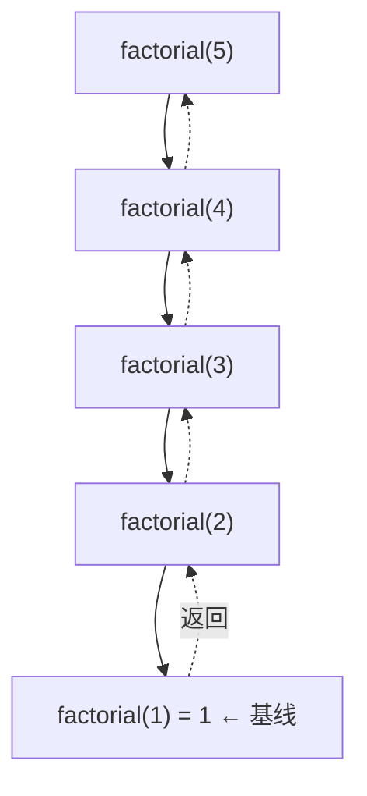

# PY-022 递归

## 1. 知识概览

| 项 | 内容 |
|---|---|
| 知识 ID | `PY-022` |
| 所属模块 | M-PY-02 数据结构与算法基础 |
| 学习难度 | L3 中级 |
| **预计学习时间** | 55 分钟 |
| 前置知识 | [[PY-009 函数]] |
| 学习目标 | 会写"基线条件 + 递归步骤"、能画出调用栈、知道何时该用记忆化 |

## 2. 通俗原理讲解

递归就是**函数调用自己**，像"俄罗斯套娃"：打开一层，里面还有一个更小的同样的娃娃，直到最小的那个打不开为止。

两个必需零件：

1. **基线条件（base case）**：什么时候停。没有它就会无限套娃，直到程序崩溃。
2. **递归步骤**：把大问题变成"规模更小的同类问题"，并相信小问题能被解决。

生活例子：查字典时遇到不懂的词，再去查那个词的解释——直到所有词都懂了（基线）。

## 3. 技术原理

**执行模型**：每次调用都会在**调用栈**上压一帧（保存参数、局部变量、返回地址）。返回时弹出。

```
factorial(5)
  → 5 * factorial(4)
        → 4 * factorial(3)
              → 3 * factorial(2)
                    → 2 * factorial(1)
                          → 1   ← 基线，开始逐层返回
```

**代价**

| 代价 | 说明 |
|---|---|
| 栈空间 O(深度) | 深度过大会 `RecursionError`（默认约 1000 层） |
| 函数调用开销 | 比循环慢 |
| 重复计算 | 朴素 `fib(n)` 是指数级，必须记忆化 |

**什么时候用递归**：问题本身是递归定义的（树、图、分治、排列组合），或者用递归写出来明显更清晰。**能用简单循环解决的，优先用循环。**

## 4. 图解辅助



去程一路压栈，回程一路相乘。

## 5. 完整代码示例

```powershell
python recursion_demo.py
```

```python
def factorial(n):
    if n <= 1:
        return 1
    return n * factorial(n - 1)


print(factorial(5))


def fib(n):
    if n < 2:
        return n
    return fib(n - 1) + fib(n - 2)


print(fib(10))


from functools import lru_cache


@lru_cache(maxsize=None)
def fib_fast(n):
    if n < 2:
        return n
    return fib_fast(n - 1) + fib_fast(n - 2)


print(fib_fast(50))


def depth(n):
    if n == 0:
        return 0
    return 1 + depth(n - 1)


print(depth(5))
```

**预期输出**

```
120
55
12586269025
5
```

**说明**

- `factorial(5) = 120`，递归 5 层。
- `fib(10) = 55`，但朴素递归会重复计算大量子问题（fib(10) 内部调用约 177 次）。
- `fib_fast(50)` 加上缓存后瞬间完成；不加缓存会慢到无法忍受。
- `depth(5) = 5`，演示"用递归数层数"。

## 6. 实践练习

**基础**

1. 用递归求 1+2+…+n。
2. 用递归求列表所有元素之和（不许用 `sum`）。
3. 用递归求字符串反转。

**进阶**

1. 用递归实现二分查找。
2. 解释为什么朴素 `fib(40)` 很慢，并给出两种改进方式。

**综合实践**

用递归打印一个目录树的层级结构（用 `pathlib`，限制深度为 2），输出形如：

```
Vault/
  00_知识首页/
  01_Python基础/
```

## 7. 参考答案

**基础 1 · 思路**：`n + sum_to(n-1)`，基线 `n == 0`。

```python
def sum_to(n):
    if n == 0:
        return 0
    return n + sum_to(n - 1)

print(sum_to(100))
```

运行结果：`5050`

**基础 2 · 思路**：取首元素 + 剩余部分之和。

```python
def total(nums):
    if not nums:
        return 0
    return nums[0] + total(nums[1:])

print(total([1, 2, 3, 4]))
```

运行结果：`10`

**基础 3 · 思路**：首尾交换或"最后一个字符 + 前面部分的反转"。

```python
def reverse(s):
    if len(s) <= 1:
        return s
    return reverse(s[1:]) + s[0]

print(reverse("abc"))
```

运行结果：`cba`

**进阶 1 · 思路**：把 while 循环改写成"区间递归"。

```python
def binary_search(arr, target, lo=0, hi=None):
    if hi is None:
        hi = len(arr) - 1
    if lo > hi:
        return -1
    mid = (lo + hi) // 2
    if arr[mid] == target:
        return mid
    if arr[mid] < target:
        return binary_search(arr, target, mid + 1, hi)
    return binary_search(arr, target, lo, mid - 1)

print(binary_search([1, 3, 5, 7, 9], 7))
```

运行结果：`3`

**进阶 2 · 思路**：朴素 fib 会重复计算同一子问题，复杂度约 O(1.618ⁿ)。改进：①记忆化（`lru_cache` 或字典）；②改迭代（自底向上）。

```python
def fib_iter(n):
    a, b = 0, 1
    for _ in range(n):
        a, b = b, a + b
    return a

print(fib_iter(40))
```

运行结果：`102334155`

**综合实践 · 思路**：递归遍历子目录，用 `depth` 参数控制层级。

```python
from pathlib import Path

def show(path, depth=0, max_depth=2):
    print("  " * depth + path.name + "/")
    if depth >= max_depth:
        return
    for child in sorted(path.iterdir()):
        if child.is_dir():
            show(child, depth + 1, max_depth)

show(Path(r"<VAULT_ROOT>"))
```

运行结果（节选，取决于实际目录）：

```
Obsidian Vault/
  .obsidian/
  00_知识首页/
  01_Python基础/
  02_科学计算/
  ...
```

## 8. 常见错误

| 错误写法 | 现象 | 原因 | 正确写法 |
|---|---|---|---|
| 没写基线条件 | `RecursionError` | 无限递归 | 先写 `if` 出口 |
| 递归参数没变小 | 死循环 | 问题规模未缩小 | 每次必须趋近基线 |
| 深度过大 | `RecursionError: maximum recursion depth` | 默认约 1000 层 | 改迭代，或分批 |
| 朴素 fib 求大数 | 卡死 | 指数级重复计算 | 记忆化或迭代 |
| 在递归里修改全局列表 | 结果错乱 | 共享可变状态 | 用参数传递或返回值 |

## 9. 知识关联

- **前置**：[[PY-009 函数]]
- **后继**：[[PY-017 树的基本概念]]（遍历依赖递归）
- **相关数学**：递推关系与数列见 `06_数学基础/05 离散数学/00 分支索引`
- **所属模块**：`M-PY-02 数据结构与算法基础`

## 10. 学习记录

| 日期 | 状态 | 掌握程度 | 遇到的问题 | 个人总结 | 待复习 |
|---|---|---|---|---|---|
| — | planned | — | — | — | — |

---

## 🔗 Notion 同步信息

> 以下内容由 Notion「AI Knowledge System · 知识点」数据库按知识 ID 合并而来（导出于 2026-11-09）。

| 属性 | 值 |
|---|---|
| 学科 | Python基础 |
| 学习状态 | 未开始 |
| 难度 | L3 推导 |
| 知识类型 | Algorithm |
| 学习目标 | 会写基线+递归步骤，能画调用栈，知道何时用记忆化。 |

- **所属模块**：[M-PY-02 数据结构与算法基础](../%E8%AF%BE%E7%A8%8B%E6%A8%A1%E5%9D%97/M-PY-02%20%E6%95%B0%E6%8D%AE%E7%BB%93%E6%9E%84%E4%B8%8E%E7%AE%97%E6%B3%95%E5%9F%BA%E7%A1%80.md)
- **前置知识**：[PY-009 函数](../02%20%E5%87%BD%E6%95%B0%E4%B8%8E%E4%BD%9C%E7%94%A8%E5%9F%9F/PY-009%20%E5%87%BD%E6%95%B0.md)
