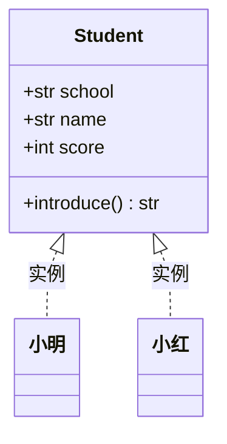

# PY-031 类与对象基础

## 1. 知识概览

| 项 | 内容 |
|---|---|
| 知识 ID | `PY-031` |
| 所属模块 | M-PY-04 面向对象编程 |
| 学习难度 | L2 初级 |
| **预计学习时间** | 55 分钟 |
| 前置知识 | [[PY-009 函数]] |
| 学习目标 | 会用 `class` 定义类、理解 `__init__` 与 `self`、分清类属性与实例属性 |

## 2. 通俗原理讲解

**类**是模具，**对象**是用这个模具做出来的具体东西。

- `class Student` 定义了"学生"应该有什么（姓名、成绩）和能做什么（自我介绍）。
- `Student("小明", 85)` 是照着模具做出的**一个具体学生**。

生活类比：

- 类 = 饼干模具
- 对象 = 用模具压出来的一块块饼干
- 属性 = 饼干上的花纹（每块可以不同）
- 方法 = 饼干能做的事（比如"被吃掉"）

## 3. 技术原理

**定义与使用**

```text
class 类名:
    类属性 = 值                    # 所有实例共享

    def __init__(self, 参数):       # 构造方法，创建对象时自动调用
        self.实例属性 = 参数        # 每个实例各自一份

    def 方法(self):                # 第一个参数必须是自己
        ...
```

**三个必须理解的点**

| 点 | 说明 |
|---|---|
| `self` | 指向"当前这个对象"，调用时**不用手动传** |
| `__init__` | 创建对象时自动执行，用来初始化属性；不返回任何值 |
| 类属性 vs 实例属性 | 类属性共享；`self.x = ...` 创建的是实例属性，会**遮蔽**同名类属性 |

**`__init__` 不是构造函数**（严格说 `__new__` 才是），它只负责"初始化"，对象已经由 `__new__` 造好了。

## 4. 图解辅助



类里写的是"结构"，两个实例各自持有自己的 `name` 与 `score`，共享 `school`。

## 5. 完整代码示例

```powershell
python class_basic.py
```

```python
class Student:
    school = "阳光中学"

    def __init__(self, name, score):
        self.name = name
        self.score = score

    def introduce(self):
        return f"我是{self.name}，来自{self.school}，成绩{self.score}"


s1 = Student("小明", 85)
s2 = Student("小红", 92)
print(s1.introduce())
print(s2.introduce())
print(Student.school, s1.school)

s1.score = 90
print(s1.score, s2.score)
print(isinstance(s1, Student))
```

**预期输出**

```
我是小明，来自阳光中学，成绩85
我是小红，来自阳光中学，成绩92
阳光中学 阳光中学
90 92
True
```

**说明**

- `s1.introduce()` 不需要传 `self`，Python 自动把 `s1` 填进去。
- `s1.score = 90` 只改了 `s1`，`s2` 仍是 92——实例属性互不影响。
- `isinstance` 判断"是不是这个类的实例"。

## 6. 实践练习

**基础**

1. 定义 `Book` 类，有 `title`、`price`，方法 `info()` 返回 `"《书名》 价格元"`。
2. 创建两个 `Book` 对象并分别调用 `info()`。
3. 给 `Book` 加一个类属性 `currency = "元"`，在方法里使用它。

**进阶**

1. 定义 `Rectangle` 类，有 `width`、`height`，方法 `area()` 与 `perimeter()`。
2. 解释：如果在方法里写 `self.score = 100`，会不会影响其他实例？为什么？

**综合实践**

写一个 `BankAccount` 类：属性 `owner`、`balance`，方法 `deposit(amount)`、`withdraw(amount)`（余额不足时返回失败信息），并打印三步操作后的结果。

## 7. 参考答案

**基础 1 · 思路**：`__init__` 存两个属性。

```python
class Book:
    def __init__(self, title, price):
        self.title = title
        self.price = price
    def info(self):
        return f"《{self.title}》 {self.price}元"

print(Book("Python入门", 59).info())
```

运行结果：`《Python入门》 59元`

**基础 2 · 思路**：造两个对象。

```python
b1 = Book("Python入门", 59)
b2 = Book("数据结构", 45)
print(b1.info())
print(b2.info())
```

运行结果：

```
《Python入门》 59元
《数据结构》 45元
```

**基础 3 · 思路**：类属性用 `self.currency` 或 `Book.currency` 都能读。

```python
class Book:
    currency = "元"
    def __init__(self, title, price):
        self.title = title
        self.price = price
    def info(self):
        return f"《{self.title}》 {self.price}{self.currency}"

print(Book("Python入门", 59).info())
```

运行结果：`《Python入门》 59元`

**进阶 1 · 思路**：两个方法各算一个公式。

```python
class Rectangle:
    def __init__(self, width, height):
        self.width = width
        self.height = height
    def area(self):
        return self.width * self.height
    def perimeter(self):
        return 2 * (self.width + self.height)

r = Rectangle(3, 4)
print(r.area(), r.perimeter())
```

运行结果：`12 14`

**进阶 2 · 思路**：`self.x = ...` 只写当前实例的 `__dict__`。

答案：不会影响其他实例。

**综合实践 · 思路**：余额检查放在 `withdraw` 里。

```python
class BankAccount:
    def __init__(self, owner, balance=0):
        self.owner = owner
        self.balance = balance
    def deposit(self, amount):
        self.balance += amount
        return self.balance
    def withdraw(self, amount):
        if amount > self.balance:
            return "余额不足"
        self.balance -= amount
        return self.balance

acc = BankAccount("小明", 100)
print(acc.deposit(50))
print(acc.withdraw(30))
print(acc.withdraw(500))
```

运行结果：

```
150
120
余额不足
```

## 8. 常见错误

| 错误写法 | 现象 | 原因 | 正确写法 |
|---|---|---|---|
| 方法定义漏了 `self` | `TypeError: takes 0 positional arguments` | 实例方法第一个参数必须是 self | `def m(self):` |
| 调用时写成 `s.introduce(s)` | `TypeError` | 自动传了两次 | `s.introduce()` |
| `__init__` 里 `return` 值 | `TypeError` | 构造方法不能返回值 | 只做初始化 |
| 类属性用可变对象 | 所有实例共享出错 | 类属性只有一份 | 在 `__init__` 里建实例属性 |
| 忘记调用类：`s = Student` | 拿到类本身 | 没加括号 | `Student(...)` |

## 9. 知识关联

- **前置**：[[PY-009 函数]]
- **后继**：[[PY-032 封装与私有属性]]、[[PY-033 继承]]
- **相关数学**：无
- **所属模块**：`M-PY-04 面向对象编程`

## 10. 学习记录

| 日期 | 状态 | 掌握程度 | 遇到的问题 | 个人总结 | 待复习 |
|---|---|---|---|---|---|
| — | planned | — | — | — | — |

---

## 🔗 Notion 同步信息

> 以下内容由 Notion「AI Knowledge System · 知识点」数据库按知识 ID 合并而来（导出于 2026-11-09）。

| 属性 | 值 |
|---|---|
| 学科 | Python基础 |
| 学习状态 | 未开始 |
| 难度 | L2 应用 |
| 知识类型 | Concept |
| 学习目标 | 会用 class 定义类、理解 __init__ 与 self、分清类属性与实例属性。 |

- **所属模块**：[M-PY-04 面向对象编程](../%E8%AF%BE%E7%A8%8B%E6%A8%A1%E5%9D%97/M-PY-04%20%E9%9D%A2%E5%90%91%E5%AF%B9%E8%B1%A1%E7%BC%96%E7%A8%8B.md)
- **前置知识**：[PY-009 函数](../02%20%E5%87%BD%E6%95%B0%E4%B8%8E%E4%BD%9C%E7%94%A8%E5%9F%9F/PY-009%20%E5%87%BD%E6%95%B0.md)
- **后继知识**：[PY-032 封装与私有属性](PY-032%20%E5%B0%81%E8%A3%85%E4%B8%8E%E7%A7%81%E6%9C%89%E5%B1%9E%E6%80%A7.md) · [PY-033 继承](PY-033%20%E7%BB%A7%E6%89%BF.md) · [PY-035 类方法与静态方法](PY-035%20%E7%B1%BB%E6%96%B9%E6%B3%95%E4%B8%8E%E9%9D%99%E6%80%81%E6%96%B9%E6%B3%95.md) · [PY-037 特殊方法](PY-037%20%E7%89%B9%E6%AE%8A%E6%96%B9%E6%B3%95.md)
- **被项目引用**：[PROJ-002 学生成绩管理系统](../../07_%E5%AE%9E%E6%88%98%E9%A1%B9%E7%9B%AE/01%20Python%E9%A1%B9%E7%9B%AE/PROJ-002%20%E5%AD%A6%E7%94%9F%E6%88%90%E7%BB%A9%E7%AE%A1%E7%90%86%E7%B3%BB%E7%BB%9F.md)
