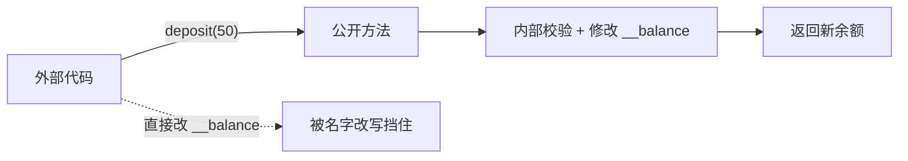

# PY-032 封装与私有属性

## 1. 知识概览

| 项 | 内容 |
|---|---|
| 知识 ID | `PY-032` |
| 所属模块 | M-PY-04 面向对象编程 |
| 学习难度 | L2 初级 |
| **预计学习时间** | 45 分钟 |
| 前置知识 | [[PY-031 类与对象基础]] |
| 学习目标 | 理解封装的意义、会用 `_` 与 `__`、知道 Python 的"私有"是约定而非强制 |

## 2. 通俗原理讲解

封装像**自动售货机**：

- 你不能直接伸手进货仓拿饮料（**数据被保护**）。
- 你只能按按钮（**公开方法**），机器自己检查钱够不够、货有没有。
- 好处：货仓怎么摆、怎么补货，你不需要知道；机器也不会让你把货仓搬空。

没有封装会怎样？任何代码都能随手把 `balance` 改成 999999——出了 bug 你根本不知道是谁改的。

## 3. 技术原理

| 写法 | 语义 | 能否被外部访问 |
|---|---|---|
| `self.name` | 公开 | 可以 |
| `self._name` | **约定**内部使用 | 可以（只是提醒） |
| `self.__name` | 名字改写（name mangling） | 不能直接用 `obj.__name`，实际存在 `_类名__name` |

**关键事实**：Python **没有真正的私有**。`__balance` 会被改写成 `_Account__balance`，所以 `a._Account__balance` 仍能访问。这是"防误用"，不是"防恶意"。

**为什么还要封装**

1. **集中校验**：所有修改走同一个入口，规则只写一次。
2. **可维护**：内部结构随便改，只要公开方法不变，调用方不受影响。
3. **可读性**：`account.deposit(50)` 比 `account.balance += 50` 清楚得多。

**Pythonic 做法**：优先用 `_` 加公开方法；需要"像属性一样访问但要校验"时用 `@property`（见 [[PY-036 属性装饰器]]）。

## 4. 图解辅助



## 5. 完整代码示例

```powershell
python encapsulation.py
```

```python
class Account:
    def __init__(self, owner, balance=0):
        self.owner = owner
        self.__balance = balance

    def deposit(self, amount):
        if amount <= 0:
            raise ValueError("金额必须为正")
        self.__balance += amount
        return self.__balance

    def get_balance(self):
        return self.__balance


a = Account("小明", 100)
print(a.get_balance())
print(a.deposit(50))
print(a.owner)

try:
    print(a.__balance)
except AttributeError as e:
    print("外部不可直接访问:", type(e).__name__)

print(a._Account__balance)
```

**预期输出**

```
100
150
小明
外部不可直接访问: AttributeError
150
```

**说明**

- `a.__balance` 报错，因为外部访问的是 `__balance`，而实际属性名被改成了 `_Account__balance`。
- 最后一行证明"仍可绕过"——所以私有只是**约定与防误用**。
- `deposit` 里做了校验，非法金额直接抛 `ValueError`，这是封装的真正价值。

## 6. 实践练习

**基础**

1. 定义 `Person`，把 `age` 设为私有，提供 `get_age` 与 `set_age`（要求 0–150）。
2. 尝试从外部直接访问私有属性，观察报错类型。
3. 解释 `_name` 与 `__name` 的区别。

**进阶**

1. 写 `Wallet` 类：余额私有，`spend` 不允许超额，`add` 不允许负数。
2. 说明为什么"把所有属性都设成私有"反而是坏设计。

**综合实践**

写一个 `Password` 类：内部保存密码（私有），提供 `set_password`（长度 ≥ 8 才接受）与 `check(text)`（返回是否匹配，不回显密码）。

## 7. 参考答案

**基础 1 · 思路**：私有 + 校验。

```python
class Person:
    def __init__(self, age):
        self.__age = age
    def get_age(self):
        return self.__age
    def set_age(self, value):
        if not (0 <= value <= 150):
            raise ValueError("年龄不合法")
        self.__age = value

p = Person(20)
p.set_age(30)
print(p.get_age())
try:
    p.set_age(200)
except ValueError as e:
    print("拒绝:", e)
```

运行结果：

```
30
拒绝: 年龄不合法
```

**基础 2 · 思路**：直接访问会抛 `AttributeError`。

```python
try:
    print(p.__age)
except AttributeError as e:
    print("外部访问失败:", type(e).__name__)
```

运行结果：`AttributeError: 'Person' object has no attribute '__age'`

**基础 3 · 思路**：`_` 是约定，`__` 有名字改写。

答案：`_name` 只是"提醒别乱用"，外部照样能访问；`__name` 会被改写成 `_类名__name`，外部直接用原名访问不到。

**进阶 1 · 思路**：两个方法各自校验。

```python
class Wallet:
    def __init__(self, balance=0):
        self.__balance = balance
    def spend(self, amount):
        if amount > self.__balance:
            return "余额不足"
        self.__balance -= amount
        return self.__balance
    def add(self, amount):
        if amount < 0:
            raise ValueError("不能加负数")
        self.__balance += amount
        return self.__balance

w = Wallet(100)
print(w.spend(30))
print(w.spend(500))
print(w.add(50))
```

运行结果：

```
70
余额不足
120
```

**进阶 2 · 思路**：过度封装增加无谓的样板代码。

答案：如果每个属性都要 getter/setter，代码量翻倍却没有带来校验或约束；应该只对"需要保护的不变量"做封装，其余保持简单的公开属性。

**综合实践 · 思路**：私有 + 长度校验 + 只返回布尔。

```python
class Password:
    def __init__(self):
        self.__value = ""
    def set_password(self, text):
        if len(text) < 8:
            raise ValueError("密码至少 8 位")
        self.__value = text
    def check(self, text):
        return text == self.__value

p = Password()
p.set_password("abcd1234")
print(p.check("abcd1234"), p.check("wrong"))
try:
    p.set_password("123")
except ValueError as e:
    print("拒绝:", e)
```

运行结果：

```
True False
拒绝: 密码至少 8 位
```

## 8. 常见错误

| 错误写法 | 现象 | 原因 | 正确写法 |
|---|---|---|---|
| 以为 `__x` 绝对安全 | 仍可用 `_类名__x` 访问 | 只是改名 | 明白它是约定 |
| 给私有属性写 `__init__` 外的赋值 | 生成了新属性而非改私有 | 名字不同 | 通过方法修改 |
| 所有字段都加 `__` | 代码难用难测 | 过度封装 | 只保护关键不变量 |
| 用 `__x__` 双下划线结尾 | 不触发改名 | 双结尾是魔术方法风格 | 避免这种命名 |
| 忘记 `self.` 直接写 `__x` | `NameError` | 那是局部变量 | `self.__x` |

## 9. 知识关联

- **前置**：[[PY-031 类与对象基础]]
- **后继**：[[PY-036 属性装饰器]]（更 Pythonic 的封装）
- **相关数学**：无
- **所属模块**：`M-PY-04 面向对象编程`

## 10. 学习记录

| 日期 | 状态 | 掌握程度 | 遇到的问题 | 个人总结 | 待复习 |
|---|---|---|---|---|---|
| — | planned | — | — | — | — |

---

## 🔗 Notion 同步信息

> 以下内容由 Notion「AI Knowledge System · 知识点」数据库按知识 ID 合并而来（导出于 2026-11-09）。

| 属性 | 值 |
|---|---|
| 学科 | Python基础 |
| 学习状态 | 未开始 |
| 难度 | L2 应用 |
| 知识类型 | Concept |
| 学习目标 | 理解封装意义，会用 _ 与 __，知道私有是约定而非强制。 |

- **所属模块**：[M-PY-04 面向对象编程](../%E8%AF%BE%E7%A8%8B%E6%A8%A1%E5%9D%97/M-PY-04%20%E9%9D%A2%E5%90%91%E5%AF%B9%E8%B1%A1%E7%BC%96%E7%A8%8B.md)
- **前置知识**：[PY-031 类与对象基础](PY-031%20%E7%B1%BB%E4%B8%8E%E5%AF%B9%E8%B1%A1%E5%9F%BA%E7%A1%80.md)
- **后继知识**：[PY-036 属性装饰器](PY-036%20%E5%B1%9E%E6%80%A7%E8%A3%85%E9%A5%B0%E5%99%A8.md)
