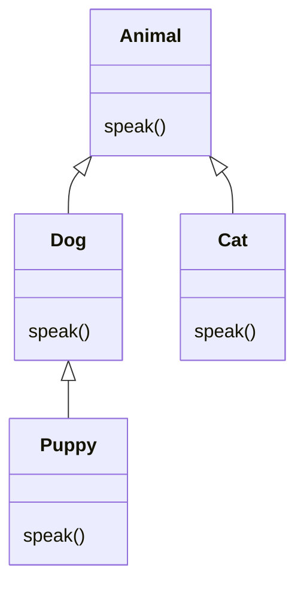

# PY-033 继承

## 1. 知识概览

| 项 | 内容 |
|---|---|
| 知识 ID | `PY-033` |
| 所属模块 | M-PY-04 面向对象编程 |
| 学习难度 | L2 初级 |
| **预计学习时间** | 50 分钟 |
| 前置知识 | [[PY-031 类与对象基础]] |
| 学习目标 | 会写子类、理解方法重写与 `super()`、知道什么时候不该用继承 |

## 2. 通俗原理讲解

继承像**家谱**：

- 子类自动拥有父类的属性与方法（"遗传"）。
- 子类可以**改写**某个方法（"变异"）。
- 需要父类原版时，用 `super()` 喊一声"爸，还是你来"。

好处：公用逻辑写一次，多个子类共享，改一处全生效。

## 3. 技术原理

```text
class 子类(父类):
    def 方法(self):
        super().方法()      # 先执行父类版本
        ...                 # 再加子类逻辑
```

| 能力 | 说明 |
|---|---|
| 方法重写 | 子类定义同名方法即覆盖父类 |
| `super()` | 调用父类实现，支持多重继承的 MRO 链 |
| `isinstance(obj, 父类)` | 子类实例也是父类实例 → `True` |
| `issubclass(子类, 父类)` | 判断类之间的继承关系 |

**`super()` 为什么好**：直接写 `父类.方法(self)` 会硬编码父类，多重继承时还会跳过 MRO 中间层；`super()` 按 MRO 顺序找下一个，能正确协作。

**什么时候不该用继承**：如果两个东西只是"有相似字段"，用**组合**更合适（见 [[PY-038 组合与继承]]）。继承表达的是"**是一种（is-a）**"关系：`Dog` 是一种 `Animal`。

## 4. 图解辅助



`Puppy` 继承 `Dog`，`Dog` 继承 `Animal`：三层，方法查找沿这条链向上。

## 5. 完整代码示例

```powershell
python inherit_demo.py
```

```python
class Animal:
    def __init__(self, name):
        self.name = name

    def speak(self):
        return "..."


class Dog(Animal):
    def speak(self):
        return "汪汪"


class Cat(Animal):
    def speak(self):
        return "喵喵"


class Puppy(Dog):
    def speak(self):
        return super().speak() + "（小声）"


for a in [Animal("动物"), Dog("旺财"), Cat("咪咪"), Puppy("小狗")]:
    print(a.name, a.speak())

print(isinstance(Puppy("x"), Animal))
print(issubclass(Dog, Animal))
```

**预期输出**

```
动物 ...
旺财 汪汪
咪咪 喵喵
小狗 汪汪（小声）
True
True
```

**说明**

- 三个子类都重写了 `speak`，调用时按**实际类型**选版本。
- `Puppy.speak` 用 `super().speak()` 拿到 `Dog` 的 `"汪汪"`，再拼后缀。
- 子类没有定义 `__init__`，直接继承了父类的。

## 6. 实践练习

**基础**

1. 定义 `Shape` 有 `area()` 返回 0，`Square` 继承并重写返回边长平方。
2. 给 `Dog` 加 `fetch()` 方法，验证 `Puppy` 也能调用。
3. 用 `issubclass` 验证 `Puppy` 与 `Animal` 的关系。

**进阶**

1. 子类重写 `__init__` 时用 `super().__init__(...)` 保留父类初始化。
2. 解释为什么"给 `Puppy` 加上 `fly()` 不该用继承 `Bird`"。

**综合实践**

设计 `Employee` → `Manager` / `Developer`：共同属性 `name`、`salary`，`Manager` 有 `team_size`，`Developer` 有 `language`；各自实现 `describe()`，并在子类里调用父类实现。

## 7. 参考答案

**基础 1 · 思路**：父类给默认实现，子类覆盖。

```python
class Shape:
    def area(self):
        return 0

class Square(Shape):
    def __init__(self, side):
        self.side = side
    def area(self):
        return self.side ** 2

print(Shape().area(), Square(3).area())
```

运行结果：`0 9`

**基础 2 · 思路**：子类自动继承父类方法。

```python
class Dog(Animal):
    def speak(self):
        return "汪汪"
    def fetch(self):
        return f"{self.name} 去捡球"

print(Dog("旺财").fetch())
```

运行结果：`旺财 去捡球`

**基础 3 · 思路**：`issubclass` 沿继承链判断。

```python
print(issubclass(Puppy, Animal))
```

运行结果：`True`

**进阶 1 · 思路**：先 `super().__init__`，再补子类字段。

```python
class Puppy(Dog):
    def __init__(self, name, age):
        super().__init__(name)
        self.age = age
    def speak(self):
        return f"{super().speak()} 我{self.age}个月"

print(Puppy("小狗", 3).speak())
```

运行结果：`汪汪 我3个月`

**进阶 2 · 思路**：继承要求"是一种"。

答案：`Puppy` 不是 `Bird`，不满足 is-a；如果只是"都能叫"，应该用共同的协议/接口（鸭子类型或 ABC），而不是强行继承。

**综合实践 · 思路**：父类写公共部分，子类 `super().describe()` 再接自己的。

```python
class Employee:
    def __init__(self, name, salary):
        self.name = name
        self.salary = salary
    def describe(self):
        return f"{self.name}，月薪 {self.salary}"

class Manager(Employee):
    def __init__(self, name, salary, team_size):
        super().__init__(name, salary)
        self.team_size = team_size
    def describe(self):
        return super().describe() + f"，带 {self.team_size} 人团队"

class Developer(Employee):
    def __init__(self, name, salary, language):
        super().__init__(name, salary)
        self.language = language
    def describe(self):
        return super().describe() + f"，主用 {self.language}"

for e in [Manager("张经理", 20000, 5), Developer("李工", 18000, "Python")]:
    print(e.describe())
```

运行结果：

```
张经理，月薪 20000，带 5 人团队
李工，月薪 18000，主用 Python
```

## 8. 常见错误

| 错误写法 | 现象 | 原因 | 正确写法 |
|---|---|---|---|
| 子类 `__init__` 没调 `super()` | 父类属性不存在 | 父类初始化没执行 | `super().__init__(...)` |
| 把 `super` 写成 `super`（无括号） | `TypeError` | `super` 是函数 | `super().m()` |
| 为复用代码强行继承 | 关系混乱 | 违反 is-a | 用组合 |
| 多重继承顺序搞错 | 调到意外的方法 | MRO 顺序 | 用 `__mro__` 检查 |
| 覆盖方法后忘了原逻辑 | 功能丢失 | 没调父类 | 需要时 `super()` |

## 9. 知识关联

- **前置**：[[PY-031 类与对象基础]]
- **后继**：[[PY-034 多态与鸭子类型]]、[[PY-038 组合与继承]]
- **相关数学**：无
- **所属模块**：`M-PY-04 面向对象编程`

## 10. 学习记录

| 日期 | 状态 | 掌握程度 | 遇到的问题 | 个人总结 | 待复习 |
|---|---|---|---|---|---|
| — | planned | — | — | — | — |

---

## 🔗 Notion 同步信息

> 以下内容由 Notion「AI Knowledge System · 知识点」数据库按知识 ID 合并而来（导出于 2026-11-09）。

| 属性 | 值 |
|---|---|
| 学科 | Python基础 |
| 学习状态 | 未开始 |
| 难度 | L2 应用 |
| 知识类型 | Concept |
| 学习目标 | 会写子类、理解方法重写与 super()、知道何时不该继承。 |

- **所属模块**：[M-PY-04 面向对象编程](../%E8%AF%BE%E7%A8%8B%E6%A8%A1%E5%9D%97/M-PY-04%20%E9%9D%A2%E5%90%91%E5%AF%B9%E8%B1%A1%E7%BC%96%E7%A8%8B.md)
- **前置知识**：[PY-031 类与对象基础](PY-031%20%E7%B1%BB%E4%B8%8E%E5%AF%B9%E8%B1%A1%E5%9F%BA%E7%A1%80.md)
- **后继知识**：[PY-034 多态与鸭子类型](PY-034%20%E5%A4%9A%E6%80%81%E4%B8%8E%E9%B8%AD%E5%AD%90%E7%B1%BB%E5%9E%8B.md) · [PY-038 组合与继承](PY-038%20%E7%BB%84%E5%90%88%E4%B8%8E%E7%BB%A7%E6%89%BF.md) · [PY-040 面向对象综合案例](PY-040%20%E9%9D%A2%E5%90%91%E5%AF%B9%E8%B1%A1%E7%BB%BC%E5%90%88%E6%A1%88%E4%BE%8B.md)
