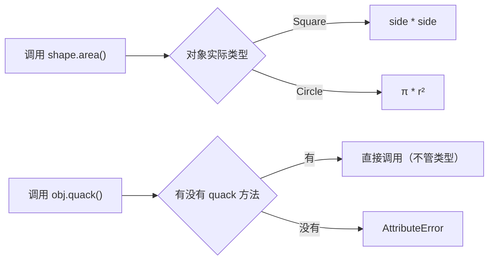

# PY-034 多态与鸭子类型

## 1. 知识概览

| 项 | 内容 |
|---|---|
| 知识 ID | `PY-034` |
| 所属模块 | M-PY-04 面向对象编程 |
| 学习难度 | L3 中级 |
| **预计学习时间** | 50 分钟 |
| 前置知识 | [[PY-033 继承]] |
| 学习目标 | 理解"同一接口、不同实现"、会用抽象基类、理解鸭子类型与它的风险 |

## 2. 通俗原理讲解

**多态**：同一个动作，不同对象有不同做法。

- 你说"叫一声"，狗汪汪、猫喵喵、鸭子嘎嘎。
- 你不需要知道它是什么动物，只要它会"叫"。

**鸭子类型**（Python 的特色）：

> "如果它走起来像鸭子、叫起来像鸭子，那它就是鸭子。"

意思：Python **不检查类型**，只检查"有没有这个方法"。你传进来一个有 `quack()` 的对象，它就能用——不管它是什么类。

## 3. 技术原理

| 概念 | 说明 |
|---|---|
| 多态 | 子类重写同一方法，调用方按实际类型分派 |
| 鸭子类型 | 不看类型，只看行为（有没有那个方法/属性） |
| 抽象基类 ABC | 强制子类实现某些方法，提供"编译期"约束 |
| `Protocol` | 结构化类型（3.8+），静态检查层面的鸭子类型 |

**鸭子类型的代价**：错误发现得晚。传错对象时，直到调用那一刻才报 `AttributeError`。所以：

- 小项目：鸭子类型足够，灵活。
- 大项目：用 ABC 或 `Protocol` + 类型检查，把错误提前。

**Python 内置到处都是多态**：`len()` 对 str/list/dict 都有效；`for` 对任何可迭代对象都有效；`+` 对数字和字符串行为不同（运算符重载）。

## 4. 图解辅助



## 5. 完整代码示例

```powershell
python polymorphism.py
```

```python
from abc import ABC, abstractmethod


class Shape(ABC):
    @abstractmethod
    def area(self):
        pass


class Square(Shape):
    def __init__(self, side):
        self.side = side

    def area(self):
        return self.side ** 2


class Circle(Shape):
    def __init__(self, r):
        self.r = r

    def area(self):
        return round(3.14159 * self.r ** 2, 2)


for s in [Square(3), Circle(2)]:
    print(type(s).__name__, s.area())

try:
    Shape()
except TypeError as e:
    print("抽象类不能实例化:", type(e).__name__)


class Duck:
    def quack(self):
        return "嘎嘎"


class Person:
    def quack(self):
        return "我学鸭子叫"


for o in [Duck(), Person()]:
    print(o.quack())
```

**预期输出**

```
Square 9
Circle 12.57
抽象类不能实例化: TypeError
嘎嘎
我学鸭子叫
```

**说明**

- `Shape` 是抽象类，不能直接实例化，强制子类实现 `area`。
- `for s in [...]` 里调用 `s.area()`，按实际类型分派——这就是多态。
- `Person` 不是 `Duck`，但有 `quack()`，所以能"当鸭子用"——这就是鸭子类型。

## 6. 实践练习

**基础**

1. 定义 `Cat`、`Cow` 都有 `sound()`，循环调用输出不同声音。
2. 写 `describe(obj)`，只要对象有 `name` 属性就打印它（鸭子类型）。
3. 解释为什么 `len()` 能同时用于字符串和列表。

**进阶**

1. 用 `ABC` 定义 `Payment`，要求子类实现 `pay(amount)`，再写 `Alipay`、`WechatPay`。
2. 说明鸭子类型在什么情况下会带来麻烦，并给出两种缓解办法。

**综合实践**

写一个"插件式导出器"：定义若干类（CSVExporter、JSONExporter），都实现 `export(data) -> str`；主程序遍历一个列表，统一调用 `export`，不需要判断类型。

## 7. 参考答案

**基础 1 · 思路**：同名方法，不同实现。

```python
class Cat:
    def sound(self): return "喵"

class Cow:
    def sound(self): return "哞"

for a in [Cat(), Cow()]:
    print(a.sound())
```

运行结果：

```
喵
哞
```

**基础 2 · 思路**：只访问属性，不判断类型。

```python
def describe(obj):
    return f"名称：{obj.name}"

class Foo:
    name = "小物件"

print(describe(Foo()))
```

运行结果：`名称：小物件`

**基础 3 · 思路**：它们都实现了 `__len__`。

答案：`len()` 只要求对象实现 `__len__`，不看具体类型。

**进阶 1 · 思路**：抽象方法强制实现。

```python
from abc import ABC, abstractmethod

class Payment(ABC):
    @abstractmethod
    def pay(self, amount):
        pass

class Alipay(Payment):
    def pay(self, amount):
        return f"支付宝支付 {amount}"

class WechatPay(Payment):
    def pay(self, amount):
        return f"微信支付 {amount}"

for p in [Alipay(), WechatPay()]:
    print(p.pay(100))
```

运行结果：

```
支付宝支付 100
微信支付 100
```

**进阶 2 · 思路**：错误发现晚、契约不明确。

答案：麻烦是"传错对象要到运行时才报错"。缓解：①用 ABC 明确契约；②用类型注解 + `Protocol` + mypy 静态检查。

**综合实践 · 思路**：统一接口，列表驱动。

```python
import json

class CSVExporter:
    def export(self, data):
        return ",".join(str(x) for x in data)

class JSONExporter:
    def export(self, data):
        return json.dumps(data, ensure_ascii=False)

data = [1, 2, 3]
for exporter in [CSVExporter(), JSONExporter()]:
    print(type(exporter).__name__, "→", exporter.export(data))
```

运行结果：

```
CSVExporter → 1,2,3
JSONExporter → [1, 2, 3]
```

## 8. 常见错误

| 错误写法 | 现象 | 原因 | 正确写法 |
|---|---|---|---|
| 用 `type(x) == A` 判断 | 子类被排除 | 精确类型比较 | 用 `isinstance` |
| 以为多态必须继承 | 多此一举 | 鸭子类型不看继承 | 只要有方法即可 |
| 传错对象，很晚才报错 | `AttributeError` | 运行时才检查 | 加类型注解/ABC |
| 抽象类忘了实现方法 | `TypeError` | 抽象方法未实现 | 子类全部实现 |
| 用 `hasattr` 判断代替设计 | 逻辑脆弱 | 靠猜行为 | 用协议或 ABC |

## 9. 知识关联

- **前置**：[[PY-033 继承]]
- **后继**：[[PY-037 特殊方法]]（运算符重载就是多态）、[[PY-038 组合与继承]]
- **相关数学**：无
- **所属模块**：`M-PY-04 面向对象编程`

## 10. 学习记录

| 日期 | 状态 | 掌握程度 | 遇到的问题 | 个人总结 | 待复习 |
|---|---|---|---|---|---|
| — | planned | — | — | — | — |

---

## 🔗 Notion 同步信息

> 以下内容由 Notion「AI Knowledge System · 知识点」数据库按知识 ID 合并而来（导出于 2026-11-09）。

| 属性 | 值 |
|---|---|
| 学科 | Python基础 |
| 学习状态 | 未开始 |
| 难度 | L3 推导 |
| 知识类型 | Concept |
| 学习目标 | 理解同一接口不同实现，会用 ABC，理解鸭子类型的风险。 |

- **所属模块**：[M-PY-04 面向对象编程](../%E8%AF%BE%E7%A8%8B%E6%A8%A1%E5%9D%97/M-PY-04%20%E9%9D%A2%E5%90%91%E5%AF%B9%E8%B1%A1%E7%BC%96%E7%A8%8B.md)
- **前置知识**：[PY-033 继承](PY-033%20%E7%BB%A7%E6%89%BF.md)
