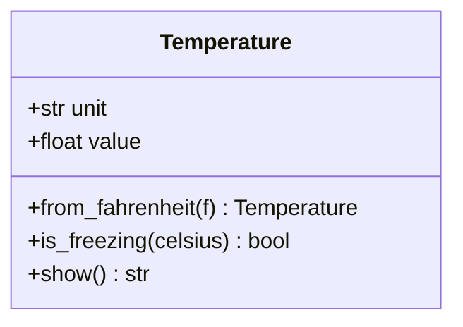

# PY-035 类方法与静态方法

## 1. 知识概览

| 项 | 内容 |
|---|---|
| 知识 ID | `PY-035` |
| 所属模块 | M-PY-04 面向对象编程 |
| 学习难度 | L2 初级 |
| **预计学习时间** | 40 分钟 |
| 前置知识 | [[PY-031 类与对象基础]] |
| 学习目标 | 分清实例方法 / 类方法 / 静态方法，知道各自的第一个参数与适用场景 |

## 2. 通俗原理讲解

三种方法像**三种员工**：

- **实例方法**：需要"我手头的资料"才能干活（访问实例属性）→ 第一个参数是 `self`。
- **类方法**：需要"公司整体信息"（类属性），不需要具体某个人 → 第一个参数是 `cls`。
- **静态方法**：只是"借用公司场地"做一件独立的事，跟谁都没关系 → 没有 `self` / `cls`。

## 3. 技术原理

| 方法类型 | 装饰器 | 第一个参数 | 能访问实例属性 | 能访问类属性 | 典型用途 |
|---|---|---|---|---|---|
| 实例方法 | 无 | `self` | ✅ | ✅ | 操作对象状态 |
| 类方法 | `@classmethod` | `cls` | ❌ | ✅ | 备用构造器、工厂方法 |
| 静态方法 | `@staticmethod` | 无 | ❌ | ❌（可显式写类名） | 工具函数、与类相关但不依赖状态 |

**类方法最常见的用途：备用构造器**。比如 `Temperature.from_fahrenheit(212)`——用另一个单位创建对象，比写 `Temperature(100)` 更清楚。

**静态方法的判断标准**：如果这个函数**完全不需要 `self` 或 `cls`**，只是逻辑上属于这个类，就用 `@staticmethod`。它本质上就是"放在类命名空间里的普通函数"。

## 4. 图解辅助



`from_fahrenheit` 是类方法（造对象）、`is_freezing` 是静态方法（纯计算）、`show` 是实例方法（读值）。

## 5. 完整代码示例

```powershell
python methods_demo.py
```

```python
class Temperature:
    unit = "C"

    def __init__(self, value):
        self.value = value

    @classmethod
    def from_fahrenheit(cls, f):
        return cls((f - 32) * 5 / 9)

    @staticmethod
    def is_freezing(celsius):
        return celsius <= 0

    def show(self):
        return f"{self.value:.1f}°{self.unit}"


t = Temperature.from_fahrenheit(212)
print(t.show())
print(Temperature.is_freezing(-5), Temperature.is_freezing(10))
print(t.unit)
```

**预期输出**

```
100.0°C
True False
C
```

**说明**

- `from_fahrenheit` 用 `cls(...)` 创建实例，子类调用时会自动用子类构造（这是 `cls` 比硬写 `Temperature` 好的原因）。
- `is_freezing` 不需要对象，直接 `Temperature.is_freezing(-5)` 调用。
- `t.unit` 读的是类属性。

## 6. 实践练习

**基础**

1. 给 `Temperature` 加 `from_celsius` 类方法，验证与 `__init__` 等价。
2. 写一个静态方法 `c_to_f(c)` 做摄氏转华氏。
3. 判断：类方法能否访问 `self.value`？

**进阶**

1. 写 `Person.from_string("小明,18")` 类方法，从字符串解析出对象。
2. 解释为什么工厂方法要用 `cls` 而不是类名。

**综合实践**

写 `Vector` 类：实例方法 `length()`，类方法 `zero()`（返回零向量），静态方法 `dot(a, b)`（计算两向量点积，不依赖实例）。

## 7. 参考答案

**基础 1 · 思路**：`cls(value)` 即可。

```python
def from_celsius(cls, c):
    return cls(c)

Temperature.from_celsius = classmethod(from_celsius)
print(Temperature.from_celsius(25).show())
```

运行结果：`25.0°C`

**基础 2 · 思路**：纯函数，无需状态。

```python
def c_to_f(c):
    return c * 9 / 5 + 32

Temperature.c_to_f = staticmethod(c_to_f)
print(Temperature.c_to_f(100))
```

运行结果：`212.0`

**基础 3 · 思路**：类方法没有实例。

答案：不能。`cls` 是类对象，没有 `value` 这个实例属性。

**进阶 1 · 思路**：切分字符串后 `cls(...)`。

```python
class Person:
    def __init__(self, name, age):
        self.name = name
        self.age = age
    @classmethod
    def from_string(cls, s):
        name, age = s.split(",")
        return cls(name, int(age))
    def __repr__(self):
        return f"Person({self.name!r}, {self.age})"

print(Person.from_string("小明,18"))
```

运行结果：`Person('小明', 18)`

**进阶 2 · 思路**：子类继承工厂时，`cls` 指向子类。

答案：硬写 `Temperature(...)` 会永远返回父类实例；用 `cls` 则返回**实际调用者**的类，子类继承后依然正确。

**综合实践 · 思路**：三种方法各司其职。

```python
class Vector:
    def __init__(self, x, y):
        self.x, self.y = x, y
    def length(self):
        return round((self.x ** 2 + self.y ** 2) ** 0.5, 2)
    @classmethod
    def zero(cls):
        return cls(0, 0)
    @staticmethod
    def dot(a, b):
        return a.x * b.x + a.y * b.y
    def __repr__(self):
        return f"Vector({self.x}, {self.y})"

v = Vector(3, 4)
print(v.length())
print(Vector.zero())
print(Vector.dot(Vector(1, 2), Vector(3, 4)))
```

运行结果：

```
5.0
Vector(0, 0)
11
```

## 8. 常见错误

| 错误写法 | 现象 | 原因 | 正确写法 |
|---|---|---|---|
| 类方法第一个参数写 `self` | 逻辑混乱但不报错 | 约定是 `cls` | 用 `cls` |
| 静态方法里访问 `self.x` | `NameError` | 没有 self | 改为实例方法 |
| 工厂方法硬编码类名 | 子类返回父类 | 不支持继承 | 用 `cls(...)` |
| 什么都写成静态方法 | 失去面向对象意义 | 滥用 | 能实例方法就实例方法 |
| 忘记装饰器 | 参数错位 | 当普通方法调用 | 加 `@classmethod` / `@staticmethod` |

## 9. 知识关联

- **前置**：[[PY-031 类与对象基础]]
- **后继**：[[PY-036 属性装饰器]]
- **相关数学**：无
- **所属模块**：`M-PY-04 面向对象编程`

## 10. 学习记录

| 日期 | 状态 | 掌握程度 | 遇到的问题 | 个人总结 | 待复习 |
|---|---|---|---|---|---|
| — | planned | — | — | — | — |

---

## 🔗 Notion 同步信息

> 以下内容由 Notion「AI Knowledge System · 知识点」数据库按知识 ID 合并而来（导出于 2026-11-09）。

| 属性 | 值 |
|---|---|
| 学科 | Python基础 |
| 学习状态 | 未开始 |
| 难度 | L2 应用 |
| 知识类型 | Concept |
| 学习目标 | 分清实例/类/静态方法及各自第一参数与适用场景。 |

- **所属模块**：[M-PY-04 面向对象编程](../%E8%AF%BE%E7%A8%8B%E6%A8%A1%E5%9D%97/M-PY-04%20%E9%9D%A2%E5%90%91%E5%AF%B9%E8%B1%A1%E7%BC%96%E7%A8%8B.md)
- **前置知识**：[PY-031 类与对象基础](PY-031%20%E7%B1%BB%E4%B8%8E%E5%AF%B9%E8%B1%A1%E5%9F%BA%E7%A1%80.md)
