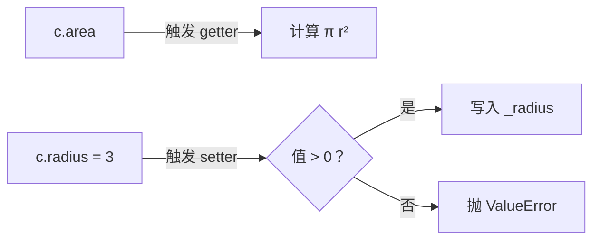

# PY-036 属性装饰器

## 1. 知识概览

| 项 | 内容 |
|---|---|
| 知识 ID | `PY-036` |
| 所属模块 | M-PY-04 面向对象编程 |
| 学习难度 | L2 初级 |
| **预计学习时间** | 45 分钟 |
| 前置知识 | [[PY-032 封装与私有属性]] |
| 学习目标 | 会用 `@property` 把方法变成"只读属性"、会用 `.setter` 做写入校验、理解它比 getter/setter 好在哪 |

## 2. 通俗原理讲解

普通做法是写 `get_balance()` / `set_balance()`，调用时要加括号，啰嗦。

`@property` 让**方法伪装成属性**：

```text
c.radius        # 看起来像读属性，实际执行了方法
c.radius = 3    # 看起来像赋值，实际执行了校验
```

好处：**对外像字段一样简单，对内保留校验逻辑**。以后把 `radius` 从普通字段改成 property，调用方代码一行都不用改。

## 3. 技术原理

```python
class C:
    @property
    def x(self):            # getter
        return self._x

    @x.setter
    def x(self, value):     # setter
        self._x = value
```

| 组成 | 作用 |
|---|---|
| `@property` | 定义读操作 |
| `@x.setter` | 定义写操作（可校验） |
| `@x.deleter` | 定义 `del` 行为（少用） |
| 只定义 getter | 得到**只读**属性，赋值会 `AttributeError` |

**关键约定**

- 内部真实数据用 `_x`（单下划线）存。
- 不要在 `setter` 里再写 `self.x = value`（会无限递归）。
- 计算型属性（如 `area`）只写 getter，每次访问都重新计算。

**什么时候用**：需要"读取时计算"或"写入时校验"的字段；纯数据字段不需要 property，反而增加复杂度。

## 4. 图解辅助



## 5. 完整代码示例

```powershell
python property_demo.py
```

```python
class Circle:
    def __init__(self, radius):
        self._radius = radius

    @property
    def radius(self):
        return self._radius

    @radius.setter
    def radius(self, value):
        if value <= 0:
            raise ValueError("半径必须为正")
        self._radius = value

    @property
    def area(self):
        return round(3.14159 * self._radius ** 2, 2)


c = Circle(2)
print(c.radius, c.area)
c.radius = 3
print(c.radius, c.area)

try:
    c.radius = -1
except ValueError as e:
    print("拒绝非法值:", e)
```

**预期输出**

```
2 12.57
3 28.27
拒绝非法值: 半径必须为正
```

**说明**

- `c.radius` 没加括号，但执行的是 getter。
- `c.radius = 3` 触发 setter，校验通过后写入 `_radius`。
- `c.area` 是**计算属性**：每次访问都重新算，不存储。
- 赋 `-1` 被 setter 拦下，对象状态没有被破坏。

## 6. 实践练习

**基础**

1. 给 `Circle` 加只读属性 `diameter`（半径 × 2）。
2. 定义 `Person`，`age` 用 property 限制在 0–150。
3. 判断：只写 getter 不写 setter，赋值会怎样？

**进阶**

1. 写 `Temperature`，`celsius` 与 `fahrenheit` 两个 property 互相转换。
2. 解释为什么 setter 里不能写 `self.x = value`。

**综合实践**

写 `BankAccount`：私有 `_balance`，property `balance` 只读；方法 `deposit` / `withdraw` 修改余额；再写一个只读属性 `is_overdrawn`（余额 < 0）。

## 7. 参考答案

**基础 1 · 思路**：只读计算属性。

```python
def diameter(self):
    return self._radius * 2

Circle.diameter = property(diameter)
c = Circle(2)
print(c.diameter)
```

运行结果：`4`

**基础 2 · 思路**：setter 里校验。

```python
class Person:
    def __init__(self, age):
        self.age = age
    @property
    def age(self):
        return self._age
    @age.setter
    def age(self, v):
        if not (0 <= v <= 150):
            raise ValueError("非法年龄")
        self._age = v

p = Person(30)
print(p.age)
```

运行结果：`30`

**基础 3 · 思路**：只读属性。

答案：抛 `AttributeError: can't set attribute`。

**进阶 1 · 思路**：两个 property 共用 `_celsius`。

```python
class Temperature:
    def __init__(self, c):
        self._celsius = c
    @property
    def celsius(self):
        return self._celsius
    @celsius.setter
    def celsius(self, v):
        self._celsius = v
    @property
    def fahrenheit(self):
        return round(self._celsius * 9 / 5 + 32, 1)

t = Temperature(100)
print(t.celsius, t.fahrenheit)
t.celsius = 0
print(t.celsius, t.fahrenheit)
```

运行结果：

```
100 212.0
0 32.0
```

**进阶 2 · 思路**：会递归调用自己。

答案：`self.x = value` 又会触发 setter，无限递归直到 `RecursionError`；必须写 `self._x = value`。

**综合实践 · 思路**：余额只读，改余额走方法。

```python
class BankAccount:
    def __init__(self, balance=0):
        self._balance = balance
    @property
    def balance(self):
        return self._balance
    @property
    def is_overdrawn(self):
        return self._balance < 0
    def deposit(self, amount):
        self._balance += amount
    def withdraw(self, amount):
        self._balance -= amount

acc = BankAccount(100)
acc.withdraw(150)
print(acc.balance, acc.is_overdrawn)
try:
    acc.balance = 999
except AttributeError as e:
    print("余额只读:", type(e).__name__)
```

运行结果：

```
-50 True
余额只读: AttributeError
```

## 8. 常见错误

| 错误写法 | 现象 | 原因 | 正确写法 |
|---|---|---|---|
| setter 里 `self.x = value` | `RecursionError` | 递归触发自己 | `self._x = value` |
| `@x.setter` 写在 `@property` 之前 | `NameError` | 顺序反了 | 先 getter 再 setter |
| 用 `c.radius()` 调用 | `TypeError` | property 是属性不是方法 | `c.radius` |
| 所有字段都做 property | 代码冗长 | 过度设计 | 只给需校验/计算的字段 |
| 忘记初始化 `_x` | `AttributeError` | getter 读取不存在 | 在 `__init__` 里设初值 |

## 9. 知识关联

- **前置**：[[PY-032 封装与私有属性]]
- **后继**：[[PY-037 特殊方法]]
- **相关数学**：无
- **所属模块**：`M-PY-04 面向对象编程`

## 10. 学习记录

| 日期 | 状态 | 掌握程度 | 遇到的问题 | 个人总结 | 待复习 |
|---|---|---|---|---|---|
| — | planned | — | — | — | — |

---

## 🔗 Notion 同步信息

> 以下内容由 Notion「AI Knowledge System · 知识点」数据库按知识 ID 合并而来（导出于 2026-11-09）。

| 属性 | 值 |
|---|---|
| 学科 | Python基础 |
| 学习状态 | 未开始 |
| 难度 | L2 应用 |
| 知识类型 | Concept |
| 学习目标 | 会用 property 做只读与写入校验，理解它优于 getter/setter。 |

- **所属模块**：[M-PY-04 面向对象编程](../%E8%AF%BE%E7%A8%8B%E6%A8%A1%E5%9D%97/M-PY-04%20%E9%9D%A2%E5%90%91%E5%AF%B9%E8%B1%A1%E7%BC%96%E7%A8%8B.md)
- **前置知识**：[PY-032 封装与私有属性](PY-032%20%E5%B0%81%E8%A3%85%E4%B8%8E%E7%A7%81%E6%9C%89%E5%B1%9E%E6%80%A7.md)
