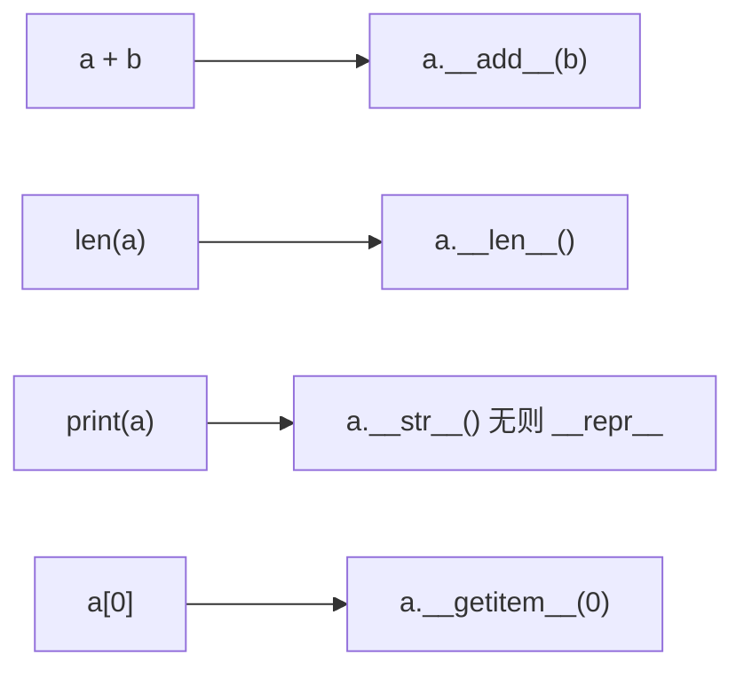

# PY-037 特殊方法

## 1. 知识概览

| 项 | 内容 |
|---|---|
| 知识 ID | `PY-037` |
| 所属模块 | M-PY-04 面向对象编程 |
| 学习难度 | L3 中级 |
| **预计学习时间** | 55 分钟 |
| 前置知识 | [[PY-031 类与对象基础]] |
| 学习目标 | 理解"双下划线方法"如何让对象接入 Python 语法、会写常用的 6 个 |

## 2. 通俗原理讲解

特殊方法（也叫魔术方法、dunder）是**Python 预留的"插座"**。

你写 `a + b`，Python 不会直接算，而是去找 `a.__add__(b)`。
你写 `len(a)`，它去找 `a.__len__()`。

所以：**你实现了对应的方法，你的对象就能用对应的语法**。

- 实现了 `__add__` → 能用 `+`
- 实现了 `__len__` → 能用 `len()`
- 实现了 `__getitem__` → 能用 `a[0]` 和 `for`
- 实现了 `__repr__` → 打印时显示友好内容

这不是"高级技巧"，而是**让自己的类融入语言**的正规方式。

## 3. 技术原理

| 语法 | 对应方法 | 说明 |
|---|---|---|
| `repr(a)` / 调试打印 | `__repr__` | 给开发者看，最好能重建对象 |
| `str(a)` / `print(a)` | `__str__` | 给用户看（不写则回退 `__repr__`） |
| `a + b` | `__add__` | 算术运算 |
| `a == b` | `__eq__` | 相等（默认比较身份） |
| `len(a)` | `__len__` | 长度 |
| `a[i]` | `__getitem__` | 下标/切片 |
| `for x in a` | `__iter__` | 迭代 |
| `with a` | `__enter__` / `__exit__` | 上下文管理 |
| `a()` | `__call__` | 让对象可调用 |

**两个要点**

1. **`__eq__` 最好配 `__hash__`**：定义了相等语义后，对象默认可哈希性会被取消；要放进 `set`/做字典键需显式实现 `__hash__`。
2. **不要滥用**：能用普通方法表达清楚的，就别重载运算符——可读性优先。

## 4. 图解辅助



## 5. 完整代码示例

```powershell
python dunder_demo.py
```

```python
class Vector:
    def __init__(self, x, y):
        self.x, self.y = x, y

    def __repr__(self):
        return f"Vector({self.x}, {self.y})"

    def __add__(self, other):
        return Vector(self.x + other.x, self.y + other.y)

    def __eq__(self, other):
        return isinstance(other, Vector) and (self.x, self.y) == (other.x, other.y)

    def __len__(self):
        return 2

    def __getitem__(self, i):
        return (self.x, self.y)[i]


a = Vector(1, 2)
b = Vector(3, 4)
print(a + b)
print(a == Vector(1, 2))
print(len(a), a[0], a[1])
print(str(a), repr(a))
```

**预期输出**

```
Vector(4, 6)
True
2 1 2
Vector(1, 2) Vector(1, 2)
```

**说明**

- `a + b` 触发了 `__add__`，返回新的 `Vector`。
- `a == Vector(1, 2)` 为 `True`，因为实现了 `__eq__`（否则比的是内存地址，为 `False`）。
- `len(a)` 返回 2、`a[0]` 返回 `x`——对象"像容器一样"可用。
- 没定义 `__str__`，所以 `str(a)` 回退到 `__repr__`，两者输出一样。

## 6. 实践练习

**基础**

1. 给 `Vector` 加 `__sub__`，实现向量相减。
2. 给 `Vector` 加 `__mul__`，实现数乘（`v * 3`）。
3. 判断：没实现 `__eq__` 时，两个内容相同的对象 `==` 会怎样？

**进阶**

1. 实现 `Playlist` 类，支持 `len()`、`for` 遍历、`p[0]` 取歌。
2. 解释为什么定义了 `__eq__` 之后，对象默认不能再放进 `set`。

**综合实践**

写一个 `Matrix2` 类（2×2 矩阵）：支持 `+`、`*`（矩阵乘法）、`==`、`repr`，并打印运算结果。

## 7. 参考答案

**基础 1 · 思路**：返回新对象。

```python
def __sub__(self, other):
    return Vector(self.x - other.x, self.y - other.y)

Vector.__sub__ = __sub__
print(Vector(3, 4) - Vector(1, 2))
```

运行结果：`Vector(2, 2)`

**基础 2 · 思路**：数在右，乘每个分量。

```python
def __mul__(self, k):
    return Vector(self.x * k, self.y * k)

Vector.__mul__ = __mul__
print(Vector(1, 2) * 3)
```

运行结果：`Vector(3, 6)`

**基础 3 · 思路**：默认 `__eq__` 比较的是身份（`is`）。

答案：比较内存地址，内容相同也返回 `False`。

**进阶 1 · 思路**：`__len__` + `__iter__` + `__getitem__`。

```python
class Playlist:
    def __init__(self, songs):
        self.songs = list(songs)
    def __len__(self):
        return len(self.songs)
    def __iter__(self):
        return iter(self.songs)
    def __getitem__(self, i):
        return self.songs[i]
    def __repr__(self):
        return f"Playlist({self.songs})"

p = Playlist(["歌A", "歌B"])
print(len(p), p[0])
for s in p:
    print(s)
```

运行结果：

```
2 歌A
歌A
歌B
```

**进阶 2 · 思路**：相等的对象必须有相同哈希，否则集合语义会崩。

答案：Python 会把 `__hash__` 设为 `None`（不可哈希），强制你显式定义一致的哈希规则。

**综合实践 · 思路**：二维列表存矩阵，实现四个方法。

```python
class Matrix2:
    def __init__(self, a, b, c, d):
        self.m = [[a, b], [c, d]]
    def __add__(self, o):
        return Matrix2(*(self.m[i][j] + o.m[i][j] for i in range(2) for j in range(2)))
    def __mul__(self, o):
        r = [[sum(self.m[i][k] * o.m[k][j] for k in range(2)) for j in range(2)] for i in range(2)]
        return Matrix2(r[0][0], r[0][1], r[1][0], r[1][1])
    def __eq__(self, o):
        return self.m == o.m
    def __repr__(self):
        return f"Matrix2{self.m}"

x = Matrix2(1, 2, 3, 4)
y = Matrix2(5, 6, 7, 8)
print(x + y)
print(x * y)
print(x == Matrix2(1, 2, 3, 4))
```

运行结果：

```
Matrix2[[6, 8], [10, 12]]
Matrix2[[19, 22], [43, 50]]
True
```

## 8. 常见错误

| 错误写法 | 现象 | 原因 | 正确写法 |
|---|---|---|---|
| `__repr__` 返回非字符串 | `TypeError` | 必须返回 str | `return f"..."` |
| 定义了 `__eq__` 还想放进 set | `TypeError: unhashable` | `__hash__` 被置空 | 同时实现 `__hash__` |
| `__add__` 里修改自身 | 副作用意外 | 运算应返回新对象 | 返回新实例 |
| 把 `__str__` 当 `__repr__` 用 | 调试信息不清 | 用途不同 | 两个都写 |
| 重载 `__eq__` 不判类型 | `AttributeError` | 对方没有 x/y | 先 `isinstance` |

## 9. 知识关联

- **前置**：[[PY-031 类与对象基础]]
- **后继**：[[PY-039 Python 对象模型]]、`PY-045 自定义异常与上下文管理器`（`__enter__/__exit__`，待建）
- **相关数学**：向量与矩阵运算见 [[MATH-201 向量与空间基础]]、[[MATH-216 矩阵乘法]]
- **所属模块**：`M-PY-04 面向对象编程`

## 10. 学习记录

| 日期 | 状态 | 掌握程度 | 遇到的问题 | 个人总结 | 待复习 |
|---|---|---|---|---|---|
| — | planned | — | — | — | — |

---

## 🔗 Notion 同步信息

> 以下内容由 Notion「AI Knowledge System · 知识点」数据库按知识 ID 合并而来（导出于 2026-11-09）。

| 属性 | 值 |
|---|---|
| 学科 | Python基础 |
| 学习状态 | 未开始 |
| 难度 | L3 推导 |
| 知识类型 | Concept |
| 学习目标 | 理解双下划线方法如何接入语法，会写常用六个。 |

- **所属模块**：[M-PY-04 面向对象编程](../%E8%AF%BE%E7%A8%8B%E6%A8%A1%E5%9D%97/M-PY-04%20%E9%9D%A2%E5%90%91%E5%AF%B9%E8%B1%A1%E7%BC%96%E7%A8%8B.md)
- **前置知识**：[PY-031 类与对象基础](PY-031%20%E7%B1%BB%E4%B8%8E%E5%AF%B9%E8%B1%A1%E5%9F%BA%E7%A1%80.md)
- **后继知识**：[PY-039 Python 对象模型](PY-039%20Python%20%E5%AF%B9%E8%B1%A1%E6%A8%A1%E5%9E%8B.md) · [PY-040 面向对象综合案例](PY-040%20%E9%9D%A2%E5%90%91%E5%AF%B9%E8%B1%A1%E7%BB%BC%E5%90%88%E6%A1%88%E4%BE%8B.md)
- **被项目引用**：[PROJ-002 学生成绩管理系统](../../07_%E5%AE%9E%E6%88%98%E9%A1%B9%E7%9B%AE/01%20Python%E9%A1%B9%E7%9B%AE/PROJ-002%20%E5%AD%A6%E7%94%9F%E6%88%90%E7%BB%A9%E7%AE%A1%E7%90%86%E7%B3%BB%E7%BB%9F.md)
