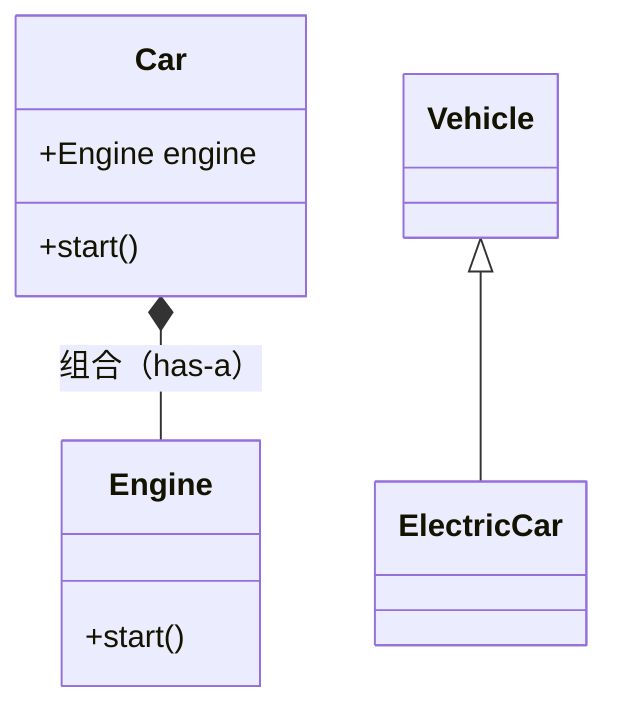

# PY-038 组合与继承

## 1. 知识概览

| 项 | 内容 |
|---|---|
| 知识 ID | `PY-038` |
| 所属模块 | M-PY-04 面向对象编程 |
| 学习难度 | L3 中级 |
| **预计学习时间** | 45 分钟 |
| 前置知识 | [[PY-033 继承]] |
| 学习目标 | 分清 is-a 与 has-a、知道"优先组合"的理由、能判断该选哪个 |

## 2. 通俗原理讲解

- **继承**是"**是一种**"：狗**是一种**动物。
- **组合**是"**有一个**"：汽车**有一个**引擎。

两者的区别不在写法，而在**关系**：

- 汽车不是引擎，所以不该 `class Car(Engine)`。
- 正确做法是 `self.engine = Engine()`——把引擎当零件装进来。

经验法则：**优先用组合**。继承是强耦合（父类一改，子类全受影响），组合是松耦合（换个零件就行）。

## 3. 技术原理

| 维度 | 继承 | 组合 |
|---|---|---|
| 关系 | is-a | has-a |
| 耦合 | 强（依赖父类实现） | 弱（只依赖接口） |
| 复用方式 | 自动获得父类方法 | 调用被组合对象的方法 |
| 灵活性 | 运行时不可换父类 | 运行时可替换部件 |
| 典型问题 | 继承层次过深、方法冲突 | 委托代码略多 |

**什么时候必须用继承**：

1. 确实存在 is-a 关系（`Square` 是 `Shape`）。
2. 需要多态分派（统一接口不同实现）。
3. 框架要求（如 ORM 的模型基类）。

**什么时候用组合**：只是"需要某个能力"，而不是"是某种东西"。比如"日志功能"——给类加一个 `self.logger`，而不是继承 `Logger`。

## 4. 图解辅助



左：继承（is-a）；右：组合（has-a）。汽车"有一个"引擎，但"不是"引擎。

## 5. 完整代码示例

```powershell
python compose_vs_inherit.py
```

```python
class Engine:
    def start(self):
        return "引擎启动"


class Car:
    def __init__(self):
        self.engine = Engine()

    def start(self):
        return f"汽车：{self.engine.start()}"


class ElectricCar(Car):
    def start(self):
        return "电动车：电机启动"


print(Car().start())
print(ElectricCar().start())
print(isinstance(ElectricCar(), Car))
```

**预期输出**

```
汽车：引擎启动
电动车：电机启动
True
```

**说明**

- `Car` 用组合持有一个 `Engine`，`start` 委托给它。
- `ElectricCar` 用继承复用 `Car` 的身份，但重写了 `start`（因为动力方式不同）。
- 这里两者都合理：`Car` has-a `Engine`（组合），`ElectricCar` is-a `Car`（继承）。

## 6. 实践练习

**基础**

1. 给 `Car` 加一个 `Wheel` 类（组合），输出"4 个轮子"。
2. 判断：`class Car(Engine)` 是否合理？为什么？
3. 用继承实现 `Truck(Car)`，重写 `start` 输出"卡车启动"。

**进阶**

1. 把"日志功能"分别用继承和组合实现，比较两种写法。
2. 解释"继承层次超过 3 层就该警惕"的原因。

**综合实践**

设计一个"订单系统"：`Order` 组合 `Customer` 与若干 `OrderItem`；`Order` 提供 `total()`；再写一个 `VipOrder` 用继承给折扣。说明哪部分是组合、哪部分是继承、为什么。

## 7. 参考答案

**基础 1 · 思路**：组合一个列表。

```python
class Wheel:
    def __init__(self, size):
        self.size = size

class Car:
    def __init__(self):
        self.engine = Engine()
        self.wheels = [Wheel(16) for _ in range(4)]
    def wheel_count(self):
        return f"{len(self.wheels)} 个轮子"

print(Car().wheel_count())
```

运行结果：`4 个轮子`

**基础 2 · 思路**：违反 is-a。

答案：不合理。汽车不是引擎，只是"有一个"引擎；继承会继承 `start()` 等无关语义，还会让 `isinstance(car, Engine)` 为真，逻辑荒谬。

**基础 3 · 思路**：子类重写。

```python
class Truck(Car):
    def start(self):
        return "卡车启动"

print(Truck().start())
```

运行结果：`卡车启动`

**进阶 1 · 思路**：继承把日志变成"身份的一部分"，组合只是"多一个零件"。

```python
class Logger:
    def log(self, msg):
        print("[LOG]", msg)

# 组合
class Service:
    def __init__(self):
        self.logger = Logger()
    def run(self):
        self.logger.log("service running")

Service().run()
```

运行结果：`[LOG] service running`

组合版可以随时换成 `NullLogger`（不打印），继承版做不到。

**进阶 2 · 思路**：每层都增加耦合与认知负担。

答案：层数越多，改上层越容易影响下层；方法解析顺序（MRO）变复杂；调试时要在多个类之间跳转。

**综合实践 · 思路**：数据用组合，可变行为用继承。

```python
class Customer:
    def __init__(self, name):
        self.name = name

class OrderItem:
    def __init__(self, name, price):
        self.name, self.price = name, price

class Order:
    def __init__(self, customer):
        self.customer = customer
        self.items = []
    def add(self, item):
        self.items.append(item)
    def total(self):
        return sum(i.price for i in self.items)

class VipOrder(Order):
    def total(self):
        return round(super().total() * 0.9, 2)

o = Order(Customer("小明"))
o.add(OrderItem("书", 50))
o.add(OrderItem("笔", 10))
print(o.total())

v = VipOrder(Customer("小红"))
v.add(OrderItem("书", 50))
print(v.total())
```

运行结果：

```
60
45.0
```

## 8. 常见错误

| 错误写法 | 现象 | 原因 | 正确写法 |
|---|---|---|---|
| 为复用代码滥用继承 | 语义错乱 | 违反 is-a | 用组合 |
| 组合对象在 `__init__` 里写死 | 无法替换 | 耦合具体类 | 允许注入 |
| 继承后又大量重写父类方法 | 说明不合适 | 关系不成立 | 考虑组合 |
| 多重继承解决一切 | MRO 难以预测 | 复杂度过高 | 用 mixin 且克制 |
| 组合里忘了初始化 | `AttributeError` | 没建部件 | 在 `__init__` 里创建 |

## 9. 知识关联

- **前置**：[[PY-033 继承]]
- **后继**：[[PY-039 Python 对象模型]]、[[PY-040 面向对象综合案例]]
- **相关数学**：无
- **所属模块**：`M-PY-04 面向对象编程`

## 10. 学习记录

| 日期 | 状态 | 掌握程度 | 遇到的问题 | 个人总结 | 待复习 |
|---|---|---|---|---|---|
| — | planned | — | — | — | — |

---

## 🔗 Notion 同步信息

> 以下内容由 Notion「AI Knowledge System · 知识点」数据库按知识 ID 合并而来（导出于 2026-11-09）。

| 属性 | 值 |
|---|---|
| 学科 | Python基础 |
| 学习状态 | 未开始 |
| 难度 | L3 推导 |
| 知识类型 | Concept |
| 学习目标 | 分清 is-a 与 has-a，知道优先用组合的理由。 |

- **所属模块**：[M-PY-04 面向对象编程](../%E8%AF%BE%E7%A8%8B%E6%A8%A1%E5%9D%97/M-PY-04%20%E9%9D%A2%E5%90%91%E5%AF%B9%E8%B1%A1%E7%BC%96%E7%A8%8B.md)
- **前置知识**：[PY-033 继承](PY-033%20%E7%BB%A7%E6%89%BF.md)
