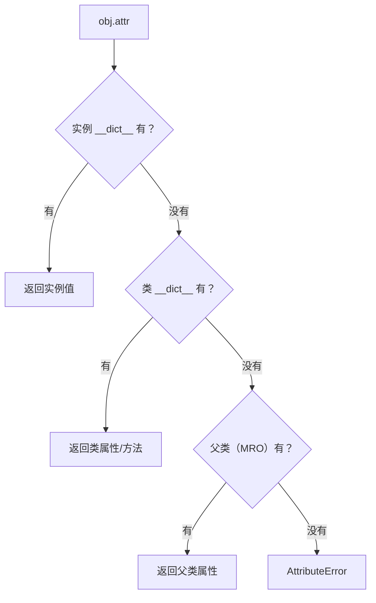

# PY-039 Python 对象模型

## 1. 知识概览

| 项 | 内容 |
|---|---|
| 知识 ID | `PY-039` |
| 所属模块 | M-PY-04 面向对象编程 |
| 学习难度 | L3 中级 |
| **预计学习时间** | 50 分钟 |
| 前置知识 | [[PY-037 特殊方法]] |
| 学习目标 | 理解 `__dict__`、属性查找顺序、MRO，能解释"为什么我给对象加了属性却找不到" |

## 2. 通俗原理讲解

Python 里"对象"其实是三层抽屉：

1. **实例抽屉**（`obj.__dict__`）：只属于这个对象的属性。
2. **类抽屉**（`Cls.__dict__`）：所有实例共享的方法与类属性。
3. **父类抽屉**：按继承链一层层往上找。

**读属性**时从 1 找到 3，谁先有就用谁——这就是"就近原则"。
**写属性**时只写 1（实例抽屉），不会影响类和别的实例。

## 3. 技术原理

**属性查找顺序**（`obj.attr`）：

```
实例 __dict__ → 类 __dict__ → 父类（按 MRO）→ 元类 → __getattr__ → AttributeError
```

**MRO（方法解析顺序）**：一个类到 `object` 的线性化顺序，可用 `Cls.__mro__` 查看。Python 用 C3 线性化，保证"子类在前、父类在后"且顺序一致。

**三个容易混淆的点**

| 现象 | 解释 |
|---|---|
| `obj.class_attr = x` 只影响该对象 | 写的是实例抽屉，遮蔽了类属性 |
| 修改 `Cls.class_attr` 影响所有没被遮蔽的实例 | 类抽屉共享 |
| `obj.__dict__` 看不到方法 | 方法在类抽屉里 |

**`__slots__`**：如果类定义了 `__slots__`，实例就没有 `__dict__`，能省内存、防止乱加属性——但灵活性下降。

## 4. 图解辅助



## 5. 完整代码示例

```powershell
python object_model.py
```

```python
class A:
    class_attr = "A的类属性"

    def __init__(self):
        self.instance_attr = "实例属性"


a = A()
print(a.class_attr)
print(a.instance_attr)
print(a.__dict__)
print(A.__dict__.keys() & {"class_attr"})

a.class_attr = "改的是实例"
print(a.class_attr, A.class_attr)


class B(A):
    pass


b = B()
print(isinstance(b, A), type(b) is A, type(b) is B)
print([c.__name__ for c in B.__mro__])
```

**预期输出**

```
A的类属性
实例属性
{'instance_attr': '实例属性'}
{'class_attr'}
改的是实例 A的类属性
True False True
['B', 'A', 'object']
```

**说明**

- `a.__dict__` 只有实例属性；`class_attr` 在 `A.__dict__` 里。
- `a.class_attr = ...` 只是在实例抽屉里加了一项，类属性没动。
- `type(b) is A` 为 `False`：`b` 的精确类型是 `B`；但 `isinstance(b, A)` 为 `True`（继承关系）。
- MRO 顺序 `B → A → object`。

## 6. 实践练习

**基础**

1. 定义类并在 `__init__` 里设两个属性，打印 `obj.__dict__`。
2. 给类加一个类属性，用实例和类分别读取。
3. 打印某个自定义类的 `__mro__` 名称列表。

**进阶**

1. 解释：为什么 `a.method` 能取到方法，但 `a.__dict__` 里没有它？
2. 给类加 `__slots__ = ("x",)`，尝试给实例加别的属性会怎样？

**综合实践**

写一个"属性访问记录器"：用 `__getattr__` 在访问不存在的属性时打印提示并返回 `None`，验证它对已有属性不触发。

## 7. 参考答案

**基础 1 · 思路**：直接打印。

```python
class P:
    def __init__(self):
        self.x = 1
        self.y = 2

print(P().__dict__)
```

运行结果：`{'x': 1, 'y': 2}`

**基础 2 · 思路**：类属性通过实例也能读。

```python
class P:
    kind = "人类"

print(P.kind, P().kind)
```

运行结果：`人类 人类`

**基础 3 · 思路**：`__mro__` 给的是类对象列表。

```python
print([c.__name__ for c in P.__mro__])
```

运行结果：`['P', 'object']`

**进阶 1 · 思路**：方法在类里，不在实例里。

答案：方法定义在类的 `__dict__` 中；实例访问时通过类查找拿到"绑定方法"（自动带上 self），所以实例字典里没有。

**进阶 2 · 思路**：`__slots__` 禁止额外属性。

```python
class S:
    __slots__ = ("x",)
    def __init__(self):
        self.x = 1

s = S()
print(s.x)
try:
    s.y = 2
except AttributeError as e:
    print("禁止新增属性:", type(e).__name__)
```

运行结果：

```
1
禁止新增属性: AttributeError
```

**综合实践 · 思路**：`__getattr__` 只在"正常查找失败"时调用。

```python
class Recorder:
    def __init__(self):
        self.exists = 1

    def __getattr__(self, name):
        print(f"[记录] 访问了不存在的属性：{name}")
        return None

r = Recorder()
print(r.exists)
print(r.missing)
```

运行结果：

```
1
[记录] 访问了不存在的属性：missing
None
```

已有属性 `exists` 不会触发 `__getattr__`。

## 8. 常见错误

| 错误写法 | 现象 | 原因 | 正确写法 |
|---|---|---|---|
| 以为改实例属性会改类 | 其他实例没变 | 就近遮蔽 | 改 `Cls.attr` |
| 在 `__init__` 外访问未设属性 | `AttributeError` | 实例抽屉没有 | 先赋值 |
| 混淆 `type(x) is A` 与 `isinstance` | 子类被误判 | 精确类型 vs 继承 | 按需选择 |
| 给 `__slots__` 类加新属性 | `AttributeError` | 没有 `__dict__` | 用 `__dict__` 或去掉 slots |
| 以为 `__getattr__` 对所有属性生效 | 已有属性不触发 | 只在失败时调用 | 用 `__getattribute__`（慎用） |

## 9. 知识关联

- **前置**：[[PY-037 特殊方法]]
- **后继**：[[PY-040 面向对象综合案例]]
- **相关数学**：无
- **所属模块**：`M-PY-04 面向对象编程`

## 10. 学习记录

| 日期 | 状态 | 掌握程度 | 遇到的问题 | 个人总结 | 待复习 |
|---|---|---|---|---|---|
| — | planned | — | — | — | — |

---

## 🔗 Notion 同步信息

> 以下内容由 Notion「AI Knowledge System · 知识点」数据库按知识 ID 合并而来（导出于 2026-11-09）。

| 属性 | 值 |
|---|---|
| 学科 | Python基础 |
| 学习状态 | 未开始 |
| 难度 | L3 推导 |
| 知识类型 | Concept |
| 学习目标 | 理解 __dict__、属性查找与 MRO，能解释属性找不到的原因。 |

- **所属模块**：[M-PY-04 面向对象编程](../%E8%AF%BE%E7%A8%8B%E6%A8%A1%E5%9D%97/M-PY-04%20%E9%9D%A2%E5%90%91%E5%AF%B9%E8%B1%A1%E7%BC%96%E7%A8%8B.md)
- **前置知识**：[PY-037 特殊方法](PY-037%20%E7%89%B9%E6%AE%8A%E6%96%B9%E6%B3%95.md)
