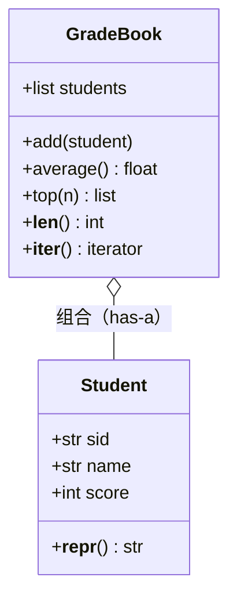

# PY-040 面向对象综合案例

## 1. 知识概览

| 项 | 内容 |
|---|---|
| 知识 ID | `PY-040` |
| 所属模块 | M-PY-04 面向对象编程 |
| 学习难度 | L3 中级 |
| **预计学习时间** | 60 分钟 |
| 前置知识 | [[PY-033 继承]]、[[PY-037 特殊方法]] |
| 学习目标 | 把封装、继承、特殊方法组合成一个可运行的小系统，体会"类怎么分工" |

## 2. 通俗原理讲解

单个知识点像**零件**：会写类、会继承、会重载运算符。

真实项目是**装配**：一个"成绩管理系统"需要

- `Student` 负责**存一个学生**（数据 + 自我介绍）；
- `GradeBook` 负责**管一群学生**（增删查、平均分、排名）；
- `GradeBook` 内部用**列表组合**学生（has-a），而不是继承学生（is-a）。

分工原则：**一个类只负责一件事**。学生不该知道"怎么算班级平均分"，班册也不该知道"学生怎么介绍自己"。

## 3. 技术原理

本案例用到四个已学能力：

| 能力 | 用在哪 |
|---|---|
| `__init__` / 实例属性 | 存学生信息 |
| 封装（`_` / 校验） | 成绩范围限制 |
| 组合（列表装对象） | `GradeBook.students` |
| 特殊方法（`__len__`/`__iter__`/`__repr__`） | 让班册"像容器"一样自然使用 |

**设计检查清单**（写任何类前问自己）

1. 这个类**代表什么**？一句话能说清吗？
2. 它**拥有**什么数据？（属性）
3. 它能**做什么**？（方法）
4. 它**不该**做什么？（边界，避免上帝类）

## 4. 图解辅助



`GradeBook` 组合多个 `Student`，对外表现出"容器"的行为。

## 5. 完整代码示例

```powershell
python oop_case.py
```

```python
class Student:
    def __init__(self, sid, name, score):
        if not (0 <= score <= 100):
            raise ValueError("成绩必须在 0–100")
        self.sid = sid
        self.name = name
        self.score = score

    def __repr__(self):
        return f"Student({self.sid}, {self.name}, {self.score})"


class GradeBook:
    def __init__(self):
        self.students = []

    def add(self, student):
        self.students.append(student)
        return self

    def average(self):
        return round(sum(s.score for s in self.students) / len(self.students), 2)

    def top(self, n=1):
        return sorted(self.students, key=lambda s: -s.score)[:n]

    def __len__(self):
        return len(self.students)

    def __iter__(self):
        return iter(self.students)


book = GradeBook()
book.add(Student("001", "小明", 85))
book.add(Student("002", "小红", 92))
book.add(Student("003", "小刚", 78))

print(len(book), book.average())
print(book.top(2))
for s in book:
    print(s.name, s.score)
```

**预期输出**

```
3 85.0
[Student(002, 小红, 92), Student(001, 小明, 85)]
小明 85
小红 92
小刚 78
```

**说明**

- `Student` 在构造时就校验成绩，非法值根本进不来——这是**封装**的价值。
- `GradeBook.add` 返回 `self`，所以可以链式调用 `book.add(...).add(...)`。
- `__len__` 与 `__iter__` 让班册"像列表一样"用：`len(book)`、`for s in book`。
- `top` 用 `sorted` + `lambda`，**不修改**原列表。

## 6. 实践练习

**基础**

1. 给 `Student` 加 `level` 属性（≥90 为 A，≥80 为 B，其余 C），在 `__repr__` 里体现。
2. 给 `GradeBook` 加 `find(name)` 方法，返回学生对象或 `None`。
3. 试着创建 `Student("004", "小美", 120)`，观察报错。

**进阶**

1. 给 `GradeBook` 加 `remove(sid)` 方法，返回是否删除成功。
2. 加 `by_score()` 返回按分数升序的新列表（不改原列表）。

**综合实践**

扩展成"多班级"系统：再加 `School` 类，组合多个 `GradeBook`，提供 `school_average()` 与 `best_student()`；用 2 个班、共 5 名学生测试。

## 7. 参考答案

**基础 1 · 思路**：加属性 + 改 `__repr__`。

```python
class Student:
    def __init__(self, sid, name, score):
        if not (0 <= score <= 100):
            raise ValueError("成绩必须在 0–100")
        self.sid, self.name, self.score = sid, name, score

    @property
    def level(self):
        if self.score >= 90:
            return "A"
        if self.score >= 80:
            return "B"
        return "C"

    def __repr__(self):
        return f"Student({self.sid}, {self.name}, {self.score}, {self.level})"

print(Student("001", "小明", 85))
```

运行结果：`Student(001, 小明, 85, B)`

**基础 2 · 思路**：遍历比对。

```python
def find(self, name):
    for s in self.students:
        if s.name == name:
            return s
    return None

GradeBook.find = find
print(book.find("小红"), book.find("不存在"))
```

运行结果：`Student(002, 小红, 92) None`

**基础 3 · 思路**：构造时校验触发。

答案：抛 `ValueError: 成绩必须在 0–100`。

**进阶 1 · 思路**：按学号过滤重建列表。

```python
def remove(self, sid):
    before = len(self.students)
    self.students = [s for s in self.students if s.sid != sid]
    return len(self.students) < before

GradeBook.remove = remove
print(book.remove("003"), book.remove("999"))
```

运行结果：`True False`

**进阶 2 · 思路**：`sorted` 返回新列表。

```python
def by_score(self):
    return sorted(self.students, key=lambda s: s.score)

GradeBook.by_score = by_score
print(book.by_score())
```

运行结果：`[Student(001, 小明, 85), Student(002, 小红, 92)]`

**综合实践 · 思路**：`School` 组合多个 `GradeBook`。

```python
class School:
    def __init__(self, name):
        self.name = name
        self.books = []
    def add_book(self, book):
        self.books.append(book)
        return self
    def all_students(self):
        return [s for b in self.books for s in b]
    def school_average(self):
        ss = self.all_students()
        return round(sum(s.score for s in ss) / len(ss), 2)
    def best_student(self):
        return max(self.all_students(), key=lambda s: s.score)

b1 = GradeBook()
b1.add(Student("001", "小明", 85)).add(Student("002", "小红", 92))
b2 = GradeBook()
b2.add(Student("101", "小刚", 78)).add(Student("102", "小美", 95)).add(Student("103", "小强", 60))

school = School("阳光中学").add_book(b1).add_book(b2)
print(len(school.all_students()), school.school_average())
print(school.best_student())
```

运行结果：

```
5 82.0
Student(102, 小美, 95)
```

## 8. 常见错误

| 错误写法 | 现象 | 原因 | 正确写法 |
|---|---|---|---|
| 让 `Student` 提供 `class_average()` | 职责混乱 | 学生不该知道全班 | 放到 `GradeBook` |
| `top()` 用 `sort()` 原地排序 | 原顺序被打乱 | `sort` 改变原列表 | 用 `sorted` |
| `add` 不返回 `self` | 无法链式调用 | 返回 None | `return self` |
| 用继承把 `GradeBook` 变成 `list` | 过度耦合 | is-a 不成立 | 组合列表 |
| 忘了 `__len__` 却调 `len(book)` | `TypeError` | 没有该方法 | 实现 `__len__` |

## 9. 知识关联

- **前置**：[[PY-033 继承]]、[[PY-037 特殊方法]]
- **后继**：`PY-041 文件读写`（把学生数据存文件，待建）、`PY-047 SQLite 基础`（存数据库，待建）
- **相关数学**：平均值与排序见 [[PY-011 列表深入]]
- **所属模块**：`M-PY-04 面向对象编程`

## 10. 学习记录

| 日期 | 状态 | 掌握程度 | 遇到的问题 | 个人总结 | 待复习 |
|---|---|---|---|---|---|
| — | planned | — | — | — | — |

---

## 🔗 Notion 同步信息

> 以下内容由 Notion「AI Knowledge System · 知识点」数据库按知识 ID 合并而来（导出于 2026-11-09）。

| 属性 | 值 |
|---|---|
| 学科 | Python基础 |
| 学习状态 | 未开始 |
| 难度 | L3 推导 |
| 知识类型 | Application |
| 学习目标 | 把封装/继承/特殊方法组合成小系统，体会类怎么分工。 |

- **所属模块**：[M-PY-04 面向对象编程](../%E8%AF%BE%E7%A8%8B%E6%A8%A1%E5%9D%97/M-PY-04%20%E9%9D%A2%E5%90%91%E5%AF%B9%E8%B1%A1%E7%BC%96%E7%A8%8B.md)
- **前置知识**：[PY-033 继承](PY-033%20%E7%BB%A7%E6%89%BF.md) · [PY-037 特殊方法](PY-037%20%E7%89%B9%E6%AE%8A%E6%96%B9%E6%B3%95.md)
