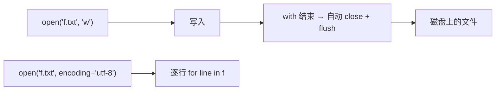

# PY-041 文件读写

## 1. 知识概览

| 项 | 内容 |
|---|---|
| 知识 ID | `PY-041` |
| 所属模块 | M-PY-05 文件、异常与数据持久化 |
| 学习难度 | L2 初级 |
| **预计学习时间** | 50 分钟 |
| 前置知识 | [[PY-010 模块与导入]] |
| 学习目标 | 会用 `open`/`with` 读写文本、理解编码与模式、知道大文件要逐行读 |

## 2. 通俗原理讲解

文件读写像**借书**：

- 先"借"（打开文件）→ 才能看或写。
- 用完必须"还"（关闭），否则别人借不到、数据可能没落盘。
- `with` 就是"自动还书机"——离开代码块时自动关闭，哪怕中途出错。

## 3. 技术原理

| 模式 | 含义 | 文件不存在时 |
|---|---|---|
| `"r"` | 只读 | 报错 |
| `"w"` | 只写（**清空原内容**） | 新建 |
| `"a"` | 追加 | 新建 |
| `"x"` | 独占创建 | 报错（已存在） |
| `"r+"` / `"w+"` | 读写 | 视情况 |

**必须记住**

1. **`"w"` 会清空原文件**，误用等于删数据。
2. **编码要显式写 `encoding="utf-8"`**，否则 Windows 默认 GBK，中文容易乱码。
3. **先读后写、先写后读**要分别打开，别在同一个句柄上混用。
4. **大文件不要 `read()`**，用 `for line in f` 逐行，内存只占一行。

## 4. 图解辅助



## 5. 完整代码示例

```powershell
python file_io.py
```

```python
from pathlib import Path

p = Path("demo.txt")
p.write_text("第一行\n第二行\n", encoding="utf-8")
print(p.read_text(encoding="utf-8").strip())

with p.open("a", encoding="utf-8") as f:
    f.write("第三行\n")

with p.open(encoding="utf-8") as f:
    for i, line in enumerate(f, 1):
        print(i, line.rstrip())

print(p.read_text(encoding="utf-8").splitlines())

p.unlink()
print("exists:", p.exists())
```

**预期输出**

```
第一行
第二行
1 第一行
2 第二行
3 第三行
['第一行', '第二行', '第三行']
exists: False
```

**说明**

- `write_text` 是最简写法，内部自动开关文件。
- `"a"` 模式追加，不会清空已有内容。
- `for line in f` 逐行读，内存友好；`rstrip()` 去掉行尾换行。
- 最后 `unlink()` 清理演示文件，保持目录干净。

## 6. 实践练习

**基础**

1. 写一个程序，把三行文字写入 `note.txt`，再读回来打印。
2. 用追加模式给 `note.txt` 再加一行。
3. 统计一个文件有多少行。

**进阶**

1. 写 `copy_file(src, dst)`，逐行复制（不用 `shutil`）。
2. 把文件内容反转后写入新文件（按行反转）。

**综合实践**

写一个"日志追加器"：函数 `log(msg)` 把带时间戳的一行追加到 `app.log`；连续调用三次后读回并打印所有行。

## 7. 参考答案

**基础 1 · 思路**：`write_text` + `read_text`。

```python
from pathlib import Path
p = Path("note.txt")
p.write_text("甲\n乙\n丙\n", encoding="utf-8")
print(p.read_text(encoding="utf-8").strip())
p.unlink()
```

运行结果：

```
甲
乙
丙
```

**基础 2 · 思路**：`"a"` 模式。

```python
with p.open("a", encoding="utf-8") as f:
    f.write("丁\n")
```

运行结果：文件末尾追加 `丁`。

**基础 3 · 思路**：逐行计数。

```python
p = Path("count.txt")
p.write_text("a\nb\nc\n", encoding="utf-8")
n = sum(1 for _ in p.open(encoding="utf-8"))
print("行数:", n)
p.unlink()
```

运行结果：`行数: 3`

**进阶 1 · 思路**：打开两个句柄，逐行读逐行写。

```python
from pathlib import Path

def copy_file(src, dst):
    with Path(src).open(encoding="utf-8") as fin, Path(dst).open("w", encoding="utf-8") as fout:
        for line in fin:
            fout.write(line)

Path("s.txt").write_text("1\n2\n", encoding="utf-8")
copy_file("s.txt", "d.txt")
print(Path("d.txt").read_text(encoding="utf-8").splitlines())
Path("s.txt").unlink(); Path("d.txt").unlink()
```

运行结果：`['1', '2']`

**进阶 2 · 思路**：读成列表，反转，再写回。

```python
from pathlib import Path

src, dst = Path("in.txt"), Path("out.txt")
src.write_text("一\n二\n三\n", encoding="utf-8")
lines = src.read_text(encoding="utf-8").splitlines()
dst.write_text("\n".join(reversed(lines)) + "\n", encoding="utf-8")
print(dst.read_text(encoding="utf-8").splitlines())
src.unlink(); dst.unlink()
```

运行结果：`['三', '二', '一']`

**综合实践 · 思路**：`datetime` 生成时间戳，`"a"` 追加。

```python
from datetime import datetime
from pathlib import Path

p = Path("app.log")

def log(msg):
    ts = datetime.now().strftime("%Y-%m-%d %H:%M:%S")
    with p.open("a", encoding="utf-8") as f:
        f.write(f"[{ts}] {msg}\n")

log("启动")
log("处理数据")
log("结束")

print(len(p.read_text(encoding="utf-8").splitlines()), "行")
p.unlink()
```

运行结果：`3 行`

## 8. 常见错误

| 错误写法 | 现象 | 原因 | 正确写法 |
|---|---|---|---|
| 用 `"w"` 想追加 | 原内容被清空 | `"w"` 截断文件 | 用 `"a"` |
| 不写 `encoding` | Windows 下中文乱码 | 默认 GBK | `encoding="utf-8"` |
| 忘记关闭 | 内容没落盘/句柄泄漏 | 未 flush | 用 `with` |
| 大文件 `read()` | 内存爆 | 全量载入 | 逐行迭代 |
| 路径写错 | `FileNotFoundError` | 相对路径基准不对 | 用绝对路径或确认 cwd |

## 9. 知识关联

- **前置**：[[PY-010 模块与导入]]
- **后继**：[[PY-042 路径与 pathlib]]、[[PY-043 CSV 与 JSON]]
- **相关数学**：无
- **所属模块**：`M-PY-05 文件、异常与数据持久化`

## 10. 学习记录

| 日期 | 状态 | 掌握程度 | 遇到的问题 | 个人总结 | 待复习 |
|---|---|---|---|---|---|
| — | planned | — | — | — | — |

---

## 🔗 Notion 同步信息

> 以下内容由 Notion「AI Knowledge System · 知识点」数据库按知识 ID 合并而来（导出于 2026-11-09）。

| 属性 | 值 |
|---|---|
| 学科 | Python基础 |
| 学习状态 | 未开始 |
| 难度 | L2 应用 |
| 知识类型 | Technique |
| 学习目标 | 会用 open/with 读写文本，理解编码与模式，大文件逐行读。 |

- **所属模块**：[M-PY-05 文件、异常与数据持久化](../%E8%AF%BE%E7%A8%8B%E6%A8%A1%E5%9D%97/M-PY-05%20%E6%96%87%E4%BB%B6%E3%80%81%E5%BC%82%E5%B8%B8%E4%B8%8E%E6%95%B0%E6%8D%AE%E6%8C%81%E4%B9%85%E5%8C%96.md)
- **前置知识**：[PY-010 模块与导入](../06%20%E6%A8%A1%E5%9D%97%E4%B8%8E%E5%8C%85/PY-010%20%E6%A8%A1%E5%9D%97%E4%B8%8E%E5%AF%BC%E5%85%A5.md)
- **后继知识**：[PY-042 路径与 pathlib](PY-042%20%E8%B7%AF%E5%BE%84%E4%B8%8E%20pathlib.md)
- **被项目引用**：[PROJ-003 文件批量处理工具](../../07_%E5%AE%9E%E6%88%98%E9%A1%B9%E7%9B%AE/01%20Python%E9%A1%B9%E7%9B%AE/PROJ-003%20%E6%96%87%E4%BB%B6%E6%89%B9%E9%87%8F%E5%A4%84%E7%90%86%E5%B7%A5%E5%85%B7.md)
