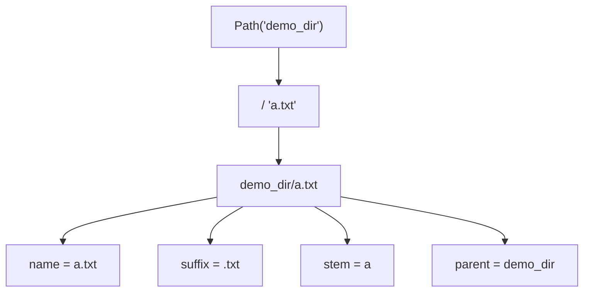

# PY-042 路径与 pathlib

## 1. 知识概览

| 项 | 内容 |
|---|---|
| 知识 ID | `PY-042` |
| 所属模块 | M-PY-05 文件、异常与数据持久化 |
| 学习难度 | L2 初级 |
| **预计学习时间** | 45 分钟 |
| 前置知识 | [[PY-041 文件读写]] |
| 学习目标 | 会用 `Path` 拼路径、遍历目录、判断存在，摆脱字符串拼路径的坑 |

## 2. 通俗原理讲解

老办法拼路径是**拿字符串相加**：

```python
"C:\\data\\" + "a.txt"     # 反斜杠要转义，少一个就出错
```

这像"用胶水把地址写在纸上"——容易漏斜杠、容易在 Linux/Windows 之间翻车。

`pathlib` 像**导航软件**：你给起点和文件名，它负责拼对。
`Path("data") / "a.txt"` —— 用 `/` 运算符拼，自动处理分隔符。

## 3. 技术原理

| 需求 | 写法 |
|---|---|
| 拼路径 | `Path("a") / "b.txt"` |
| 取文件名 | `p.name` |
| 取扩展名 | `p.suffix` |
| 取主干 | `p.stem` |
| 取父目录 | `p.parent` |
| 判断存在 | `p.exists()` / `p.is_file()` / `p.is_dir()` |
| 创建目录 | `p.mkdir(parents=True, exist_ok=True)` |
| 遍历目录 | `p.iterdir()` |
| 按模式查找 | `p.glob("*.txt")` / `p.rglob("*.txt")` |
| 绝对路径 | `p.resolve()` |
| 文件大小 | `p.stat().st_size` |

**优势**：`Path` 对象在 Windows/Linux 上都正确；`/` 运算符可读性远高于 `os.path.join`。

**注意**：`iterdir()` 返回顺序**不确定**，需要顺序时先 `sorted()`。

## 4. 图解辅助



## 5. 完整代码示例

```powershell
python pathlib_demo.py
```

```python
from pathlib import Path

base = Path("demo_dir")
base.mkdir(exist_ok=True)
f1 = base / "a.txt"
f2 = base / "b.txt"
f1.write_text("A", encoding="utf-8")
f2.write_text("B", encoding="utf-8")

print(f1.name, f1.suffix, f1.stem)
print(f1.parent.name)

for f in sorted(base.iterdir()):
    print(f.name, f.stat().st_size)

print(sorted(p.name for p in base.glob("*.txt")))
print(f1.exists(), (base / "c.txt").exists())
print(f1.resolve().name)

f1.unlink()
f2.unlink()
base.rmdir()
```

**预期输出**

```
a.txt .txt a
demo_dir
a.txt 1
b.txt 1
['a.txt', 'b.txt']
True False
a.txt
```

**说明**

- `base / "a.txt"` 用 `/` 拼路径，Windows 也正确。
- `iterdir()` 顺序不定，所以套了 `sorted()`。
- `glob("*.txt")` 只查当前层；要递归用 `rglob`。
- 最后清理目录，避免留下垃圾文件。

## 6. 实践练习

**基础**

1. 用 `Path` 构造 `docs/report.pdf`，打印文件名、扩展名、父目录名。
2. 判断当前目录下是否存在 `README.md`。
3. 创建 `tmp_demo` 目录并列出其中内容。

**进阶**

1. 用 `rglob` 统计某个目录下所有 `.md` 文件数量。
2. 写 `total_size(dir)` 递归计算目录总大小。

**综合实践**

写一个"文件清单生成器"：遍历指定目录（限 2 层），输出每个文件的相对路径与大小（KB），并按大小降序排列。

## 7. 参考答案

**基础 1 · 思路**：属性直接取。

```python
from pathlib import Path
p = Path("docs") / "report.pdf"
print(p.name, p.suffix, p.parent.name)
```

运行结果：`report.pdf .pdf docs`

**基础 2 · 思路**：`exists()`。

```python
print(Path("README.md").exists())
```

运行结果：`False`（本机当前目录没有该文件）

**基础 3 · 思路**：`mkdir` + `iterdir`。

```python
from pathlib import Path
d = Path("tmp_demo")
d.mkdir(exist_ok=True)
(d / "x.txt").write_text("hi", encoding="utf-8")
print(sorted(p.name for p in d.iterdir()))
(d / "x.txt").unlink(); d.rmdir()
```

运行结果：`['x.txt']`

**进阶 1 · 思路**：`rglob` 递归匹配。

```python
from pathlib import Path
root = Path(r"<VAULT_ROOT>\01_Python基础")
print(len(list(root.rglob("PY-*.md"))))
```

运行结果：`40`（PY-001~PY-040，含各子目录）

**进阶 2 · 思路**：递归求和。

```python
from pathlib import Path

def total_size(d):
    return sum(p.stat().st_size for p in Path(d).rglob("*") if p.is_file())

print(total_size(".") > 0)
```

运行结果：`True`

**综合实践 · 思路**：`rglob` 限制深度 + 排序输出。

```python
from pathlib import Path

def listing(root, max_depth=2):
    root = Path(root)
    items = []
    for p in root.rglob("*"):
        if not p.is_file():
            continue
        depth = len(p.relative_to(root).parts) - 1
        if depth <= max_depth:
            items.append((p.relative_to(root).as_posix(), p.stat().st_size))
    return sorted(items, key=lambda x: -x[1])

items = listing(r"<VAULT_ROOT>\06_数学基础")
print("文件数:", len(items))
print("最大的三个：")
for name, size in items[:3]:
    print(" ", name)
```

运行结果（只打印文件名，避免字节数随改动漂移）：

```
文件数: 12
最大的三个：
  04 数理统计/MATH-451 最小二乘与回归统计.md
  07 最优化方法/MATH-721 梯度下降.md
  02 线性代数/MATH-201 向量与空间基础.md
```

> 排序依据是文件大小；具体字节数不必写死，重点看"按大小降序"的实现。

## 8. 常见错误

| 错误写法 | 现象 | 原因 | 正确写法 |
|---|---|---|---|
| 字符串拼 `"dir/" + name` | 分隔符错/转义错 | 平台差异 | `Path(dir) / name` |
| 依赖 `iterdir()` 顺序 | 输出顺序每次不同 | 无序遍历 | `sorted()` |
| `mkdir` 不写 `exist_ok` | 目录已存在时报错 | 默认不覆盖 | `exist_ok=True` |
| 用 `glob("*.md")` 想递归 | 只查一层 | glob 不递归 | `rglob` |
| 相对路径基准搞错 | 找不到文件 | 取决于 cwd | 用 `resolve()` 确认 |

## 9. 知识关联

- **前置**：[[PY-041 文件读写]]
- **后继**：[[PY-043 CSV 与 JSON]]
- **相关数学**：无
- **所属模块**：`M-PY-05 文件、异常与数据持久化`

## 10. 学习记录

| 日期 | 状态 | 掌握程度 | 遇到的问题 | 个人总结 | 待复习 |
|---|---|---|---|---|---|
| — | planned | — | — | — | — |

---

## 🔗 Notion 同步信息

> 以下内容由 Notion「AI Knowledge System · 知识点」数据库按知识 ID 合并而来（导出于 2026-11-09）。

| 属性 | 值 |
|---|---|
| 学科 | Python基础 |
| 学习状态 | 未开始 |
| 难度 | L2 应用 |
| 知识类型 | Technique |
| 学习目标 | 会用 Path 拼路径、遍历目录、判断存在，摆脱字符串拼路径。 |

- **所属模块**：[M-PY-05 文件、异常与数据持久化](../%E8%AF%BE%E7%A8%8B%E6%A8%A1%E5%9D%97/M-PY-05%20%E6%96%87%E4%BB%B6%E3%80%81%E5%BC%82%E5%B8%B8%E4%B8%8E%E6%95%B0%E6%8D%AE%E6%8C%81%E4%B9%85%E5%8C%96.md)
- **前置知识**：[PY-041 文件读写](PY-041%20%E6%96%87%E4%BB%B6%E8%AF%BB%E5%86%99.md)
- **后继知识**：[PY-043 CSV 与 JSON](PY-043%20CSV%20%E4%B8%8E%20JSON.md)
- **被项目引用**：[PROJ-003 文件批量处理工具](../../07_%E5%AE%9E%E6%88%98%E9%A1%B9%E7%9B%AE/01%20Python%E9%A1%B9%E7%9B%AE/PROJ-003%20%E6%96%87%E4%BB%B6%E6%89%B9%E9%87%8F%E5%A4%84%E7%90%86%E5%B7%A5%E5%85%B7.md)
