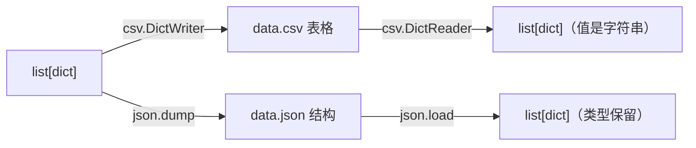

# PY-043 CSV 与 JSON

## 1. 知识概览

| 项 | 内容 |
|---|---|
| 知识 ID | `PY-043` |
| 所属模块 | M-PY-05 文件、异常与数据持久化 |
| 学习难度 | L2 初级 |
| **预计学习时间** | 50 分钟 |
| 前置知识 | [[PY-042 路径与 pathlib]] |
| 学习目标 | 会用 `csv` 读写表格、用 `json` 存取结构化数据、知道两者的取舍 |

## 2. 通俗原理讲解

两种最常见的"存数据"方式：

- **CSV**：像**Excel 的纯文本版**。一行一条记录，逗号分隔字段。适合表格，人类直接能看懂。
- **JSON**：像**带结构的说明书**。能表达嵌套（列表里放字典、字典里放列表）。适合配置和接口数据。

一句话：**表格用 CSV，结构用 JSON**。

## 3. 技术原理

| 对比 | CSV | JSON |
|---|---|---|
| 结构 | 平铺表格 | 可嵌套 |
| 类型 | 全是字符串（读回来要自己转） | 有数字/布尔/null |
| 可读性 | 表格直观 | 结构直观 |
| 大小 | 更小 | 略大 |
| 典型用途 | 数据导出、Excel 交换 | 配置文件、API 响应 |

**CSV 的两个坑**

1. 字段里含逗号/换行时，必须用 `csv` 模块写（它会自动加引号），不要手动 `",".join`。
2. `DictReader` 读到的值**全是字符串**，`"85"` 要自己 `int()`。

**JSON 的两个坑**

1. 中文默认会被转义成 `\uXXXX`，要加 `ensure_ascii=False`。
2. `json.loads` 只吃字符串，读文件应直接用 `json.load(f)`。

## 4. 图解辅助



## 5. 完整代码示例

```powershell
python csv_json.py
```

```python
import csv
import json
from pathlib import Path

p = Path("data.csv")
with p.open("w", encoding="utf-8", newline="") as f:
    w = csv.writer(f)
    w.writerow(["name", "score"])
    w.writerow(["小明", 85])
    w.writerow(["小红", 92])

with p.open(encoding="utf-8", newline="") as f:
    rows = list(csv.DictReader(f))
print(rows)

total = sum(int(r["score"]) for r in rows)
print("总分:", total)

j = Path("data.json")
j.write_text(json.dumps(rows, ensure_ascii=False, indent=2), encoding="utf-8")
print(json.loads(j.read_text(encoding="utf-8"))[0]["name"])

p.unlink()
j.unlink()
```

**预期输出**

```
[{'name': '小明', 'score': '85'}, {'name': '小红', 'score': '92'}]
总分: 177
小明
```

**说明**

- `newline=""` 是 CSV 的硬性要求，否则 Windows 下会多出空行。
- `DictReader` 把每行变成字典，但 `score` 是字符串 `'85'`，所以求和前要 `int()`。
- `ensure_ascii=False` 让中文原样写入，打开文件能直接读。
- 最后清理临时文件。

## 6. 实践练习

**基础**

1. 把 `[["姓名","分数"],["小明",85]]` 写成 CSV，再读回来打印。
2. 把 `{"name": "小明", "tags": ["a", "b"]}` 存成 JSON 并读回。
3. 判断：CSV 读回来的数字是什么类型？

**进阶**

1. 读取 CSV 后计算平均分并输出（注意类型转换）。
2. 把嵌套结构（列表里放字典）存成 JSON，再原样读回并断言相等。

**综合实践**

写一个"成绩单导出器"：给定学生列表，同时导出 `scores.csv`（表格）与 `scores.json`（含嵌套的课程明细），再分别读回打印，比较两者的差异。

## 7. 参考答案

**基础 1 · 思路**：`writerow` / `reader`。

```python
import csv
from pathlib import Path

p = Path("t.csv")
with p.open("w", encoding="utf-8", newline="") as f:
    w = csv.writer(f)
    w.writerow(["姓名", "分数"])
    w.writerow(["小明", 85])

with p.open(encoding="utf-8", newline="") as f:
    print(list(csv.reader(f)))
p.unlink()
```

运行结果：`[['姓名', '分数'], ['小明', '85']]`

**基础 2 · 思路**：`json.dumps` / `loads`。

```python
import json
s = json.dumps({"name": "小明", "tags": ["a", "b"]}, ensure_ascii=False)
print(s)
print(json.loads(s)["tags"])
```

运行结果：

```
{"name": "小明", "tags": ["a", "b"]}
['a', 'b']
```

**基础 3 · 思路**：CSV 没有类型概念。

答案：**字符串**，要自己转换。

**进阶 1 · 思路**：`int()` 转换后求平均。

```python
import csv
from pathlib import Path

p = Path("avg.csv")
with p.open("w", encoding="utf-8", newline="") as f:
    w = csv.writer(f)
    w.writerow(["name", "score"])
    w.writerow(["小明", 85])
    w.writerow(["小红", 92])

with p.open(encoding="utf-8", newline="") as f:
    scores = [int(r["score"]) for r in csv.DictReader(f)]
print("平均:", sum(scores) / len(scores))
p.unlink()
```

运行结果：`平均: 88.5`

**进阶 2 · 思路**：`dumps` → `loads` 后比较。

```python
import json
data = [{"name": "小明", "tags": ["a", "b"]}, {"name": "小红", "tags": []}]
s = json.dumps(data, ensure_ascii=False)
print(json.loads(s) == data)
```

运行结果：`True`

**综合实践 · 思路**：同一份数据两种落地方式。

```python
import csv
import json
from pathlib import Path

students = [
    {"name": "小明", "courses": [{"c": "数学", "s": 85}]},
    {"name": "小红", "courses": [{"c": "数学", "s": 92}]},
]

csv_p = Path("scores.csv")
with csv_p.open("w", encoding="utf-8", newline="") as f:
    w = csv.writer(f)
    w.writerow(["name", "course", "score"])
    for st in students:
        for c in st["courses"]:
            w.writerow([st["name"], c["c"], c["s"]])

json_p = Path("scores.json")
json_p.write_text(json.dumps(students, ensure_ascii=False, indent=2), encoding="utf-8")

with csv_p.open(encoding="utf-8", newline="") as f:
    print("CSV 行数:", len(list(csv.reader(f))) - 1)
print("JSON 条数:", len(json.loads(json_p.read_text(encoding="utf-8"))))

csv_p.unlink()
json_p.unlink()
```

运行结果：

```
CSV 行数: 2
JSON 条数: 2
```

> 差别在结构：CSV 被"拍平"成一行一条明细；JSON 保留了嵌套。

## 8. 常见错误

| 错误写法 | 现象 | 原因 | 正确写法 |
|---|---|---|---|
| CSV 忘了 `newline=""` | 多出空行 | Windows 换行转换 | `open(..., newline="")` |
| 手动 `",".join` 写 CSV | 字段含逗号时错位 | 没转义 | 用 `csv` 模块 |
| 忘了 `int()` 转换 | 求和报 `TypeError` | 读回是字符串 | 显式转换 |
| `ensure_ascii` 默认 True | 中文变 `\uXXXX` | 默认 ASCII | `ensure_ascii=False` |
| 用 `json.loads` 读文件对象 | `TypeError` | 参数要字符串 | 用 `json.load(f)` |

## 9. 知识关联

- **前置**：[[PY-042 路径与 pathlib]]
- **后继**：[[PY-047 SQLite 基础]]、[[PY-048 数据持久化方案]]
- **相关数学**：无
- **所属模块**：`M-PY-05 文件、异常与数据持久化`

## 10. 学习记录

| 日期 | 状态 | 掌握程度 | 遇到的问题 | 个人总结 | 待复习 |
|---|---|---|---|---|---|
| — | planned | — | — | — | — |

---

## 🔗 Notion 同步信息

> 以下内容由 Notion「AI Knowledge System · 知识点」数据库按知识 ID 合并而来（导出于 2026-11-09）。

| 属性 | 值 |
|---|---|
| 学科 | Python基础 |
| 学习状态 | 未开始 |
| 难度 | L2 应用 |
| 知识类型 | Technique |
| 学习目标 | 会用 csv 读写表格、用 json 存取结构化数据，知道取舍。 |

- **所属模块**：[M-PY-05 文件、异常与数据持久化](../%E8%AF%BE%E7%A8%8B%E6%A8%A1%E5%9D%97/M-PY-05%20%E6%96%87%E4%BB%B6%E3%80%81%E5%BC%82%E5%B8%B8%E4%B8%8E%E6%95%B0%E6%8D%AE%E6%8C%81%E4%B9%85%E5%8C%96.md)
- **前置知识**：[PY-042 路径与 pathlib](PY-042%20%E8%B7%AF%E5%BE%84%E4%B8%8E%20pathlib.md)
- **后继知识**：[PY-047 SQLite 基础](PY-047%20SQLite%20%E5%9F%BA%E7%A1%80.md) · [PY-048 数据持久化方案](PY-048%20%E6%95%B0%E6%8D%AE%E6%8C%81%E4%B9%85%E5%8C%96%E6%96%B9%E6%A1%88.md)
- **被项目引用**：[PROJ-002 学生成绩管理系统](../../07_%E5%AE%9E%E6%88%98%E9%A1%B9%E7%9B%AE/01%20Python%E9%A1%B9%E7%9B%AE/PROJ-002%20%E5%AD%A6%E7%94%9F%E6%88%90%E7%BB%A9%E7%AE%A1%E7%90%86%E7%B3%BB%E7%BB%9F.md) · [PROJ-004 JSON 数据管理工具](../../07_%E5%AE%9E%E6%88%98%E9%A1%B9%E7%9B%AE/01%20Python%E9%A1%B9%E7%9B%AE/PROJ-004%20JSON%20%E6%95%B0%E6%8D%AE%E7%AE%A1%E7%90%86%E5%B7%A5%E5%85%B7.md)
