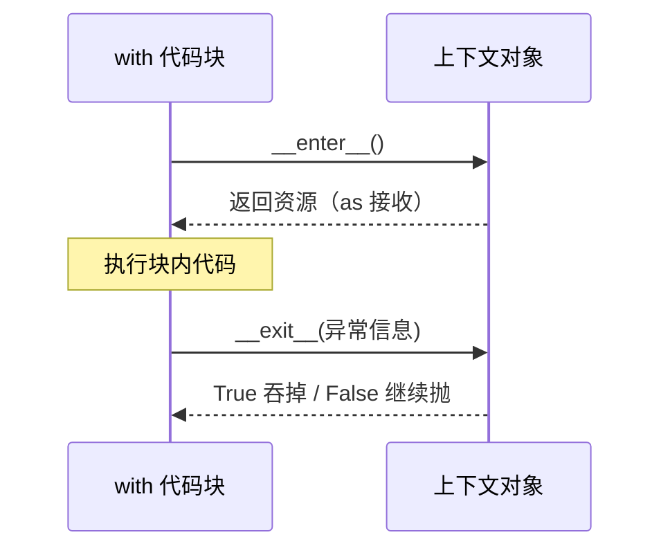

# PY-045 自定义异常与上下文管理器

## 1. 知识概览

| 项 | 内容 |
|---|---|
| 知识 ID | `PY-045` |
| 所属模块 | M-PY-05 文件、异常与数据持久化 |
| 学习难度 | L3 中级 |
| **预计学习时间** | 55 分钟 |
| 前置知识 | [[PY-044 异常处理]] |
| 学习目标 | 会定义业务异常、会用 `with` 管理资源、理解 `__enter__` / `__exit__` |

## 2. 通俗原理讲解

**自定义异常**像给错误"分类贴标签"：不再只有 `ValueError`，而是有 `ValidationError`、`PaymentError`——上层能一眼看出是哪类问题。

**上下文管理器**（`with`）像**自动门**：靠近自动开（`__enter__`），离开自动关（`__exit__`），哪怕你中途跑掉（异常）它也照关。

文件操作、数据库连接、锁、临时目录都适合用 `with`。

## 3. 技术原理

**自定义异常**

```python
class AppError(Exception):      # 项目根异常
    pass

class ValidationError(AppError):  # 具体异常
    def __init__(self, field):
        super().__init__(f"字段校验失败: {field}")
        self.field = field
```

继承 `Exception` 即可；建议建"项目根异常"，上层用 `except AppError` 一次性兜住所有业务异常。

**上下文管理器**

```python
class C:
    def __enter__(self):        # 进入 with 时调用，返回值给 as
        return self
    def __exit__(self, exc_type, exc, tb):   # 离开时调用
        return False            # False=不吞异常；True=吞掉
```

| `__exit__` 返回 | 效果 |
|---|---|
| `False` / `None` | 异常继续向上抛 |
| `True` | 异常被抑制，`with` 之后的代码继续跑 |

**`contextlib.contextmanager`**：用生成器写更简洁，`yield` 前是进入、后是退出。

## 4. 图解辅助



## 5. 完整代码示例

```powershell
python custom_exception.py
```

```python
class AppError(Exception):
    pass


class ValidationError(AppError):
    def __init__(self, field):
        super().__init__(f"字段校验失败: {field}")
        self.field = field


def check_age(age):
    if age < 0:
        raise ValidationError("age")
    return age


try:
    check_age(-1)
except AppError as e:
    print(type(e).__name__, e, e.field)


class Timer:
    def __enter__(self):
        print("开始")
        return self

    def __exit__(self, exc_type, exc, tb):
        print("结束")
        return False


with Timer():
    print("工作中")


class IgnoreError:
    def __enter__(self):
        return self

    def __exit__(self, exc_type, exc, tb):
        print("吞掉异常:", exc_type.__name__)
        return True


with IgnoreError():
    raise ValueError("x")
print("继续执行")
```

**预期输出**

```
ValidationError 字段校验失败: age age
开始
工作中
结束
吞掉异常: ValueError
继续执行
```

**说明**

- `except AppError` 能同时抓住子类 `ValidationError`——这就是分层异常的价值。
- `Timer.__exit__` 返回 `False`，异常不会被吞（本例没有异常）。
- `IgnoreError.__exit__` 返回 `True`，`ValueError` 被吞掉，所以后面还能打印"继续执行"。

## 6. 实践练习

**基础**

1. 定义 `NetworkError(Exception)`，在函数里 `raise` 它并捕获打印。
2. 写一个上下文管理器 `Printer`，进入打印"开始"、退出打印"结束"。
3. 判断：`__exit__` 返回 `True` 会怎样？

**进阶**

1. 用 `contextlib.contextmanager` 重写 `Printer`。
2. 写一个"临时文件"上下文管理器，进入时创建、退出时删除。

**综合实践**

写一个"配置文件加载器"：用上下文管理器打开文件（确保关闭），自定义 `ConfigError` 处理格式错误，加载失败时返回默认配置并打印原因。

## 7. 参考答案

**基础 1 · 思路**：定义 + raise + except。

```python
class NetworkError(Exception):
    pass

try:
    raise NetworkError("连接超时")
except NetworkError as e:
    print("捕获:", e)
```

运行结果：`捕获: 连接超时`

**基础 2 · 思路**：两个魔术方法。

```python
class Printer:
    def __enter__(self):
        print("开始")
        return self
    def __exit__(self, *args):
        print("结束")
        return False

with Printer():
    print("中间")
```

运行结果：

```
开始
中间
结束
```

**基础 3 · 思路**：抑制异常。

答案：异常被吞掉，`with` 之后的代码继续执行。

**进阶 1 · 思路**：`@contextmanager` + `yield`。

```python
from contextlib import contextmanager

@contextmanager
def printer():
    print("开始")
    try:
        yield
    finally:
        print("结束")

with printer():
    print("中间")
```

运行结果同上。

**进阶 2 · 思路**：进入建文件，退出删文件。

```python
from pathlib import Path
from contextlib import contextmanager

@contextmanager
def temp_file(name):
    p = Path(name)
    p.write_text("临时内容", encoding="utf-8")
    try:
        yield p
    finally:
        if p.exists():
            p.unlink()

with temp_file("demo_tmp.txt") as p:
    print("使用中:", p.read_text(encoding="utf-8"))
print("已删除:", not Path("demo_tmp.txt").exists())
```

运行结果：

```
使用中: 临时内容
已删除: True
```

**综合实践 · 思路**：组合自定义异常与上下文管理器。

```python
import json
from pathlib import Path

class ConfigError(Exception):
    pass

class ConfigFile:
    def __init__(self, path):
        self.path = Path(path)
        self.f = None
    def __enter__(self):
        self.f = self.path.open(encoding="utf-8")
        return self.f
    def __exit__(self, exc_type, exc, tb):
        if self.f:
            self.f.close()
        return False

def load_config(path, default=None):
    try:
        with ConfigFile(path) as f:
            return json.load(f)
    except FileNotFoundError:
        print("配置不存在，使用默认值")
        return default or {}
    except json.JSONDecodeError as e:
        raise ConfigError(f"配置格式错误: {e}") from e

print(load_config("missing.json", {"mode": "default"}))
```

运行结果：`{'mode': 'default'}`

## 8. 常见错误

| 错误写法 | 现象 | 原因 | 正确写法 |
|---|---|---|---|
| 自定义异常不继承 `Exception` | 无法被 `except` | 基类不对 | 继承 `Exception` |
| `__exit__` 参数写错个数 | `TypeError` | 必须是 4 个参数 | `(self, exc_type, exc, tb)` |
| 忘写 `return False` | 默认 None（不吞） | 其实等价 | 显式写更清楚 |
| 吞掉所有异常 | 隐藏 bug | `return True` 滥用 | 只在明确场景吞 |
| 用 `with` 但对象没实现协议 | `AttributeError` | 缺 `__enter__` | 实现两个方法 |

## 9. 知识关联

- **前置**：[[PY-044 异常处理]]
- **后继**：[[PY-046 logging 日志]]、[[PY-048 数据持久化方案]]
- **相关数学**：无
- **所属模块**：`M-PY-05 文件、异常与数据持久化`

## 10. 学习记录

| 日期 | 状态 | 掌握程度 | 遇到的问题 | 个人总结 | 待复习 |
|---|---|---|---|---|---|
| — | planned | — | — | — | — |

---

## 🔗 Notion 同步信息

> 以下内容由 Notion「AI Knowledge System · 知识点」数据库按知识 ID 合并而来（导出于 2026-11-09）。

| 属性 | 值 |
|---|---|
| 学科 | Python基础 |
| 学习状态 | 未开始 |
| 难度 | L3 推导 |
| 知识类型 | Technique |
| 学习目标 | 会定义业务异常、用 with 管理资源、理解 enter/exit。 |

- **所属模块**：[M-PY-05 文件、异常与数据持久化](../%E8%AF%BE%E7%A8%8B%E6%A8%A1%E5%9D%97/M-PY-05%20%E6%96%87%E4%BB%B6%E3%80%81%E5%BC%82%E5%B8%B8%E4%B8%8E%E6%95%B0%E6%8D%AE%E6%8C%81%E4%B9%85%E5%8C%96.md)
- **前置知识**：[PY-044 异常处理](PY-044%20%E5%BC%82%E5%B8%B8%E5%A4%84%E7%90%86.md)
