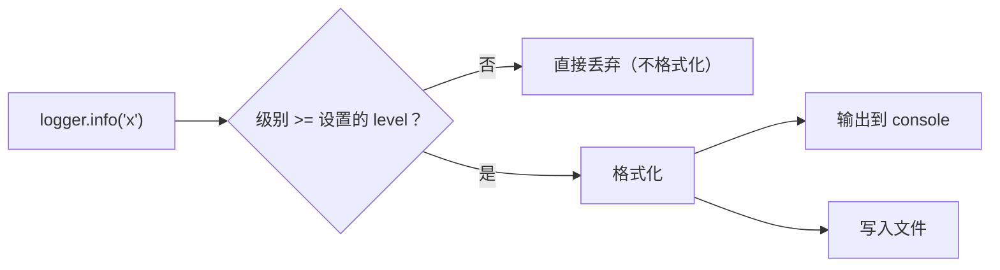

# PY-046 logging 日志

## 1. 知识概览

| 项 | 内容 |
|---|---|
| 知识 ID | `PY-046` |
| 所属模块 | M-PY-05 文件、异常与数据持久化 |
| 学习难度 | L2 初级 |
| **预计学习时间** | 45 分钟 |
| 前置知识 | [[PY-044 异常处理]] |
| 学习目标 | 会用 `logging` 分级记录、知道它比 `print` 好在哪、会把日志写进文件 |

## 2. 通俗原理讲解

`print` 像**在墙上写字**：谁都能看见，但没法分级、没法关掉、没法只写进文件。

`logging` 像**公司日志系统**：

- 分级别（DEBUG / INFO / WARNING / ERROR / CRITICAL）；
- 可以只显示重要级别；
- 可以同时输出到控制台和文件；
- 自动带时间、模块名。

**为什么不用 print 调试生产代码**：print 会混进正常输出，而且没法"上线时关掉调试信息"。

## 3. 技术原理

| 级别 | 数值 | 用途 |
|---|---|---|
| DEBUG | 10 | 细节排查 |
| INFO | 20 | 正常运行信息 |
| WARNING | 30 | 不影响运行但需注意 |
| ERROR | 40 | 功能失败 |
| CRITICAL | 50 | 程序可能无法继续 |

**两个核心设置**

```text
logging.basicConfig(level=logging.INFO, format="%(levelname)s %(message)s")
```

- `level`：低于该级别的日志**不会输出**。
- `format`：常用占位符 `%(asctime)s`、`%(levelname)s`、`%(name)s`、`%(message)s`。

**写入文件**：`filename="app.log", encoding="utf-8"`。

**性能注意**：`logger.debug(f"{obj}")` 即使不输出也会先做字符串拼接；应写 `logger.debug("%s", obj)`，由 logging 决定是否格式化。

## 4. 图解辅助



## 5. 完整代码示例

```powershell
python logging_demo.py
```

```python
import logging

logging.basicConfig(level=logging.INFO, format="%(levelname)s %(message)s")
logger = logging.getLogger("demo")

logger.debug("不会显示")
logger.info("启动")
logger.warning("注意")

try:
    1 / 0
except ZeroDivisionError as e:
    logger.error("捕获到除零: %s", e)

print("这行是 stdout")
```

**预期输出**（日志走 stderr，最后一行走 stdout）

```
INFO 启动
WARNING 注意
ERROR 捕获到除零: division by zero
这行是 stdout
```

**说明**

- `logger.debug` 没出现，因为 `level=INFO`（20）> DEBUG（10）。
- `logger.error("%s", e)` 用参数化写法，避免无谓拼接。
- 最后一行证明"日志"和"普通输出"是两条通道。

## 6. 实践练习

**基础**

1. 配置 `level=WARNING`，依次记录 info / warning / error，观察哪些出现。
2. 把格式改成带级别与消息的 `[LEVEL] message`。
3. 判断：`logging` 默认输出到 stdout 还是 stderr？

**进阶**

1. 把日志写入 `app.log`（UTF-8），运行后读文件确认内容。
2. 解释 `logger.info(f"{x}")` 与 `logger.info("%s", x)` 的性能差异。

**综合实践**

写一个"带日志的文件处理器"：遍历一个目录下所有 `.md`，记录每个文件名与大小（INFO），遇到无权限访问的文件记录 WARNING 并继续，最后记录处理总数。

## 7. 参考答案

**基础 1 · 思路**：级别过滤。

```python
import logging
logging.basicConfig(level=logging.WARNING, format="%(levelname)s %(message)s")
logger = logging.getLogger("t")
logger.info("信息")
logger.warning("警告")
logger.error("错误")
```

运行结果：

```
WARNING 警告
ERROR 错误
```

**基础 2 · 思路**：改 format。

```python
logging.basicConfig(level=logging.INFO,
                    format="[%(levelname)s] %(message)s")
logging.getLogger("t").info("hello")
```

运行结果：`[INFO] hello`

**基础 3 · 思路**：默认 handler。

答案：**stderr**。

**进阶 1 · 思路**：`filename` 参数。

```python
import logging
from pathlib import Path

p = Path("app.log")
logger = logging.getLogger("file_demo")
logger.setLevel(logging.INFO)
logger.propagate = False

handler = logging.FileHandler(p, encoding="utf-8")
handler.setFormatter(logging.Formatter("%(levelname)s %(message)s"))
logger.addHandler(handler)

logger.info("写入文件")
handler.close()
logger.removeHandler(handler)

print(p.read_text(encoding="utf-8").strip())
p.unlink()
```

运行结果：`INFO 写入文件`

> 注意：`basicConfig` 在同一进程里**只生效一次**；后续要换输出目标（如写到文件），必须自己建 `FileHandler`。

**进阶 2 · 思路**：f-string 立即求值。

答案：`f"{x}"` 无论日志是否输出都会先拼字符串；`"%s", x` 只在需要输出时才格式化，日志级别被过滤时零开销。

**综合实践 · 思路**：遍历 + 分级记录。

```python
import logging
from pathlib import Path

logging.basicConfig(level=logging.INFO, format="%(levelname)s %(message)s")
logger = logging.getLogger("scan")

root = Path(r"<VAULT_ROOT>\06_数学基础")
count = 0
for p in sorted(root.rglob("*.md")):
    try:
        size = p.stat().st_size
        logger.info("%s (%d B)", p.name, size)
        count += 1
    except OSError as e:
        logger.warning("跳过 %s：%s", p.name, e)

logger.info("共处理 %d 个文件", count)
```

运行结果（节选）：

```
INFO 00 数学库首页.md (5093 B)
INFO 00 分支索引.md (2437 B)
...
INFO 共处理 12 个文件
```

## 8. 常见错误

| 错误写法 | 现象 | 原因 | 正确写法 |
|---|---|---|---|
| 重复 `basicConfig` | 第二条配置不生效 | 只在无 handler 时生效 | 只配一次，或用 handler |
| 用 `print` 当日志 | 无法分级/关闭 | 缺基础设施 | 用 `logging` |
| `f-string` 传参 | 有性能损耗 | 提前求值 | `"%s", x` |
| 忘写 `encoding` | 中文日志乱码 | Windows 默认 GBK | `encoding="utf-8"` |
| 级别设太低 | 日志刷屏 | DEBUG 上线 | 生产用 INFO/WARNING |

## 9. 知识关联

- **前置**：[[PY-044 异常处理]]
- **后继**：[[PY-048 数据持久化方案]]
- **相关数学**：无
- **所属模块**：`M-PY-05 文件、异常与数据持久化`

## 10. 学习记录

| 日期 | 状态 | 掌握程度 | 遇到的问题 | 个人总结 | 待复习 |
|---|---|---|---|---|---|
| — | planned | — | — | — | — |

---

## 🔗 Notion 同步信息

> 以下内容由 Notion「AI Knowledge System · 知识点」数据库按知识 ID 合并而来（导出于 2026-11-09）。

| 属性 | 值 |
|---|---|
| 学科 | Python基础 |
| 学习状态 | 未开始 |
| 难度 | L2 应用 |
| 知识类型 | Technique |
| 学习目标 | 会用 logging 分级记录、写文件，知道比 print 好在哪。 |

- **所属模块**：[M-PY-05 文件、异常与数据持久化](../%E8%AF%BE%E7%A8%8B%E6%A8%A1%E5%9D%97/M-PY-05%20%E6%96%87%E4%BB%B6%E3%80%81%E5%BC%82%E5%B8%B8%E4%B8%8E%E6%95%B0%E6%8D%AE%E6%8C%81%E4%B9%85%E5%8C%96.md)
- **前置知识**：[PY-044 异常处理](PY-044%20%E5%BC%82%E5%B8%B8%E5%A4%84%E7%90%86.md)
