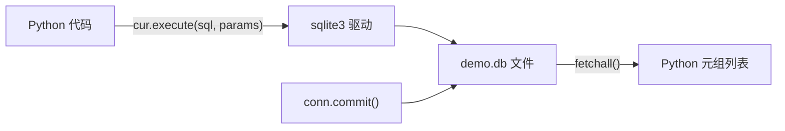

# PY-047 SQLite 基础

## 1. 知识概览

| 项 | 内容 |
|---|---|
| 知识 ID | `PY-047` |
| 所属模块 | M-PY-05 文件、异常与数据持久化 |
| 学习难度 | L3 中级 |
| **预计学习时间** | 55 分钟 |
| 前置知识 | [[PY-043 CSV 与 JSON]] |
| 学习目标 | 会用 `sqlite3` 建表/增删改查、理解参数化查询防注入、知道何时该用数据库 |

## 2. 通俗原理讲解

CSV/JSON 像**笔记本**：写起来简单，但数据一多，找一条记录就得从头翻。

SQLite 像**带索引的档案柜**：

- 一个 `.db` 文件就是一个完整数据库（不用装服务器）。
- 能按条件高速查找、能保证事务（要么全成功、要么全失败）。
- Python 标准库自带 `sqlite3`，零安装。

适合：本地工具、桌面应用、小型数据分析。不适合：多机高并发。

## 3. 技术原理

**四步走**

```text
import sqlite3
conn = sqlite3.connect("demo.db")   # 1 连接（不存在会自动创建）
cur = conn.cursor()                  # 2 游标
cur.execute("CREATE TABLE ...")      # 3 执行 SQL
conn.commit()                        # 4 提交
conn.close()
```

| 概念 | 说明 |
|---|---|
| 表（table） | 行 + 列，像 Excel 的一个 sheet |
| 主键（PRIMARY KEY） | 唯一标识一行 |
| 事务 | `commit()` 才真正落盘；失败可 `rollback()` |
| 参数化 `?` | **必须用**，不要字符串拼接 SQL |

**SQL 注入**：`f"SELECT * FROM t WHERE name='{name}'"` 若 `name` 是 `' OR '1'='1`，就会查出全部数据。用 `?` 占位由驱动转义，安全。

**常用类型**：`INTEGER`、`REAL`、`TEXT`、`BLOB`、`NULL`。

## 4. 图解辅助



## 5. 完整代码示例

```powershell
python sqlite_demo.py
```

```python
import sqlite3
from pathlib import Path

db = Path("demo.db")
conn = sqlite3.connect(db)
cur = conn.cursor()

cur.execute("CREATE TABLE student (id INTEGER PRIMARY KEY, name TEXT, score INTEGER)")
cur.executemany("INSERT INTO student (name, score) VALUES (?, ?)",
                [("小明", 85), ("小红", 92)])
conn.commit()

cur.execute("SELECT name, score FROM student ORDER BY score DESC")
for row in cur.fetchall():
    print(row)

cur.execute("SELECT AVG(score) FROM student")
print("平均分:", cur.fetchone()[0])

cur.execute("UPDATE student SET score = ? WHERE name = ?", (90, "小明"))
conn.commit()

cur.execute("SELECT COUNT(*) FROM student WHERE score >= 90")
print("90 分以上:", cur.fetchone()[0])

conn.close()
db.unlink()
```

**预期输出**

```
('小红', 92)
('小明', 85)
平均分: 88.5
90 分以上: 2
```

**说明**

- `executemany` 批量插入，比循环 `execute` 快。
- `fetchall()` 返回元组列表；`fetchone()` 返回一行。
- 更新后必须 `commit()` 才落盘，否则关闭连接时可能丢失。
- 参数用 `?` 占位，值放在第二个参数里——**永远不要拼字符串**。

## 6. 实践练习

**基础**

1. 建 `book` 表（id、title、price），插入两本书并查询全部。
2. 查询价格大于 40 的书。
3. 判断：不 `commit()` 会怎样？

**进阶**

1. 写 `add_student(name, score)` 与 `list_students()` 两个函数，封装数据库操作。
2. 用参数化查询演示：输入 `' OR '1'='1` 时，参数化写法为何安全。

**综合实践**

写一个"简易通讯录"：建 `contact` 表（name、phone），支持添加、按姓名查电话、删除、列出全部；全部用参数化查询，最后打印操作结果。

## 7. 参考答案

**基础 1 · 思路**：建表 + 插入 + 查询。

```python
import sqlite3
conn = sqlite3.connect(":memory:")
cur = conn.cursor()
cur.execute("CREATE TABLE book (id INTEGER PRIMARY KEY, title TEXT, price REAL)")
cur.executemany("INSERT INTO book (title, price) VALUES (?, ?)",
                [("Python入门", 59.0), ("数据结构", 45.0)])
print(cur.execute("SELECT title, price FROM book").fetchall())
```

运行结果：`[('Python入门', 59.0), ('数据结构', 45.0)]`

> `:memory:` 表示内存数据库，测试时很方便，不产生文件。

**基础 2 · 思路**：`WHERE price > ?`。

```python
print(cur.execute("SELECT title FROM book WHERE price > ?", (40,)).fetchall())
```

运行结果：`[('Python入门',), ('数据结构',)]`

**基础 3 · 思路**：事务未提交。

答案：改动可能不会写入磁盘，连接关闭后丢失。

**进阶 1 · 思路**：封装成函数，连接复用。

```python
import sqlite3

def init():
    conn = sqlite3.connect(":memory:")
    conn.execute("CREATE TABLE s (name TEXT, score INTEGER)")
    return conn

conn = init()

def add_student(conn, name, score):
    conn.execute("INSERT INTO s VALUES (?, ?)", (name, score))
    conn.commit()

def list_students(conn):
    return conn.execute("SELECT name, score FROM s ORDER BY score DESC").fetchall()

add_student(conn, "小明", 85)
add_student(conn, "小红", 92)
print(list_students(conn))
```

运行结果：`[('小红', 92), ('小明', 85)]`

**进阶 2 · 思路**：参数被当成"值"而不是"SQL 片段"。

```python
evil = "' OR '1'='1"
print(conn.execute("SELECT name FROM s WHERE name = ?", (evil,)).fetchall())
```

运行结果：`[]`——被当成普通字符串，没有注入。

**综合实践 · 思路**：四个操作 + 参数化。

```python
import sqlite3

conn = sqlite3.connect(":memory:")
conn.execute("CREATE TABLE contact (name TEXT PRIMARY KEY, phone TEXT)")

def add(name, phone):
    conn.execute("INSERT OR REPLACE INTO contact VALUES (?, ?)", (name, phone))
    conn.commit()

def find(name):
    row = conn.execute("SELECT phone FROM contact WHERE name = ?", (name,)).fetchone()
    return row[0] if row else None

def remove(name):
    conn.execute("DELETE FROM contact WHERE name = ?", (name,))
    conn.commit()

def all_contacts():
    return conn.execute("SELECT name, phone FROM contact ORDER BY name").fetchall()

add("小明", "13800000001")
add("小红", "13800000002")
print("查小明:", find("小明"))
remove("小红")
print("全部:", all_contacts())
```

运行结果：

```
查小明: 13800000001
全部: [('小明', '13800000001')]
```

## 8. 常见错误

| 错误写法 | 现象 | 原因 | 正确写法 |
|---|---|---|---|
| 字符串拼 SQL | 注入风险 | 未转义 | `?` 参数化 |
| 忘记 `commit()` | 数据没保存 | 事务未提交 | 改完就 commit |
| 用 `fetchall` 取巨量数据 | 内存爆 | 全量载入 | 分批 `fetchmany` |
| 表已存在再 CREATE | `OperationalError` | 重复建表 | `IF NOT EXISTS` |
| 用完不 `close()` | 文件被占用/锁 | 连接未释放 | `close()` 或 `with conn:` |

## 9. 知识关联

- **前置**：[[PY-043 CSV 与 JSON]]
- **后继**：[[PY-048 数据持久化方案]]
- **相关数学**：无
- **所属模块**：`M-PY-05 文件、异常与数据持久化`

## 10. 学习记录

| 日期 | 状态 | 掌握程度 | 遇到的问题 | 个人总结 | 待复习 |
|---|---|---|---|---|---|
| — | planned | — | — | — | — |

---

## 🔗 Notion 同步信息

> 以下内容由 Notion「AI Knowledge System · 知识点」数据库按知识 ID 合并而来（导出于 2026-11-09）。

| 属性 | 值 |
|---|---|
| 学科 | Python基础 |
| 学习状态 | 未开始 |
| 难度 | L3 推导 |
| 知识类型 | Technique |
| 学习目标 | 会用 sqlite3 建表与增删改查，理解参数化防注入。 |

- **所属模块**：[M-PY-05 文件、异常与数据持久化](../%E8%AF%BE%E7%A8%8B%E6%A8%A1%E5%9D%97/M-PY-05%20%E6%96%87%E4%BB%B6%E3%80%81%E5%BC%82%E5%B8%B8%E4%B8%8E%E6%95%B0%E6%8D%AE%E6%8C%81%E4%B9%85%E5%8C%96.md)
- **前置知识**：[PY-043 CSV 与 JSON](PY-043%20CSV%20%E4%B8%8E%20JSON.md)
- **后继知识**：[PY-048 数据持久化方案](PY-048%20%E6%95%B0%E6%8D%AE%E6%8C%81%E4%B9%85%E5%8C%96%E6%96%B9%E6%A1%88.md)
- **被项目引用**：[PROJ-005 简易 SQLite 数据库应用](../../07_%E5%AE%9E%E6%88%98%E9%A1%B9%E7%9B%AE/01%20Python%E9%A1%B9%E7%9B%AE/PROJ-005%20%E7%AE%80%E6%98%93%20SQLite%20%E6%95%B0%E6%8D%AE%E5%BA%93%E5%BA%94%E7%94%A8.md)
