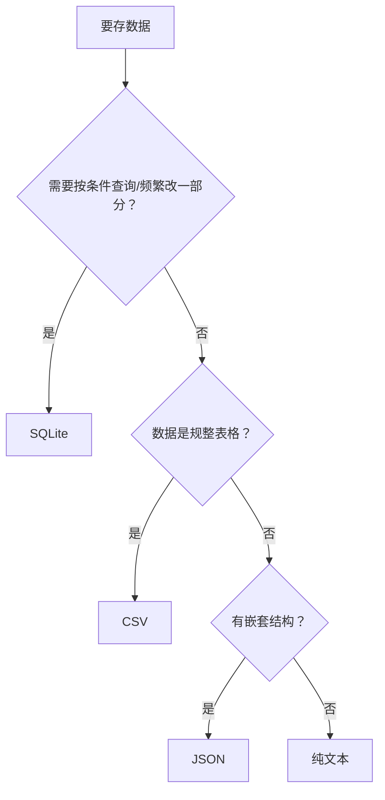
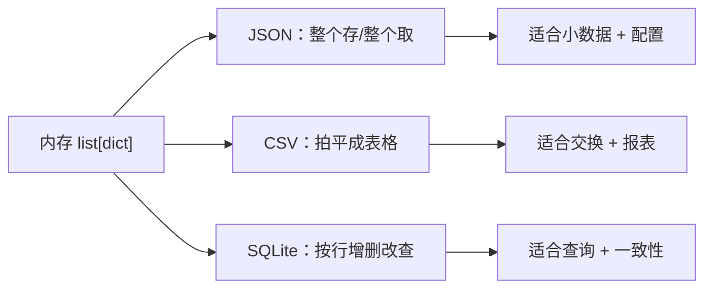

# PY-048 数据持久化方案

## 1. 知识概览

| 项 | 内容 |
|---|---|
| 知识 ID | `PY-048` |
| 所属模块 | M-PY-05 文件、异常与数据持久化 |
| 学习难度 | L3 中级 |
| **预计学习时间** | 45 分钟 |
| 前置知识 | [[PY-043 CSV 与 JSON]]、[[PY-047 SQLite 基础]] |
| 学习目标 | 能在文本 / CSV / JSON / SQLite 之间做出合理选择，知道各自的边界 |

## 2. 通俗原理讲解

"持久化"就是**让数据活过程序退出**。

- 变量在内存里，程序一关就没了。
- 存成文件或数据库，下次还能读回来。

四种常见方案，像四种收纳方式：

| 方案 | 类比 | 适合 |
|---|---|---|
| 纯文本 | 便签 | 日志、说明 |
| CSV | 表格纸 | 规整的二维数据、给 Excel 用 |
| JSON | 结构说明书 | 配置、嵌套数据、接口 |
| SQLite | 档案柜 | 大量数据、要查询、要保证一致性 |

## 3. 技术原理

| 维度 | 文本 | CSV | JSON | SQLite |
|---|---|---|---|---|
| 结构 | 无 | 二维表 | 任意嵌套 | 表 + 索引 |
| 查询 | 靠代码 | 靠代码 | 靠代码 | **SQL** |
| 部分更新 | 难 | 难 | 难 | **易**（UPDATE） |
| 并发写 | 危险 | 危险 | 危险 | 事务支持 |
| 人类可读 | ✅ | ✅ | 一般 | ❌（二进制） |
| 依赖 | 无 | 无 | 无 | Python 内置 |

**选择决策树**



**三条经验**

1. **配置用 JSON**（可读、可嵌套）。
2. **导出给人看用 CSV**。
3. **本地应用的状态用 SQLite**（省心且有查询能力）。

## 4. 图解辅助



## 5. 完整代码示例

```powershell
python persistence.py
```

```python
import json
import sqlite3
from pathlib import Path

data = [{"name": "小明", "score": 85}, {"name": "小红", "score": 92}]

txt = Path("demo.json")
txt.write_text(json.dumps(data, ensure_ascii=False), encoding="utf-8")
print("JSON 写入:", txt.exists())

db = Path("demo2.db")
conn = sqlite3.connect(db)
cur = conn.cursor()
cur.execute("CREATE TABLE s (name TEXT, score INTEGER)")
cur.executemany("INSERT INTO s VALUES (?, ?)", [(d["name"], d["score"]) for d in data])
conn.commit()

cur.execute("SELECT name FROM s WHERE score > ?", (90,))
print("查询结果:", cur.fetchall())

conn.close()
print("SQLite 文件存在:", db.exists())

txt.unlink()
db.unlink()
```

**预期输出**

```
JSON 写入: True
查询结果: [('小红',)]
SQLite 文件存在: True
```

**说明**

- JSON 版是"整个读、整个写"，想改一个人也得重写整个文件。
- SQLite 版可以直接 `WHERE` 筛选、`UPDATE` 单行——数据变大后优势明显。
- 两者都用 `Path` 管理文件，结束时清理。

## 6. 实践练习

**基础**

1. 判断：保存 1000 条订单，需要按日期查询，用哪种方案？
2. 判断：保存程序配置（含嵌套的窗口设置），用哪种？
3. 把同一份数据分别存成 CSV 与 SQLite，比较文件大小（`stat().st_size`）。

**进阶**

1. 写一个函数 `save(records, kind)`，`kind` 为 `"json"` 或 `"sqlite"` 时走不同实现。
2. 说明为什么"用 CSV 存日志"不如"纯文本追加"。

**综合实践**

写一个"学生成绩仓库"：启动时从 SQLite 读取，运行时增删改，退出前写回；再提供一个"导出 CSV"功能用于给别人看。

## 7. 参考答案

**基础 1 · 思路**：要查询。

答案：**SQLite**（可按日期 `WHERE` 筛选，还能建索引）。

**基础 2 · 思路**：嵌套 + 可读。

答案：**JSON**。

**基础 3 · 思路**：同一批数据两种落地。

```python
import csv, sqlite3
from pathlib import Path

rows = [{"name": f"u{i}", "score": i} for i in range(100)]

csv_p = Path("t.csv")
with csv_p.open("w", encoding="utf-8", newline="") as f:
    w = csv.DictWriter(f, fieldnames=["name", "score"])
    w.writeheader()
    w.writerows(rows)

db_p = Path("t.db")
conn = sqlite3.connect(db_p)
conn.execute("CREATE TABLE t (name TEXT, score INTEGER)")
conn.executemany("INSERT INTO t VALUES (?, ?)", [(r["name"], r["score"]) for r in rows])
conn.commit(); conn.close()

print("CSV 更大:", csv_p.stat().st_size > db_p.stat().st_size)
csv_p.unlink(); db_p.unlink()
```

运行结果：`CSV 更大: True`（小数据下 CSV 通常更大；大数据时关系会反转）

**进阶 1 · 思路**：用分支封装两种实现。

```python
import json, sqlite3
from pathlib import Path

def save(records, kind, path):
    p = Path(path)
    if kind == "json":
        p.write_text(json.dumps(records, ensure_ascii=False), encoding="utf-8")
    elif kind == "sqlite":
        conn = sqlite3.connect(p)
        conn.execute("CREATE TABLE IF NOT EXISTS t (name TEXT, score INTEGER)")
        conn.executemany("INSERT INTO t VALUES (?, ?)", [(r["name"], r["score"]) for r in records])
        conn.commit(); conn.close()
    else:
        raise ValueError("未知类型")
    return p.exists()

print(save([{"name": "小明", "score": 85}], "json", "a.json"))
Path("a.json").unlink()
```

运行结果：`True`

**进阶 2 · 思路**：追加成本与结构约束。

答案：CSV 每写一行都要保证列对齐，且无法简单追加"非表格"信息；纯文本 `"a"` 模式追加一行即可，天然适合日志。

**综合实践 · 思路**：读-改-写 + 导出。

```python
import csv, sqlite3
from pathlib import Path

db = Path("school.db")
conn = sqlite3.connect(db)
conn.execute("CREATE TABLE IF NOT EXISTS student (name TEXT, score INTEGER)")
conn.commit()

def add(name, score):
    conn.execute("INSERT INTO student VALUES (?, ?)", (name, score))
    conn.commit()

def all_rows():
    return conn.execute("SELECT name, score FROM student ORDER BY score DESC").fetchall()

add("小明", 85)
add("小红", 92)
rows = all_rows()
print("库内:", rows)

csv_p = Path("export.csv")
with csv_p.open("w", encoding="utf-8", newline="") as f:
    w = csv.writer(f)
    w.writerow(["name", "score"])
    w.writerows(rows)
print("导出:", csv_p.exists())

conn.close()
csv_p.unlink(); db.unlink()
```

运行结果：

```
库内: [('小红', 92), ('小明', 85)]
导出: True
```

## 8. 常见错误

| 错误想法 | 后果 | 正确做法 |
|---|---|---|
| 所有数据都塞 JSON | 数据一大就慢、改一行要重写全文件 | 超过几千条考虑 SQLite |
| 用 CSV 存嵌套 | 结构丢失、需要拍平 | 改 JSON |
| 直接对文件做并发写 | 内容损坏 | 用数据库事务 |
| 持久化时忘了编码 | 中文乱码 | `encoding="utf-8"` |
| 不清理临时文件 | 目录越来越乱 | 用完 `unlink()` |

## 9. 知识关联

- **前置**：[[PY-043 CSV 与 JSON]]、[[PY-047 SQLite 基础]]
- **后继**：`PY-070 数据读取与写出`（Pandas 的读写能力，待建）
- **相关数学**：无
- **所属模块**：`M-PY-05 文件、异常与数据持久化`

## 10. 学习记录

| 日期 | 状态 | 掌握程度 | 遇到的问题 | 个人总结 | 待复习 |
|---|---|---|---|---|---|
| — | planned | — | — | — | — |

---

## 🔗 Notion 同步信息

> 以下内容由 Notion「AI Knowledge System · 知识点」数据库按知识 ID 合并而来（导出于 2026-11-09）。

| 属性 | 值 |
|---|---|
| 学科 | Python基础 |
| 学习状态 | 未开始 |
| 难度 | L3 推导 |
| 知识类型 | Concept |
| 学习目标 | 能在文本/CSV/JSON/SQLite 之间做出合理选择。 |

- **所属模块**：[M-PY-05 文件、异常与数据持久化](../%E8%AF%BE%E7%A8%8B%E6%A8%A1%E5%9D%97/M-PY-05%20%E6%96%87%E4%BB%B6%E3%80%81%E5%BC%82%E5%B8%B8%E4%B8%8E%E6%95%B0%E6%8D%AE%E6%8C%81%E4%B9%85%E5%8C%96.md)
- **前置知识**：[PY-043 CSV 与 JSON](PY-043%20CSV%20%E4%B8%8E%20JSON.md) · [PY-047 SQLite 基础](PY-047%20SQLite%20%E5%9F%BA%E7%A1%80.md)
- **后继知识**：[PY-052 环境变量与配置文件](../06%20%E6%A8%A1%E5%9D%97%E4%B8%8E%E5%8C%85/PY-052%20%E7%8E%AF%E5%A2%83%E5%8F%98%E9%87%8F%E4%B8%8E%E9%85%8D%E7%BD%AE%E6%96%87%E4%BB%B6.md)
