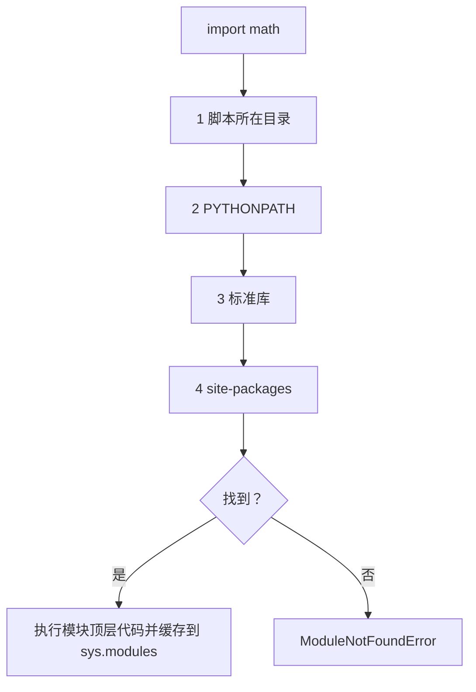

# PY-010 模块与导入

## 1. 知识概览

> ⏱ **预计学习时间**：45 分钟

模块就是**一个 `.py` 文件**。用 `import` 把它引进来，用 `模块名.名字` 访问里面的函数、类、变量。

- 一句话：模块是"把代码分文件装好"的机制；包是"把模块放文件夹"的机制。
- 解决什么问题：代码写长了必须拆分，否则一个文件几千行无法维护。
- 关键结论：`import` 只执行一次，模块对象被缓存。

## 2. 学习目标

1. 会用 `import x`、`from x import y`、`import x as y` 三种写法。
2. 知道标准库在哪查（`math`、`random`、`statistics`、`pathlib`、`json`）。
3. 能解释 `if __name__ == "__main__":` 的作用。
4. 能说清"模块搜索路径"与"同名文件遮蔽标准库"的风险。

## 3. 通俗原理讲解

模块像**工具箱**：

- `import math` = 把整个工具箱搬来，用的时候说"工具箱里的 sqrt"（`math.sqrt`）。
- `from math import sqrt` = 只把那把螺丝刀拿出来，直接用 `sqrt`。
- `import numpy as np` = 给工具箱起个短名字，少打字。

为什么推荐 `import math` 而不是 `from math import *`？因为后者会把几十个名字倒进你的命名空间，容易撞名、看不出函数来自哪里。

### 图解：import 的查找顺序



## 4. 深入技术原理

- **导入过程**：查找（`sys.path` 顺序）→ 编译 → 执行模块顶层代码 → 缓存进 `sys.modules`。所以**重复 import 不会重复执行**。
- **`sys.path` 顺序**：脚本所在目录 → 环境变量 `PYTHONPATH` → 标准库 → 第三方包（site-packages）。
- **`__name__`**：文件被直接运行时是 `"__main__"`；被 import 时是模块名。因此 `if __name__ == "__main__":` 里的代码只在"直接运行"时执行——这是脚本与库的双重身份写法。
- **包**：带 `__init__.py` 的目录（Python 3.3+ 支持命名空间包，但入门仍建议放 `__init__.py`）。
- **风险**：如果你在项目里建了 `random.py`，它会**遮蔽**标准库的 `random`，导致古怪错误（"自己遮蔽自己"）。
- 相对导入 `from . import x` 只能用于包内。

## 5. 完整可运行代码

```powershell
python import_demo.py
```

```python
import math
print(math.sqrt(16))
print(round(math.pi, 5))

from math import sqrt, pi
print(sqrt(25), round(pi, 3))

import random
random.seed(42)
print(round(random.random(), 4))

import statistics as st
print(st.mean([1, 2, 3, 4]))

from pathlib import Path
p = Path("demo.txt")
print(p.name, p.suffix)

if __name__ == "__main__":
    print("作为脚本直接运行")
```

## 6. 逐段代码解析

| 代码 | 结果 | 说明 |
|---|---|---|
| `math.sqrt(16)` | `4.0` | 返回浮点，即使是完全平方数 |
| `round(math.pi, 5)` | `3.14159` | 圆周率保留 5 位 |
| `from math import sqrt, pi` | — | 只取需要的东西，调用时不用前缀 |
| `random.seed(42)` | — | 固定随机种子，让结果可复现 |
| `round(random.random(), 4)` | `0.6394` | 种子 42 下的第一个随机数 |
| `st.mean([1,2,3,4])` | `2.5` | `as` 起了短别名 |
| `Path("demo.txt").name` | `demo.txt` | 文件名 |
| `Path("demo.txt").suffix` | `.txt` | 扩展名 |
| `if __name__ == "__main__"` | 打印 | 直接运行时才执行 |

## 7. 运行结果

```
4.0
3.14159
5.0 3.142
0.6394
2.5
demo.txt .txt
作为脚本直接运行
```

## 8. 基础练习

1. 用 `math` 计算 `2` 的平方根并保留 3 位小数。
2. 用 `statistics` 求一组数的中位数。
3. 用 `pathlib` 取出路径 `"data/report.csv"` 的文件名与扩展名。

## 9. 进阶练习

1. 写两个文件 `tools.py` 与 `main.py`：`tools.py` 里定义 `add`，`main.py` 里导入并调用。说明 `if __name__ == "__main__"` 在其中起什么作用。
2. 为什么不要在项目里把文件命名为 `random.py` 或 `json.py`？给出会发生的具体后果。

## 10. 综合实践

写一个"日志统计"脚本：

- 用 `pathlib` 遍历当前目录下所有 `.md` 文件；
- 用 `statistics` 统计这些文件大小的平均值；
- 用 `math.ceil` 把平均值向上取整；
- 输出文件个数、平均字节数、向上取整结果。

（本练习不依赖真实文件：可用 `Path(".")` 先跑通，再换成 Vault 路径观察输出。）

## 11. 参考答案

**基础**

1. `print(round(math.sqrt(2), 3))` → `1.414`
2. `import statistics; print(statistics.median([1, 3, 2, 4]))` → `2.5`
3. `from pathlib import Path; p = Path("data/report.csv"); print(p.name, p.suffix)` → `report.csv .csv`

**进阶**

1. `tools.py`：`def add(a, b): return a + b`；`main.py`：`import tools; print(tools.add(1, 2))`。`if __name__ == "__main__":` 让 `tools.py` 里的自测代码只在直接运行时跑，被 import 时不跑。
2. 因为脚本所在目录在 `sys.path` 最前，你的 `random.py` 会**遮蔽**标准库 `random`。后果：`import random` 拿到的是你的文件，标准库函数全部消失，可能引发 `AttributeError`，且错误信息极具误导性。

**综合实践**

```python
import math
import statistics
from pathlib import Path

sizes = [p.stat().st_size for p in Path(".").glob("*.md")]
if sizes:
    avg = statistics.mean(sizes)
    print("文件数", len(sizes))
    print("平均字节", round(avg, 1))
    print("向上取整", math.ceil(avg))
else:
    print("当前目录没有 .md 文件")
```

## 12. 常见错误

| 错误现象 | 根本原因 | 正确做法 |
|---|---|---|
| `ModuleNotFoundError` | 模块不在 `sys.path` 里 | 检查文件位置、拼写、是否装了包 |
| `ImportError: cannot import name` | 名字不存在或拼错 | 确认模块里确实定义了该名字 |
| 改了代码但不生效 | 模块已被缓存 | 重启解释器；交互环境用 `importlib.reload` |
| 导入自己的文件后标准库异常 | 同名文件遮蔽 | 重命名，别用标准库名字 |
| 循环导入报错 | A 导 B、B 又导 A | 拆出公共模块，或把 import 移到函数内 |

## 13. 知识关联

- **前置**：[[PY-009 函数]]
- **后继**：无（Python 基础路线到此收尾，下一步进入科学计算）
- **相关数学**：无
- **所属模块**：`M-PY-01 Python 编程基础`

## 14. 学习记录

| 日期 | 动作 | 用时 | 结果 | 复盘 |
|---|---|---|---|---|
| 2026-11-01 | 建立笔记 | — | 待学 | — |

- 掌握判定：能解释 `__name__ == "__main__"` 与同名遮蔽，并跑通日志统计脚本 = `practiced`。

---

## 🔗 Notion 同步信息

> 以下内容由 Notion「AI Knowledge System · 知识点」数据库按知识 ID 合并而来（导出于 2026-11-09）。

| 属性 | 值 |
|---|---|
| 学科 | Python基础 |
| 学习状态 | 未开始 |
| 难度 | L2 应用 |
| 知识类型 | Concept |
| 学习目标 | 会导入模块、使用标准库，理解 __main__ 与同名遮蔽风险。 |

- **所属模块**：[M-PY-01 Python 编程基础](../%E8%AF%BE%E7%A8%8B%E6%A8%A1%E5%9D%97/M-PY-01%20Python%20%E7%BC%96%E7%A8%8B%E5%9F%BA%E7%A1%80.md)
- **前置知识**：[PY-009 函数](../02%20%E5%87%BD%E6%95%B0%E4%B8%8E%E4%BD%9C%E7%94%A8%E5%9F%9F/PY-009%20%E5%87%BD%E6%95%B0.md)
- **后继知识**：[PY-041 文件读写](../05%20%E5%BC%82%E5%B8%B8%E4%B8%8E%E6%96%87%E4%BB%B6/PY-041%20%E6%96%87%E4%BB%B6%E8%AF%BB%E5%86%99.md) · [PY-049 包与项目结构](PY-049%20%E5%8C%85%E4%B8%8E%E9%A1%B9%E7%9B%AE%E7%BB%93%E6%9E%84.md) · [PY-050 pip 与虚拟环境](PY-050%20pip%20%E4%B8%8E%E8%99%9A%E6%8B%9F%E7%8E%AF%E5%A2%83.md)
