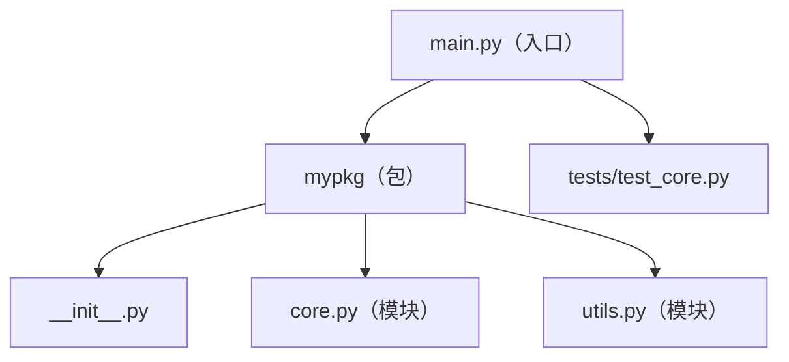

# PY-049 包与项目结构

## 1. 知识概览

| 项 | 内容 |
|---|---|
| 知识 ID | `PY-049` |
| 所属模块 | M-PY-06 Python 进阶与工程实践 |
| 学习难度 | L2 初级 |
| **预计学习时间** | 45 分钟 |
| 前置知识 | [[PY-010 模块与导入]] |
| 学习目标 | 会划分包与模块、理解 `__init__.py` 的作用、能落地一个标准项目目录 |

## 2. 通俗原理讲解

包像**文件夹**，模块像**文件**。

- 一个 `.py` 文件 = 一个模块（`utils.py`）
- 一个含 `__init__.py` 的文件夹 = 一个包（`mypkg/`）
- 包可以再套包（子包）

没有规划的后果：所有代码堆在 `main.py`，几千行后改一处怕崩三处。

## 3. 技术原理

**标准项目结构（入门版）**

```text
myproject/
├── mypkg/
│   ├── __init__.py      # 包标记，可放版本号与对外导出
│   ├── core.py
│   └── utils.py
├── tests/
│   └── test_core.py
├── README.md
├── requirements.txt
└── main.py              # 程序入口
```

| 文件 | 作用 |
|---|---|
| `__init__.py` | 标记这是包；导入包时执行；可写 `VERSION`、`__all__` |
| `main.py` | 入口，尽量只做"参数解析 + 调用" |
| `tests/` | 测试代码，与源码分离 |

**导入规则**

- `import mypkg.utils` 需要 `myproject` 在 `sys.path` 里（通常是"运行入口文件所在的目录"）。
- 包内相互导入用 `from . import utils`（相对导入，仅包内可用）。
- **不要**从包外 `sys.path.append` 硬塞路径——那是临时手段，正规做法是安装包（`pip install -e .`）。

## 4. 图解辅助



## 5. 完整代码示例

```powershell
python package_demo.py
```

```python
import shutil
import sys
import tempfile
from pathlib import Path

root = Path(tempfile.mkdtemp())
pkg = root / "mypkg"
pkg.mkdir()
(pkg / "__init__.py").write_text("VERSION = '1.0'\n", encoding="utf-8")
(pkg / "utils.py").write_text("def add(a, b):\n    return a + b\n", encoding="utf-8")

sys.path.insert(0, str(root))

import mypkg
from mypkg.utils import add

print(mypkg.VERSION, add(2, 3))

shutil.rmtree(root)
print("已清理:", not root.exists())
```

**预期输出**

```
1.0 5
已清理: True
```

**说明**

- `__init__.py` 让 `mypkg` 成为包，`VERSION` 就是包级属性。
- `from mypkg.utils import add` 定位到 `mypkg/utils.py` 里的 `add`。
- 演示完立刻 `rmtree` 清理，不污染工作目录。
- 真实项目里不靠 `sys.path.insert`，而是在项目根执行 `python main.py`（入口所在目录自动在路径里）。

## 6. 实践练习

**基础**

1. 手写一个包 `calc/`，含 `__init__.py` 与 `basic.py`（`add`/`sub`），导入并调用。
2. 在 `__init__.py` 里写 `VERSION = "0.1"`，从包外读取。
3. 判断：没有 `__init__.py` 的目录还能 `import` 吗？

**进阶**

1. 设计一个含子包的结构：`app/` + `app/services/`，并写出导入语句。
2. 解释为什么"把测试文件放在源码目录里"不好。

**综合实践**

用手写文件的方式搭出一个最小项目（`main.py` + `mypkg/` + `tests/`），让 `main.py` 调用包内函数并打印结果；说明每个文件的职责。

## 7. 参考答案

**基础 1 · 思路**：目录 + `__init__.py` + 模块。

```python
import shutil, sys, tempfile
from pathlib import Path

root = Path(tempfile.mkdtemp()); pkg = root / "calc"; pkg.mkdir()
(pkg / "__init__.py").write_text("", encoding="utf-8")
(pkg / "basic.py").write_text("def add(a,b):\n    return a+b\n\ndef sub(a,b):\n    return a-b\n", encoding="utf-8")
sys.path.insert(0, str(root))
from calc.basic import add, sub
print(add(3, 4), sub(3, 4))
shutil.rmtree(root)
```

运行结果：`7 -1`

**基础 2 · 思路**：`__init__.py` 里的变量就是包属性。

```python
import mypkg
print(mypkg.VERSION)
```

运行结果：`1.0`

**基础 3 · 思路**：命名空间包。

答案：Python 3.3+ 可以（命名空间包），但工程上仍建议保留 `__init__.py`，语义更清晰、工具兼容更好。

**进阶 1 · 思路**：子包同样需要 `__init__.py`。

```text
app/
├── __init__.py
└── services/
    ├── __init__.py
    └── user.py
```

导入：`from app.services.user import ...`

**进阶 2 · 思路**：源码与测试混在一起。

答案：打包发布时会把测试一起带出去；测试依赖（如 pytest）不该污染运行环境；目录职责不清，import 容易绕。

**综合实践 · 思路**：入口只做编排。

```text
demo_proj/
├── mypkg/__init__.py
├── mypkg/core.py
├── tests/test_core.py
└── main.py
```

`main.py`：`from mypkg.core import greet; print(greet("世界"))`
`core.py`：`def greet(name): return f"你好，{name}"`

## 8. 常见错误

| 错误写法 | 现象 | 原因 | 正确写法 |
|---|---|---|---|
| 目录里没有 `__init__.py` 却当包用 | 部分工具识别不到 | 缺包标记 | 加上（哪怕空文件） |
| 用 `sys.path.append` 到处塞路径 | 换个目录就崩 | 依赖运行位置 | 用 `pip install -e .` 或规范入口 |
| 循环导入 | `ImportError` | A 导 B、B 导 A | 抽公共模块 |
| 包名与标准库同名 | 导入到错的模块 | 遮蔽 | 换名 |
| 测试混在源码目录 | 打包带上测试 | 职责不清 | 分离 `tests/` |

## 9. 知识关联

- **前置**：[[PY-010 模块与导入]]
- **后继**：[[PY-050 pip 与虚拟环境]]、[[PY-051 requirements 与 pyproject]]
- **相关数学**：无
- **所属模块**：`M-PY-06 Python 进阶与工程实践`

## 10. 学习记录

| 日期 | 状态 | 掌握程度 | 遇到的问题 | 个人总结 | 待复习 |
|---|---|---|---|---|---|
| — | planned | — | — | — | — |

---

## 🔗 Notion 同步信息

> 以下内容由 Notion「AI Knowledge System · 知识点」数据库按知识 ID 合并而来（导出于 2026-11-09）。

| 属性 | 值 |
|---|---|
| 学科 | Python基础 |
| 学习状态 | 未开始 |
| 难度 | L2 应用 |
| 知识类型 | Technique |
| 学习目标 | 会划分包与模块，理解 __init__.py，能落地标准项目目录。 |

- **所属模块**：[M-PY-06 Python 进阶与工程实践](../%E8%AF%BE%E7%A8%8B%E6%A8%A1%E5%9D%97/M-PY-06%20Python%20%E8%BF%9B%E9%98%B6%E4%B8%8E%E5%B7%A5%E7%A8%8B%E5%AE%9E%E8%B7%B5.md)
- **前置知识**：[PY-010 模块与导入](PY-010%20%E6%A8%A1%E5%9D%97%E4%B8%8E%E5%AF%BC%E5%85%A5.md)
- **被项目引用**：[PROJ-004 JSON 数据管理工具](../../07_%E5%AE%9E%E6%88%98%E9%A1%B9%E7%9B%AE/01%20Python%E9%A1%B9%E7%9B%AE/PROJ-004%20JSON%20%E6%95%B0%E6%8D%AE%E7%AE%A1%E7%90%86%E5%B7%A5%E5%85%B7.md)
