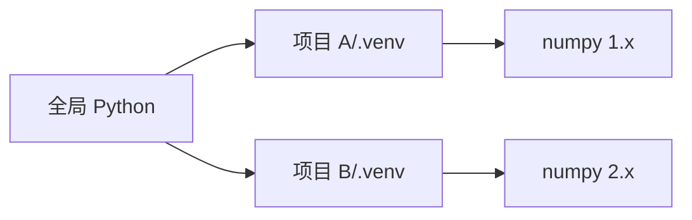

# PY-050 pip 与虚拟环境

## 1. 知识概览

| 项 | 内容 |
|---|---|
| 知识 ID | `PY-050` |
| 所属模块 | M-PY-06 Python 进阶与工程实践 |
| 学习难度 | L2 初级 |
| **预计学习时间** | 45 分钟 |
| 前置知识 | [[PY-010 模块与导入]] |
| 学习目标 | 会用 `pip` 装包、会建/激活虚拟环境、理解"为什么每个项目要独立环境" |

## 2. 通俗原理讲解

`pip` 是**应用商店**：`pip install requests` 就把别人的包装到你机器上。

虚拟环境是**给每个项目单独的储物柜**：

- 项目 A 要 `numpy 1.x`，项目 B 要 `numpy 2.x`——装在同一处必然打架。
- 每个项目一个 `.venv`，各自装各自的，互不干扰；删掉 `.venv` 就等于"清空这个项目的依赖"。

**为什么必须用**：全局装包迟早会遇到"升级了 A，弄坏了 B"。

## 3. 技术原理

**Windows PowerShell 下的完整流程**

```powershell
# 1 建环境（在项目根目录）
python -m venv .venv

# 2 激活（PowerShell）
.\.venv\Scripts\Activate.ps1

# 3 确认用的是虚拟环境里的解释器
python -c "import sys; print(sys.executable)"

# 4 装包
python -m pip install requests

# 5 退出
deactivate
```

> 若提示"禁止运行脚本"，执行一次：
> `Set-ExecutionPolicy -Scope CurrentUser RemoteSigned`

**关键区别**

| 命令 | 用哪个 pip |
|---|---|
| `pip install x` | PATH 里的 pip，可能不是当前环境 |
| `python -m pip install x` | **当前解释器的 pip**（推荐） |

**CMD 与 PowerShell 的激活脚本不同**

| Shell | 命令 |
|---|---|
| PowerShell | `.\.venv\Scripts\Activate.ps1` |
| CMD | `.venv\Scripts\activate.bat` |
| Git Bash | `source .venv/Scripts/activate` |

## 4. 图解辅助



两个环境各自持有自己的依赖版本，互不影响。

## 5. 完整代码示例

下面的 Python 片段用来判断"当前是否在虚拟环境里"：

```powershell
python -c "import sys; print(sys.prefix != sys.base_prefix)"
```

在已安装的脚本中也可以这样写：

```python
import sys

in_venv = sys.prefix != sys.base_prefix
print("解释器:", sys.version.split()[0])
print("是否在虚拟环境:", in_venv)
print("site-packages 前缀:", sys.prefix)
```

**预期输出**（在系统 Python 下运行）

```
解释器: 3.15.0
是否在虚拟环境: False
site-packages 前缀: C:\Program Files\Python315
```

**说明**

- `sys.prefix != sys.base_prefix` 是判断虚拟环境的标准写法。
- 在 `.venv` 里运行时，`sys.prefix` 会指向项目下的 `.venv`，结果为 `True`。
- 我这台机器默认解释器是系统 Python，所以显示 `False`——这是**如实输出**，不是环境有问题。

## 6. 实践练习

**基础**

1. 在任意空目录建 `.venv`，激活后确认 `sys.prefix` 变化。
2. 用 `python -m pip list` 查看已安装包。
3. 判断：`pip install` 与 `python -m pip install` 有什么区别？

**进阶**

1. 建两个环境，分别装不同版本的同一个包，验证互不影响（可用 `pip show` 看版本）。
2. 写出"从零克隆项目到跑起来"的完整命令序列（PowerShell）。

**综合实践**

为一个小项目写一份 `SETUP.md`：包含建环境、激活、装依赖、运行、退出五步，全部用 PowerShell 命令，并注明 CMD 的差异。

## 7. 参考答案

**基础 1 · 思路**：建 + 激活 + 看前缀。

```powershell
mkdir demo_env
cd demo_env
python -m venv .venv
.\.venv\Scripts\Activate.ps1
python -c "import sys; print(sys.prefix)"
deactivate
```

运行结果：输出路径里包含 `demo_env\.venv`。

**基础 2 · 思路**：列包。

```powershell
python -m pip list
```

运行结果：一长串包名与版本（随环境不同）。

**基础 3 · 思路**：解释器绑定。

答案：`pip` 是某个具体解释器安装的脚本，可能与你要用的解释器不一致；`python -m pip` 明确用"当前这个 python"的 pip，最可靠。

**进阶 1 · 思路**：两个目录各建一个环境。

```powershell
python -m venv projA\.venv
projA\.venv\Scripts\python.exe -m pip install "requests==2.31.0"
python -m venv projB\.venv
projB\.venv\Scripts\python.exe -m pip install "requests==2.32.0"
projA\.venv\Scripts\python.exe -m pip show requests
projB\.venv\Scripts\python.exe -m pip show requests
```

运行结果：两个环境分别显示 2.31.0 与 2.32.0，互不影响。

**进阶 2 · 思路**：克隆 → 建环境 → 装依赖 → 运行。

```powershell
git clone <仓库地址> myproj
cd myproj
python -m venv .venv
.\.venv\Scripts\Activate.ps1
python -m pip install -r requirements.txt
python main.py
```

**综合实践 · 思路**：五步写清，标注 CMD 差异。

```markdown
## 安装
1. `python -m venv .venv`
2. PowerShell: `.\.venv\Scripts\Activate.ps1` ／ CMD: `.venv\Scripts\activate.bat`
3. `python -m pip install -r requirements.txt`
4. `python main.py`
5. `deactivate`
```

## 8. 常见错误

| 错误写法 | 现象 | 原因 | 正确写法 |
|---|---|---|---|
| 全局装一堆包 | 版本冲突 | 没有隔离 | 每项目一个 `.venv` |
| 用 `pip` 而不是 `python -m pip` | 装到了别的解释器 | PATH 不明确 | 统一用 `python -m pip` |
| 激活失败提示脚本被禁用 | `UnauthorizedAccess` | 执行策略限制 | `Set-ExecutionPolicy -Scope CurrentUser RemoteSigned` |
| 把 `.venv` 提交进 Git | 仓库巨大 | 依赖不该入库 | 写入 `.gitignore` |
| 换目录后忘了激活 | 用的还是全局包 | shell 未激活 | 重新激活再运行 |

## 9. 知识关联

- **前置**：[[PY-010 模块与导入]]
- **后继**：[[PY-051 requirements 与 pyproject]]、[[PY-055 Git 基础]]
- **相关数学**：无
- **所属模块**：`M-PY-06 Python 进阶与工程实践`

## 10. 学习记录

| 日期 | 状态 | 掌握程度 | 遇到的问题 | 个人总结 | 待复习 |
|---|---|---|---|---|---|
| — | planned | — | — | — | — |

---

## 🔗 Notion 同步信息

> 以下内容由 Notion「AI Knowledge System · 知识点」数据库按知识 ID 合并而来（导出于 2026-11-09）。

| 属性 | 值 |
|---|---|
| 学科 | Python基础 |
| 学习状态 | 未开始 |
| 难度 | L2 应用 |
| 知识类型 | Technique |
| 学习目标 | 会用 pip 装包、建虚拟环境，理解为何每个项目要独立环境。 |

- **所属模块**：[M-PY-06 Python 进阶与工程实践](../%E8%AF%BE%E7%A8%8B%E6%A8%A1%E5%9D%97/M-PY-06%20Python%20%E8%BF%9B%E9%98%B6%E4%B8%8E%E5%B7%A5%E7%A8%8B%E5%AE%9E%E8%B7%B5.md)
- **前置知识**：[PY-010 模块与导入](PY-010%20%E6%A8%A1%E5%9D%97%E4%B8%8E%E5%AF%BC%E5%85%A5.md)
- **后继知识**：[PY-051 requirements 与 pyproject](PY-051%20requirements%20%E4%B8%8E%20pyproject.md) · [PY-055 Git 基础](PY-055%20Git%20%E5%9F%BA%E7%A1%80.md)
