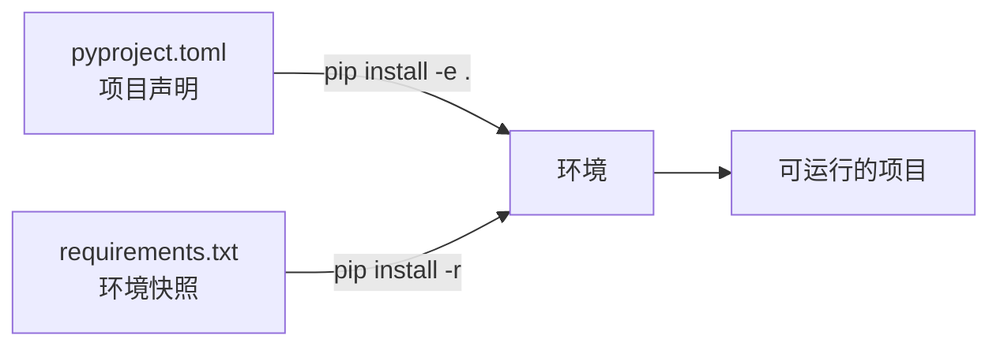

# PY-051 requirements 与 pyproject

## 1. 知识概览

| 项 | 内容 |
|---|---|
| 知识 ID | `PY-051` |
| 所属模块 | M-PY-06 Python 进阶与工程实践 |
| 学习难度 | L2 初级 |
| **预计学习时间** | 40 分钟 |
| 前置知识 | [[PY-050 pip 与虚拟环境]] |
| 学习目标 | 会写 `requirements.txt`、会读 `pyproject.toml`、知道两者的分工 |

## 2. 通俗原理讲解

两个文件回答两个不同问题：

- `requirements.txt`：**这个项目现在装了哪些包、什么版本**——用于"复现环境"。
- `pyproject.toml`：**这个项目本身是什么、要什么依赖**——用于"打包与发布"。

类比：

- `requirements.txt` = 你家冰箱的**库存清单**（精确到生产批号）。
- `pyproject.toml` = 餐厅的**菜单与规格书**（要什么原料，不写具体批次）。

## 3. 技术原理

**requirements.txt 常见写法**

```text
requests==2.31.0     # 精确锁定
numpy>=2.0,<3.0      # 范围约束
pytest               # 不限版本（不推荐用于生产）
```

| 符号 | 含义 |
|---|---|
| `==` | 精确等于 |
| `>=` / `<=` | 大于等于 / 小于等于 |
| `~=` | 兼容版本（`~=2.1` 允许 2.x） |
| `!=` | 排除某版本 |

**pyproject.toml 最小示例**

```toml
[project]
name = "myproj"
version = "0.1.0"
requires-python = ">=3.10"
dependencies = ["requests>=2.31", "numpy>=2.0"]

[project.optional-dependencies]
dev = ["pytest", "ruff"]
```

**两个实用命令**

```powershell
python -m pip freeze > requirements.txt      # 导出当前环境
python -m pip install -r requirements.txt    # 按清单安装
```

**注意**：`pip freeze` 会把**所有**包（含间接依赖）都导出，适合锁定环境；手写 `requirements.txt` 通常只写直接依赖。

## 4. 图解辅助



## 5. 完整代码示例

```powershell
python parse_deps.py
```

```python
import tomllib
from pathlib import Path

req = "requests==2.31.0\nnumpy>=2.0\npytest  # 测试用\n"
p = Path("requirements_demo.txt")
p.write_text(req, encoding="utf-8")

lines = [
    line.strip()
    for line in p.read_text(encoding="utf-8").splitlines()
    if line.strip() and not line.strip().startswith("#")
]
print(lines)

p.unlink()

toml_text = """
[project]
name = "demo"
version = "0.1.0"
requires-python = ">=3.10"
dependencies = ["requests", "numpy"]

[project.optional-dependencies]
dev = ["pytest", "ruff"]
"""

data = tomllib.loads(toml_text)
print(data["project"]["name"], data["project"]["dependencies"])
print(data["project"]["optional-dependencies"]["dev"])
```

**预期输出**

```
['requests==2.31.0', 'numpy>=2.0', 'pytest']
demo ['requests', 'numpy']
['pytest', 'ruff']
```

**说明**

- 注释用 `#`，解析时要过滤掉（pip 也支持行内注释，但自己解析时先按整行处理更稳）。
- `tomllib` 是 3.11+ 标准库，只读不写。
- `optional-dependencies` 就是"可选依赖组"，安装时用 `pip install ".[dev]"`。

## 6. 实践练习

**基础**

1. 写一个 `requirements.txt`，含三个包：精确版本、版本范围、无约束各一个。
2. 用 `tomllib` 读取一份 `pyproject.toml` 并打印 `name` 与 `version`。
3. 判断：`pip freeze` 与手写 requirements 有什么区别？

**进阶**

1. 给项目加 `dev` 可选依赖组，并写出安装命令。
2. 解释 `~=` 与 `>=` 的差别，各举一个会翻车的例子。

**综合实践**

为一个"天气查询小工具"写两份文件：`requirements.txt`（锁定运行依赖）与 `pyproject.toml`（声明项目元信息 + dev 依赖），并写清安装步骤。

## 7. 参考答案

**基础 1 · 思路**：三种写法各一行。

```text
requests==2.31.0
numpy>=2.0,<3.0
pytest
```

**基础 2 · 思路**：`tomllib.loads`。

```python
import tomllib
text = '[project]\nname = "demo"\nversion = "0.1.0"\n'
data = tomllib.loads(text)
print(data["project"]["name"], data["project"]["version"])
```

运行结果：`demo 0.1.0`

**基础 3 · 思路**：快照 vs 声明。

答案：`pip freeze` 导出**当前环境的全部已装包**（含间接依赖、精确版本）；手写只列**直接依赖**，更易读但复现性弱。

**进阶 1 · 思路**：`[project.optional-dependencies]`。

```toml
[project.optional-dependencies]
dev = ["pytest", "ruff"]
```

安装：`python -m pip install ".[dev]"`

**进阶 2 · 思路**：兼容 vs 下限。

答案：`~=2.1` 允许 `2.2`、`2.9` 但不允许 `3.0`；`>=2.1` 允许 `3.0`（可能破坏兼容）。依赖大版本升级有风险时用 `~=`。

**综合实践 · 思路**：两份文件各司其职。

```text
# requirements.txt
requests==2.31.0
```

```toml
# pyproject.toml
[project]
name = "weather-tool"
version = "0.1.0"
requires-python = ">=3.10"
dependencies = ["requests>=2.31"]

[project.optional-dependencies]
dev = ["pytest", "ruff"]
```

安装：`python -m pip install -r requirements.txt`（运行）

开发：`python -m pip install ".[dev]"`（含测试工具）

## 8. 常见错误

| 错误写法 | 现象 | 原因 | 正确写法 |
|---|---|---|---|
| 生产环境不锁版本 | 明天装到不兼容版本 | 无约束 | 关键包用 `==` 或 `~=` |
| 把 `.venv` 的绝对路径写进配置 | 换机器失效 | 环境相关 | 只写包名与版本 |
| `pyproject.toml` 语法错 | 解析失败 | TOML 格式严格 | 用工具校验 |
| 把 dev 依赖写进运行依赖 | 部署变重 | 混淆用途 | 用 optional-dependencies |
| 手动编辑 `pip freeze` 结果 | 可能破坏一致性 | 间接依赖缺失 | 重新 freeze |

## 9. 知识关联

- **前置**：[[PY-050 pip 与虚拟环境]]
- **后继**：[[PY-053 单元测试与 pytest]]、[[PY-055 Git 基础]]
- **相关数学**：无
- **所属模块**：`M-PY-06 Python 进阶与工程实践`

## 10. 学习记录

| 日期 | 状态 | 掌握程度 | 遇到的问题 | 个人总结 | 待复习 |
|---|---|---|---|---|---|
| — | planned | — | — | — | — |

---

## 🔗 Notion 同步信息

> 以下内容由 Notion「AI Knowledge System · 知识点」数据库按知识 ID 合并而来（导出于 2026-11-09）。

| 属性 | 值 |
|---|---|
| 学科 | Python基础 |
| 学习状态 | 未开始 |
| 难度 | L2 应用 |
| 知识类型 | Technique |
| 学习目标 | 会写 requirements.txt、读 pyproject.toml，知道两者分工。 |

- **所属模块**：[M-PY-06 Python 进阶与工程实践](../%E8%AF%BE%E7%A8%8B%E6%A8%A1%E5%9D%97/M-PY-06%20Python%20%E8%BF%9B%E9%98%B6%E4%B8%8E%E5%B7%A5%E7%A8%8B%E5%AE%9E%E8%B7%B5.md)
- **前置知识**：[PY-050 pip 与虚拟环境](PY-050%20pip%20%E4%B8%8E%E8%99%9A%E6%8B%9F%E7%8E%AF%E5%A2%83.md)
